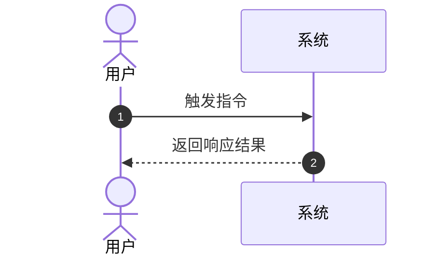

# [PRD] 需求名称 / 功能名称

> - **文档版本**：v1.0.0
> - **责任人**：
> - **创建日期**：YYYY-MM-DD
> - **状态**：[草稿 / 评审中 / 已定稿]

---

## 1. 背景与目标
### 1.1 业务背景
描述为什么要做这个功能/系统，当前痛点与业务诉求。

### 1.2 目标与非目标
- **Goal（核心目标）**：
  - 目标 1：...
  - 目标 2：...
- **Non-Goal（明确不做）**：
  - 本期不涉及：...

---

## 2. 用户角色与使用场景
| 角色 | 角色定位 | 典型使用场景 |
| :--- | :--- | :--- |
| 开发者 | 主力使用系统编写代码 | 通过终端或 IDE 触发智能体协同任务 |
| 审查专家 | 评估代码规范与安全性 | 自动化获取补丁工件进行双审校验 |

---

## 3. 功能需求清单与优先级
- **P0（核心必选）**：
  - [ ] 需求点 1：...
- **P1（重要推荐）**：
  - [ ] 需求点 2：...
- **P2（锦上添花）**：
  - [ ] 需求点 3：...

---

## 4. 业务流程与交互
（可使用 Mermaid 流程图或时序图绘制）

---

## 5. 验收标准 (Acceptance Criteria)
1. 场景 A：当输入 X 时，系统必须产生 Y 结果。
2. 场景 B：异常输入时，给出明确错误提示，不崩溃。
