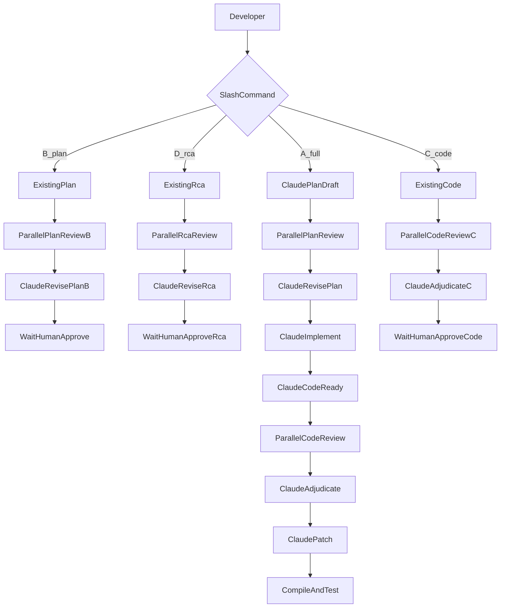
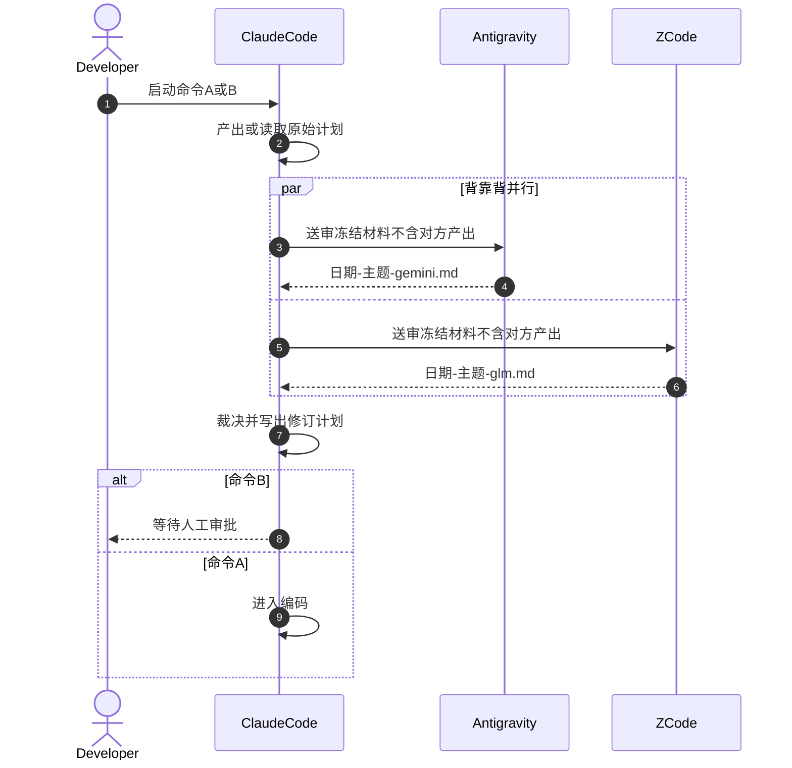
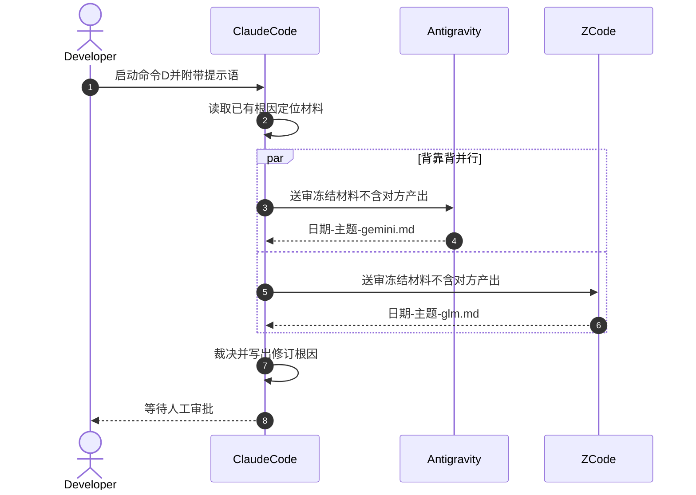

# [PRD] Driver-DualCritic 主攻双审流水线

> 稳定版文档整理（2026-10-18）：本文保留历史 FR/AC 与增量记录；产品当前发布基线见[中文手册](./需求说明书.md)。历史采样中的“尚未完成”等措辞不代表当前统一状态；M11/M12 当前结论以主设计台账及报告末节为准。

> - **作者 / 负责人**：Chen Zhenbo（依据原始需求整理）
> - **创建日期**：2026-09-10
> - **当前版本**：v1.4.29
> - **状态**：**基线已实现、演进需求待实施(Baseline implemented, evolution pending)**
> - **来源**：[原始需求.txt](./原始需求.txt)；演进需求来源见 3.2 小节「多 Agent 演进需求」
> - **文档版本**：v1.4.29
> - **⚠️ 实现状态**：FR-01～FR-26 与 AC-01～AC-19 是**已实现基线**；
>   **FR-27～FR-31 与 AC-20～AC-25 是演进需求**（各条标注了实现里程碑）：截至本版
>   **AC-20 已达成**（M8 第 4 步）、**AC-22 部分达成**（1／2／3 侧分支均可真跑，
>   「三个编号前缀都对闸门可见」仍须逐轮核对，见该条达成边界）、
>   **AC-24 已达成**（接入套件端到端验收，见该条证明边界——但它**不足以完整验收 FR-31**：
>   两家真实接入已随 M8 / M9 完成，「核心流程零改动」仍未成立，见 FR-31 条），
>   **AC-21 已达成**（子句 ③「审批前的裁决完整性由编排器侧无条件复核兜住」随 M10a 第 3 步；子句 ① ② 随 M10b，2026-09-26；含达成边界，见该条），
>   **AC-25 已达成**（M11 第 3 步，2026-10-07：只覆盖路径通道、三审形态，含达成边界，见该条），
>   **AC-23 已达成**（M11 第 12 步收口，2026-10-16：生效思考等级只在 gemini 侧可回读，含达成边界，见该条）。
>   **审核者现状（M9 第 7 步，2026-09-20）**：四家 Agent 均已启用为审核者，缺省集合为 codex / gemini / glm
>   三家（默认即三侧）；claude 作审核者须 `--driver` 取非 claude（当轮 Driver 不得入选），
>   已于 M9 第 6 步以名义 Driver 真实审查一次并通过 `consulted` 交叉核对——**这不构成 FR-28 / AC-21 达成**：
>   `--driver` 只是编排器内部的运行属性，换一家 Agent 在自己的 CLI 里真正执笔仍待 M10b
>   （M10a 于 2026-09-24 交付的是编排器侧的判定与护栏：按阶段声明当轮 Driver、提交锚跨时间面、翻开 `driverEnabled` 并收紧、`approve` 前置复核、Bash 侧全集字面保护）。
>   **Driver 现状（M10b，2026-09-26）**：上句「仍待 M10b」自本版起更新——四家都能在自己的 CLI 里经入口资产发起命令
>   （claude / gemini / glm 写 `/dual-*`，codex 写 `$dual-*`），护栏如实分级为 claude L1、glm L2（有尽力拦截的 Hook）、
>   codex / gemini L2（无 Hook），并在 QUICKSTART §5.2 与闸门停点话术里对使用者明示。真载体实跑两轮：glm 走命令 B（J4）、
>   codex 走命令 C；gemini 只以名义 Driver 跑过，命令 A / D 未在非 claude 载体上实跑——**FR-28 因此仍记部分达成**，AC-21 达成（含边界）。
>   **AC-22 的达成面自 M8 第 3 步起扩大**：第三家审核者（Codex）已接入，「选 3」分支
>   首次可真跑（M8 第 4 步的计划双审即三侧入选的形态之一），但**「三个编号前缀都对闸门可见」
>   仍须逐轮核对 `gate --check` 的差集**，不得据此宣布 FR-29 完整达成。
>   **AC-20 已达成**（2026-09-16，M8 第 4 步）：两个家族各真实审查一次，四个分量逐一有据；
>   三条达成边界与一条利益冲突标注随该条与验收报告登记，引用时须一并带上。
>   现有能力另含两项**不改变对外行为**的内部工作：一次行为等价重构（Agent 注册表，M7a），
>   以及 M7b 六步（`run.v2`、`config.v2` 与其内存迁移、适配器接线收敛、多审退化逐对计算、
>   第 5 步的 `--critics` 入口——**这一步开始改变对外行为**——与第 6 步的接入套件验收装置）。
>   **不得据 FR-27～FR-31 判定系统现有能力，也不得把内部改动读成需求达成。**
> - **变更说明**：v1.4.29（2026-10-17）随主设计 v1.3.164（M12 批次 3：作废侧重跑一次，BACKLOG EV-225）同步。**改 AC-25 的 Then 与达成边界**，不新增需求：作废类命中后该侧在同一次运行内重跑一次（任务书顶部点名上一次碰到的位置），重跑干净则以重跑结论参与；二次命中该侧判失败（`peer_leak`），严格策略下整次失败、显式允许降级时降级继续。v1.4.20 定稿的「不自动重跑、严格策略下不因作废中止」是 EV-225 之前的现行行为，随之改写；达成边界 ③ 由「不含作废侧自动重跑」改为「作废侧重跑为桩级验收，真实厂商调用只做不泄漏回归」。点名方式按设计 10.1.1：命令通道只点程序名与位置、不回显命令参数（对用户 D-7「点名路径或命令」的落点收紧）。
> - **变更说明**：v1.4.28（2026-10-16）随主设计 v1.3.159（M11 第 12 步：全量手工剧本收口，M11 达成）同步。**不改需求、不改判据，只翻达成状态**：AC-23 由「已验收」转为**已达成**（剧本 11 九格在第 12 步两轮三审中重跑成立，可选 11.7 以档位表格子 `{tier}` 实跑，见 `doc/05_testing/REPORT_2026-10-12_m11_step12_manual_acceptance.md`）；FR-30 转为**已达成**（达成边界同 AC-23：生效思考等级只在 gemini 侧可回读，codex、claude 如实记空，ZCode 无此概念）；S8 转为可用。FR-27 / FR-28 / FR-29 / FR-31 的部分达成口径不变。
> - **变更说明**：v1.4.27（2026-10-08）随主设计 v1.3.140（M11 第 11 步：AC-23 真实验收）同步。**不改需求、不改判据、不翻任何达成状态**（FR-30 / S8 / AC-23 的状态随 M11 第 12 步收口），只改 FR-30 进度句里「AC-23 的真实验收随第 11 步」这一处将来时：codex、gemini 各以「选档」与「精确指定」发起一次、共 4 次真实审查，档位名与来源、请求与生效的思考等级在运行记录、审查文档头与复盘报告三处一致，生效值 gemini 侧取回读、codex 侧如实记空（见 `doc/05_testing/REPORT_2026-10-08_m11_ac23_acceptance.md`）。
> - **变更说明**：v1.4.25（2026-10-08）随主设计 v1.3.139（M11 第 10 步：文档收口与对账）同步。**不改需求、不改判据、不翻任何达成状态**（FR-30 / S8 / AC-23 的状态随 M11 第 12 步收口），只改三处与实现对不上的断言：①FR-27「本项目只探测并展示可粘贴样例」——代码里没有配置样例输出，预检与 `doctor` 只点名该补的文件与 `[model_providers.〈家族〉]` 段，条目末尾的进度句如实补记（BACKLOG EV-231，用户定「按现状改准」）；②AC-20 末条「给出可粘贴的配置指引」同理补一句达成边界，Given / Then 原文不动；③AC-20 下「本条达成 ≠ FR-27 达成」的注记仍写「换家族仍须改两处配置、无单次覆盖入口（EV-22）」，M11 第 5～6 步已补齐单次覆盖入口、EV-22 结案，改为现状。
> - **变更说明**：v1.4.24（2026-10-08）随主设计 v1.3.135（M11 第 7 步：复盘报告按 Driver 与审核者两个维度聚合）同步。**只改 FR-30 的进度句，不改需求、不改判据，FR-30 仍未实现、AC-23 仍未达成**：复盘报告已能按审核者汇总意见、裁决、失败与降级、用过的模型与思考等级，并按发起方（Driver）分开统计、换过 Driver 不串档；逐轮表加了思考等级的请求值与生效值两列，旧留痕没有这两项时写「—」、留痕明确记空时另有写法，生效值只取回读。FR-30 只差真实验收（第 11 步）。
> - **变更说明**：v1.4.23（2026-10-08）随主设计 v1.3.133（M11 第 6 步：思考等级透传与留痕接线）同步。**只改 FR-30 与 FR-27 的进度句，不改需求、不改判据，FR-30 仍未实现、AC-23 仍未达成**：思考等级与厂商 profile 已下传给各家、发起前的「写了却不下传」拒绝已撤（精确指定思考等级与不同的厂商 profile 自此可用）；每次运行的档位名与来源、思考等级的请求值与生效值都记入留痕——生效值只取回读，codex、claude 侧如实记空。FR-30 仍差按审核者聚合的报告（第 7 步）与真实验收（第 11 步）；AC-23 达成边界注记与实现核对一致，随第 11 步真实验收再翻。
> - **变更说明**：v1.4.22（2026-10-08）随主设计 v1.3.132（M11 第 5 步：档位命令行旗标）同步。**只补 FR-30 与 FR-27 的进度句，不改需求、不改判据，FR-30 仍未实现、AC-23 仍未达成**：发起时逐审核者选档（`--tier-<审核者>`）与精确指定思考等级、厂商 profile 的命令行入口已上线；思考等级与厂商 profile 下传给各家、生效值回读入档随第 6 步——在那之前，精确指定思考等级或与当前不同的厂商 profile 会在发起前被拒绝（gemini 的模型名已带档位时只告警），选档的运行事后只能从请求模型反推选了哪一档（发起时告警）。
> - **变更说明**：v1.4.21（2026-10-07）随主设计 v1.3.131（M11 第 4 步：配置契约与档位解析）同步。**只补 FR-30 的进度句，不改需求、不改任何判据，FR-30 仍未实现、AC-23 仍未达成**：每个 Agent 的三档预设（`agents.<id>.tiers`）、档位表的选档形态与发起前的取值校验已落地；发起时选档与精确覆盖的命令行入口随 M11 第 5 步，思考等级下传给各家与生效值回读入档随第 6 步——在那之前，档位里写了思考等级、或写了与当前厂商 profile 不同的 profile，发起前即被拒绝（不会静默按另一组值运行）。
> - **变更说明**：v1.4.20（2026-10-07）随主设计 v1.3.130（M11 第 3 步：AC-25 三审形态检测收口）同步。**AC-25 转为已达成**，不新增需求、不改判据：①Then 末句「严格策略下的整体处置以设计 12.1 为准」按源码现行行为定稿为「严格策略下不因作废而整次中止」——作废侧照常落盘、意见仍须逐条裁决，运行状态与退出码不变，整次中止只由失败或超时侧触发；原设想的「二次命中即该侧失败、严格策略下整次中止」以重跑为前提，随 BACKLOG EV-225 一并定；②补「作废后有效侧不足两家时，共同阻断记为未执行并告警」一句（v1.4.19 已有的现行处置，此前只写在设计 12.1）；③达成边界：只覆盖路径通道、三审形态，桩级验收，不含作废侧自动重跑与命令文本通道的三侧用例。文档头实现状态段与第 6 章需求对照表演进行同步改为「AC-25 已达成」。
> - **变更说明**：v1.4.19（2026-10-07）随主设计 v1.3.129（M11 第 2 步：档位契约并入）同步。**改两条验收标准**，不新增需求：①**AC-25 改写并改里程碑**：Then 原写「作废重跑一次，二次命中即该侧失败；严格策略下整次中止」，其中「重跑一次」在两侧形态下也从未实现，用户 2026-10-07 定移出本条、另立 BACKLOG EV-225；里程碑由 M7b 改为 M11（M7b 并未达成本条，用户 2026-10-07 定并入 M11）；严格策略下的整体处置以设计 12.1 为准，M11 第 3 步实测后定稿。②**AC-23 补达成边界**：M11 第 1 步实测 codex、claude 两家没有生效思考等级的回读面，「生效思考等级回读入档」只在 gemini 侧可达成，另三家只核请求值入档、档位与来源一致（用户 2026-10-07 定）。两条的达成状态都不变（仍未达成）。AC-23 第二个 Given 补达成边界注记（计划双审 GLM-04）。
> - **变更说明**：v1.4.18（2026-10-06）随主设计 v1.3.127（只读失守未确证改动放行，EV-223）同步。**改 FR-15、AC-08 与异常表一行的处置口径**（原始需求 20261005 第 1 条「只要没有真正进行了修改，就放行」，用户 2026-10-06 定判据）：只读失守仍须检出并告警；是否阻断审批改由跑后复算决定——复算确证审查期间工作树有改动才阻断，复算无变化或比不了则以告警放行、结论照常进审批，并点明复算看不见的盲区。检出与告警的要求不变。
> - **变更说明**：v1.4.17（2026-09-29）随主设计 v1.3.63（门面文档版本指针，EV-167）同步。**只改两处措辞，不新增需求、不改判据**：3.2 引言里指向设计的那一句不再写死设计版本号，改为链接、版本以设计文档头为准；第 5 章 AC-20～AC-25 段首原写「截至本版」加括号 v1.4.8，「本版」与文档头矛盾，改为时点记述「截至 v1.4.8」，各条状态一字不改（v1.4.9 起各版都不改判据）。
> - **变更说明**：v1.4.16（2026-09-28）随主设计 v1.3.54（失联后取消挂住的worker，EV-146）同步。**只补 FR-24 的一句边界，不新增需求、不改判据**：失联时进程还在而之后被 `review --cancel` 结束的运行，确认退出后同样记 `failed`。
> - **变更说明**：v1.4.15（2026-09-27）随主设计 v1.3.51（派生后失败的孤儿worker，EV-150）同步。**只补 FR-24 的一句边界，不新增需求、不改判据**：`review --start` 在拉起工作进程之后启动未完成的运行，工作进程被终止并确认退出后同样记 `failed`，并注明是这一种。v1.4.14（2026-09-27）随主设计 v1.3.50（事后收尾余项，EV-145）同步。**只补 FR-24 的一句边界，不新增需求、不改判据**：准备阶段写完运行元数据之后失败（含 `review --start` 在拉起审查员之前失败）、同步路径异常的运行也记 `failed`，并注明是哪一种。v1.4.13（2026-09-27）随主设计 v1.3.49（闸门拦截不留骨架，EV-109 / EV-145 ①）同步。**只补 FR-24 的一句边界，不新增需求、不改判据**：被闸门拦下（上一轮未裁决直接重跑）的 `--start` 不写运行元数据、不算一次运行；AC-16 原文不动（它约束的是预检失败，`review` 自身失败出口的零工件口径在主设计验收表）。v1.4.12（2026-09-27）随主设计 v1.3.48（未收尾运行的留痕与复盘可见性，EV-142 / EV-144）同步。**只改 FR-24 的边界说明，不新增需求、不改判据**：worker 异常与 `--wait` 判 `worker_lost`（工作进程确认退出时）的运行也把成败状态（`failed`）写入主题子目录的运行元数据（此前停在 `running`）；复盘报告另列没有产出审查文档的运行。
> - **变更说明**：v1.4.11（2026-09-26）随主设计 v1.3.47（留痕字段与误报小修，EV-127 / EV-128 / EV-137）同步。**只改 FR-24 的边界说明，不新增需求、不改判据**：被 `review --cancel` 取消的运行，其成败状态（`cancelled`）也写入主题子目录的运行元数据（工作进程确认退出后写；此前停在 `running`）；worker 异常与 `worker_lost` 两种失败仍停在 `running`，已登记 BACKLOG EV-142。
> - **变更说明**：v1.4.10（2026-09-26）随主设计 v1.3.46（审批前工作树摘要，EV-132 候选 ② 折中版）同步。**只改 FR-28 / AC-21 的边界说明，不新增需求、不改判据**：审批时（`approve` 通过与两个闸门停点）打印自审查收尾以来的工作树改动摘要，只告知、不拦、不改退出码与闸门迁移；闸门期仍无机制拦截或兜底，原候选 ②「审批前复核加工作树比对、不一致即拒」用户定为不做。
> - **变更说明**：v1.4.9（2026-09-26）随主设计 v1.3.45（留痕与文案小修）同步。**只改 FR-28 / AC-21 的边界说明，不新增需求、不改判据**：闸门停点尾句与入口资产 L2 段已按审查中 / 闸门期 / 审批后三个时点写实（EV-132 候选 ①），闸门期无机制兜底这一事实仍在（候选 ② 待办）。
> - **变更说明**：v1.4.8（2026-09-26）随主设计 v1.3.43（M10b 第 5 步纪律 6 回溯）同步。**本版只改状态口径与两处实现说明，不新增需求、不改判据**：①**AC-21 由部分达成改为已达成**——子句 ① 由 M10b 第 4 步 3-5 验收（glm 在自己的 ZCode 会话里走通命令 B，J4），子句 ② 由 QUICKSTART §5.2 与按当轮 Driver 措辞的闸门停点话术交付；达成边界写明 gemini 只以名义 Driver 跑过、codex 真载体走的是命令 C，以及停点话术尾句「越界会在审批前复核与跑后漂移复算时暴露」对闸门期不成立（BACKLOG EV-132）；②**FR-28 仍记部分达成**（M10a + M10b）：「任一已注册 Agent 在自己的 CLI 里发起四条命令」只实跑了 glm 命令 B、codex 命令 C，命令 A / D 与 gemini 真载体未跑，第 12 章子表该行记「◐ 部分」而非 ✅；③S6 改为已可用；④FR-20 / AC-09 补实现说明：非 claude 载体上提示语由 Driver 模型转抄进命令行（claude 由 CLI 替换 `$ARGUMENTS` 保证逐字），改写被静默接受、空焦点被编造可绕过「缺焦点拒绝启动」，入口资产的「逐字转抄、空参数不编造」规约是唯一事前防线（M10b r10 §2.4.3）；⑤抬头、FR-01、3.2、第 5 章引言与追溯矩阵的「待 M10b」同步改准。
> - **变更说明**：v1.4.7（2026-09-24）随主设计 v1.3.37（M10a 第 5 步纪律 6 回溯）同步。**本版只改状态口径与 FR-17 / AC-18 的措辞，不新增需求、不改判据**：①FR-28 由「待实施」改为**部分达成 · M10a**；AC-21 **只标子句 ③ 达成**——r7 计划原写「达成的是后半（L2 差异明示 + 编排器无条件复核）」，核实后子句 ②「差异对使用者明示」并未交付（用户文档零命中 L1 / L2），不得整体转为达成；第 12 章追溯矩阵增子表，逐条标明 FR-28 的五个成分与 AC-21 的三个子句落在 M9 / M10a / M10b 哪边；②FR-17 / AC-18 的「主脑」不再恒为 claude：同源改按当轮 Driver 厂商的名义模型族近似判定（属启发式，设计 11.5、BACKLOG EV-107），claude 为 Driver 时与原口径等价；③抬头、S6、FR-01、3.2 的「待 M10」按拆分改为 M10b。
> - **变更说明**：v1.4.6（2026-09-20）随主设计 v1.3.30（M9 第 7 步纪律 6 回溯）同步。**本版只改状态口径，不新增需求、不改任何判据**：①抬头与 3.2 的「第三家仍待 M8 / M9」「只有两家启用」等句自 M8 第 3 步起失实，一并改准；②AC-22 由「三侧待 M8 / M9」改为「1／2／3 侧均可真跑、前缀可见性逐轮核对」，仍记部分达成；③FR-31 的「部分达成」理由更换——`ProbeSection` 与 preflight 写死两项已收敛（BACKLOG EV-05 结案），未成立的是「零改动」本身（接 claude 改了 Hook 判据与选侧检查、第 ⑤ 件显式不做）；④FR-27 由「待实施」改「部分达成」（AC-20 已达成，profile 单次覆盖入口待 M11）；⑤S6～S8 场景状态与追溯矩阵演进行同步；⑥新增「审核者现状」段写明 claude 作审核者的前提（`--driver` 取非 claude）与「不构成 FR-28 达成」。
> - **变更说明**：v1.4.5（2026-09-16）随主设计 v1.3.11（M8 第 4 步）同步。**本版只改判据与状态口径，不新增需求**：①**AC-20 的「互可区分」拆成逐分量断言**——两次运行的 `model_provider` 互异、生效模型互异、各自与本次请求一致、两侧 provider 的 `base_url`（至少 host）互异。起因是实测 `codex exec -p qwen -m deepseek-v4-pro` **成功退 0** 且回读 provider=qwen，即**同一个模型名可以挂在两个 provider 下**，「两次生效模型不同 ⇒ 两个家族」不成立；而 provider **id** 互异也证明不了 endpoint 互异（两个段可指向同一个 `base_url`）。②**沙箱负对照的正对照形态改写**——原写「同一次调用里对允许写路径的写入必须成功」，**已由实跑证伪**：`-s read-only` 把整个文件系统置为只读，「允许写的路径」不存在，照此执行恒不可满足；改为「写命令确实进轨迹 + 其输出显示被拒 + 哨兵未创建」。③**新增一条预检要求**：配置的模型不在本次 profile **生效的**目录里即拒——目录随 profile 分层，拿基底目录校验会误杀该 profile 的默认模型、误放只在基底目录里的 slug。④实现状态段、第 5 章前言与第 12 章追溯矩阵按 M8 进度更新；**AC-20 仍未达成**（判据与实现已落，真机验收未跑）。
> - **变更说明**：v1.4.4（2026-09-14）随主设计 v1.3.6 的接入套件验收装置（M7b 第 6 步）同步。**本版改动两处需求条款的达成状态，并修正一个数字**：FR-31 与 AC-24 由「待实施」改为「已达成（含证明边界）」，同时把沿用至今的**「五件套」改为「七件套」**。改这个数字不是措辞调整——第 ⑥ 件（模型路由）是 M7b 计划稿第二版补的，第 ⑦ 件（配置形状）是第 6 步真去接一遍才撞出来的：入选审核者必须在 `agents` 段里有条目，而配置段要先在 schema 的 `oneOf` 里有形状才过得了校验。两次修正说明同一件事——**「几件套」这个数字照着文档数不出来，只有实际接一遍才算数**，这正是 AC-24 以桩实测为口径的理由。AC-24 的证明边界一并写明：桩不触发真实适配器路径，也不触发第三家的探活与 CLI 版本校验（那两项仍是按厂商写死的编排，已登记为 BACKLOG EV-05），对真检验在 M8 / M9。**AC-22 不因本版变化**——第三家审核者仍未接入，「选 3」分支依旧结构性不可达。v1.4.3（2026-09-14）随主设计 v1.3.4 的 `--critics` 入口落地同步。**本版是 M7b 六步里第一次真正改动需求达成状态的**：前四步只让契约就位，第 5 步把入口接上，FR-29 自此对外可观察。**但 AC-22 只是部分达成**——它要求「分别选 1 / 2 / 3 个审核者各跑一轮」，而当前只有两家启用了审核者能力，选 3 的分支必然被拒。故 AC-22 标注为「部分达成」并写明达成边界（1／2 侧已实跑验证、3 侧待 M8 / M9），FR-29 的分步说明相应更新，S7 场景也标出「只选一个」那半已可用。**这样标的理由**：把部分达成写成完全达成，正是本项目 v1.3.0 反复记过的那类失守——读者据此以为能选三侧，真去用时才发现被拒。v1.4.2（2026-09-14）随主设计 v1.3.2 的 `config.v2` 落地同步，同样**只精确化实现状态口径、不改需求条款**：FR-29 的分步落地说明补上配置契约一侧（`default_critics` / `max_critics` 已进入校验，登记但未启用的 Agent 出现在其中会报错），并把「仍缺入口」改写为「仍缺入口**与消费端**」——第 4 步只让该字段被校验，**不改变实际跑哪几侧**，接线在第 5 步。不写清这一点，读者会从「配置里已经有 default_critics」推出「已经能选审核者了」。v1.4.1（2026-09-14）随主设计 v1.3.1 的 `run.v2` 落地同步，**只精确化实现状态口径、不改任何需求条款**：把三处「截至本版尚未实现」的全称断言改为「无一条达成验收」，并在 FR-29 末尾记下它的**分步落地状态**——数据契约一侧已成立（`critics_selected` 与 `review_mode: full|partial` 落盘、选 1 侧不标降级、参与者事实与降级警示分两处标注），仍缺 `--critics` 入口，故 AC-22 跑不起来、本条整体仍记待实施。改这三处的理由：M7b 分六步交付，「尚未实现」这种整体断言在中途会同时变成两种意义上的不准确——既低估了已落的契约，又可能被读成能力已具备。判定口径统一为**以 AC 是否可跑为准，不以内部改动为准**。v1.4.0 承接 2026-09-13 项目负责人提出的六条多 Agent 演进需求，
>   按[设计 v1.3.0](../02_design/2026-09-10-Driver-DualCritic主攻双审流水线设计.md) 的规范链回溯（§24 台账）同步修订：
>   ①**FR-01 措辞改「当轮 Driver」**——「唯一执笔者」的约束不变，变的只是由谁担任；
>   ②3.2 新增 **FR-27～FR-31**（多模型经 Codex 接入含 profile 透传、任意 Agent 为 Driver、
>   每次选 1～3 审核者、逐审核者模型与思考等级三档、通用扩展架构），
>   **编号自 FR-27 起排**——FR-26「等待期进度反馈」已占用并实现，
>   而本文第 3 章规定「编号一经分配即保持稳定」；
>   ③第 5 章新增 **AC-20～AC-25**（同理自 AC-20 起排，AC-19 已占用）；
>   ④第 2 章新增场景 **S6～S8**（换一家 Agent 主攻 / 三审加严 / 按任务选思考深度）；
>   ⑤第 12 章追溯矩阵增演进行；
>   ⑥全文新增的演进条目**一律标注「未实现 + 实现里程碑」**，与已实现基线在文本层面严格区分。
>   v1.3.1 按设计 18.2 的点名回填四项，消除与实现的口径分裂：①**裁决词统一为 FR-14 的「接受 / 驳回 / 暂缓」**，全文八处「不接受」改为「驳回」（第 436 行引用原始需求原话处保留，属史实）；AC-12 的「若已实现 FR-14」条件句作废——第三态已实现并默认开启。②4.4 第 3 条写明**约束对象是流水线的自动行为、不含开发者手工编辑**，闸门不把仓库变成只读。③11.2 的六项待设计对齐项**全部回填设计裁决**并标注依据章节。④`reference/…-gemini.md` 的「已批准 · 实施基线」口径作废，改标「参考方案」。v1.3.0 依据 2026-09-10 评审意见修订：澄清命令 A/C 链路不含独立根因审阶段、待审根因材料一律引导至命令 D（FR-22、第 4.4 节、第 8 章）；明确「需求」审查并入计划审/代码审送审材料，不设独立命令（FR-03）；FR-04/FR-22 补逐条裁决 P0 要求并在第 11.3 节声明为超出原始第 4 条的加强项；AC-05 增加编程 Agent 执行证据要求；新增 AC-16～AC-18 覆盖 FR-16/FR-17/FR-18；并修正主题名缺省规则（第 8 章）、FR-25 重跑命名、FR-14 术语、第 10 章空审查引用与追溯矩阵 AC-12 归属。v1.2.0 将 FR-22（Bug 根因独立命令）升为 P0，并同步命令规格、流程、验收、工件、异常与追溯矩阵；独立根因审为本期必选命令 D，不得再按「可选入口」描述。v1.1.0 仅改过变更说明、未同步其它章节，作废跳过。

---

## 1. 背景与目标

### 1.1 业务背景

AI 编程已从单次补全进入自主智能体阶段。开发者在 macOS + VS Code 中主要与 **Claude Code** 对话：提需求、出计划、写代码、修缺陷。单一主脑在大型仓库、跨模块重构和长链路排错上仍会出现三类系统性失败：

1. **单模型视野盲区**：同一模型既起草又自检，容易漏掉自己引入的逻辑幻觉、边界遗漏和安全死角。
2. **手工双审不可持续**：另开 Antigravity、ZCode 窗口，把计划或 diff 复制粘贴再手工回收意见，赶工时会被跳过；且粘贴等于把两家产品降成聊天框，用不上它们读仓库、搜引用、跑工具的**编程 Agent 能力**。
3. **过程不可追溯**：意见留在三个产品的会话里，事后无法回答「当时为何改计划 / 为何驳回某条意见」。

因此需要在 VS Code 原生开发流中建立一套 **「主攻 + 双审」（Driver-DualCritic）** 全自动协同流水线：Claude Code 仍是唯一执笔与裁决者；Antigravity 与 ZCode 以各自编程 Agent 背靠背审查；全过程以 Markdown 工件落盘。

### 1.2 目标与非目标

- **Goal（核心目标）**：
  - 在 macOS + VS Code 原生流中，由 Claude Code（VS Code 插件）作为唯一主攻，完成需求理解、方案起草、编码与缺陷修复。
  - 由 Antigravity（Google）与 ZCode（智谱）以编程 Agent 能力对需求、计划、方案、代码、Bug 根因做独立二次审查，意见回给 Claude Code 裁决，提高任务准确度。
  - 计划审、代码审与 Bug 根因审全过程留痕；支持一键全流程自动跑到编译测试，也支持仅跑计划审、代码审或根因审并等待人工审批。
  - 审查员工作目录为项目根；除对方审查产出外可读全库；两边互不可见，避免上下文污染。
- **Non-Goal（明确不做）**：
  - 不让审查员修改业务代码或成为第二作者。
  - 不把厂商 Agent 降级为 HTTP 补全 API，也不用兼容网关「假装」成另一家 Agent。
  - 不引入独立 GUI 或常驻重型 Daemon 作为主交互；交互入口仍是 Claude Code 的 `/` 命令。
  - 不替代人类对合入主干的最终责任。
  - 本期不以 Windows 为一级交付平台（原始需求锁定 macOS）。

---

## 2. 用户角色与使用场景

| 角色 | 角色定位 | 典型使用场景 |
| :--- | :--- | :--- |
| 开发者 | 唯一人类操作者 | 在 VS Code 对 Claude Code 下达 `/` 命令，审批 B/C/D 闸门，最终决定是否合入 |
| Driver（Claude Code） | 主攻与裁决 | 理解需求、起草/修订计划、编写代码、修订根因结论、逐条应答审查意见、执行编译测试 |
| Critic-A（Antigravity） | 独立审查员 A | 只读审查计划/代码/根因，输出 `日期-主题-gemini.md` |
| Critic-B（ZCode） | 独立审查员 B | 只读审查同上，输出 `日期-主题-glm.md`；与 A 背靠背隔离 |

**场景 S1 · 全自动闭环**：开发者给出任务，启动命令 A。系统自动完成「出方案 → 双审 → 改方案 → 写代码 → 双审 → 确认修改 → 改代码 → 编译测试」，工件全部落盘。

**场景 S2 · 已有计划后补审**：Claude Code 已写出计划。开发者启动命令 B，并附带审查焦点提示语。两边并行审查，Claude Code 修订方案后**停止并等待人工审批**，不自动进入编码。

**场景 S3 · 已有代码后补审**：代码已写好。开发者启动命令 C，并附带提示语。两边审查代码，Claude Code 确认修改方案后**停止并等待人工审批**，不自动合入。

**场景 S4 · 已有根因后补审**：Claude Code 已写出 Bug 根因定位材料。开发者启动命令 D，并附带提示语。两边并行审查根因，Claude Code 修订根因结论（含对每条意见的裁决：接受 / 驳回 / 暂缓）后**停止并等待人工审批**，不自动开始改代码。

**场景 S5 · 按任务选模型**：开发者（或项目配置）为本次任务指定 Antigravity 与 ZCode 各自使用的 LLM，两边可以使用不同模型。

> **以下 S6～S8 为演进场景**（对应 FR-27～FR-31）：截至 v1.4.8，S6、S7 已可用（选 1 侧不标降级随 M7b 第 5 步、
> 显式选三个随 M8 第 3 步三家启用；第四家 claude 随 M9 可选，须 `--driver` 取非 claude），
> S6 随 M10b 第 4 步可用（glm 在自己的 ZCode 会话里走通命令 B；codex 真载体走通命令 C；达成边界见 AC-21），S8 随 M11 第 12 步可用（2026-10-16，v1.4.28；达成边界见 AC-23）。

**场景 S6 · 换一家 Agent 主攻**〔已可用 · M10b（2026-09-26）；编排器侧护栏 M10a 已交付；达成边界见 AC-21〕：开发者在另一家编程 Agent 里发起命令 B。
该 Agent 起草与裁决，其余三家中的若干家做只读审查，工件与闸门语义不变。
若该 Agent 不具备事前写拦截，开发者会被明确告知护栏等级的差异。

**场景 S7 · 三审加严**〔**可用 · M7b 第 5 步 + M8 第 3 步**；「三个编号前缀都对闸门可见」逐轮核对，见 AC-22〕：一次高风险改动，
开发者显式选择三个审核者。三份审查齐备后逐条裁决，**任何一家的意见都不会对闸门不可见**。
反过来，开发者也可以只选一个审核者——那是配置意图，留痕里**不标降级**。
> **后半句已可用**：`--critics <id>` 选一侧并成功时记 `full`、不写降级理由（已实跑验证）。
> **前半句自 M8 第 3 步起可用**：三家启用且默认即三侧（D4-4）；M9 起第四家 claude 也可入选
> （须 `--driver` 取非 claude）。

**场景 S8 · 按任务选思考深度**〔已可用 · M11（2026-10-16）；生效思考等级只在 gemini 侧可回读，达成边界见 AC-23〕：开发者为本次审查逐个审核者选「高/中/低」档
（或精确指定模型与思考等级）。事后可从留痕中核对每一侧**实际生效**的模型与思考等级——
请求值与生效值都在，且以生效值为准。

---

## 3. 功能需求清单与优先级

编号规则：`FR-xxx` 为功能需求，`NFR-xxx` 为非功能需求（见第 9 章）。优先级：P0 必须本期落地，P1 强烈建议本期落地，P2 可分期。编号一经分配即保持稳定，不随优先级或章节顺序重排（如 FR-22 位于 P0 小节、AC-14/AC-15 列于 AC-03 之后均为正常现象），以便跨版本追溯。

### 3.1 P0（核心必选）

- [ ] **FR-01 主攻角色**：**当轮 Driver** 以 VS Code 插件为入口，负责理解用户需求、起草方案、编写代码、修复缺陷。它是**当次运行中唯一有权修改业务代码**的智能体。
  缺省 Driver 是 Claude Code；「Driver」自 M9 第 5 步起已是每次运行的属性（记入运行元数据），注册表四家自 M10a 起均可用作 Driver；在别家自己的 CLI 里执笔自 M10b 起可用（真载体实跑覆盖见 FR-28 的达成边界）。
  **无论谁担任 Driver，「唯一执笔者」的约束不变**——变的只是由谁担任。
- [ ] **FR-02 双审走编程 Agent**：Antigravity 与 ZCode 必须通过各自厂商的编程 Agent 运行时执行审查（具备读仓库、工具循环、多步推理）。禁止仅调用 LLM 聊天/补全接口，禁止用兼容网关冒充另一家 Agent。
- [ ] **FR-03 审查对象**：两边须能对 Claude Code 给出的**需求、计划、方案、代码、Bug 根因定位**进行独立审查，并将意见输出给 Claude Code 参考。其中「需求」不是独立送审阶段：对需求合理性的审查融入计划审与代码审的送审材料及审查焦点（FR-16、FR-20），不设单独命令；「根因」的独立入口见 FR-22。
- [ ] **FR-04 计划留痕**：以下四类文档必须保存到项目归档目录，以备后续参考：
  1. Claude Code 生成的原始计划；
  2. Antigravity 生成的计划审核文档；
  3. ZCode 生成的计划审核文档；
  4. Claude Code 生成的修改后计划。

  修改后计划须体现对两边意见的逐条裁决（每条意见标「接受 / 驳回 / 暂缓」及理由，见 FR-14 与 AC-12）。原始第 4 条仅对代码应答文档要求逐条裁决，此处将计划阶段逐条裁决定为 P0 属超出原始需求的加强项（见第 11.3 节）。
- [ ] **FR-05 代码留痕**：以下三类文档必须保存：
  1. Antigravity 生成的代码审核文档；
  2. ZCode 生成的代码审核文档；
  3. Claude Code 对意见的应答文档（每条意见须标明「接受 / 驳回 / 暂缓」，以及对应的修改计划）。
- [ ] **FR-06 按任务指定模型**：可根据任务不同，分别指定 Antigravity 与 ZCode 使用的 LLM（通过项目配置或命令参数）。两边模型允许不同。
- [ ] **FR-07 审查工作目录与可读范围**：审查 Agent 执行时的根目录为**所在项目根目录**。除另一个审查 Agent 生成的文件外，它能读取整个项目的任何资料。
- [ ] **FR-08 工件命名**：
  - Claude Code 生成的、需要二次审核的文档：`日期-主题-claude.md`
  - Antigravity 审核输出：`日期-主题-gemini.md`
  - ZCode 审核输出：`日期-主题-glm.md`
  - 日期格式为 `YYYY-MM-DD`。主题字段可追加阶段后缀以区分同角色多份文档（计划修订与根因修订为 `-revised`，代码应答为 `-response`），角色后缀不得改。
- [ ] **FR-09 统一归档与主题子目录**：三个 Agent 生成的文档统一存储在工程中的**一个**归档目录下，并按**任务主题**建立子目录。
- [ ] **FR-10 背靠背隔离**：两个审查 Agent 互相不能看到对方输出的文档，以防上下文污染、破坏独立性。
- [ ] **FR-11 全流程顺序**：Claude Code 出方案 → Gemini + GLM 审核 → Claude Code 修改方案 → Claude Code 编写代码 → Gemini + GLM 审查 → Claude Code 确认修改方案 → 修改代码 → 编译测试。
- [ ] **FR-12 四条 `/` 命令**：以 Claude Code 斜杠命令开启流程，语义固定如下（具体命令字符串见第 8 章与待设计对齐项）：
  - **命令 A（全流程）**：按 FR-11 自动跑完，含编译测试，中途不停人工闸门。
  - **命令 B（计划审核）**：Claude Code **已经出好计划**；根据命令后面带的提示语，自动执行「Gemini + GLM 审核 → Claude Code 修改方案」，然后**等待人工审批**。
  - **命令 C（代码审核）**：Claude Code **已经写好代码**；根据命令后面带的提示语，自动执行「Gemini + GLM 审查 → Claude Code 确认修改方案」，然后**等待人工审批**。
  - **命令 D（根因审核）**：Claude Code **已经给出 Bug 根因定位材料**；根据命令后面带的提示语，自动执行「Gemini + GLM 审核 → Claude Code 修订根因结论」，然后**等待人工审批**。命令 D 是本期必选入口，不得用命令 A 或 C 代替。
- [ ] **FR-22 Bug 根因独立命令**：必须提供独立 `/` 命令（即 FR-12 命令 D），对已有的 Bug 根因定位材料做双审并修订结论。原始需求第 2 条已将根因列为审查对象，第 11 条未单列该命令；本期补齐独立入口，禁止把「可经全流程/代码审顺带送审根因」写成可取消命令 D 的理由。审查员须具备根因审查能力（FR-03）；但命令 A 与命令 C 的链路不含独立根因审阶段，运行中出现待审根因材料时一律引导开发者改用命令 D，不得把未送审的根因当作已完成双审。根因阶段须按第 6.4 节落盘四件套；修订根因须体现对两边意见的逐条裁决（同 FR-04，见 AC-12），该逐条裁决定为 P0 属超出原始需求的加强项（见第 11.3 节）。

### 3.2 P1（重要推荐 · 最佳实践）

> **⚠️ 实现状态（v1.4.6 起）**：本节的 **FR-27～FR-31 为多 Agent 演进需求，截至本版
> FR-27 / FR-28 / FR-29 / FR-31 均为部分达成**（各见其条目说明；FR-28 随 M10a），FR-30 已达成（M11，2026-10-16，v1.4.28，含达成边界）。
> 系统的**现状能力止于 FR-01～FR-26**，外加一次行为等价的内部重构（Agent 注册表，M7a）
> 与 M7b 六步（`run.v2` 落盘入选集合与完成度、`config.v2` 与其内存迁移、适配器接线收敛、
> 多审退化逐对计算、`--critics` 入口、接入套件验收装置）。
> **其中只有第 5、6 步改变了对外可判定的状态**：第 5 步让 FR-29 对外可观察，
> 第 6 步让 AC-24 可验收、FR-31 达到桩级；前四步只是契约就位，**不构成任何一条 FR 的达成**。
> 第三家（Codex，M8）与第四家（Claude Code，M9）审核者均已接入；M10a 交付了编排器侧的 Driver 判定与护栏（按阶段声明当轮 Driver、提交锚跨时间面、翻开 `driverEnabled` 并收紧、`approve` 前置复核、Bash 侧全集字面保护），M10b（2026-09-26）交付了四家入口资产、多目标安装与护栏分级明示，在别家自己的 CLI 里执笔已可用（达成边界见 FR-28）。判定现状能力时**一律以 AC 是否可跑为准，不以内部改动为准**。
> 五条演进需求的设计依据见[设计](../02_design/2026-09-10-Driver-DualCritic主攻双审流水线设计.md) 16.1 二期里程碑表与 §24 台账（当前版本见其文档头），
> **各条的实现里程碑逐条标注在需求末尾**。不得据这五条判定系统现有能力。

- [ ] **FR-13 审查意见可裁决**：每条意见必须是可单独接受/驳回的最小单元，至少包含：编号、严重度（`blocker` / `major` / `minor` / `nit`）、位置、问题、依据、建议、置信度。Antigravity 与 ZCode 的编号前缀不得冲突。
- [ ] **FR-14 主脑逐条裁决**：Claude Code 须对每条意见标记「接受 / 驳回 / 暂缓」，并写明理由。禁止静默忽略。驳回与暂缓必须出现在裁决记录中（代码阶段为应答文档，计划/根因阶段为对应修订件）。
- [ ] **FR-15 审查员只读**：审查 Agent 不得写入业务文件。若发生只读失守（审查阶段出现非预期的业务文件改动），系统必须能检测并告警，且不得把失守后的仓库状态当作合法产物继续流转。是否阻断该轮裁决进入审批，取决于跑后复算（v1.4.18，EV-223；原始需求 20261005 第 1 条）：复算确证审查期间工作树有改动则阻断；复算无变化或比不了则告警放行、结论照常进审批，告警须点明复算看不见的写入（被 .gitignore 忽略的文件、归档根与编排器自有目录、改了又改回、写到项目外、MCP 执行型调用的任意写），不得暗示复算能证明审查员没写。
- [ ] **FR-16 送审上下文自包含**：提供给审查员的材料必须冻结且自包含（含被审对象全文或等价快照、任务提示语、必要项目约束）。审查员不得依赖 Claude Code 的对话历史，也不得读取对方审查产出。送审材料本身须可审计。
- [ ] **FR-17 模型族可核对**：本轮 Driver 模型由可选会话声明提供，审核者模型取运行时回读。按可解析模型标识逐对比较 Driver 与各审核者、审核者彼此，记录 `same-family / different-family / unknown`、来源和原因。工具身份或供应商不能证明异构；缺声明、缺回读及可跨供应商映射的别名记 unknown。同族或未知均告警继续，不自动换模型、不进入审批门禁。请求接入、模型与思考等级和回读值分别可见（主设计 11.6）。真实路线验收完成前保留未完成状态。
- [ ] **FR-18 启动预检**：流程启动前须检查两边编程 Agent 可调用且已认证。预检失败须明确报错并中止，禁止进入「缺一方却当作双审完成」的假双审。
- [ ] **FR-19 超时与降级可见**：某一审查员超时或失败时，不得把单审文件改名或伪装成双审。归档必须标记单审及原因。系统须支持两种可配置策略：**严格模式**（阻塞中止）与 **降级模式**（在标记后允许主脑继续）。
- [ ] **FR-20 提示语传入审查上下文**：命令 B、C、D 后面携带的提示语必须进入两边审查员的送审材料，作为本次审查焦点。
  〔实现说明（M10b，不改判据）：claude 载体上提示语由 CLI 替换 `$ARGUMENTS` 逐字进入；codex / gemini / glm 载体不替换占位符，
  提示语由 Driver 模型从用户消息**转抄**进命令行——被改写时静默接受，空焦点被编造可绕过「缺焦点拒绝启动」，
  入口资产里「逐字转抄、空参数不编造」的规约是唯一事前防线（设计 8.5「L2 的已知边界」，M10b r10 §2.4.3）。
  M10b 第 4 步两轮真载体（codex、glm）逐字比对主题与焦点均一致——样本两轮，不证明长焦点或特殊字符下的保真〕
- [ ] **FR-21 编译测试为全流程出口**：命令 A 结束前必须**真实执行**当前项目的编译及测试命令（以项目既有约定为准），并将通过/失败结果写入归档。测试失败时全流程不得宣称成功。

### 3.3 P2（锦上添花 · 可分期）

- [ ] **FR-23 可配置跳过纯文档审**：对仅含文档、注释或格式、且配置允许的代码 diff，可跳过代码双审。业务代码、依赖清单（锁文件除外）、CI 与权限相关文件变更不得跳过。
- [ ] **FR-24 运行元数据**：每次任务运行将所用模型、起止时间、成败状态写入该主题子目录，便于复盘。Token 与 CLI 版本为可选字段。被取消的运行记 `cancelled`（v1.4.11，EV-128）；worker 异常与 `worker_lost`（工作进程确认退出时）的运行记 `failed`（v1.4.12，EV-142），失联时进程还在则不写、仍为 `running`。准备阶段写完运行元数据之后失败、同步路径异常的运行同样记 `failed`（v1.4.14，EV-145）；`review --start` 在拉起工作进程之后启动未完成的，终止工作进程并确认退出后同样记 `failed`（v1.4.15，EV-150）；失联时进程还在、之后被 `review --cancel` 结束的，确认退出后同样记 `failed`（v1.4.16，EV-146）。
- [ ] **FR-25 阶段重跑不覆盖既有工件**：同一任务同一阶段允许重跑。重跑产生的新文件一律追加版本后缀（或等价的新文件名），既有工件无论是否已经人工审批均不得覆盖，避免同日重跑撞名覆盖审查或主脑文件。
- [ ] **FR-26 等待期进度反馈**：双审进行期间，用户必须按稳定节奏收到可读进度，每条能回答「跑到哪了 / 还要多久 / 两侧各自什么状态」。编排器在每次等待返回时给出成品单行摘要与结构化进度（已用、预算、百分比、第几次/共几次、两侧状态），主脑负责**向用户播报**而非仅打印到工具输出；启动时另播报一条含入选各侧请求模型（尚未回读）与阶段预算的开场。反馈的最小间隔等于单次等待窗口——主脑只在工具调用返回时才能说话，这是平台约束（设计 7.5.1）。

#### 多 Agent 演进需求（FR-27～FR-31，**FR-27 / FR-28 / FR-29 / FR-31 部分达成，FR-30 已达成**）

来源：2026-09-13 项目负责人提出的六条演进需求。设计依据见
[`2026-09-13-通用Agent编排与动态多审设计.md`](../02_design/2026-09-13-通用Agent编排与动态多审设计.md) v1.0.0（受控增量规范）。

- [ ] **FR-27 多模型家族经 Codex 接入为审核者**：QWen、DeepSeek 等模型家族通过 Codex 这一厂商编程 Agent
  参与审查，证据链与只读约束同既有两侧；模型目录**开放多家族**，以厂商配置中的 provider 列表为源。
  Codex 的厂商 profile 可配置并**逐次透传**，最终以 `codex -p <配置> exec …` 运行——
  profile 是**基座而非档位**，与 FR-30 的档位旗标按厂商自身优先级叠加，生效模型一律回读为准。
  多家族接入的**前提是用户侧自行完成 provider 配置**：本项目只探测并展示可粘贴样例，
  不代写、不改用户全局配置（设计 16.2 纪律 5）。〔**部分达成 · M8 第 4 步**（AC-20 已达成，含三条边界）；profile 单次覆盖入口已上线（M11 第 5 步，`--profile-<审核者>`），档位条目与单次覆盖给出的 profile 自 M11 第 6 步起逐次下传为 `codex -p`，发起前的可用性与模型目录检查按同一个值（EV-22 结案）；「展示可粘贴样例」**未实现**——预检与 `doctor` 只点名该补的文件与 `[model_providers.〈家族〉]` 段（BACKLOG EV-231，v1.4.25 补记）；验收 AC-20〕
- [ ] **FR-28 任意注册 Agent 可为 Driver**：「Driver」由系统常量降为**每次运行的属性**，
  任一已注册 Agent 均可发起四条命令，工件与闸门语义不变。
  **护栏能力不追求拉齐且必须如实分级**：部分 Agent 不具备事前写拦截（无 blocking Hook），
  以「编排器侧确定性校验双点 + 留痕唯一事实来源 + 跑后复算」补偿，
  差异须对使用者明示，不得伪装成同等级强制。〔**部分达成 · M10a + M10b**：编排器侧的判定与护栏（M10a）；四家入口资产、多目标安装、护栏如实分级与差异明示（M10b，QUICKSTART §5.2 与闸门停点话术）已交付。「任一已注册 Agent 在自己的 CLI 里发起四条命令」只实跑了 glm 命令 B、codex 命令 C，gemini 仅以名义 Driver 跑过、命令 A / D 未在非 claude 载体上实跑，故整体仍记部分达成；逐条落点见第 12 章子表；验收 AC-21（已达成，含边界）〕
- [ ] **FR-29 每次审核动态选择 1～3 个审核者**：隔离、裁决、归档、闸门全部由「两侧」泛化为「N 侧」。
  **选 1 个审核者是配置意图，不是降级**——不标降级、不写降级理由；
  「降级」一词仅保留给「部分入选审核者失败后继续跑」的情形。
  〔**部分达成 · M7b 第 5 步**（`--critics` 入口已生效）**+ M8 第 3 步**（三家启用、默认即三侧）**+ M9**（第四家可选）；「三个前缀都对闸门可见」须逐轮核对；验收 AC-22〕
  **分步落地状态（M7b 按六步交付）**：数据契约一侧已成立——`run.v2` 落盘 `critics_selected`
  与 `review_mode: full|partial`，「入选 1 侧并成功」记 `full` 且不写降级理由，
  审查文档把参与者事实与降级警示分两处标注（第 1、3 步，设计 6.7.1）。
  配置契约一侧也已成立——`config.v2` 的 `review.default_critics` 与 `max_critics` 进入校验，
  登记但未启用为审核者的 Agent 出现在其中会报错而非静默忽略（第 4 步，设计 13.1.1）。
  **入口已接线**（第 5 步，设计 7.1）：`--critics <id,…>` 生效，`default_critics` 成为缺省来源，
  校验不过一律退 64 且零工件；选 1 侧记 `full`、不写降级理由——「选 1 审是配置意图」
  自此是实跑可验的行为，不再只是文字。
  **第三家已随 M8 第 3 步接入、第四家随 M9 第 4 步启用**：`--critics a,b,c` 可真跑（默认即三侧，D4-4），
  claude 作审核者须 `--driver` 取非 claude。**本条仍记部分达成**：AC-22 的「三个编号前缀都对闸门可见」
  是逐轮核对项（`gate --check` 差集），不是一次实跑能一劳永逸证明的；把它写成完全达成，
  是本项目反复记过的那类失守。
- [ ] **FR-30 逐审核者指定模型与思考等级，并提供高中低三档组合**：
  每个 Agent 可配置三档「模型 + 思考等级」预设，发起时选档或精确覆盖；
  **生效值一律回读可核对**——思考等级的请求值与生效值可能不同（部分厂商存在归并映射），
  故生效等级须与生效模型一并回读入档，**不采信请求值**（AC-13 纪律的延伸）。〔**已达成 · M11**（2026-10-16，v1.4.28）；验收 AC-23，含达成边界〕
  > 进度（v1.4.27，M11 第 4～7 步与第 11 步验收）：三档预设的配置形态、选档解析与发起前校验已落地；发起时选档与精确覆盖的命令行入口已上线（第 5 步）；思考等级与厂商 profile 已下传给各家，档位名与来源、思考等级的请求值与生效值逐次入档（第 6 步）——生效值只取回读，目前只有 gemini 侧读得到，codex、claude 侧如实记空（见 AC-23 达成边界）。复盘报告按审核者与按 Driver 两个维度汇总，逐轮列思考等级的请求值与生效值（第 7 步）。AC-23 的真实验收已于第 11 步完成（v1.4.27，4 次真实审查，判据全部成立，见 `doc/05_testing/REPORT_2026-10-08_m11_ac23_acceptance.md`）；**已达成**（v1.4.28，M11 第 12 步收口：剧本 11 在两轮三审中重跑成立、11.7 档位表格子 `{tier}` 实跑，见 `doc/05_testing/REPORT_2026-10-12_m11_step12_manual_acceptance.md`）。
- [ ] **FR-31 通用 Agent 扩展架构**：新增一家 Agent 只需一份**接入套件**，核心流程零改动。
  Agent 注册表是后缀 / 前缀 / 配置键 / 探针段 / 镜头键 / 禁读矩阵的**唯一来源**。
  〔**部分达成 · M7a（注册表本体）+ M7b 第 6 步（桩级端到端验收）+ M8 / M9（两家真实接入已完成）**；「零改动」仍未成立，见下；验收 AC-24〕

  **为什么是「部分达成」而不是「已达成」**（2026-09-14 代码双审 AGY-02）：
  条文承诺的是「核心流程**零改动**」，而 BACKLOG **EV-05** 同时承认——
  真实第三家的探针结论要落盘就得改 `types.ts` 的 `ProbeSection`，
  且 `preflight` 的 CLI 版本校验、只读能力检查、探活编排仍是按厂商写死的两侧编排，
  第三家**完全不被检查**。两句话不能同时为真。
  桩绕过了这两处（无外部 CLI、且以 `--skip-auth-check` 跑通预检），
  所以本条现在成立的范围是「**桩级**：注册表追加 + 套件补丁 ⇒ 三审全链路可跑」。
  按本项目对 AC-22 的同一把尺子——**把部分达成写成完全达成，是反复记过的那类失守**。

  **M9 第 7 步复核（2026-09-20）**：上面两条成本中，`ProbeSection` 已随 M6 第 1 步改为按 CLI 派生，
  `preflight` 三项已随 M8 第 3 步按注册表 / 适配器遍历（BACKLOG EV-05 结案），M9 第 6 步 claude 侧预检 7/7
  在真实链路证实。**但「零改动」仍不成立，理由换了**：接入 claude 时核心流程改了 Hook 保护集判据
  与选侧检查（该 Agent 同时是缺省 Driver，套件不覆盖这一情形），第 ⑤ 件对 claude 显式不做（EV-44）。
  故本条继续记部分达成。

  **套件是七件，不是五件。** 这个数字被修正过两次，每次都是实际去接一遍才发现的：

  | # | 件 | 落点 |
  | :--- | :--- | :--- |
  | ① | 注册项 | `agents/registry.ts` 加一条 |
  | ② | 适配器 | `adapters/<id>.ts` 本体 + `adapters/index.ts` 接线一行 |
  | ③ | 探针 | `probes/<id>.ts` |
  | ④ | 镜头 | `lenses.yaml` 加一个键 |
  | ⑤ | 入口资产 | 该 Agent 读的协议片段 |
  | ⑥ | **模型路由** | `profiles.<档位>.<id>`（配置面，非代码） |
  | ⑦ | **配置形状** | `config.v2.json` 的 `agents` oneOf 加一支 |

  第 ⑥ 件是 M7b 计划稿第二版补的（漏了它的症状是 `routeModel` 返回 null、运行期退 69）；
  第 ⑦ 件是 M7b 第 6 步实测补的——**入选审核者必须在 `agents` 段里有条目**，
  而配置段要先在 schema 的 `oneOf` 里有形状才过得了校验。
  两次都说明同一件事：**「几件套」这个数字只有真去接一遍才算数**，
  照着文档数是数不出来的，这也正是 AC-24 要以桩实测为验收口径的理由。

---

## 4. 业务流程与交互

### 4.1 四条命令总览

命令 B 停在计划修订后的人工审批，命令 C 停在确认修改方案后的人工审批，命令 D 停在根因修订后的人工审批；审批通过后是否另开编码、改代码或实施修复，不属于这三条闸门命令的自动范围。

### 4.2 计划审核交互（命令 A 的前半段 / 命令 B）

### 4.3 根因审核交互（命令 D）

### 4.4 关键规则

1. **双审并行**：Gemini 与 GLM 须同时启动，互不等待对方完成后再开始。
2. **隔离**：任一方的送审材料、工作目录可见文件、提示词中，均不得出现对方审查文档或其摘要。
3. **闸门**：命令 B 在「CC 修改方案」之后必须停下；命令 C 在「CC 确认修改方案」之后必须停下；命令 D 在「CC 修订根因结论」之后必须停下。未获人工审批前，不得自动继续编码、改代码、实施修复或合入。

   > **约束对象是流水线的自动行为，不含开发者的手工编辑。**（设计 8.4 回填）
   > 闸门拦的是「Claude Code 在没有人点头的情况下自己往下走」，不是把仓库变成只读：
   > 开发者本人随时可以改任何文件。实现上表现为 `hook-pre-write` 只拦 **Claude Code 发起的**
   > 业务文件写入，且默认只锁触发闸门的那个会话（`gate.approval_lock_scope: session`，24h TTL）。
4. **命令 A 不停闸**：从出方案一直自动执行到编译测试结束（仍不替代人类最终合入主干的责任）。命令 A 不替代命令 D：全流程成功不等于已完成独立根因审；运行中产出待审根因材料时，一律引导至命令 D 送审（FR-22），不得默认全流程已覆盖根因审。
5. **命令 B/C/D 的输入前提**：B 的被审对象是**已存在的计划**，不是从零生成计划；C 的被审对象是**已存在的代码**，不是从零实现功能；D 的被审对象是**已存在的根因定位材料**，不是从零撰写根因。
6. **主脑独写**：只有 Claude Code 可以修改方案、根因结论与业务代码；审查员只输出意见文档。

---

## 5. 验收标准 (Acceptance Criteria)

下列场景均须可演示或可测试。未特别声明的环境为 macOS + VS Code + Claude Code 插件。

1. **AC-01 命令 A 工件齐全**  
   Given 一个可编译的示例任务，When 开发者启动全流程命令 A 且流程成功结束，Then 对应主题子目录中至少存在：原始计划（`*-claude.md`）、计划审 `*-gemini.md`、计划审 `*-glm.md`、修订计划（`*-claude.md`）、代码审 `*-gemini.md`、代码审 `*-glm.md`、应答文档（`*-claude.md`）、编译测试结果记录。计划阶段与代码阶段的 `*-claude.md` 不得互相覆盖（见第 6.2 节阶段子目录）。

2. **AC-02 命令 B 人工闸门**  
   Given Claude Code 已写出计划，When 开发者启动命令 B 并附带提示语，Then 系统完成双审与方案修订后停止，不自动开始编写业务代码，并向开发者明确等待审批。

3. **AC-03 命令 C 人工闸门**  
   Given 业务代码已存在，When 开发者启动命令 C 并附带提示语，Then 系统完成双审与「确认修改方案」后停止，不自动把修改合入主干，并向开发者明确等待审批。

4. **AC-14 命令 D 人工闸门**  
   Given Claude Code 已写出 Bug 根因定位材料，When 开发者启动命令 D 并附带提示语，Then 系统完成双审与根因修订后停止，不自动开始编写或修改业务代码以实施修复，并向开发者明确等待审批。

5. **AC-15 命令 D 工件齐全**  
   Given 根因定位材料已存在，When 开发者启动命令 D 且流程成功到达停点，Then 对应主题子目录的根因阶段目录（见第 6.2 节 `bug/`）中至少存在：原始根因（`*-claude.md`）、根因审 `*-gemini.md`、根因审 `*-glm.md`、修订根因（主题含 `-revised` 的 `*-claude.md`）。修订件不得覆盖原稿。

6. **AC-04 背靠背隔离**  
   Given 一次并行双审正在进行，When 检查任一审查员在该次运行中的可读范围与送审材料，Then 其中不得包含对方的 `*-gemini.md` / `*-glm.md` 或其内容摘录。

7. **AC-05 禁止纯 LLM 冒充 Agent**  
   Given 系统配置或实现路径，When 审查实际仅调用 HTTP 补全/聊天 API、或用兼容网关冒充 Antigravity/ZCode，Then 该路径视为验收失败，即使能生成一篇「评审文」。正向证据要求：归档或本次运行的可观测信息（NFR-05）中必须可见可核对的编程 Agent 执行证据（如工具调用/多步循环记录或等价的会话标识）；无法提供该证据时，该次审查不得标为合格双审。

8. **AC-06 单审不可伪装**  
   Given 一侧审查员超时或认证失败，When 流程按降级模式继续或按严格模式中止，Then 归档中必须出现单审标记及原因；不得把仅有的一份审查文件改名为另一侧的文件名，也不得把该次运行标记为完整双审。

9. **AC-07 命名与目录**  
   Given 任意一次成功产生的审查或主脑送审文档，When 查看落盘路径，Then 文件名符合 `YYYY-MM-DD-<主题>-{claude|gemini|glm}.md`，且位于统一归档目录下的任务主题子目录中。计划修订件与根因修订件主题含 `-revised`，代码应答件主题含 `-response`，且均不覆盖对应阶段的既有原稿。命令 D 的四件套必须落在 `bug/`（或等价根因阶段目录），不得与 `plan/`、`code/` 混放以致互相覆盖。

10. **AC-08 只读失守可检出**  
    Given 审查阶段若出现非预期的业务文件写入，When 流程继续或中止，Then 系统必须检出该改动并告警；该次审查不得被标为干净完成。
    > v1.4.18（EV-223）：轨迹记到写事件、但跑后复算未确证改动的一轮，裁决校验以告警码 `readonly_breach_unconfirmed` 放行（告警列调用记录与复算盲区），可在 `gate --check` 输出与审批停点核对；复算确证改动的一轮仍以 `readonly_breach` 判失败、裁决不得进入审批。

11. **AC-09 提示语送达**  
    Given 命令 B、C 或 D 带有非空提示语，When 打开两边审查所用的送审材料，Then 该提示语均出现在两边材料中。
    > 非 claude 载体上提示语经 Driver 模型转抄进命令行，本条验收的是「进了命令行的那份」是否进材料；转抄本身的保真边界见 FR-20 实现说明（M10b）。

12. **AC-10 编译测试为真**  
    Given 命令 A 跑到出口，When 查看归档中的测试记录，Then 其中包含实际执行过的编译/测试命令及其退出状态；命令失败时全流程状态为失败。

13. **AC-11 可读范围**  
    Given 一次审查运行，When 审查员需要核对仓库内非对方产出的源码或文档，Then 它可以读取项目根下除对方审查产出以外的资料。

14. **AC-12 裁决完整性**  
    Given 两边审查文档中存在至少一条意见，When Claude Code 完成本阶段应答（计划修订、代码应答或根因修订），Then 每条意见都有一个裁决（「接受 / 驳回 / 暂缓」之一）且附理由（计划/代码见 FR-04/FR-05，根因见 FR-22，均为 P0）。第三态「暂缓」由 FR-14 提供，**已实现并默认开启**（`gate.allow_defer: true`），暂缓同样须附理由与解除条件。

15. **AC-13 按任务指定模型**  
    Given 项目配置或命令参数为 Antigravity 与 ZCode 指定了不同的 LLM，When 本次双审实际执行，Then 两边分别使用被指定的模型，且所用模型可在该次运行的可观测信息中核对（NFR-05）。

16. **AC-16 启动预检失败即中止**（FR-18）  
    Given 任一审查员未安装、不可调用或未认证，When 开发者启动命令 A/B/C/D，Then 系统在任一侧送审开始前明确报错并中止，不产生任何审查工件，不生成任何双审标记。

17. **AC-17 送审材料冻结且自包含**（FR-16）  
    Given 一次送审所用材料，When 对照被审对象与任务输入检查该材料，Then 其中包含被审对象全文或等价快照、命令提示语与必要项目约束；材料自冻结起不受后续仓库改动影响，且本身落盘可审计。

18. **AC-18 模型族三态与请求可见**（FR-17）
    Given Driver 会话声明与审核者回读模型，When 审查收尾，Then 所有参与者两两比较并在 v3、审查文档和报告中保留模型、来源、三态及原因。跨工具同族、同供应商不同族、别名未知和 Driver 缺声明均按事实输出；同族与未知仅告警，不改变选侧或阻断闸门。接入方式单次覆盖不得改变模型；请求值不能充当回读。v1/v2 历史布尔显示为「旧版名义族判定」，不按新规则重算。

19. **AC-19 等待期进度可读可预期**（FR-26）  
    Given 一次已启动的双审，When 每次等待窗口返回，Then 返回中含单行成品摘要与结构化进度字段（已用、预算、百分比、第几次/共几次、两侧状态），且主脑向用户播报该摘要；Given 启动时刻，Then 用户收到一条含主题、阶段、入选各侧请求模型（尚未回读）、阶段预算与汇报节奏的开场播报；Given 运行尚无有效心跳，Then 上述字段存在但取值为空，摘要退化为启动提示而非报错。

    > **以下 AC-20～AC-25 对应 FR-27～FR-31，均为演进验收。截至 v1.4.8：AC-20 已达成（M8 第 4 步，含三条达成边界）、AC-24 已达成（只验收到 FR-31 的桩级范围）、AC-22 部分达成（1／2／3 侧均可真跑，第四家随 M9 可选，编号前缀覆盖仍须逐轮核对），AC-21 已达成（子句 ③ M10a、子句 ① ② M10b，含达成边界）、AC-23 / AC-25 无一可跑通。**
    > 它们描述的是**达成时该如何验收**，不是对现状的断言。各条末尾标注实现里程碑。
    > M7b 前四步落地的是契约与内部泛化，未使任何一条转为可验收；第 5 步的 `--critics`
    > 入口才让 AC-22 的一部分变成可跑通的。判定一律以各条自身标注的达成边界为准。

20. **AC-20 Codex 多模型家族真实审查**（FR-27）〔**已达成 · M8 第 4 步**〕
    > **达成情况（2026-09-16）**：`qwen` 与 `deepseek` 两个家族各真实审查一次，
    > 四个分量逐一有据，沙箱正负对照两侧均成立。
    > 证据链见 [验收报告](../05_testing/REPORT_2026-09-16_m8_ac20_acceptance.md)。
    >
    > **达成边界（三条，随报告登记，不削减本条达成）**：
    > ①该 Agent 的只读保障**只剩两重**——被拒的写不进轨迹，「未检出写事件」不足以排除失守，
    > 指纹比对仍有效，已逐轮留痕（`verification_degraded`）；
    > ②分量④依赖两侧 provider 的 `base_url` 都取得到，任一侧为 `null` 时该分量记「无法校验」；
    > ③家族一那轮是**单侧运行**，满足本条但**不满足 AC-22 的三侧场景**，两者不可互相引用。
    >
    > **一条必须随本条引用的标注**：两次取证审的都是 codex 自己的接入代码。
    > 这不影响上述机械判据，但**「意见质量」这项主观评价存在结构性利益冲突**，
    > 若用于决定是否把它纳入默认审核者集合，须带此标注并与另一侧对照着读。
    >
    > **本条达成 ≠ FR-27 达成**：FR-27 还含 profile 透传的可用性面——
    > 本条达成时换家族仍须改两处配置、无单次覆盖入口（EV-22）；该缺口已由 M11 第 5～6 步补齐（`--profile-codex` 与档位条目的 `profile`，EV-22 结案，v1.4.25 改准），FR-27 仍记部分达成，理由见该条。

    Given 已按指引完成至少两个模型家族的 provider 配置，When 分别指定两家族的模型各发起一次审查，
    Then 两次运行**逐分量**满足：① `model_provider` 互不相同、② 生效模型互不相同、
    ③ 各自与本次请求的模型一致、④ 两侧 provider 的 `base_url`（**归一到 host**）互不相同
    ——**任一侧取不到 host 时本分量记「无法校验」，不得据此宣布本条达成**
    （本机 `gpt` profile 即这一格：内置 provider 无 `[model_providers.*]` 段），
    读项目文件次数达到该族生效下限，执行证据完整；
    > **为什么要拆到分量**：实测 `codex exec -p qwen -m deepseek-v4-pro` 成功退 0，
    > 回读 provider=qwen 而模型名为 deepseek-v4-pro——同一个模型名可挂在两个 provider 下，
    > 故「两次生效模型不同 ⇒ 两个家族」不成立；而 provider **id** 互异也证明不了 endpoint 互异
    > （两个段可指向同一个 base_url），故第 ④ 分量不可省。

    Given 该 Agent 在只读模式下尝试写文件，Then 同一次调用里三条同时成立：
    ①那条写命令**确实进了轨迹**、②**它自己的输出显示写入被拒**、③项目内哨兵未创建；
    > **为什么负对照必须带正对照**：单看「哨兵文件不存在」，
    > 「模型试了被拒」与「模型压根没尝试」产出完全相同的观测——
    > 没有正对照，这条验收可以在模型什么都没做的情况下通过。
    > **本条初稿要求的是「同一次调用里对允许写路径的写入必须成功」，
    > 已由 M8 第 4 步实跑证伪**：`-s read-only` 把整个文件系统置为只读，
    > 临时目录同样写不进，「允许写的路径」不存在，照此执行本条恒不可满足。
    > 实跑同时给出了可用的形态：该 Agent 在只读沙箱下**不拒绝执行命令**，
    > 它让 shell 跑、写调用在 syscall 层失败，于是命令带着 `status: completed`
    > 进轨迹且失败痕迹在它的 `output` 里（`operation not permitted`）。
    > 这比「另写一个文件」强——它直接证明了「试过」与「被拒」两件事。

    Given 指定了厂商 profile，Then 请求值如实入档于 `profile_requested`，
    而**生效模型仍以回读为准、不采信 profile 意图**；
    Given 选用的模型所属家族尚未配置 provider，Then **预检即拒绝启动**并给出可粘贴的配置指引；
    （达成边界，v1.4.25 补记：预检确实拒绝启动，给出的指引是点名该补的文件与 `[model_providers.〈家族〉]` 段，**不是可粘贴的配置样例**，见 BACKLOG EV-231。）
    Given 配置的模型不在**本次 profile 生效的**模型目录里，Then 预检即拒绝——
    目录随 profile 分层，拿基底目录校验会两个方向都错（误杀该 profile 的默认模型、
    误放只在基底目录里的 slug，后者要到端点拒绝才失败，违背 AC-16 的「失败零工件」承诺）。

21. **AC-21 任一 Agent 作为 Driver 走通命令 B**（FR-28）〔**已达成 · 子句 ③ M10a + 子句 ① ② M10b**（2026-09-26，含达成边界）〕
    Given 指定某个已注册 Agent 为 Driver，When 走完命令 B，Then 工件命名、闸门停点、逐条裁决的语义
    与现有 Driver 一致；Given Driver 不具备事前写拦截能力，Then 该差异在文档中对使用者明示，
    且审批前的裁决完整性由编排器侧无条件复核兜住。
    > **达成边界（M10a，2026-09-24）**：本条 Then 有三个子句——①语义与现有 Driver 一致地走完命令 B、②差异对使用者明示、③审批前无条件复核。
    > **只有 ③ 已达成**（M10a 第 3 步：`approve` 与 `--await-approval` 共用的前置复核，只保裁决齐备 + 本轮登记工件哈希一致，**不保审批来自人**）；
    > ① ② 待 M10b（用户文档至今没有 L1 / L2 的明示）。**不得据此整体转为达成**，逐条落点见第 12 章子表。
    > **达成边界（M10b，2026-09-26；上一段保留为 M10a 时点的记录）**：
    > **①** 由 M10b 第 4 步 3-5 验收：glm 在 ZCode 桌面端自己的会话里认领、起草原稿、送审、逐条裁决、停在人工审批，工件命名、闸门停点与裁决语义与缺省 Driver 一致；
    > 同轮核了参数保真（主题、焦点逐字）与载体证据（会话留痕里 `review --start` 出自该会话、无子代理）。gemini 只以**名义** Driver 走过命令 B（原稿与裁决件实出 Claude 会话），
    > codex 真载体走的是命令 C——本子句对「某个已注册 Agent」成立，不外推为四家都在自己的 CLI 里走过命令 B。报告 `doc/05_testing/REPORT_2026-09-25_m10b_step4.md` §1.3～§1.5。
    > **②** 差异明示落在两处：QUICKSTART §5.2（四家等级：claude L1；glm L2、有尽力拦截的 Hook，写明桌面端、已信任且在会话开始前信任、主代理、matcher 覆盖、不超时五个生效前提；codex / gemini L2、无 Hook）
    > 与闸门停点话术（按当轮 Driver 的有效等级措辞，第 4 步四家原文均对上）。**停点话术尾句「越界……会在审批前复核与跑后漂移复算时暴露」对闸门期不成立**——
    > 审批前复核不看工作树（3-4 实测：闸门期改业务文件后 `approve` 放行），已登记 BACKLOG EV-132；QUICKSTART 按实测写明。**v1.4.9（设计 v1.3.45）起停点文案已按时点写实**（候选 ①）：闸门期写明无机制兜底、审批之后看由谁提交；原候选 ②（给审批前复核补工作树比对）用户定为不做；**v1.4.10（设计 v1.3.46）起审批时打印自审查收尾以来的工作树改动摘要**（候选 ② 折中版），只告知、不拦，闸门期仍无机制兜底。
    > **③** 不变（M10a 第 3 步）。

22. **AC-22 1～3 审核者动态生效**（FR-29）〔**部分达成 · M7b 第 5 步 + M8 第 3 步**；「三个前缀都对闸门可见」逐轮核对〕
    > **达成边界（2026-09-14 实测）**：`--critics` 入口已生效，**选 1 / 选 2 的分支可验收且已实跑通过**
    > （入选集合如实记录、选 1 侧记 `full` 且无降级理由、只落该侧文档）。
    > **选 3 个自 M8 第 3 步起可真跑**（三家启用、D4-4 后默认即三侧，M8 第 4 步的计划双审即三侧形态）；
    > M9 起第四家 claude 也可入选（须 `--driver` 取非 claude，M9 第 6 步以名义 Driver 单侧实跑一次）。
    > 「三个编号前缀都对闸门可见」是**逐轮核对项**（`gate --check` 差集），不是一次实跑能证明的，
    > 故本条仍记部分达成，不得据本条声称 FR-29 已完整达成。

    Given 分别选 1 / 2 / 3 个审核者各跑一轮，Then 运行元数据中的入选集合如实记录；
    Given 选 1 个审核者，Then **不带降级标记、不写降级理由**（配置意图不是降级）；
    Given 选 3 个，Then 三份审查齐备，且裁决完整性校验**覆盖全部三个编号前缀**——
    任何一家的意见都不得对闸门不可见。

23. **AC-23 档位与精确覆盖生效可核对**（FR-30）〔**已达成 · M11 第 12 步**（2026-10-16，v1.4.28），含达成边界〕
    Given 以「选档」和「精确指定模型 + 思考等级」两种方式各发起一次，
    Then 生效模型、**生效思考等级**与档位来源三者均回读入档且彼此一致；
    Given 厂商对请求的思考等级做了归并，Then 归并后的**生效值**入档，请求值另记，两者不得混淆。（本子句按下方达成边界执行：没有回读面的侧生效值记空、请求值照记，不据此判失败；归并的核对只在能回读的侧进行。）
    **达成边界（v1.4.19，M11 第 1 步实测，设计 3.6 / 3.7 / 11.1）**：生效思考等级**只在 gemini 侧可回读**（档位编码在回执的模型名里）；codex 侧的归并发生在厂商服务端、客户端看不到，会话文件里的思考等级只是请求值的回显；claude 侧 CLI 接受思考等级但不回报；zcode 没有思考等级。这三家的生效值如实记为空（不拿请求值充数），本条在这三家只核「请求值入档、档位与来源一致」。验收方式：gemini、codex 各以「选档」与「精确指定」两种方式发起一次。
    **达成（v1.4.28，M11 第 12 步）**：第 11 步 4 次单侧真实审查判据全部成立；第 12 步在两轮三审（首轮选档、次轮精确指定）中重跑成立，可选的档位表格子 `{tier}` 一格也已实跑（codex 侧 `tier_source = profile`），见 `doc/05_testing/REPORT_2026-10-12_m11_step12_manual_acceptance.md`。

24. **AC-24 新增 Agent 接入套件、核心流程零改动**（FR-31）〔**已达成 · M7b 第 6 步**，含证明边界〕
    Given 在未改动的生产检出上，仅按接入套件白名单叠加一个桩 Agent，
    Then ①叠加脚本**实际触及的路径集**落在白名单内（比对的是脚本触及的路径，
    不是「夹具树与夹具树」——那样断言恒真、是同义反复）；
    ②预检 → 主题解析 → 审查 → 裁决校验 → 工件齐备的全链路在该产物上真实通过。
    **证明边界**：桩不触发真实适配器路径（厂商旗标、轨迹解析、思考等级透传），
    也不触发第三家的探活与 CLI 版本校验（那两项仍是按厂商写死的编排，
    桩侧不被检查，见 BACKLOG EV-05）；**其中预检是以 `--skip-auth-check` 跑通的**
    ——探活那一段本来就要真实厂商凭据，夹具无从覆盖。对真检验已随 M8（codex，2026-09-16）与 M9（claude，2026-09-20）完成；EV-05 的两项 preflight 写死已于 M8 第 3 步收敛。

    > **AC-24 达成 ≠ FR-31 达成。** 本条自身以桩为口径（演进设计定的就是「以桩 Agent 实测」），
    > 按这个口径它确实达成了；但它**不足以完整验收 FR-31**——上面那两处按厂商写死的编排
    > 不在本条的断言面内。读到「AC-24 已达成」时不要据此推出「新增 Agent 已经零改动」。
    > 这一句是 2026-09-14 代码双审 AGY-02 的直接落点：
    > 验收条目达成而需求条目未达成时，**两边都要说清楚**，不能只标一边。

    **实测落点**：`test/integration/stub-agent-kit.test.ts` 与
    `test/fixtures/stub-agent-kit/`。断言 ① 用**两层**判据防同义反复——
    叠加脚本的自报清单，必须与「整棵树逐文件哈希前后比对」算出的真实差集逐项相等；
    断言 ② 在重打包产物上跑完五个环节，并**先 `tsc --noEmit`**
    （构建走 esbuild 只转译不查类型，不单独 typecheck 的话
    「类型层不认第三家」这类问题一个都不会暴露）。
    白名单另有下界守卫：每一条都必须被真正用到，否则「几件套」这个数字会悄悄变长。

25. **AC-25 N 方隔离与路径通道检测收口**（FR-29 / FR-10）〔**已达成 · M11 第 3 步**（2026-10-07），含达成边界〕（原标 M7b、未达成，2026-10-07 并入 M11）
    Given 三审运行中某一侧伪造读取另两方的任一产物——**包括归档元数据目录下的结构化意见原文
    与项目外运行目录中的本轮输出**（M7a 之前这两条是检测盲区）——
    Then 该侧判定为泄漏、该次结论作废，并**在同一次运行内重跑一次**（任务书顶部点名上一次碰到的位置并重申禁读，正文不变）：重跑干净则以重跑结论参与、计入共同阻断；**二次命中该侧判失败（`peer_leak`）**，之后按失败侧规则——严格策略下整次失败，显式允许降级时降级继续；首次命中与重跑按侧逐次留痕可复核，归档只放最终那次的审查件；有效侧不足两家时，共同阻断记为「未执行」并告警，不得与「查过、未发现」混同（设计 10.1.1、12.1）。
    **v1.4.19 改写**：原 Then 为「作废重跑一次，二次命中即该侧失败；严格策略下整次中止」。「重跑一次」在两侧形态下也从未实现，用户 2026-10-07 定移出本条、另立 BACKLOG EV-225。
    **v1.4.20 定稿**：严格策略那一句按源码现行行为定稿（M11 第 3 步核实：判定作废与判定中止是两条互不读取的路径，作废不改该侧状态）；原设想的「二次命中即该侧失败、严格策略下整次中止」以重跑为前提，随 EV-225 一并定。
    **v1.4.29 改写**：EV-225 随 M12 批次 3 实现，Then 改为「作废并重跑一次、二次命中判失败」（见上），v1.4.20 那句现行行为随之过时。
    **实现状态**：**已达成**。两侧形态下的路径检测随 M7a 实现（含结构化意见与运行目录、提示语与核验同源生成）；
    三审形态由 M11 第 3 步补齐：禁读矩阵覆盖「三审 × 四种当轮 Driver」并含两个方向的跨轮角色翻转，
    桩用例让每一侧分别伪造读取另两方的审查件正文、结构化意见与运行目录内的本轮输出，变异验证确认用例咬住判定（设计 15.3）。
    **达成边界**：①只覆盖**路径通道、三审形态**；②**桩级验收**——证明编排器的禁读枚举、命中分档、按侧留痕与闸门处置在三审下成立，
    不证明真实审查员 CLI 的轨迹采集覆盖这些读取；③作废侧重跑一次（EV-225，M12 批次 3）为**桩级验收**——真实泄漏难以稳定诱发，真实厂商调用只做不泄漏回归。
    **命令文本通道**（经 git 对象库等不产生文件系统读取的方式获取对方产物）的验收
    随独立演进项交付，**暂不排 AC 号**。

---

## 6. 工件与留痕规范

### 6.1 归档根目录

三个 Agent 的文档必须落在工程内**同一个**归档根目录。该目录名称可配置，需求层**不锁死**具体文件夹名（例如 `.reviews/` 或其他名称属于设计决策，见第 11 章）。同一工程在同一时期只允许一个生效的归档根。

工件纳入版本管理。密钥、凭据、API Key 禁止写入任何归档工件。

### 6.2 主题子目录与阶段划分

按**任务主题**建立子目录。同一主题既有计划审、代码审又有根因审时，若所有 `*-claude.md` 平铺在同一目录会撞名。需求层采用如下优化解释（不改变原始「日期-主题-角色」命名）：

- 主题子目录下再设阶段目录：`plan/`、`code/`、`bug/`。`bug/` 是命令 D 的必选阶段目录，不得再写成「可选」。未跑根因审的任务可以不创建 `bug/`；一旦执行命令 D，该目录（或设计给出的等价根因阶段目录）必须存在且可被 AC-15 找到。
- 文件名仍为 `YYYY-MM-DD-<主题>-{claude|gemini|glm}.md`。
- 计划原稿、计划修订、代码应答、根因原稿与根因修订均使用 `claude` 后缀，靠所在阶段目录区分职责：
  - `plan/` 下的原始计划主题字段不得含 `revised`。修订计划与原稿必须是两个文件：主题字段在原稿主题后追加 `-revised`（例如 `2026-09-10-登录重构-revised-claude.md`），禁止覆盖原稿。
  - `code/` 下的 `*-claude.md` 为应答文档（含「接受 / 驳回 / 暂缓」裁决与修改计划）。主题字段追加 `-response`，以免与其它 `claude` 产物混淆。
  - `bug/` 下的原始根因主题字段不得含 `revised`。修订根因与原稿必须是两个文件：主题字段追加 `-revised`，禁止覆盖原稿。

命令 A 的编译测试结果记录存放在该主题子目录内（阶段目录由设计决定，但必须可被 AC-01 找到）。

### 6.3 角色后缀

| 后缀 | 产出主体 | 允许的内容 |
| :--- | :--- | :--- |
| `claude` | Claude Code | 需要二次审核的计划/方案原稿、修订后计划、对审查意见的应答、根因原稿与修订根因 |
| `gemini` | Antigravity | 计划或代码（或根因）的独立审查意见 |
| `glm` | ZCode | 同上 |

审查员不得使用 `claude` 后缀。主脑不得把审查意见写成 `gemini` / `glm` 文件。

### 6.4 各阶段最低工件集

**计划阶段（FR-04）**

| 工件 | 角色后缀 | 说明 |
| :--- | :--- | :--- |
| 原始计划 | claude | 送审前冻结；主题不含 `-revised` / `-response` |
| 计划审核 | gemini | Antigravity 独立意见 |
| 计划审核 | glm | ZCode 独立意见 |
| 修订计划 | claude | 主题追加 `-revised`，不得覆盖原始计划 |

**代码阶段（FR-05）**

| 工件 | 角色后缀 | 说明 |
| :--- | :--- | :--- |
| 代码审核 | gemini | Antigravity 独立意见 |
| 代码审核 | glm | ZCode 独立意见 |
| 应答文档 | claude | 主题追加 `-response`；逐条「接受 / 驳回 / 暂缓」+ 理由 + 修改计划 |

原始需求未强制代码阶段必须另存一份 diff 文件；若设计选择保存 diff，它是附加工件，不能替代上述三类。

**根因阶段（FR-22）**

| 工件 | 角色后缀 | 说明 |
| :--- | :--- | :--- |
| 原始根因 | claude | 送审前冻结；主题不含 `-revised` / `-response` |
| 根因审核 | gemini | Antigravity 独立意见 |
| 根因审核 | glm | ZCode 独立意见 |
| 修订根因 | claude | 主题追加 `-revised`，不得覆盖原始根因；须逐条体现对两边意见的裁决（「接受 / 驳回 / 暂缓」+ 理由，AC-12） |

### 6.5 审查意见与应答的内容要求

审查文档（P1，FR-13）每条意见字段见第 3.2 节。计划修订、代码应答与根因修订（P0：FR-04、FR-05、FR-22；P1：FR-14）必须能让后人判断：哪条意见被接受、哪条被驳回或暂缓、理由是什么、接受项打算改哪里。

---

## 7. 隔离与权限

对应原始需求第 6、9 条，并叠加只读约束。

1. **进程与会话独立**：两次审查必须是相互独立的运行实例，不得共享会把对方意见带入上下文的会话。
2. **输出路径独立**：`*-gemini.md` 与 `*-glm.md` 分文件落盘，互不写入对方文件。
3. **可见性**：审查员可以读取项目根下资料，但**不能**读取另一审查员生成的文件（含进行中的临时输出）。主脑在两边都完成后才同时读取两份意见。
4. **提示词干净**：送审提示词与附件不得包含对方意见、对方摘要或「另一边已经认为……」类陈述。
5. **写权限**：审查员不得修改业务代码与业务文档。主脑是唯一写代码主体。归档中属于该审查员角色的输出文件，应由编排侧落盘，而不是让审查员直接改仓库里的任意路径（具体机制属设计，需求只要求结果：审查员不改业务文件）。
6. **裁决权**：审查意见只是输入。最终是否改计划、是否改代码、是否修订根因结论，由 Claude Code 裁决并接受人类在 B/C/D 闸门及合入主干上的约束。

---

## 8. 命令规格

需求规定**意图、输入、输出和停点**，不绑定最终斜杠字符串。设计可采用例如 `/dual-run`、`/dual-review-plan`、`/dual-review-code`、`/dual-review-bug`，但必须覆盖下列四条语义，且开发者只通过 Claude Code 的 `/` 命令开启。

| 命令 | 意图 | 前置条件 | 必选输入 | 可选输入 | 自动执行到 | 停点 |
| :--- | :--- | :--- | :--- | :--- | :--- | :--- |
| A 全流程 | 从方案到编译测试一次跑完 | 开发者已给出任务目标 | 任务目标（可由对话上下文提供） | 任务主题名、两边模型 | FR-11 全链路含编译测试 | 编译测试结束（成功或失败均须留痕） |
| B 计划审核 | 对已有计划做双审并改方案 | 原始计划已存在 | **命令后提示语**（审查焦点） | 任务主题名、两边模型 | Gemini+GLM 审核 → CC 修改方案 | **等待人工审批** |
| C 代码审核 | 对已有代码做双审并确认改法 | 待审代码已存在 | **命令后提示语**（审查焦点） | 任务主题名、两边模型 | Gemini+GLM 审查 → CC 确认修改方案 | **等待人工审批** |
| D 根因审核 | 对已有 Bug 根因定位做双审并修订结论 | 根因定位材料已存在 | **命令后提示语**（审查焦点） | 任务主题名、两边模型 | Gemini+GLM 审核 → CC 修订根因结论 | **等待人工审批** |

规则：

- 命令 B、C、D **必须**带提示语；缺提示语时应拒绝启动并说明原因，不得用空提示语默默开审。
- 命令 A 不强制额外提示语；若提供，应进入两边计划审与代码审的送审材料。命令 A 不自动执行命令 D，也不因全流程成功而免除独立根因审；运行中若产出待审根因材料，应提示开发者另用命令 D 送审（FR-22）。
- 任务主题名缺省时，由 Claude Code 依据任务目标推导，并在归档路径与本次运行的可观测输出中可见；开发者显式指定时以指定值为准。主题名不得包含路径分隔符等破坏目录结构的字符。
- 命令 B 不得因为「计划不够好」而丢弃已有计划、改从零再写一套却不留原稿。
- 命令 C 的「确认修改方案」必须落盘为应答文档；若裁决为需要改代码，修改计划须写明；是否立即改代码在停点之后由人工决定（C 本身在确认方案后等待）。
- 命令 D 不得因为「根因不够好」而丢弃已有根因材料、改从零再写一套却不留原稿。修订根因必须落盘为 `*-revised-claude.md`；是否据此改代码在停点之后由人工决定（D 本身在修订结论后等待，不自动修代码）。
- 命令 D 不得用命令 A 或 C 代替：对已有根因材料做双审必须走命令 D。

---

## 9. 非功能需求

| 编号 | 类别 | 要求 |
| :--- | :--- | :--- |
| NFR-01 | 平台 | P0 运行环境为 macOS + VS Code；Claude Code 插件为唯一主交互入口。 |
| NFR-02 | 可靠性 | 两边审查默认并行。单侧失败须可见（FR-19）。允许对失败侧自动重试一次；仍失败则进入严格中止或降级标记，不得静默丢弃。 |
| NFR-03 | 超时 | 单侧审查必须有上限时间（具体数值由设计/配置给出，需求要求「有上限且超时可观测」）。超时按 FR-19 处理。 |
| NFR-04 | 安全 | 审查只读（FR-15）。归档与送审材料不得写入密钥或凭据。 |
| NFR-05 | 可观测 | 每次运行必须能核对：任务主题、阶段、两边实际使用的模型、开始/结束时间、成功/失败/单审降级。成败与单审标记必须写入归档（FR-19）。模型与时间至少须在本次运行的可观测输出中可见；写入主题子目录的结构化元数据见 FR-24（P2）。 |
| NFR-06 | 成本 | 必须支持按任务选择较弱或较强模型（FR-06）。不得把「无差别全用最强模型」写成硬性功能要求。 |
| NFR-07 | 审计 | 留痕工件对人可读（Markdown），可在 VS Code 中打开对照。 |

---

## 10. 异常与降级矩阵

| 异常 | 系统必须表现 | 对应需求 |
| :--- | :--- | :--- |
| 一侧或两侧未安装/不可调用 | 预检失败，明确报错，不启动审查，不生成假双审标记 | FR-18 |
| 一侧或两侧未认证 | 同上 | FR-18 |
| 审查输出无法解析为可用意见 | 将该侧标记失败；可按配置重试一次；仍失败则严格中止或单审降级，并留下原始输出备查 | FR-19 |
| 一侧超时 | 不得伪装双审；严格模式中止；降级模式标记 `single_review` 及原因后由配置决定是否继续 | FR-19 |
| 审查结果为零条意见 | 允许视为该侧「无问题」，但必须在归档中可见为「空审查」，不得删除该侧文件来假装没跑 | FR-13、NFR-05 |
| 审查阶段写入业务文件 | 检出、告警；该次审查不得标为干净完成；不得带着未说明的脏工作区继续宣称成功。跑后复算确证改动则裁决不得进入审批；未确证则告警放行并点明复算盲区（v1.4.18） | FR-15、AC-08 |
| 命令 A 编译或测试失败 | 全流程状态为失败；已产生的计划/审查/应答工件保留 | FR-21、AC-10 |
| 命令 B/C/D 缺少提示语 | 拒绝启动并提示需要提示语 | FR-20、第 8 章 |
| 命令 B 找不到已有计划 / 命令 C 找不到已有代码 / 命令 D 找不到已有根因材料 | 拒绝启动并说明缺少的前置产物 | FR-12、FR-22 |
| 人类在 B/C/D 闸门拒绝 | 不进入后续自动编码、实施修复或合入；已有工件保留 | FR-12、FR-22 |

---

## 11. 约束与待设计对齐项

### 11.1 本期约束

- 目标环境：macOS + VS Code 原生开发流。
- 主脑形态：Claude Code VS Code 插件；流程由 `/` 命令开启。
- 审查侧必须是 Antigravity 与 ZCode 的编程 Agent 能力，而不是任意两个 LLM。
- 本文只规定 What 与验收，不规定 CLI 参数、Hook、脚本路径或编排实现。

### 11.2 待设计对齐项（**已由设计裁决并回填**）

> 下列各项在 v1.3.0 时留给设计决定，现已全部有定论并落地实现。
> 「设计裁决」列即当前生效口径；实现与之冲突时以
> [设计文档](../02_design/2026-09-10-Driver-DualCritic主攻双审流水线设计.md) 为准。

| 项 | 需求已锁定 | **设计裁决（现行）** | 依据 |
| :--- | :--- | :--- | :--- |
| 归档根目录名 | 工程内单一归档目录 + 按主题子目录 | **`.reviews/`**，可经 `config.archive_root` 覆盖 | 设计 6.1 |
| 斜杠命令字符串 | 必须具备 A/B/C/D 四条语义 | **`/dual-run`、`/dual-review-plan`、`/dual-review-code`、`/dual-review-bug`**；另有 `/dual-approve`、`/dual-abandon`、`/dual-status` 共七条 | 设计 7.4 |
| 严格模式默认值 | 必须同时支持严格与降级 | **默认 `strict`**（一侧失败即中止、退 75）；需要时以 `--allow-single` 单次降级，降级在 `run.json` / `task.json` / 文档头三处留痕 | 设计 12.4、18.1 #2（2026-09-11 拍板） |
| 阶段子目录 | 必须避免各阶段 `*-claude.md` 互相覆盖 | **`plan/` `code/` `bug/` `verify/`** 四个阶段目录 | 设计 6.1 |
| 修订计划/根因与原稿区分 | 修订不得覆盖原稿；主题追加 `-revised` | **`-revised`**（计划/根因）与 **`-response`**（代码应答）两个后缀；不引入中文别名。防覆盖由 `O_CREAT\|O_EXCL` 原子创建保证，命中即抬升 `-r<N>` | 设计 6.2、FR-25 |
| 编译测试命令 | 必须真实执行项目既有编译测试 | **只执行 `.trivium/config.yaml` 的 `verify.build` / `verify.test` 显式声明的命令，绝不猜测执行**；候选由 `trivium doctor --suggest-verify` 展示（覆盖 Node/Make/Rust/Flutter/Go/Python，含深度 2 以内的 monorepo 子目录）、经人逐条确认后**手工写入** | 设计 14.1 |

### 11.3 与现有仓库文档的关系

- [原始需求.txt](./原始需求.txt) 是本 PRD 的需求来源；冲突时以原始需求的 What 为准，本 PRD 仅对歧义做可验收的解释（如阶段子目录）。原始第 11 条未单列根因命令，但第 2 条已将根因列为审查对象；本期将独立根因审解释为 P0 命令 D，不视为与第 11 条冲突，也不得再把第 11 条未单列当成「本期可不做」。
- 原始第 4 条仅对代码应答文档要求逐条「接受 / 不接受 + 修改计划」（本 PRD 统一采用 FR-14 的三态措辞「接受 / 驳回 / 暂缓」，「不接受」即「驳回」）；本 PRD 将计划修订与根因修订的逐条裁决一并定为 P0（FR-04、FR-22、AC-12、第 6.5 节），属超出原始需求的加强项，特此声明。
- `doc/02_design/` 下既有多模型方案、以及仓库根 [README.md](../../README.md) 中的 `PLAN_RAW.md` / `PLAN_REVIEW_AGY.md` 等命名，**不是本期需求原文**；README 快速开始中的平台口径（「或 Linux / Windows」）与本文 NFR-01（本期 P0 一级平台为 macOS）不一致，同属须同步项。
- 后续设计若采用另一套文件名或平台口径，必须先回溯修订本 PRD 或同步修订 README，禁止两套规范长期并行。

---

## 12. 需求追溯矩阵

| 原始需求 | 摘要 | 本 PRD | 优先级 | 主要验收 |
| :--- | :--- | :--- | :--- | :--- |
| 1 | Claude Code 作主脑：需求、方案、编码、修缺陷 | FR-01 | P0 | 角色与命令 A/B/C/D 行为 |
| 2 | Antigravity、ZCode 独立审查需求/计划/方案/代码/根因 | FR-03、FR-22 | P0 | AC-01、AC-14、AC-15、审查对象覆盖 |
| 3 | 使用两家编程 Agent 能力，而非仅 LLM | FR-02 | P0 | AC-05 |
| 4 | 计划四件套与代码三件套留痕（含逐条裁决） | FR-04、FR-05、第 6.4 节计划/代码 | P0 | AC-01、AC-12 |
| 5 | 按任务指定两边不同 LLM | FR-06、NFR-06 | P0 | AC-13 |
| 6 | 审查根目录=项目根；除对方产出外可读全库 | FR-07 | P0 | AC-11 |
| 7 | `日期-主题-claude/gemini/glm.md` | FR-08、第 6.3 节 | P0 | AC-07 |
| 8 | 统一目录 + 按任务主题子目录 | FR-09、第 6.1–6.2 节 | P0 | AC-07、AC-15 |
| 9 | 两边互不可见 | FR-10、第 7 章 | P0 | AC-04 |
| 10 | 出方案→双审→改方案→写代码→双审→确认→改代码→编译测试 | FR-11、FR-21 | P0 | AC-01、AC-10 |
| 11A | `/` 全流程自动完成 | FR-12 命令 A | P0 | AC-01、AC-10 |
| 11B | 已有计划 + 提示语 → 双审 → 改方案 → 等人工审批 | FR-12 命令 B、FR-20 | P0 | AC-02、AC-09 |
| 11C | 已有代码 + 提示语 → 双审 → 确认方案 → 等人工审批 | FR-12 命令 C、FR-20 | P0 | AC-03、AC-09 |
| 2+12 | 已有根因 + 提示语 → 双审 → 修订结论 → 等人工审批（第 11 条未单列，本期补齐为命令 D） | FR-12 命令 D、FR-22、FR-20 | P0 | AC-14、AC-15、AC-09、AC-12 |
| 12 | 其他最佳实践 | FR-13～FR-21、FR-23～FR-26、NFR-01～07、第 10 章 | P1/P2 | AC-06、AC-08、AC-16～AC-19 |
| 演进 | 2026-09-13 六条演进需求（多模型经 Codex 接入含 profile 透传、任意 Agent 为 Driver、每次选 1～3 审核者、逐审核者模型与思考等级三档、通用扩展架构） | FR-27～FR-31 | P1 | AC-20～AC-25 **（FR-27 / FR-28 / FR-29 / FR-31 部分达成；AC-20 已达成、AC-24 已达成、AC-22 部分达成（1／2／3 侧均可真跑，前缀可见性逐轮核对）；AC-21 已达成（含达成边界）、AC-25 已达成（路径通道、三审形态，含达成边界）、AC-23 未实现；FR-28 / AC-21 逐条落在哪边见下表。逐条以各条自身的达成边界为准，见 3.2 小节与第 5 章各条）** |

**FR-28 / AC-21 跨 M9 / M10a / M10b，逐条标明落点**（不逐条标，两边都会以为对方写了）：

| 条目 | 成分 | 落在哪边 | 状态 |
| :--- | :--- | :--- | :--- |
| FR-28 | 「Driver」降为每次运行的属性（`run.json.driver`） | M9 第 5 步 | ✅ |
| FR-28 | 工件与闸门语义不变——编排器侧：按阶段声明当轮 Driver、提交锚跨时间面、翻开 `driverEnabled` 并收紧、Bash 侧全集字面保护 | M10a 第 1～3、5 步 | ✅（八条达成边界见设计 16.1 M10a 行） |
| FR-28 | 编排器侧确定性校验双点（`approve` 前置复核） | M10a 第 3 步 | ✅（只保裁决齐备 + 本轮登记工件哈希一致，不保审批来自人） |
| FR-28 | 任一已注册 Agent 在自己的 CLI 里发起四条命令 | M10b | ◐ 部分（真载体实跑 glm 命令 B、codex 命令 C；gemini 仅名义 Driver；命令 A / D 未在非 claude 载体上实跑） |
| FR-28 | 护栏如实分级、差异对使用者明示 | M10b 第 3、5 步 | ✅（QUICKSTART §5.2 与闸门停点话术；停点尾句原对闸门期宣称「事后暴露」，v1.4.9 起已按时点写实；v1.4.10 起审批时打印工作树改动摘要、只告知，闸门期仍不拦不兜底——BACKLOG EV-132 候选 ② 折中版） |
| AC-21 | 子句 ①：指定某个已注册 Agent 为 Driver，走完命令 B，工件命名 / 闸门停点 / 逐条裁决语义与现有 Driver 一致 | M10b 第 4 步 | ✅（3-5 glm 真载体；gemini 名义、codex 走命令 C，见 AC-21 达成边界） |
| AC-21 | 子句 ②：Driver 不具备事前写拦截时，该差异在文档中对使用者明示 | M10b 第 3、5 步 | ✅（同 FR-28 第五行） |
| AC-21 | 子句 ③：审批前的裁决完整性由编排器侧无条件复核兜住 | M10a 第 3 步 | ✅ |

原始第 12 条拆分：FR-13～FR-21 为本期 P1；FR-22 已升为 P0（补齐原始第 2 条审查对象的独立命令入口）；FR-23～FR-25 为 P2。AC-16～AC-18 为 v1.3.0 评审后补充的 P1 验收场景（分别对应 FR-18、FR-16、FR-17）。
