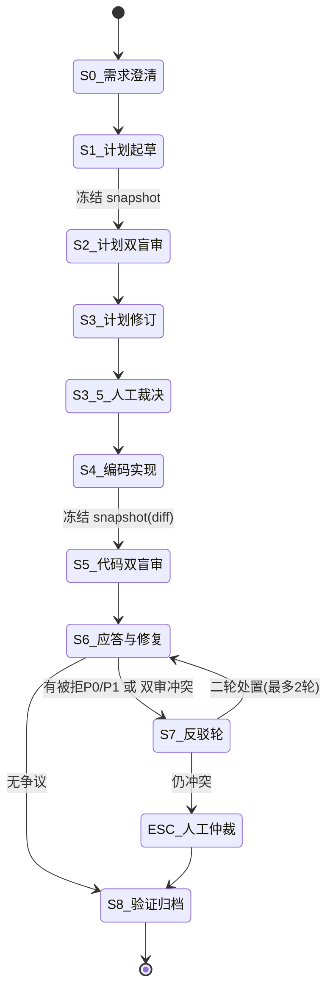

# Driver-DualCritic（主攻 + 双审）多智能体协同流水线设计方案

> 运行环境：macOS + VS Code 原生开发流
> 角色分工：Claude Code（主脑 / Driver）× Antigravity（Critic-A, Google）× ZCode（Critic-B, 智谱）
> 版本：v1.0 设计稿 · 2026-09-10

---

## 1. 需求映射与验收标准

| # | 原始需求 | 本方案的落地机制 | 验收判据 |
|---|---|---|---|
| 1 | Claude Code 作主脑（VS Code 插件），负责理解需求、起草方案、编码、修 Bug | Claude Code 保持交互式 IDE 主脑地位，所有"写"权限集中在它；通过 `CLAUDE.md` 注入 DDC 协议，使其知道何时必须送审 | 任一代码变更的提交者只能是 Claude Code；未过审产物无法进入下一阶段 |
| 2 | Antigravity 与 ZCode 各自**独立**审查需求/计划/方案/代码/Bug 根因 | 双盲审核：同一份**冻结快照**（content-addressed）分别在两个独立 `git worktree` 中送审，两个 Agent 互不可见对方产出 | 审核文档 front-matter 中 `blind: true` 且 `input_hash` 相同；任一方可读到另一方产出即判失败 |
| 3 | 不只是用 LLM 能力，要用两家的**编程 Agent 能力** | 通过 Critic Adapter 直接 fork 真实 Agent CLI（`agy`、`zcode`），授予只读工具集（读文件、grep、跑测试、看 diff），让其自主完成探索式审查，而非一次性补全 | Critic 产物中包含 `tool_trace`（读了哪些文件、跑了哪些命令），证明是 Agent 行为 |
| 4 | 全过程留痕（计划四件套 + 代码审核三件套） | `.ddc/` 审计台账：append-only、按任务分目录、YAML front-matter 机读、`manifest.yaml` 哈希链、每阶段一次 git commit | `ddc ledger verify` 能重放并校验整条哈希链；缺失任一必存产物则 gate 失败 |
| 5 | 可按任务给两个 Critic 指定不同 LLM | Profile 路由表 `.ddc/profiles.yaml`：`task_kind × critic → model`；绕开 ZCode 不支持 `--model` 的限制（配置原子换入/换出 + 全局锁） | 日志与 front-matter 记录实际生效模型；`ddc doctor --models` 可核验 |

**非目标**：不做云端服务、不做团队多人协作权限体系、不替代 CI/CD（与之互补）、不追求"无人值守到底"（保留人工门禁）。

---

## 2. 设计原则（决定了后面所有取舍）

1. **确定性编排 + 认知性执行分离**。状态机、超时、重试、留痕、门禁判定全部由普通代码（`ddc` 编排器）承担；LLM 只做判断和写代码。绝不用一个 LLM 去"记得"流程该走哪一步。
2. **快照不可变**。审核对象永远是 `(git_ref, content_hash)` 二元组，不是"当前工作区"。避免审查期间代码漂移导致意见对不上号。
3. **产物即接口**。Agent 之间不通过对话传递信息，只通过约定路径 + 约定 schema 的文件传递。对话会丢，文件可查、可 diff、可回归测试。
4. **双盲 + 结构化应答**。独立性与盲审是"二次审核有价值"的前提；应答文档必须逐条结构化（accept / reject / partial + 证据），否则审核沦为橡皮图章。
5. **最小写权限**。Critic 只读；只有 Driver 可写；编排器只写 `.ddc/`。
6. **降级可见**。任一 Critic 不可用时不静默跳过，而是显式标注 `degraded: true` 并默认阻塞门禁，由人放行。

---

## 3. 总体架构

```
┌──────────────────────────── VS Code (macOS) ────────────────────────────┐
│  Claude Code 插件 = Driver（主脑，人可对话）                              │
│    ├── CLAUDE.md  ← 注入 DDC 协议（何时送审、产物写到哪、怎么应答）        │
│    ├── Slash: /ddc:start | /ddc:plan-review | /ddc:code-review | /ddc:close
│    └── MCP client ──┐                                                   │
│                     │  tools: ddc_review / ddc_snapshot / ddc_status    │
│  VS Code Tasks ─────┼────────────┐   Output Channel: "DDC" 进度流        │
└─────────────────────┼────────────┼──────────────────────────────────────┘
                      ▼            ▼
        ┌───────────────────────────────────────────┐
        │  ddc-mcp / ddc CLI  （本地 Node 编排器）    │
        │  ┌─────────────────────────────────────┐  │
        │  │ State Machine + Gates (流程/门禁)    │  │
        │  │ Snapshot Manager (git worktree/哈希) │  │
        │  │ Model Router (profiles.yaml)         │  │
        │  │ Artifact Ledger (留痕/哈希链/commit)  │  │
        │  │ Runner Pool (并行/超时/重试/缓存)      │  │
        │  └───────┬─────────────────┬───────────┘  │
        │   Critic Adapter 层（统一契约）            │
        │   ┌──────┴──────┐   ┌──────┴──────┐       │
        │   │ AgyAdapter  │   │ZcodeAdapter │       │
        │   │ (Google)    │   │ (Zhipu)     │       │
        │   └──────┬──────┘   └──────┬──────┘       │
        └──────────┼─────────────────┼──────────────┘
                   ▼                 ▼
        antigravity-cli (agy -p)   zcode (--prompt --json)
        只读工具集 + 独立 worktree   只读工具集 + 独立 worktree
                   │                 │
                   └── 写审核文档到约定路径 ──┘
                                │
                                ▼
                  项目内 .ddc/ 审计台账（git 跟踪）
```

**关键取舍说明：为什么 Driver 不直接 shell out 调 Critic，而要走 MCP？**
Claude Code 的 Bash 工具确实能直接跑 `agy -p ...`，但会出现三个问题：①审核超时/重试/pty 兜底这类基础设施代码塞进对话上下文，污染主脑注意力；②两个 Critic 无法真正并行（Agent 内串行 tool call）；③留痕与门禁判定失去一致性保证。把这件事外包给一个薄薄的 MCP server + 独立 CLI（同一份代码两个入口），既保证交互式使用，也让同一套流水线能在 CI 里无人值守重放。

---

## 4. 流水线状态机

### 4.1 阶段定义

| 阶段 | 编号 | 输入 | 执行者 | 必存产物 | 门禁（Gate） |
|---|---|---|---|---|---|
| 需求澄清 | S0 | 用户原始需求 | Driver | `00-requirement.md` | Driver 自检：目标/边界/验收标准三段齐全 |
| 计划起草 | S1 | S0 | Driver | `10-plan.draft.md` | 无 |
| **计划双盲审** | S2 | S1 快照 | Critic-A + Critic-B 并行 | `20-review-antigravity.md`、`20-review-zcode.md` | 两份齐全且 `input_hash` 一致 |
| 计划修订 | S3 | S1 + S2 | Driver | `30-plan.revised.md` + `31-disposition-plan.md` | 每条 finding 有处置；P0 未闭合则不可进 S3→S4 |
| 计划裁决 | S3.5 | S2/S3 | 人工（可选自动） | `32-approval.md` | 人工签字 / 或 auto-approve 规则命中 |
| 编码实现 | S4 | S3 已批版本 | Driver | 代码 diff + `40-impl-notes.md` | 本地 lint/typecheck/test 通过 |
| **代码双盲审** | S5 | S4 快照（diff-only + 上下文） | Critic-A + Critic-B 并行 | `50-review-antigravity.md`、`50-review-zcode.md` | 同 S2 |
| 审核应答与修复 | S6 | S5 | Driver | `60-disposition-code.md`（接受/不接受/修改计划）+ 修复 diff | 每条 finding 有处置；被拒项必须给证据 |
| 反驳轮（可选） | S7 | S6 | Critic 定向复核 | `70-rebuttal-*.md` | 触发条件：被拒 P0/P1 ≥ 1，或双 Critic 冲突 |
| 验证与归档 | S8 | S6/S7 | 编排器 + Driver | `80-verification.md` + `manifest.yaml` 终态 | 测试/构建绿灯；台账哈希链可验证 |

Bug 根因定位走同一条链，只是把 S0/S1 换成 `00-incident.md` + `10-rca.draft.md`，S2 审的是**根因结论**而非代码（见 §7.3）。

### 4.2 流转图



### 4.3 回退与收敛控制

- **阶段回退**：S5 若发现"计划层缺陷"（不是实现 bug），Critic 打 `layer: plan` 标签 → 编排器把任务退回 S3 而非 S6，并保留原计划版本链（`10-plan.draft.v1/v2.md`）。
- **最大轮次**：反驳轮硬上限 2 轮，超过强制升级人工。防止两个 Agent 无限互相说服烧 token。
- **收敛判据**：同一 finding 在两轮内 severity 未降级且 Driver 连续拒绝 → 判定为"分歧项"，走人工。
- **幂等**：每个阶段以 `(task_id, stage, input_hash, model)` 为 key 缓存；重放时命中缓存直接复用产物（`--force` 可穿透）。

---

## 5. 留痕规范（`.ddc/` 审计台账）

### 5.1 目录结构

```
project/
├── CLAUDE.md                     # 含 @.ddc/PROTOCOL.md 引用，向主脑注入协议
└── .ddc/
    ├── PROTOCOL.md               # DDC 协议（人写的规则，Driver 必读）
    ├── profiles.yaml             # 任务类型 × Critic → 模型/工具集/预算
    ├── config.yaml               # CLI 路径、超时、并行度、只读策略、门禁开关
    ├── tasks/
    │   └── 2026-09-10-auth-oidc/ # 一任务一目录（日期-语义slug）
    │       ├── manifest.yaml     # 任务状态机 + 阶段产物哈希链
    │       ├── inputs/
    │       │   └── snapshot.json # 冻结快照：git_ref、tree_hash、file 清单
    │       ├── 00-requirement.md
    │       ├── 10-plan.draft.md              # ① 原始计划（Claude Code）
    │       ├── 20-review-antigravity.md      # ② Critic-A 审核文档
    │       ├── 20-review-zcode.md            # ③ Critic-B 审核文档
    │       ├── 30-plan.revised.md            # ④ 修改后计划（Claude Code）
    │       ├── 31-disposition-plan.md        # ⑤ 对计划审核意见的应答
    │       ├── 32-approval.md
    │       ├── 40-impl-notes.md
    │       ├── 50-review-antigravity.md      # 代码审核 · Critic-A
    │       ├── 50-review-zcode.md            # 代码审核 · Critic-B
    │       ├── 60-disposition-code.md        # Claude Code 应答（接受/不接受/修改计划）
    │       ├── 70-rebuttal-antigravity.md    # （可选）反驳轮
    │       ├── 80-verification.md
    │       └── logs/
    │           ├── antigravity.<ts>.stdout.log      # Agent 原始 transcript
    │           ├── antigravity.<ts>.tool_trace.json # 读过的文件/跑过的命令
    │           ├── zcode.<ts>.stdout.log
    │           └── zcode.<ts>.json
    ├── ledger.index            # 全局哈希链尾指针（编排器维护）
    └── quarantine/             # 失败/降级产物，不参与门禁但保留证据
```

**命名约定**：`<序号>-<种类>-<角色>.md`，序号即阶段顺序，前缀数字保证 `ls` 出来就是时间线。角色名固定：`antigravity` / `zcode` / `driver`（Driver 产物省后缀）。

### 5.2 审核文档 schema（机读 front-matter）

Critic 产物必须以此为骨架，否则 `ledger` 判为格式不合格并重试一次：

```markdown
---
schema: ddc.review.v1
task: 2026-09-10-auth-oidc
stage: S5-code-review
critic: antigravity            # antigravity | zcode
model: gemini-high-reasoning   # 实际生效模型（编排器回填，非自述）
agent: agy/1.1.x               # CLI 及版本
blind: true
input:
  git_ref: 3f9a1c2
  snapshot_hash: sha256:8c1f...   # 与被审对象一致，独立性证据
started_at: 2026-09-10T11:02:11+08:00
finished_at: 2026-09-10T11:09:44+08:00
duration_s: 453
tool_calls: {read: 27, grep: 9, test_run: 2}   # Agent 行为证据
coverage:
  reviewed_files: 18
  skipped_files: [pnpm-lock.yaml]
verdict: request-changes       # approve | approve-with-nits | request-changes | block
findings_count: {P0: 1, P1: 2, P2: 4, nit: 6}
---

## 结论摘要
（≤5 行。先说结论与最危险的一条）

## Findings
- id: F-A1                 # 稳定 ID：F-<critic缩写><序号>，应答文档按此逐条引用
  severity: P0
  layer: code              # code | plan | requirement | rca（决定回退目标阶段）
  kind: correctness        # correctness|security|concurrency|contract|test-gap|maintainability|scope-drift
  confidence: high
  file: src/auth/oidc/callback.ts:88
  claim: state 参数未做 CSRF 绑定，回调可被重放
  evidence: |
    代码路径与攻击构造（含复现步骤或失败测试）
  impact: 账号接管
  suggestion: |
    最小修复方向，不写具体代码（避免越权成"第二作者"）
  blocks_release: true

## 我认为方案里对的地方（防止只挑刺）
## 我没有覆盖到的部分（暴露盲区）
```

### 5.3 应答文档 schema（Driver 的闭环义务）

```markdown
---
schema: ddc.disposition.v1
task: 2026-09-10-auth-oidc
stage: S6
author: claude-code
addresses: [20-review-antigravity.md, 20-review-zcode.md]
---

| finding | critic | severity | 处置 | 理由与证据 | 动作 |
|---|---|---|---|---|---|
| F-A1 | antigravity | P0 | accept | 已确认，见 commit 7b12e3 测试 test/callback-replay.spec.ts | 已修复 |
| F-B3 | zcode | P1 | reject | 该分支在 §配置校验 已被上游拒绝，证据：src/x.ts:31 + 复现脚本 outputs/proof.txt | 不改 |
| F-A4 | antigravity | P2 | partial | 采纳类型收紧，不采纳重命名（牵动对外契约） | 部分修复 |

## 因审核意见导致的计划变更
- 计划 §3 → 新增 "state 绑定 nonce"；变更已回写 30-plan.revised.md v3

## 遗留风险
```

**硬约束**：`reject` 必须带 `evidence` 字段且非空；`accept` 必须带 commit/文件指针。缺证据的拒绝在 S6 门禁直接失败。

### 5.4 防篡改与可重放

- `manifest.yaml` 每阶段追加一条：`{stage, at, artifacts: [{path, sha256}], prev_chain_hash}`，形成哈希链；`ledger.index` 保存尾哈希。
- 产物只允许**追加**与新增版本（`.v2`、`.rejected`），禁止原地改写已入链文件；编排器对入链文件设 `chmod 444`。
- 每阶段一次 `git commit -m "ddc(S<stage>): <task> <产物> [<hash>]"`，把台账与代码变更绑定在同一提交序列里 —— Git 本身就是第二道审计链，同时天然支持 `git log --follow .ddc/tasks/<id>` 复盘。
- 一键复盘：`ddc report <task> --md` 生成给人看的评审纪要（含时间线、采纳分布、争议清单）。

---

## 6. Critic Adapter 层：真实编程 Agent 的驱动契约

### 6.1 统一接口

```ts
interface CriticRequest {
  taskId: string; stage: 'S2-plan-review'|'S5-code-review'|'S7-rebuttal'|'S-rca';
  snapshotDir: string;      // 独立 worktree，只读挂载点
  briefPath: string;        // 送审说明（含审查清单、评分维度、范围边界）
  outputPath: string;       // 产物落盘绝对路径（不在 snapshotDir 内）
  model?: string;           // 来自 profiles.yaml
  toolPolicy: 'read-only';  // 允许 read/grep/test；禁止 write/patch/net
  deadlineSec: number; budgetCap?: number;
}
interface CriticResult { ok: boolean; artifactPath: string; transcriptPath: string;
  toolTracePath: string; exitCode: number; degraded?: boolean; failReason?: string; }
```

**核心约定：产物路径由编排器指定并写入 brief，不依赖 Agent 的"自觉"**。brief 中明确：
> 你是二次审核者（Critic）。工作目录是仓库快照，**禁止修改任何文件**。请把审核结论**写入** `<outputPath>`，严格遵循 `ddc.review.v1` front-matter 骨架（骨架见 `.ddc/PROTOCOL.md`）。你可以自由阅读代码、运行测试与静态检查来自证。不要给出大段替换代码，只给方向与证据。

### 6.2 AgyAdapter（Antigravity, Google）

| 事项 | 做法 |
|---|---|
| 非交互执行 | `agy -p "<brief 或 @brief 路径>"`（一次性 agent 任务，不是贴一个 prompt 给模型） |
| **已知坑** | 非 TTY 场景下 `agy` 可能**丢 stdout 但仍返回 0**。macOS 必须套伪终端：`script -q /dev/null agy -p "..."`（BSD `script` 语法），或走 `expect`/`pty` 包装 |
| 产物获取 | 不解析 stdout。以 `outputPath` 文件是否存在 + schema 校验为唯一成功判据；stdout 只作为 transcript 落 `logs/` |
| 输出清洗 | 剥 ANSI/CR；`tail -c 200` 检查终止标记；空文件即判失败并重试（≤1 次） |
| 只读保障 | 用 adapter 的 sandbox/permission 设置关闭写与网络；worktree 设 `git config core.fileMode false` + 目录 `chmod 555` |
| 认证 | Google 账号/API key 走 macOS Keychain，`security find-generic-password -s ddc.agy -w` 注入子进程 env，不落盘不进 git |
| 模型选择 | 按 `agy` 当时的模型/配置项设置（子命令或配置文件，安装期以 `agy --help` 与 `agy doctor` 为准并固化进 `.ddc/config.yaml`）；切换前后各做一次探针 `agy doctor --json`，把**实际生效值**写回 result 与 front-matter，不信任"我以为设成了什么" |

### 6.3 ZcodeAdapter（ZCode, 智谱）

| 事项 | 做法 |
|---|---|
| CLI 位置 | ZCode 引擎是桌面 App 内的 `zcode.cjs`，经 `node` 或软链调用；adapter 启动时自动探测 `/Applications/ZCode.app/**/zcode.cjs` 并缓存路径 |
| 非交互执行 | `zcode --prompt "<brief>" --json` 拿机器可读结果；长任务可选 `app-server` 常驻 + stdio（注意其协议为自定义，非 JSON-RPC、非标准 MCP，需专用 transport 适配；一期先用 `--prompt/--json`，`app-server` 列二期优化以省启动开销） |
| **配置** | `~/.zcode/cli/config.json`，schema `zcode.config.v1`：`provider.{baseURL, apiKey, models}`、`model` |
| **模型切换坑（关键）** | **不支持 `--model` 传参（会直接退出）**。因此 Model Router 必须"改配置"而非"传参数"：① 全局互斥锁；② 备份原 config；③ 原子写入目标 `model`；④ 执行；⑤ `finally` 恢复。ZCode 的两个 profile 不可并行，跨 Critic 才可并行（与 agy 并行不受影响） |
| 配置隔离 | 更稳的做法是避免改全局：为每个 profile 生成独立 config 副本 + `ZCODE_HOME`/`--config` 指向（若版本支持）。不支持时才退回"锁 + 换入换出"，并把该限制写进文档与 `.ddc/PROTOCOL.md` |
| 产物获取 | 同 agy：文件存在性 + schema 校验；`--json` 输出落 `logs/*.json` 作 transcript 与 token 统计 |
| 只读保障 | 权限档位设为只读/需批准；目录 `chmod 555`；测试用可并行的只读模式或 mock 数据源，避免污染真实库 |

### 6.4 Claude Code 侧（Driver）

- 交互式：VS Code 插件里正常对话，`CLAUDE.md` 引用 `.ddc/PROTOCOL.md`，让它知道"什么时候必须调 `ddc_review`、产物写哪、S6 必须逐条应答"。
- 无人值守重放（CI/夜间批）：`claude -p --output-format stream-json --permission-mode <plan|acceptEdits> --allowedTools <...> --add-dir .ddc`，同一套 profiles 与门禁复用。
- 上下文瘦身：送审对象只给 snapshot 路径与 brief，不把整份计划贴进对话；Critic 自己读文件（这正是用 Agent 而非 API 的意义）。
- 反自证偏置：Driver 起草送审 brief 时不得写"这个方案没问题请确认"；brief 由编排器按模板生成，只描述范围与审查清单。

### 6.5 Runner Pool

- 并行度：`Critic-A ∥ Critic-B` 并行（不同厂、不同进程、不同 worktree）；同 Critic 的多 profile 串行（尤其 ZCode 的配置锁）。
- 超时：软超时 `SIGTERM` + 产物落盘检查 → 若有半成品文档入 `quarantine/`；硬超时 `SIGKILL`。默认计划审 15min / 代码审 20min（`config.yaml` 可调）。
- 重试：仅对 `transient`（空产物、非 TTY 丢输出、网络抖动）重试 1 次，同一 `input_hash` 命中缓存则不重跑。
- 预算：按任务类型设 token/时长上限，超限即截断并标 `degraded`，不静默降级。

---

## 7. 模型路由、独立性、仲裁

### 7.1 `.ddc/profiles.yaml`（对应需求 5）

```yaml
defaults: {tool_policy: read-only, deadline_s: 900, max_findings: 40}
routing:
  plan-review:                       # 需求/计划/方案审核（S2）
    antigravity: {model: gemini-high-reasoning, emphasis: [架构完备性, 遗漏需求, 可扩展性, 迁移风险]}
    zcode:       {model: glm-5.3-max,           emphasis: [边界条件, 并发与一致性, 数据模型, 可测试性]}
  code-review:                       # 代码审核（S5）
    antigravity: {model: gemini-fast-balanced,  emphasis: [correctness, contract-drift, 复杂度]}
    zcode:       {model: glm-5.3-max,           emphasis: [安全, 并发, 错误处理, 测试缺口]}
  incident-rca:                      # Bug 根因定位审核
    antigravity: {model: gemini-long-context,   emphasis: [证据链完整性, 是否存在第二根因]}
    zcode:       {model: glm-5.3-max,           emphasis: [复现充分性, 修复面最小化, 回归风险]}
  refactor-review:
    antigravity: {model: gemini-fast-balanced}
    zcode:       {model: glm-5.3-max}
budget: {per_task_critic_calls: 6, per_day_tokens_soft_cap: 3000000}
escalation: {human_gate_on: [P0-rejected, critics-conflict, degraded-critic, rounds>2]}
```

路由原则（写进协议，供人调整）：**两家模型故意异构** —— 异构（不同厂、不同长度窗口、不同训练偏好）才有互补盲区；同构只会把成本翻倍、意见雷同。`emphasis` 字段把差异化审查维度显式下发，让两次审查在覆盖面上一减一乘而非重复。

### 7.2 双盲与防锚定

- 独立性由**机制**保证而非提示词祈使：`ddc snapshot` 为每个 Critic 建独立 `git worktree`（同一 `tree_hash`），只放代码 + 被审文档，**不放**对方产物目录；`logs/` 在 snapshot 之外。
- brief 中禁止出现"另一评审认为……"；S7 反驳轮例外（此时定向只给分歧项）。
- 快照期间禁止主工作区写入被审文件：编排器持 `snapshot.lock`，Driver 侧 `git status` 变化则拒绝进入 S5。
- 交叉校验：若两份审核文档 `findings` 的 Jaccard 相似度长期 > 0.8，说明双审退化成同审 → 提示调 `emphasis` 或换 profile（这是可观测指标，不是报错）。

### 7.3 审核维度清单（brief 内置，避免"审得没重点"）

- **计划审**：需求覆盖矩阵逐条对照；隐含假设清单；不可逆决策（数据模型/对外契约/迁移）是否显式标注；里程碑是否可验证；被砍掉的替代方案理由是否成立。
- **代码审**：以 diff 为中心 + 按需展开上下文；契约漂移（函数签名/错误码/事件 payload）；边界与错误路径；并发与幂等；测试是否真能失败（`mutation` 式追问）；范围蔓延（改了计划外的什么）。
- **根因审**：复现是否稳定；有无第二个根因；修复是治症状还是治根因；回归用例是否会漏；同因点是否在代码库其他位置还存在。

### 7.4 冲突仲裁与采纳闭环

| 情形 | 规则 |
|---|---|
| 双方均提同一 P0/P1 | 自动阻断，Driver 必须修；不可 reject |
| 仅一方提且 `confidence: high` + 有可执行证据（失败测试/复现脚本） | 视同有效，需处置 |
| 仅一方提且为主观判断（无证据） | 降级为 `nit`，Driver 可 reject（仍要写理由） |
| 双方结论矛盾（一 approve 一 block） | 触发 S7 反驳轮，只把分歧项互相可见；仍矛盾 → 人工仲裁并记入 `80-verification.md` |
| Driver 连续拒同一 finding ≥2 次 | 强制人工，记 `disputed: true` |

采纳质量指标（S8 自动统计，进 `manifest.yaml`）：`adoption_rate`（采纳率）、`P0_miss_rate`（事后回归暴露但双审都没提的比例）、`false_positive_rate`（被证伪并 reject 的比例）。按 critic × model 分桶 —— 这是后续调 `profiles.yaml` 的依据，让"哪家模型更适合审什么"变成数据驱动，而不是感觉。

---

## 8. 安全与资源边界

- **写权限矩阵**：Driver → 业务代码；Critic → 仅 `outputPath`；编排器 → 仅 `.ddc/`。snapshot 目录 `chmod 555`。
- **网络**：Critic 的审查阶段默认禁网（除模型 API 出口）；跑测试用本地/mock 依赖，防数据外泄与副作用。
- **密钥**：全部存 Keychain，env 注入子进程；`.ddc/` 加 `.gitignore` 例外规则（排除 `logs/` 中可能的敏感 transcript，或入 git 前跑密钥扫描 `gitleaks`）。
- **不可信输入**：被审文档内容当作数据不参与指令构造（防 prompt injection 让 Critic 去写文件）；`outputPath` 由编排器分配并校验落在白名单前缀。
- **macOS 注意**：CLI 首次运行被 Gatekeeper 拦 → `xattr -d com.apple.quarantine`；`script` 与 `expect` 需随仓库文档化；Apple Silicon 下确认三家 CLI 的原生/arch 匹配；用 `launchd` 或 VS Code task 拉起常驻编排器时避免 PATH 缺失（GUI 进程不读 `.zshrc`，需显式绝对路径）。

---

## 9. VS Code 集成与使用流程

- **Tasks**（`.vscode/tasks.json`）：`ddc:start`、`ddc:freeze-snapshot`、`ddc:review-plan`、`ddc:review-code`、`ddc:report`、`ddc:doctor`。
- **MCP 注册**：`claude mcp add ddc -- node ./tools/ddc-mcp/server.js`，暴露 `ddc_review` / `ddc_snapshot` / `ddc_gate_check` / `ddc_ledger_verify` / `ddc_status`。
- **Slash 命令**（Driver 侧语义锚点）：`/ddc:start`（建任务目录+需求模板）、`/ddc:plan-review`、`/ddc:code-review`、`/ddc:answer`（生成应答骨架）、`/ddc:close`。
- **Output Channel "DDC"**：实时显示两 Critic 启动/进度/耗时/产物校验结果 —— 并行黑盒等待是信任杀手，必须有心跳。
- **编辑器可读性**：`.ddc/tasks/**` 的 front-matter 用 Markdown Preview 查看；配 `ddc report --html` 出一页评审纪要给非技术干系人。

**一次典型交互**：
1. 我在 VS Code 对 Claude Code 说需求 → `/ddc:start` 建 `2026-09-10-auth-oidc/00-requirement.md`。
2. Claude Code 起草 `10-plan.draft.md` → `/ddc:plan-review` 冻结快照，并行拉起 `agy`（Gemini 系）与 `zcode`（GLM 系），各写 `20-review-*.md`。
3. Claude Code 读两份意见，写 `30-plan.revised.md` + `31-disposition-plan.md`；门禁校验"P0 是否全闭合"。
4. 我扫一眼纪要，签字 `32-approval.md` → 放行编码。
5. 编码完 → `/ddc:code-review` 双盲审 diff → Claude Code 写 `60-disposition-code.md` 并修复。
6. 有分歧 → 自动 S7 反驳轮 → 仍冲突则 @ 我仲裁。
7. `/ddc:close` 跑 `80-verification.md`、`ledger verify`、一次 `git commit`，台账入库。

---

## 10. 落地路线图

| 里程碑 | 内容 | 完成判据 | 预估 |
|---|---|---|---|
| M0 探路（安装期事实核验） | `agy --help` / `agy doctor --json` / ZCode config 结构 / ZCode 是否支持独立 `--config` / Claude Code MCP 与 headless 参数，逐项实测并固化进 `.ddc/config.yaml` | 拿到三家**真实可用**的非交互命令模板 + 一份"坑清单" | 0.5–1 天 |
| M1 最小闭环 | 编排器骨架 + 两个 Adapter + `--prompt/-p` 串行调用 + 手工产物目录 | 一条真实任务跑通 S1→S3，两份审核文档落盘 | 2 天 |
| M2 留痕与门禁 | front-matter schema 校验、哈希链、`ledger verify`、git commit 自动化 | 能证明"未被篡改 + 缺件即阻塞" | 2 天 |
| M3 并行 / 模型路由 / 独立性 | worktree 双盲、Runner Pool、profiles 路由、ZCode 配置锁、缓存 | 同一任务两 Critic 真并行且互不可见；按任务换模型生效 | 3 天 |
| M4 应答闭环与仲裁 | disposition 骨架生成、reject 证据强校验、S7 反驳轮、人工升级 | 造一条 reject 无证据 → 门禁确实失败 | 2 天 |
| M5 IDE 体验与运维 | MCP server、slash、tasks、Output Channel、`ddc report`、密钥与 quarantine、指标看板 | 非作者能在 15 分钟内独立跑通一条任务 | 3 天 |

**建议一期范围**：M0–M3 + 简化版 M4（先不做 S7 反驳轮）。M5 里 `ddc report` 优先于看板。

---

## 11. 主要风险与缓解

| 风险 | 缓解 |
|---|---|
| 双审成本与时延翻倍，实践中被绕过 | 分级触发：仅"不可逆决策/核心模块/安全面"强制双审；其余走单审 + 抽检（`config.yaml` 的 `review_policy`），并保留绕过留痕 |
| Critic 越界改代码 | worktree + `chmod 555` + 只读权限档 + 事后 `git diff` 应为空（非空即失败并隔离） |
| 审核文档质量不稳定/格式跑偏 | brief 内置骨架 + schema 校验 + 一次自动"按 schema 重写"重试（用同一 Agent，成本极低） |
|三家 CLI 版本迭代导致参数变更 | M0 把探测结果固化；Adapter 用 capability probe 而非硬编码；`logs/` 保留 CLI 版本；CI 每日跑 `ddc doctor --probe` 冒烟 |
| Driver 敷衍应答（复制粘贴式接受） | `adoption_rate` 异常（≈100% 全接受但 P0_miss 高）作为质量告警；reject 必须有证据、accept 必须有 commit 指针 |
| 上下文污染 / 快照漂移 | 冻结快照 + `snapshot.lock` + `input_hash` 三方一致校验 |

---

## 12. 交付物清单（实现阶段）

1. `tools/ddc/`（编排器：state machine、snapshot、ledger、router、runner、adapters）
2. `tools/ddc-mcp/`（MCP server，与 CLI 共用内核）
3. `.ddc/PROTOCOL.md`（Driver 的行为契约）、`profiles.yaml`、`config.yaml`
4. 模板：`templates/{requirement,plan,review,disposition,approval,verification}.md`
5. `.vscode/tasks.json` + `settings.json` 片段 + `CLAUDE.md` 追加段落
6. `scripts/m0-probe.sh`（三家 CLI 能力探测，输出可粘进 `config.yaml`）
7. 一条端到端样例任务（含完整台账），作为回归测试夹具

---

## 13. 待你确认的三个决策点

1. **人工门禁是否常驻**：`32-approval.md` 默认要求人签字。要不要给低风险的 `refactor` 类任务开 auto-approve？
2. **ZCode 模型切换实现**：一期用"全局锁 + 备份/换入/恢复 `~/.zcode/cli/config.json`"。若 M0 探测出支持独立 config，则改为无锁并行版（更干净）。可接受这个不确定性吗？
3. **`logs/` 是否入 git**：入 → 审计最完整但仓库膨胀且可能含敏感片段；不入 → 只入台账哈希。我建议**入哈希、不入正文**（`logs/` 加 gitignore，哈希进 manifest）。

---

*附：本方案涉及三家 CLI 的具体参数（`agy -p`、`zcode --prompt/--json`、`zcode.config.v1` 不支持 `--model`、非 TTY 丢 stdout 等）来自公开资料与社区实测记录，实施前请在 M0 用你本机安装版本重新核验并固化，不要直接照抄命令。*
