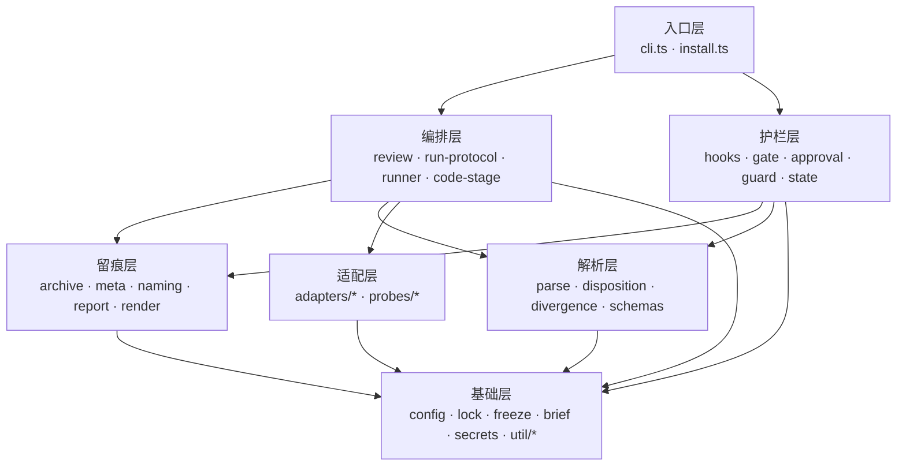
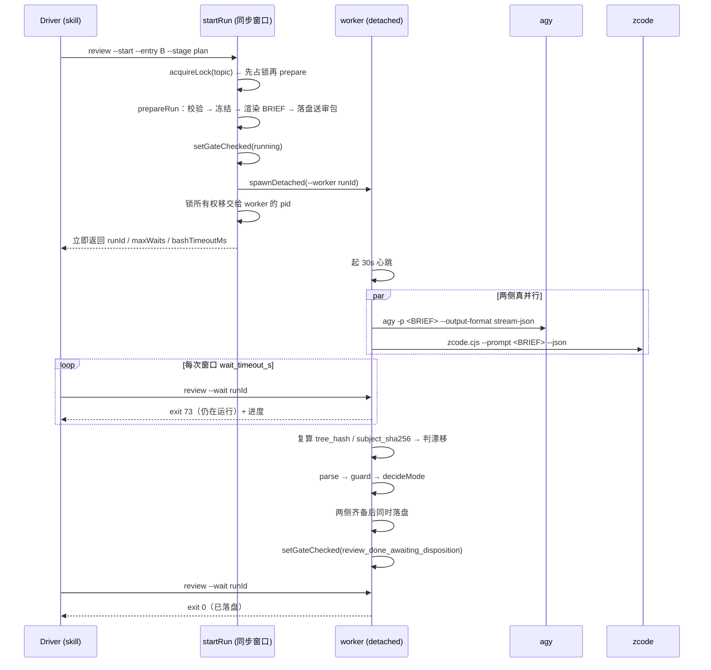
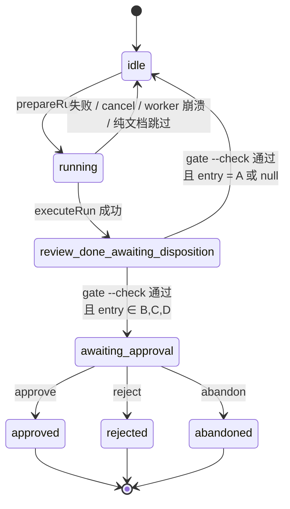

# LLD：TriviumCode 编排器详细设计说明书

> - **作者 / 负责人**：Driver（Claude）
> - **创建日期**：2026-09-13
> - **当前版本**：v1.1.0
> - **状态**：草稿(Draft)
> - **变更说明**：v1.1.0（2026-09-14）随[设计 v1.3.0](./2026-09-10-Driver-DualCritic主攻双审流水线设计.md) 的规范链回溯同步：
>   2.6 适配层新增 `agents/registry.ts`（M7a 引入的 Agent 注册表，全部 Agent 差异的唯一登记处），
>   并写明**M7a 是行为等价重构**的边界——登记四家但只启用两家审核者与一个 Driver，
>   避免读者据模块存在推断系统已支持四家。本文其余部分描述的仍是当前真实代码路径。

---

## 一、本文的定位与边界

这套系统已有三份规范性文档，本文是第四份，**只补它们不讲的那一层**：

| 文档 | 回答的问题 | 本文与它的关系 |
| :--- | :--- | :--- |
| [设计文档](./2026-09-10-Driver-DualCritic主攻双审流水线设计.md) | **为什么这么设计**（唯一实现依据，19 万字） | 本文不重述决策依据。冲突时以设计文档为准 |
| [PROTOCOL_dual_critic_relay.md](../03_api/PROTOCOL_dual_critic_relay.md) | **对外契约是什么**（四份 Schema、BRIEF 八段、漂移算法、退出码） | 本文不重述契约，只讲契约在代码里的落点 |
| [QUICKSTART.md](../07_manuals/QUICKSTART.md) / [MANUAL_user.md](../07_manuals/MANUAL_user.md) | **怎么用** | 本文不讲用法 |
| **本文** | **代码怎么组织、一次调用实际怎么走** | — |

读者假定：知道这套系统是干什么的，但没读过代码，要来维护或修改它。

规模基准：**50 个模块 / 16437 行 TypeScript**（不含测试）。运行期零第三方依赖——`ajv` 与 `yaml` 在构建时被 esbuild 打进单文件产物。

---

## 二、分层模块地图

依赖方向自上而下，**下层不得反向依赖上层**。



### 2.1 入口层

| 模块 | 行数 | 职责 | 关键导出 |
| :--- | ---: | :--- | :--- |
| `cli.ts` | 1058 | 子命令分发、argv 解析、退出码转换。**无单元测试**，仅由集成测试以子进程形式覆盖 | `main()` |
| `install.ts` | 217 | 把 `skills/*` 同步到 `~/.claude/skills/`，裁剪孤儿文件，拷只读 Agent 定义 | `runInstall()` |

`cli.ts` 的 `USAGE` 常量（第 87 行起）是命令契约的人读版本，改命令必须同步改它。

### 2.2 编排层

| 模块 | 行数 | 职责 | 关键导出 |
| :--- | ---: | :--- | :--- |
| `review.ts` | 1060 | 一次运行的准备与执行 | `prepareRun()` `executeRun()` `runReview()` |
| `run-protocol.ts` | 771 | 长时调用协议：`--start` / `--worker` / `--wait` / `--status` / `--cancel` | `startRun()` `workerMain()` `waitRun()` `cancelRun()` |
| `runner.ts` | 246 | 两侧真并行、瞬时重试、降级模式决策 | `runBothSides()` `decideMode()` `isTransientFailure()` |
| `code-stage.ts` | 261 | code 阶段的补丁头部构造与解析 | `buildDiffHeader()` `parseFrozenDiff()` |

`review.ts` 拆成 `prepare` 与 `execute` 两段，是因为 worker 进程**绝不重新 prepare**——重新冻结会算出与送审包不一致的哈希。

### 2.3 护栏层

| 模块 | 行数 | 职责 | 关键导出 |
| :--- | ---: | :--- | :--- |
| `hooks.ts` | 1041 | 五个 Claude Code Hook 入口的全部判定逻辑。**全仓最大的文件** | `hookPreWrite()` `hookPreBash()` `hookPreCommit()` `hookStop()` `hookSessionStart()` |
| `gate.ts` | 476 | 裁决完整性硬校验（11 个失败码）、共同 blocker 判定 | `checkAdjudication()` `findJointRejectedBlockers()` |
| `approval.ts` | 138 | 人工审批的状态迁移与留痕 | `recordApproval()` |
| `guard.ts` | 225 | 只读失守 / 证据下限 / 泄漏 / 漂移的**判定**（不做处置） | `judgeRun()` `judgeSide()` |
| `state.ts` | 300 | 闸门状态机、`state.json` 的读改写 | `setGateChecked()` `listOpenGates()` `shouldLockWrites()` |

`guard.ts` 只判定不处置，处置交给 `gate` 与失败策略——这条分工写在文件头注释里。

### 2.4 留痕层

| 模块 | 行数 | 职责 | 关键导出 |
| :--- | ---: | :--- | :--- |
| `archive.ts` | 451 | 防覆盖落盘、最低工件集校验、sha256 核对 | `writeArtifact()` `checkRecordedArtifacts()` `checkRunManifests()` |
| `meta.ts` | 307 | `run.json` / `task.json` 的构造与更新 | `newRunId()` `writeRunMeta()` `updateTask()` `readTaskStrict()` |
| `naming.ts` | 142 | 文件名生成与反解析（纯函数，不碰文件系统） | `buildArtifactName()` `parseArtifactName()` `validateTopic()` |
| `report.ts` | 536 | 人读复盘生成 | `buildReport()` |
| `render.ts` | 216 | 审查文档的 Markdown 渲染 | `renderReviewDoc()` |

### 2.5 解析层

| 模块 | 行数 | 职责 | 关键导出 |
| :--- | ---: | :--- | :--- |
| `parse.ts` | 262 | 从厂商 stdout 里抠出审查结论并按 schema 校验 | `parseReview()` `extractJsonCandidates()` `enumerateFallbackFindings()` |
| `disposition.ts` | 248 | 裁决表解析与三态归一 | `parseDisposition()` `normalizeDisposal()` |
| `divergence.ts` | 159 | 双审退化指标（镜头重合度 Jaccard） | `measureDivergence()` |
| `schemas.ts` | 57 | 三份 schema 的 ajv 编译与缓存（`review.v1` 由 `parse.ts` 自持） | `validateRun()` `validateConfig()` |

### 2.6 适配层

| 模块 | 行数 | 职责 |
| :--- | ---: | :--- |
| **`agents/registry.ts`** | — | **全部 Agent 差异的唯一登记处**（M7a 引入，`039bdc9`）。`AgentDescriptor` 登记四家（`claude` / `codex` / `gemini` / `glm`）的 id、显示名、vendor、归档后缀、意见前缀、`criticEnabled` / `driverEnabled`、护栏等级与协议片段落点；归档后缀、意见前缀、配置键、探针段、镜头键、**禁读矩阵**、Hook 字面集一律由它派生。`test/unit/registry-parity.test.ts` 以 grep 级对账守着「除本文件与各适配器外，任何模块不得出现具体 Agent id / 后缀 / 前缀字面量」 |
| `adapters/base.ts` | 164 | 适配器契约、证据下限判定、泄漏判定 |
| `adapters/agy.ts` | 314 | Antigravity CLI 的 argv 构造与结果解析 |
| `adapters/zcode.ts` | 331 | ZCode CLI 同上，外加 `HOME` 副本的模型覆盖 |
| `adapters/agy-events.ts` | 176 | agy 的 `stream-json` 事件流解析（工具轨迹来源） |
| `adapters/zcode-trace.ts` | 300 | ZCode 的会话日志 + rollout 双文件轨迹解析 |
| `adapters/stub.ts` | 228 | 桩适配器，经环境变量跨进程注入，`--selftest` 与集成测试用 |
| `probes/agy.ts` `probes/zcode.ts` | 348 / 420 | 本机能力实测 |
| `probes/verify-commands.ts` | 411 | 编译测试命令候选推断 |
| `probes/env.ts` `probes/fixture.ts` | 61 / 84 | 环境探测、夹具构造 |

**适配层是唯一允许调用厂商 CLI 的地方**（`adapters/base.ts` 文件头铁律）。

> **M7a 的边界**（读代码前务必分清）：注册表**登记**了四家，但当前 `criticEnabled` 只对
> `gemini` / `glm` 为真、`driverEnabled` 只对 `claude` 为真——与重构前的可选集合**逐项相同**。
> `src/trivium/types.ts` 的 `CriticId` 仍是 `Extract<AgentId, 'gemini' | 'glm'>`，
> `review.v1.json` 的意见编号 pattern 仍为 `^(AGY|GLM)-…`。
> **「注册表登记了四家」不等于「系统支持四家」**：`codex` / `claude` 的审核者能力在 M8 / M9，
> Driver 任意化在 M10。登记而不启用，是为了让注册表从第一天起就是完整的单一来源。
> 设计依据见[设计 v1.3.0](./2026-09-10-Driver-DualCritic主攻双审流水线设计.md) 5.1、6.2、16.1。

### 2.7 基础层

| 模块 | 行数 | 职责 |
| :--- | ---: | :--- |
| `config.ts` | 335 | 四级配置合并（内置默认 → `config.yaml` → `config.local.yaml` → 命令行）、探针回填与时效 |
| `lock.ts` | 327 | 主题锁（长持锁 / 短临界区）、遗留锁回收、免锁计数 |
| `freeze.ts` | 249 | 快照冻结、禁读清单枚举、漂移判定 |
| `brief.ts` | 310 | 八段送审任务书渲染 |
| `secrets.ts` | 140 | 落盘前的密钥扫描（10 条规则 + 熵判定） |
| `types.ts` | 399 | 全部类型定义与编译期契约 |
| `exit-codes.ts` | 67 | 九个退出码 |
| `util/exec.ts` | 339 | 子进程执行、进程树杀灭、PID 复用识别 |
| `util/git.ts` | 300 | 工作树哈希、补丁生成、变更列举 |
| `util/fsx.ts` `util/log.ts` | 119 / 39 | 文件系统与日志 |

---

## 三、执行流的调用链

### 3.1 `init`：在项目里布置运行时

`runInit()`（[init.ts](../../src/trivium/init.ts)）动目标项目**四处**，全部幂等：

| 动作 | 实现 | 幂等策略 |
| :--- | :--- | :--- |
| 建 `.trivium/`（`config.yaml` + `bin/trivium`） | `init.ts:280-297` | `config.yaml` 已存在则**无条件跳过，绝不覆盖** |
| 合并 Hook 进 `.claude/settings.json` | `mergeHooks()` `init.ts:129` | **按事件名替换**同名条目（识别依据是命令里的 `gate hook-<name>`，不是命令全文） |
| 修 `.gitignore` | `fixGitignore()` `init.ts:78` | 整体忽略 `.claude/` → 白名单写法；`.trivium/` 规则按标记去重 |
| 追加协议片段到 `CLAUDE.md` / `AGENTS.md` | `appendSnippet()` `init.ts:50` | **见标记即跳过** |

`bin/trivium` 是一个 sh wrapper，内含 **node 绝对路径**——GUI 启动的 VS Code 进程不读 `~/.zshrc`。路径必须取 Homebrew 的 `opt/node` 稳定链接而非 `Cellar/node/<版本>`，否则 `brew upgrade node` 之后每次工具调用报 127（`init.ts:204-212`）。

> **⚠️ 已知缺口：协议片段没有升级路径。**
> `appendSnippet` 的幂等是「见 `<!-- BEGIN TriviumCode -->` 标记就跳过」（`init.ts:63-66`），而 hooks 走的是「按名替换」。两种策略不一致，后果是**协议片段的更新永远不会传播到已初始化的项目**——重跑 `init` 能刷新 wrapper 和 hooks，唯独片段停在初始化那天的版本。实测案例：某项目的片段落后 18 行，缺了「已知误拦的出口指引」这一最实用的段落。
> 修法（给片段加版本标记 + 按标记替换）属设计变更，须走 `/dual-review-plan`。

### 3.2 `doctor`：本机能力实测

`runDoctor()`（[doctor.ts:39](../../src/trivium/doctor.ts#L39)）逐项实测两家 CLI 的真实能力，回填 `config.local.yaml` 的 `probe:` 段。

**为什么要中途落盘**：每一侧探完立即 `checkpoint()`（`doctor.ts:135`）。注释写明理由——「一次网络中断、或第二段抛异常，前面已经烧掉的配额就全白费」。

**探针的时效**：`probeIsFresh()`（[config.ts:330-335](../../src/trivium/config.ts#L330-L335)）纯算术比较 `Date.now() - generated_at < probe_ttl_days × 86400000`，默认 7 天。过期后 `checkProbeFreshness()`（[preflight.ts:112](../../src/trivium/preflight.ts#L112)）返回 `EXIT.ENV`(69)，**硬失败而非降级**，且**没有临近预警**。

预检刻意**不自动拉起** `doctor`（`preflight.ts:119-120`）：doctor 需 2~4 分钟，会击穿 Bash 工具的 600s 超时，届时配额已烧而结论未落盘。

### 3.3 `review --start` / `--wait`：一次双审的完整生命周期



#### 同步窗口 `startRun()`（[run-protocol.ts:223](../../src/trivium/run-protocol.ts#L223)）

顺序有讲究，逐条都有代价：

1. **先占主题锁再 prepare**（`run-protocol.ts:228-240`）——否则两个并发 `--start` 会各自冻结一份快照后才发现冲突。
2. `prepareRun()`，失败则释放锁后抛。
3. **纯文档跳过必须在派生前收口**（`run-protocol.ts:258-276`）：直接同步 `executeRun`，返回 `finishedInline: true`。
4. 写 `request.json`（交接文件）与 `status.json`。
5. **派生工作进程**：`spawnDetached` 用 `detached: true` + `stdio: ['ignore', fd, fd]` + `unref()`，**绝不继承父进程管道**——继承会让 worker 在父进程退出后死于 SIGPIPE。detached 即 setsid，worker 自成进程组，`--cancel` 才能按进程组杀掉 agy/zcode。
6. **锁的所有权移交**（`run-protocol.ts:304-313`）：`--start` 拿到锁后不 release，而是把锁文件内容改写成 worker 的 `pid` 与 `pid_started_at`。
7. 立即返回。若第 4~6 步失败，`releaseRunningGate` + 释放锁。

#### `prepareRun()` 的「零工件」不变式（[review.ts:275](../../src/trivium/review.ts#L275)）

第 11 步之前**一个文件都没写**（`review.ts:488-491`）。校验、定位被审对象、冻结、渲染 BRIEF 全在内存里完成，确认全部成功后才统一落盘。这是审查意见 GLM-04 的修复——原先 `locateSubject` 抛 65 或第二侧 `routeModel` 抛 69 时，会留下「目录 + 单侧 brief」的半套工件。

**`run_id` 生成**（[meta.ts:31](../../src/trivium/meta.ts#L31)）：UTC 紧凑时间戳 `20260910T142310Z`，可排序、可直接做文件名。

**code 阶段的补丁只算一次**（`review.ts:341-347`）后透传给两侧——逐侧各自 `git diff` 会让两次之间的工作树变动导致两侧拿到不同的 `subject_sha256`，那等于两侧审的不是同一段变更。

#### 冻结 `freeze()`（[freeze.ts:118](../../src/trivium/freeze.ts#L118)）

就地模式**不复制任何文件**，快照 = 哈希 + 清单：

| 字段 | 怎么来的 |
| :--- | :--- |
| `treeHash` | 走**独立 `GIT_INDEX_FILE`**：`read-tree HEAD` → `add -A` → `write-tree`（`util/git.ts:55-70`）。**绝不触碰用户的暂存区** |
| `subjectSha256` | plan/bug 取原稿文件哈希；code 取补丁文本哈希 |
| `denyPaths` | 对方角色的历史产出 + 命中 `sensitive_globs` 的文件，**逐条列真实路径而非 glob**——为的是事后能与工具轨迹逐条对账 |

#### worker 主体（[run-protocol.ts:396](../../src/trivium/run-protocol.ts#L396)）

- 30s 心跳定时器，**必须 catch**——一次磁盘满不能在两侧配额中段炸掉 worker。
- `rebuildContext()` 读 `request.json` 重建上下文，**绝不重新 prepare**。
- `finally` 里清心跳 → `releaseRunningGate` → 删主题锁（仅当锁的 pid 是自己）。

#### `executeRun()` 的漂移复算（[review.ts:676-696](../../src/trivium/review.ts#L676-L696)）

被审对象**必须重新取一次**，不能重读冻结件——code 阶段是取出冻结头部逐字复用 + **此刻重新 `git diff <base>`** 的正文再算哈希。注释明说：重读冻结件永远等于自己，导致 `subject_drift` 在 code 阶段从未触发过。

#### `--wait` 的轮询协议（[run-protocol.ts:527](../../src/trivium/run-protocol.ts#L527)）

每 2000ms 调 `interpretStatus()`，四种读数：`terminal` / `worker_lost` / `running` / `inconclusive`。窗口用尽返回 **`EXIT.STILL_RUNNING`(73)** —— 这是**预期**返回，不是失败。

`worker_lost` 三判据（`status.ts:165-196`）：无 status 且无 pid → `no_status_file`；pid 不存在**或不是同一进程**（比对启动时刻，防 macOS PID 复用）→ `pid_gone`；进程活着但心跳超 `heartbeat_stale_s` → `heartbeat_stale`。

**两个窗口参数的算法**：

```
computeMaxWaits = ceil(stageTimeoutS × (1 + transientRetries) / waitTimeoutS) + 2
bashTimeoutFor  = min(600_000, waitTimeoutS × 1000 + 60_000)
```

默认 plan(900s) → 12 次；code/bug(1200s) → 16 次；180s 窗口 → 240000ms。

`wait_timeout_s` 的取值同时是**用户能收到进度的最小间隔**（`config.ts:77-82`）——Bash 工具在命令退出前不回传 stdout，窗口内 Driver 物理上说不了话。原值 540s 等于每 9 分钟才出一声，已收到 180s。

### 3.4 审查结论 → 结构化意见 → 逐条裁决 → 闸门

#### 为什么不能 `JSON.parse(stdout)`

**两层抠 JSON 的代码，各有实测原因**：

| 层 | 位置 | 原因 |
| :--- | :--- | :--- |
| envelope（ZCode） | `zcode-trace.ts:30` | stdout 前面可能混有 `AI SDK Warning System:` 告警行，且 envelope 是多行 pretty-print。算法是从第一个 `{` 起做**括号配平扫描**，跳过字符串内的括号与转义 |
| 审查结论（两侧共用） | `parse.ts:93` | 实测 agy 1.2.0 会输出**两个首尾相接的 JSON 对象**。整段仍「以 `{` 开头 `}` 结尾」，旧实现当成一个整体，`JSON.parse` 在第二个对象起始处报错——**一份完全合格的结论每次都被降级** |

`extractJsonCandidates()` 返回**多个候选**，四路来源按可靠性排序：整段 → ```json 围栏 → 配平扫描 → **逐行兜底**。最后一路是必要的：配平扫描有硬伤，首个对象被截断会让 depth 再也回不到 0，后面所有完整对象一起被吞掉。

`parseReview()` 逐个候选试，**取首个既能解析又通过 ajv 校验的**——不是「第一个能解析的」（可能是残缺流式片段），也不是「最后一个」（厂商追加内容会顶掉真结论）。

校验前剥厂商噪音 `VENDOR_NOISE_KEYS = ['toolAction','toolSummary']`——Antigravity 即便用了 `--json-schema` 仍往根对象塞自己的字段，而 schema 的 `additionalProperties: false` 会把合格结论判死。**刻意不放宽 schema**，放宽会同时失去「字段名写错能被发现」的保护。

#### `parse_fallback`：有原文、没结构

触发于 `review.ts:707-716`。语义（`parse.ts:3-5`）：**不是致命错误**，原文保留、标记该侧、**不参与阻断判定**，但裁决件仍必须逐条应答它的意见。

落盘三件事：`review-<c>-<runId>.json` 写成 `{parse_fallback: true, raw: ...}`；审查文档顶部打醒目标记；`fallback-items.md` 把原文切块编成虚拟编号 `AGY-F01`。目的不是复原结构，而是**让 Driver 有可逐条裁决的最小单元**——否则该侧意见会被静默丢弃。

**追溯性重解析**（`gate.ts:394-406`）：`gate` 读到 `parse_fallback` 时用**当前**解析器对 `raw` 重试一次。解析降级往往是解析器自己的缺陷，修好之后既有归档能追溯地变成机读，不必重跑双审。

#### `gate --check` 的 11 个失败码（[gate.ts:91](../../src/trivium/gate.ts#L91)）

事实来源是 `_meta/review-<c>-<runId>.json`，**不是审查文档正文**。

| 码 | 判据 |
| :--- | :--- |
| `missing_disposition` | 本轮找不到裁决件 |
| `bad_front_matter` | 不合 `trivium.disposition.v1`，或 `run_id` 不等于本轮（否则抄上一轮的也能过） |
| `missing_review_json` | run.json 说该侧有结论但 `_meta` 读不到 → **留痕被动过**，不能当「无意见」放行 |
| `unparsable_table` | 表不可解析且本轮期望条数 > 0 |
| `missing_findings` / `unknown_findings` | 期望编号与表中编号的双向差集 |
| `empty_reason` | 三种裁决都必须有非空理由 |
| `defer_not_allowed` | 「暂缓」但 `allow_defer: false` |
| `missing_action` | 「接受」但没写落点 |
| `weak_reason` | 命中空洞词表，按 `reason_policy` 分流 warn / hard |
| `joint_blocker_rejected` | 双方共同提的 blocker 被全部驳回 |
| `parse_problem` | 裁决表某行解析不了（逐行报出行号与原因） |
| `degraded_round` | 本轮是降级轮次（有入选审核者未成功）。**只出 warning 不出 failure**：降级是关于「运行」的事实，Driver 改裁决件修不掉它，报 failure 会变成无法满足的闸门 |

> **本表以 `gate.ts` 的 `GateWarning` / `GateFailureCode` 联合类型为唯一来源。**
> 扩枚举时请一并回补本表；即便漏补，以类型为准——本表只会不全，不会变错。

**关键的拆分顺序**（`gate.ts:189-207`）：**先按 `isFallbackId()` 把虚拟编号拆出去，再做差集**——否则合法的 `AGY-F01` 会被判 `unknown_findings`。fallback 行的期望集来自 `.fallback-items.md`，这条修的是「原先 fallback 行只在出现时被校验、从不被要求出现：两侧都降级时一张空表就能过闸」。

#### 裁决三态

`type Disposal = '接受' | '驳回' | '暂缓'`（`types.ts:256`）——**中文字面量就是类型本身**。归一化接受「采纳/同意/accept」「不接受/拒绝/否决/reject」「搁置/推迟/defer」等同义词。

裁决表解析器对**人写出来的样子宽容，对语义严格**：列名同义词表、全角转半角、`**AGY-01**` 与 `` `AGY-01` `` 的装饰清洗、转义 `\|` 不算分隔符。第一列含编号但不以编号开头（如「见 AGY-01」）时**显式报出来**，而不是静默丢弃。

### 3.5 五个 Hook 的判定路径

统一入口 `runHook()`（`hooks.ts:945`），三档退出码：

| 情形 | 码 |
| :--- | :--- |
| 配置缺失 / 不可读 / 不在 git 仓库 / 判定放行 | **0**（语义是「**判定不了就别管**」，不只是「未初始化」） |
| 明确判定应拦截 | **2**（唯一阻断码） |
| `state.json` 存在却读不出（`StateCorruptError`） | **2**（fail-closed。`session-start` 例外，转成 exit 0 的提示） |
| 真正的程序缺陷 | **1**（非阻断） |

#### `hook-pre-write`（挂 `Edit|Write|NotebookEdit`）

四条判定，**顺序即优先级**：

1. 取不到目标路径 → 放行
2. **伪造审查文件**（basename 匹配 `-（gemini|glm）.md`）→ deny，**不受闸门状态与 TTL 限制**
3. **闸门状态文件**（`.trivium/state.json`、`.trivium/lock/**`）→ deny
4. **归档内**：命中 `_meta` 组件或 `task.json` → deny；否则放行（裁决件、原稿要写进归档）
5. 归档外业务文件：遍历 `listOpenGates()`，任一 `shouldLockWrites` 为真 → deny

**「留痕的锚」** 指三类编排器独占对象，判据是「改锚即可整枝绕过」，所以**与闸门状态无关、任何时候都 deny**：

- `_meta/review-<侧>-<run_id>.json` —— `gate --check` 的唯一事实来源
- `_meta/run-<run_id>.json` 的 `artifacts[].sha256` + `task.json.runs[]` —— 留痕核对的锚
- `.trivium/state.json` + `.trivium/lock/` —— 全部 Hook 的判定依据

#### `hook-pre-bash`（挂全部 Bash 事件，无 `if` 过滤）

第 0 步先过 `WRITE_LIKE` 14 条正则（重定向、`tee`、`sed -i`、`rm/mv/cp`、`git checkout/reset/...`、包管理器写操作、解释器内写 API）。不像写命令直接放行。

**判定刻意在未剥 heredoc 的原文上做**（`hooks.ts:390-402`，GLM-03 的修复）：原先先剥后判，`python3 - <<'PY' … PY` 剥完只剩 `python3 -`，两条规则连评估机会都没有——一条 heredoc 就能把 `review-*.json` 改成 `findings: []` 再配空裁决表过闸。

`bashTargetsProtected()` 命中则**任何时候**都 deny：整条命令任意位置出现角色后缀文件名；或按 `;`/`&&`/`||` 分段后（段首 `cd` 跟踪 cwd），路径 token 命中字面兜底 `MENTIONS_OWNED` 或解析后命中独占对象。

`.trivium/bin` 也在保护集里——删掉 wrapper 会让 settings.json 里每条 Hook 的守卫永真放行。

> **已知误拦，刻意接受**：`MENTIONS_OWNED` 是纯字面扫描，**区分不了「写它」与「说它」**。命令正文里出现 `_meta`、`task.json`、`state.json`、`.trivium`、`*-glm.md` 一律被拦，包括 commit message。
> 出口是改用 Write/Edit 工具，提交说明写进文件再 `git commit -F <文件>`。
> **不要试图给 `git commit` 开豁免**——2026-09-12 开过一次（RV-B1），双审打穿后撤回。三个前置条件漏掉至少五条夹带路径，其中换行、附着重定向、文本提及三条实测能放行。根因是原判定 fail-closed，豁免把它变成需要穷举 shell 攻击面的 fail-open。五类形态已锁成测试负例（`test/unit/hooks.test.ts:292`）。

#### `hook-pre-commit` 的三条锚

先判 `looksLikeCommit()` → `commitTargetsProject()`（只拦打在本项目上的提交），再拦 `review_done_awaiting_disposition` 状态（**不按会话过滤**——裁决齐备是仓库的属性，不是会话的属性），然后进 `checkArchiveIntegrity()`：

| 锚 | 判什么 | 存在理由 |
| :--- | :--- | :--- |
| **① git 索引** | 已提交归档文件被删除一律拦；被改动只拦不可变工件 | 改一份审查文档 → 重算 sha 写回 run.json → 两处都是 `M`，git 锚失明、run.json 自证清白。**锚与被核对对象同域时，锚本身必须由不可变规则守住** |
| **② task.json → run.json → artifacts** | 登记过的 run 其 run.json 必须在且可读；逐条比对 `artifacts[].sha256` | 原先清单来自被核对对象自身，三条路径可整枝绕过 |
| **③ state.json → task.json** | 带 `run_id` 的闸门涉及的主题，其 `task.json` 必须还在 | 首次提交前归档全是未跟踪文件，git 锚没有基线；`rm -rf .reviews/<主题>` 会让锚 ①② 一起失去对象 |

#### `hook-stop` 的三层防死循环

`stop_hook_active` 立即放行 → 阻断计数超 `stop_hook_max_blocks`（默认 2）则 exit 0 + `systemMessage` → Claude Code 自身的 8 次硬上限。

计数用**免锁自增**（`lock.ts:305-319`）：每次自增就用 `O_EXCL` 建一个唯一命名的空文件，计数 = 目录条目数。不能用「读→加一→写回」，那不是原子操作，两个并发 hook 会都读到 N 再都写 N+1。

#### `hook-session-start`（永不阻断）

`sweepDeadRunningGates()` 是**pull 式回收**：对每个 `running` 闸门读 `status.json` 的 `worker_pid`，经 `processAlive` 比对启动时刻确认已死才 CAS 回 `idle`。worker 被 SIGKILL 后原先要挂到 24h TTL。

#### shell 守卫的三分支

```sh
sh -c 'D="${CLAUDE_PROJECT_DIR}/.trivium"; W="$D/bin/trivium";
       test -x "$W" && exec "$W" gate hook-pre-write;
       test -f "$D/config.yaml" || exit 0;
       echo "TriviumCode 护栏失效：…" >&2; exit 2'
```

| 分支 | 行为 | 理由 |
| :--- | :--- | :--- |
| wrapper 在且可执行 | `exec` 它 | 进程内三档退出码接管 |
| 无 wrapper、无 `config.yaml` | **exit 0** | `settings.json` 随 Git 分发而 `.trivium/` 不进 Git，「协作者克隆后还没 init」是必然常态。直接 exec 不存在的文件会返回 127，每次工具调用都报错 |
| 无 wrapper、**有** `config.yaml` | **exit 2** | 项目确实初始化过却没有可执行 wrapper = 护栏被破坏。不能一律 `|| exit 0`——那样一条 `rm -rf .trivium/bin` 就能悄无声息地解除整套闸门 |

契约由 `test/contract/hook-guard.test.ts` **实跑那段内联 shell** 守住，不是文本匹配。

---

## 四、三个核心状态机

### 4.1 闸门状态机（`state.json`）



7 个状态（`state.ts:36-45`）。`OPEN_STATES = ['awaiting_approval', 'review_done_awaiting_disposition', 'running']`（`state.ts:242-246`）是四个拦截型 Hook 的唯一入口——注释记载第一版漏了 `running`，导致 `hook-pre-write` 看不到进行中的运行。

**每个 `<主题>/<阶段>` 只有一个槽位**，所以全部迁移走 `setGateChecked()` 的**比较-交换**，在同一把全局锁内完成。`state.json` 是全局单文件，必须用 `withGlobalLock` 而非主题锁。

**`session_id` 几乎总是 `null`**：Claude Code 不向 Bash 注入 `CLAUDE_SESSION_ID`。因此 `shouldLockWrites()` 把 null 判为「本会话」——只有**明确记录了别的会话**才不加锁。反过来写成「null 就不加锁」，护栏会在最常见路径上静默失效。

**`state.json` 存在却解析不出 → 抛 `StateCorruptError`**，不静默回落成空状态。`echo x > state.json` 曾能一次性解除全部闸门。

### 4.2 运行状态机（`run.json`）

```
running ──┬─ success   （正常收尾 / 纯文档跳过）
          └─ failed    （subject_drift | driftAction='fail' | strict 下一侧失败）
```

退出码判定优先级（`review.ts:894-908`）：`subject_drift` → exit 1；`driftAction==='fail'` → exit 1；`mode.abort` → exit 75；否则 exit 0。

> **⚠️ 已知缺口：`cancelRun` 不回写 `run.json`。**
> `cancelRun()`（[run-protocol.ts:680](../../src/trivium/run-protocol.ts#L680)）函数体内 `writeRunMeta` 零出现，只 `patchStatus` 把 `status.json.phase` 改成 `cancelled`。被 SIGKILL 的 worker 也没机会写。**结果是被取消的运行，其 `run-<id>.json` 永远停在 `status: 'running'`**。`RunStatus` 类型里的 `'cancelled'` 实际从未被写入过。

### 4.3 锁的生命周期

两类用途，同一套实现（[lock.ts](../../src/trivium/lock.ts)）：

| 类型 | `kind` | 持有时长 | 用在哪 |
| :--- | :--- | :--- | :--- |
| 长持锁 | `'run'` | 整次运行（可达 40 分钟） | `review --start` 派生的工作进程 |
| 短临界区 | `'critical'` | 毫秒级 | 任何对 `state.json` / `task.json` 的读改写 |

**互斥原语是 `fs.link` 的 EEXIST**，不是 `open('wx')`：先把完整内容写进临时文件再 `link` 进位，目标文件**一出现就是完整内容**。原先两步之间存在空文件窗口，并发者此时读到 null、判 `unparsable`、立刻把一把活锁当遗留锁回收掉。

**遗留锁四条判据，取任一成立即回收**：

| 判据 | 含义 |
| :--- | :--- |
| `pid_gone` | 持有者进程没了 |
| `pid_reused` | PID 还在但启动时刻对不上——是被系统复用的无关进程（macOS 必需） |
| `heartbeat_dead` | 运行已终态，或短临界区持有超过心跳阈值 |
| `unparsable` | 锁文件内容坏了（但**刚写下不到 2s 的不算**，那可能是别人正在写） |

**回收用 rename → 复验 → 删除**，不直接 unlink：两个并发者都判定为遗留时，第二个可能删掉第一个刚创建的新锁。复验不符时把别人的新锁**放回去**。

---

## 五、贯穿全局的五条实现约束

改代码前先读这一节。每条都附「栽过的实例」。

### 5.1 只读探针结论，绝不硬编码两侧命令行

两家 CLI 的参数与行为随版本漂移。`adapters/base.ts:8` 是铁律。实例：

- agy 的 `--effort` **只在模型 slug 没自带档位时传** ——`--model gemini-3.8-flash-high --effort medium` 会被直接拒绝、白烧一次调用（坑 P-16）
- ZCode 传裸模型名会落到错误 provider 报 "Model provider is missing an API key"，必须用探针回读的 `model_id_form` 补全前缀（坑 P-06）
- ZCode 的模型覆盖**只有 `HOME` 生效**——`ZCODE_MODEL` 环境变量不存在、`--settings` 被拒、`ZCODE_HOME`/`ZCODE_DATA_BASE_DIR` 对配置解析无效
- agy 在 M0 探测过程中**真的自升级了一次**（坑 P-02），所以探针有 TTL、且 `checkCliVersions` 独立比对版本

### 5.2 状态文件的读改写一律走锁

原子替换只防撕裂**不防丢更新**。`state.json` 用全局锁（它是全局单文件），`task.json` 用**独立的 `.task-<topic>` 锁**——不能复用主题锁，后者被 review worker 长持，复用会自锁。

实例：`gate` / `approve` / `abandon` 都在长持锁释放**之后**写这两个文件，三方互不持锁会互相覆盖。丢一条 run 指针，那个 run 的 `run.json` 就失去了外部锚。

### 5.3 护栏判定一律 fail-closed，误拦优于漏拦

代价不对称：误拦的后果是换个工具就绕开，漏拦的后果是审查文档在闸门外被悄悄改掉且无事后兜底。

RV-B1 是完整案例：给 `git commit` 开豁免，把 fail-closed 变成需要穷举危险形态的 fail-open，而 shell 的攻击面穷举不完。双审打穿（Gemini 4 blocker、ZCode 2 blocker + 3 major，11 条全接受零驳回），整个变更撤回。

同源的四次栽跟头都是「看起来合理的收窄」：AGY-01 模板正则（拼接时 `[^\s]` 被解析成 `[^s]`，**主题名只要含 ASCII `s`，保护就失效**）、GLM-04 字面前缀、GLM-03 剥 heredoc、AGY-03 守卫 exit 0。

### 5.4 留痕的锚不对 Driver 开放

见 §3.5 的「留痕的锚」。补充两条：

- `run.json.artifacts` 是**追加而非替换**（`review.ts:879-892`）——`prepareRun` 已经把补丁与两份 brief 登进去了，整体覆盖会把保护集缩回只剩审查文档
- 保护集刻意含 `_meta/review-<c>-<runId>.json`：它是 `gate --check` 的唯一事实来源，不受保护时改成 `findings: []` 就能让空裁决表过闸

### 5.5 只追加不覆盖，重跑抬 `-r<N>`

`writeArtifact()` 用 `O_CREAT|O_EXCL` **原子创建**，命中已存在即抬升轮次重试。**不得用「先 exists 再写」代替——那有 TOCTOU 竞态**。

轮次由三段接力决定：

1. `resolveRerunIndex()` 扫目录取**审查工件**的最大轮次 + 1 —— 关键是跳过 `role === 'claude'`，**原稿与裁决件不决定轮次**。重跑时原稿不重新生成、停留在第 1 轮，把它算进去首次审查就会被算成第 2 轮（实跑踩到过）
2. `firstFreeRerunIndex()` 落盘前先探一个**对两侧角色都空闲**的共同 N —— 逐侧独立抬升会分叉成 `-r2-gemini.md` 配 `-r3-glm.md`
3. `writeArtifact` 的 EEXIST 重试兜底

**例外**：`_meta/` 是覆盖写（按 `run_id` 命名，同一 run_id 重写等价于修正）。但 `_meta/` 内**不得出现角色后缀文件名**，否则 AC-07 的检查器会把审计材料误判成审查文档。

---

## 六、测试策略与覆盖现状

| 层 | 数量 | 特征 |
| :--- | ---: | :--- |
| `test/unit/` | 37 文件 | 纯函数 / 模块级 |
| `test/contract/` | 2 文件 | **实跑内联 shell 守卫**、断言两份 hooks.json 拷贝一致、断言 skill 声明旗标 ⊆ `review --start` 模板槽位 |
| `test/integration/` | 8 文件 | 起真实子进程跑**打包产物**，真 git 仓库 + 真文件系统 |

框架是 Node 原生 `node:test` + `node:assert/strict`，零第三方测试依赖。TS 经 esbuild 逐文件转译到 `dist/test/` 后再跑（不用 Node 原生 type-stripping，那需要 Node ≥ 22）。

当前基线：**726 pass / 0 fail**，`npx tsc --noEmit` 退出码 0。

`trivium doctor --selftest` 在临时夹具里真跑一遍 14 步全流水线（双审 → 闸门拦截 → 补裁决 → 闸门放行 → 编译测试 → 复盘 → 重跑不覆盖），零配额消耗；两侧走桩适配器，因此**证明不了两家 CLI 可用**。

**明确未覆盖**：

- `cli.ts`（1058 行）无直接单元测试，仅由集成测试以子进程形式间接覆盖
- `probes/env.ts`、`util/fsx.ts`、`util/log.ts` 无直连单测
- **跨进程抢锁竞态**（BACKLOG M21，唯一状态为 `doing` 的条目）——同进程并发已覆盖，但同进程 `Promise.all` 只在一个事件循环里交错，证明不了 `fs.link` 系统调用层的互斥
- 无覆盖率工具（`doc/05_testing/README.md` 写着「≥ 80%」目标，但没有任何工具在测量）
- 无 lint / format 配置（`CONTRIBUTING.md:51` 要求「提交前通过本地 Linter」，该要求无工具落地）
- 无 CI

---

## 七、现状缺口

本节如实记录已核实的实现缺口，供后续维护者判断优先级。**不粉饰、不隐去**。

| 缺口 | 证据 | 影响 |
| :--- | :--- | :--- |
| **`task.json.disputes[]` 无任何写入点** | 全仓仅 `meta.ts:88`（类型）、`meta.ts:105`（初始化为 `[]`）、`report.ts:441`（读取），无一处 push | 只有 `disputed` 布尔位被写（`cli.ts:701`）。`report` 的「争议项：编号——说明」分支**永远打印不出具体编号** |
| **`block_severities` 无消费方** | 类型（`types.ts:158`）、默认值（`config.ts:93`）、schema 校验齐全，业务逻辑零引用 | 死配置。用户改它不会有任何效果 |
| **`cancelRun` 不回写 `run.json`** | 函数体内 `writeRunMeta` 零出现 | 被取消的运行其 `run-<id>.json` 永远停在 `status:'running'`；`RunStatus` 的 `'cancelled'` 从未被写入 |
| **协议片段无升级路径** | `appendSnippet`（`init.ts:63-66`）见标记即跳过，与 hooks 的「按名替换」不一致 | 已初始化项目的协议片段永不更新。实测某项目落后 18 行 |
| **人工审批无机械边界** | `recordApproval`（`approval.ts:54-86`）无任何调用者身份校验；skill 的 `allowed-tools` 预批准了 `Bash(.trivium/bin/trivium:*)` | Driver 自己一条命令就能关掉等人工审批的闸门。曾加过一次性确认码，因明文经 stdout 由 Driver 转述、构不成边界而**主动移除**——「虚假的安全感比没有护栏更糟」。真解需要宿主提供不经过模型的带外通道 |
| **路径级 deny 两侧实测均不可用** | agy 无此能力；ZCode 的 `--disallowed-tools "Read(<路径>)"` 语法被接受，但模型改用 `Bash(head -1)`/`Grep` 读到了目标文件 | `peer_deny_applied` 恒为 `false`，隔离是**降级运行**——只靠禁读清单 + 事后轨迹核验（风险 R13） |
| **`status.json` 的两个 phase 保留未用** | `parsing` / `archiving` 定义了但代码路径不经过 | 无实际影响，但读代码时易误解 |

---

## 八、往下读

- [PROTOCOL_dual_critic_relay.md](../03_api/PROTOCOL_dual_critic_relay.md)：四份 Schema、BRIEF 八段、漂移算法的**契约定义**
- [设计文档](./2026-09-10-Driver-DualCritic主攻双审流水线设计.md)：唯一实现依据，§18.1 有 8 项仍未拍板的决策
- [ADR_001_isolation_mode.md](./ADR_001_isolation_mode.md)：为什么选就地审查而非镜像树
- [REPORT_2026-09-11_m0_probe.md](../05_testing/REPORT_2026-09-11_m0_probe.md)：两家 CLI 的 18 个实测坑与 12 条与厂商文档不符之处
- [BACKLOG.md](../08_project/BACKLOG.md)：技术债唯一事实源
- [MANUAL_user.md](../07_manuals/MANUAL_user.md)：使用手册
