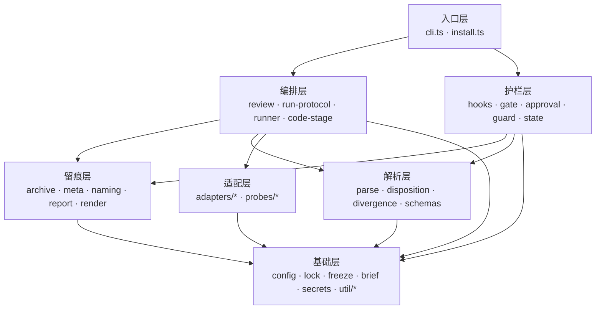
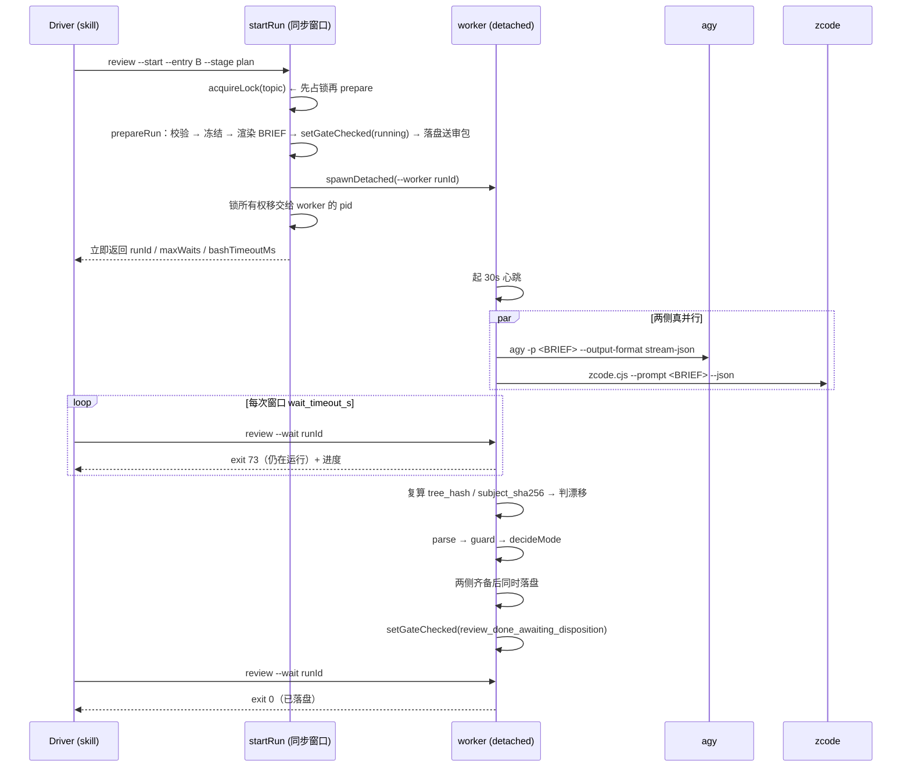
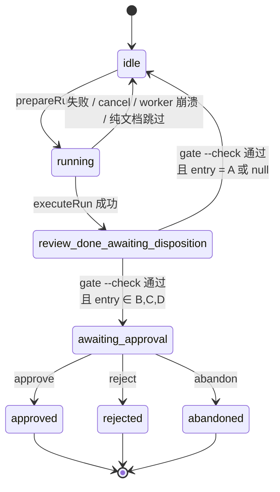

# LLD：TriviumCode 编排器详细设计说明书

> - **作者 / 负责人**：Driver（Claude）
> - **创建日期**：2026-09-13
> - **当前版本**：v1.1.55
> - **状态**：草稿(Draft)
> - **变更说明**：v1.1.55（2026-10-08）随设计 v1.3.138（M11 第 10 步第一批：`P-xx` 本机坑清单搬家，EV-13）同步：「八、往下读」的坑清单条目改指 `doc/04_development/GUIDE_local_pitfalls.md`，M0 探针报告只作 C-xx 冲突项的出处；原句「18 个实测坑」是 M0 当时的计数，一并去掉。
> - **变更说明**：v1.1.54（2026-10-08）随设计 v1.3.135（M11 第 7 步：复盘报告按 Driver 与审核者两个维度聚合）同步：模块表 `report.ts` 补「原稿与裁决件按该轮 run.json 的 driver 排除 / 定位，双维度聚合与第四节思考等级两列（设计 13.2.1）」；`meta.ts` 补「`readRunMetaDetailed` 成功分支带 `sourceSchema`，供复盘标出 run.v1 迁移轮次」；`report.ts` 行的入口名由 `buildReport()` 改准为 `buildTopicReport()`（旧错，代码三审 AGY-03）。行数列未重核。
> - **变更说明**：v1.1.53（2026-10-08）随设计 v1.3.133（M11 第 6 步：思考等级透传与留痕接线）同步：3.3 准备阶段补「可用性检查之前逐侧解析一次档位（`resolveTier`），同一结果喂可用性检查的厂商 profile 与请求构造」；模块表 `adapters/base.ts` 补必填钩子 `effortReadback`（生效思考等级只从回读结果派生）与 `availability` 的可选入参 `vendorProfiles`；`probes/claude.ts` 补 `effort_levels`（零配额解析 `--help`）。行数列未重核。
> - **变更说明**：v1.1.52（2026-10-08）随设计 v1.3.132（M11 第 5 步：档位命令行旗标）同步：模块表补 `tier-flags.ts`（三类档位旗标的收集、键校验、取值校验与合并，`cli.ts` / `topic-args.ts` 共用；键判定参数化后仍住在 `critics.ts` 的 `assertCriticFlagKeys`）；`cli.ts` 行补一句。行数列未重核。
> - **变更说明**：v1.1.51（2026-10-07）随设计 v1.3.131（M11 第 4 步：配置契约与档位解析）同步：3.3 必读交集校验一段里「排在逐侧 `routeModel` 的 69 之前」改为档位解析（`resolveTier`，原 `routeModel` 已删），并注明那条 69 对同一输入不可达；准备阶段在 slug 校验之后新增「档位组合合法」一格（`preflight.ts` `checkTierCombos`）。行数列未重核。
> - **变更说明**：v1.1.50（2026-10-07）随设计 v1.3.128（复盘面失守旗标分档，EV-224）同步：模块表 `report.ts`、`meta.ts` 两行补一句——失守旗标与 `summarizeRun` 的失守一行改调 `gate.ts` 的 `readonlyBreachLabel`。未走双审。行数列未重核。
> - **变更说明**：v1.1.49（2026-10-06）随设计 v1.3.127（只读失守未确证改动放行，EV-223）同步：「待裁决闸门的只读失守文案」小节补判据单点——失守组只收 `gate.ts` 的 `classifyReadonlyBreach` 判确证的那一格，复算无变化或比不了的失守轮归未见失守组、出原文案；快照漂移改调 `confirmedDriftText()`。行数列未重核。
> - **变更说明**：v1.1.48（2026-10-06）随设计 v1.3.126（补丁排除不受 pathspec 环境变量影响，EV-222）同步：3.3「`executeRun()` 的漂移复算」补「魔法 pathspec 钉住解释方式」一段，EV-221 那段「钉 `GIT_LITERAL_PATHSPECS=0`」补指向。未走双审。行数列未重核。
> - **变更说明**：v1.1.47（2026-10-06）随设计 v1.3.125（工作树哈希排除归档根与 `.trivium/`、文件中途消失时重试，EV-221）同步：3.3「`executeRun()` 的漂移复算」补工作树哈希的排除来源、pathspec 写法与重试；模块表 `util/git.ts` 行补一句。本批未走双审。行数列未重核。
> - **变更说明**：v1.1.46（2026-10-06）随设计 v1.3.124（运行目录跨主题同秒避让，EV-218）同步：「`run_id` 生成」一段补运行目录的排他占用、测试开关与落盘前失败的清理。本批未走双审。
> - **变更说明**：v1.1.45（2026-10-06）随设计 v1.3.116（建议命令里的主题名统一转义，EV-195）同步：模块表 `naming.ts` 行补 `shellQuoteArg()`。本批未走双审。行数列未重核。
> - **变更说明**：v1.1.44（2026-10-06）随设计 v1.3.115（失联取消两格退 69，EV-177 ② 补）同步：4.2「`cancelRun` 结束失联后仍挂着的 worker」引述块的退出码一句补上 `mismatch` / `no_identity` 两格也以 69 退出。本批未走双审。
> - **变更说明**：v1.1.43（2026-10-06）随设计 v1.3.106（回收遗留锁时收尾上一轮，EV-151）同步：4.3「告警」条之后新增「回收之后」一条（`LockHandle.reclaimed`、`settleReclaimedRunLocks` 的过滤与收尾、同步路径的 `onRunIdAllocated`）；前台中断转发一条、4.2「仍会停在 `running` 的」与已知缺口表 `cancelRun` 一行里指向 EV-151 的半句改准。本批未走双审。行数列未重核。
> - **变更说明**：v1.1.42（2026-10-06）随设计 v1.3.105（失联取消未确认退 69，EV-177 ②）同步：4.2「`cancelRun` 结束失联后仍挂着的 worker」引述块的退出码改为「确认退出退 0、`alive` 格未确认退出 69」；已知缺口表「失联后取消与主路径的口径差」行改为两处都已收口。本批未走双审。
> - **变更说明**：v1.1.41（2026-10-06）随设计 v1.3.104（留痕读不出的成因，EV-04）同步：模块表 `meta.ts` 行补 `readRunMetaDetailed()`（带成因四档的读取，`readRunMeta()` 改为调它、返回值不变）。本批未走双审。行数列未重核。
> - **变更说明**：v1.1.40（2026-10-06）随设计 v1.3.102（前台中断结束审查员 CLI，EV-155）同步：worker 节「SIGTERM 处理器」之后新增「前台中断转发」一条（`installForegroundInterruptForwarding` 的装点、只处理第一次、无登记树等同缺省处置、第二次信号直接退出、不收留痕）。本批未走双审。行数列未重核。
> - **变更说明**：v1.1.39（2026-10-06）随设计 v1.3.101（失联取消判不了不升级，EV-177 ①）同步：已知缺口表「失联后取消与主路径的两处不同口径」改为 ① 已收口（`cancelLostWorker` 的 `isGone` 改用三态的 `lostWorkerGoneJudgment`），只剩 ② 未确认退 0。本批未走双审。
> - **变更说明**：v1.1.38（2026-10-06）随设计 v1.3.96（run_id 同秒避让，EV-147）同步：「`run_id` 生成」一段补 `allocateRunId` 的避让判据与「run_id 不再保证等于开始时刻」，锚点随 `meta.ts` 加一行导入改为 :37；模块表 `meta.ts` 行补 `allocateRunId()`。本批未走双审（v1.1.38 这一笔随 EV-147 改了正文、当时漏记，v1.1.39 时补记）。行数列未重核。
> - **变更说明**：v1.1.37（2026-10-05）随设计 v1.3.91（目标回退取计划定稿，EV-212）同步：3.3 计算段那一段补任务目标第三级的取件——`resolveTaskGoal` 第 4 个必填参数「怎么取计划定稿」，代码阶段传已算好的 `resolvePlanFinal` 结果、bug 阶段第三级走到时现算，留痕读不出时不取、告警丢弃。行数列未重核。
> - **变更说明**：v1.1.36（2026-10-05）随设计 v1.3.90（计划定稿复核，EV-215）同步：3.4「计划定稿校验」之后新增「代码阶段复核」一段（`acceptedIdsForNextPlan` 与两个小函数为闸门与复核共用、`recheckPlanFinal` 的四种结论、`planFinalRecheckWarning` 与 `composeMustReadWarnings`）。行数列未重核。
> - **变更说明**：v1.1.35（2026-10-05）随设计 v1.3.89（计划定稿强制产出，EV-214）同步：3.4「`gate --check` 的失败码」表补 `missing_next_plan` / `next_plan_missing_ids` 两个失败码与 `next_plan_unchecked` 告警，其后新增「计划定稿校验」一段（`checkNextPlan`、必填可为 null 的 `planFinal`、`loadRoundReviews` 派生、基准轮次与核对哪一份、`prepareRun` 写 `plan_final_check`）。表头「11 个失败码」与行数列未重核。
> - **变更说明**：v1.1.34（2026-10-05）随设计 v1.3.88（任务目标全文送审，EV-210）同步：3.3「`prepareRun()` 的『零工件』不变式」段补计算段的两步（代码阶段 `resolvePlanFinal` 解析本主题计划定稿并交给 `buildMustReadList` 的第五个参数；`taskGoalAppendix` 判定计划阶段附录原文，与 `taskGoal` 一样只算一次、各侧共用）与渲染接线的第三个必填入参 `taskGoalAppendix`；计划定稿没能列入的告警并进 `rc.mustReadPruned` 与 `gate.warnings`。行数列未重核。
> - **变更说明**：v1.1.33（2026-10-02）随设计 v1.3.77（收工闸门文案区分只读失守，EV-98 文案部分）同步：3.x「`hook-stop` 的三层防死循环」之后新增「待裁决闸门的只读失守文案」一小节（`splitByBreach` / `breachLines`、按闸门项 `run_id` 直读、处置句与 `gate --check` 共用 `READONLY_BREACH_TRIAGE`）。行数列未重核。
> - **变更说明**：v1.1.32（2026-10-02）随设计 v1.3.76（任务书点名禁用MCP执行工具，EV-191 缓解①）同步：2.6 `adapters/base.ts` 行补可选声明 `mcpExecPrefixes`；3.3 渲染接线句补第二个必填入参 `mcpExecPrefixes`（取 `adapters[critic].mcpExecPrefixes ?? []`，非空时第 7 节多一条点名禁令）。行数列未重核。
> - **变更说明**：v1.1.31（2026-10-02）随设计 v1.3.75（MCP执行工具调用检测，EV-188）同步：2.5 表 `guard.ts`、`adapters/zcode-trace.ts` 两行的行数与职责（证据不可信档位与归因分流；MCP 调用的计数、两档分类与按调用 id 合并）。两行的旧行数（225 / 300）早已失实，本次按现行源码改准；同表其余各行未逐一核。
> - **变更说明**：v1.1.30（2026-10-02）随设计 v1.3.74（审查侧实测措辞约束，EV-95 前半）同步：2.6 `adapters/base.ts` 行补「命令执行能力声明（`CommandExecution`，挂 `CriticAdapter.commandExecution`）」；3.3「`prepareRun()` 的『零工件』不变式」段末补一句渲染接线（`renderBrief` 的必填入参 `commandExecution` 取入选侧适配器的声明，第 7 节据此二选一）。本文其余各节不涉及任务书各段的正文，不改。
> - **变更说明**：v1.1.29（2026-10-02）随设计 v1.3.73（必读与禁读交集校验，EV-02）同步：`startRun` 第 4 条补第三个只警告项来源（`rc.mustReadPruned`，追加在 `collectWarnings` 结果之后）；`prepareRun()` 零工件段补「逐侧冻结之后、`--context` 交集校验（撞上即退 64）、再逐侧剔除自动条目与渲染」的三段次序；代码双审后补全量 / 封顶两份告警与跳过轮留痕。
> - **变更说明**：v1.1.28（2026-10-01）随设计 v1.3.71（留痕读不出的出口，EV-148 文案部分）同步：3.5 `hook-pre-write` 第 2 条补「该阶段留痕读不出 ⇒ deny、出口用共用段」一句（此前只写了判定来源）。本文其余各节核过不讲这几处的出口文案（`gate` 读不出与 `approve` 通过前复核在本文没有展开，4.1 只画闸门迁移），不改。
> - **变更说明**：v1.1.27（2026-10-01）随设计 v1.3.70（漂移比不了不放行，EV-139）同步：3.3「`executeRun()` 的漂移复算」补比不了的那一格（形状闸、严格比对、分原因、`unknown` 的处置与四个人读面、`prune_objects` 桩）；退出码判定优先级补 `unknown` 落进 `driftAction==='fail'`
> - **变更说明**：v1.1.26（2026-10-01）随设计 v1.3.68（解析回退逐条降级，EV-10 / EV-56 / EV-105 / EV-113 / EV-124）同步：3.4 的「`parse_fallback`：有原文、没结构」一段改写为两档（逐条降级 / 整份回退），补两类无损修复、覆盖才替换、成因、留痕面与 gate 重试三分；2.5 表 `parse.ts` 行数与职责。代码双审 r1 修订：完整性校验第三参改为降级意见本身（evidence 核对并入）、`judgeSide` / `judgeRun` 字段改名 `degraded`；F 单元在对象拿得到时按意见逐条出。
> - **变更说明**：v1.1.25（2026-09-30）随设计 v1.3.67（取消宽限期判不了仍放锁，EV-176）同步：4.2「`cancelRun` 主路径判不了身份」引述块末段改为入口之后才判不了的处置（`terminateProcessGroup` 三态 `isGone`、首检判不了零信号、期满判不了不升级、SIGKILL 后等确认、未确认 69 不收尾）；「按记录结束审查员 CLI」引述块的触发格补「扣下 SIGKILL」；已知缺口表「`--cancel` 发过 SIGTERM 之后、宽限期里 `ps` 转坏仍回收锁」一行改为已解决，新增「失联后取消与主路径的两处不同口径」一行（EV-177，暂缓）；2.7 表 `util/exec.ts`、`run-protocol.ts` 行数与职责。
> - **变更说明**：v1.1.24（2026-09-30）随设计 v1.3.66（取不到启动时刻当不在，EV-175）同步：4.2 新增「`cancelRun` 主路径判不了身份」引述块（`RecordMatch.identity` 三态、五处处置、69 与手工出路）；已知缺口表「其余身份消费方把『活着而取不到启动时刻』当『不在』」一行改为已解决，新增「SIGTERM 之后宽限期里 `ps` 转坏仍回收锁」一行（EV-176，暂缓）；2.7 表 `util/exec.ts`、`lock.ts` 行数与职责。
> - **变更说明**：v1.1.23（2026-09-30）随设计 v1.3.65（并发写闸门偶发红，EV-153）同步：4.3 判据表 `pid_reused` 一行改为「取到了启动时刻且不符」并写明取不到时的去向（终态与年龄判据、耗满预算即 70）；已知缺口表新增「其余身份消费方把『活着而取不到启动时刻』当『不在』」一行（EV-175，暂缓）；2.7 表 `lock.ts` 行数。
> - **变更说明**：v1.1.22（2026-09-30）随设计 v1.3.64（锁回收误判已删锁文件，EV-173 / EV-149）同步：4.3 判据表 `unparsable` 一行改为「文件**存在**而内容读不出」并补「撞 EEXIST 后文件已不存在 ⇒ 立刻重试」；回收一段改写为「预检 → 按身份认领 → 复查 → rename → 复验 → 删除、放回用 link、告警在真回收之后」，写明身份三元组与适用面；2.7 表 `lock.ts` 行数与职责；已知缺口表新增「遗留锁回收仍可能挪走活锁的剩余格」一行（EV-174，暂缓）。
> - **变更说明**：v1.1.21（2026-09-29）随设计 v1.3.63（门面文档版本指针，EV-167）同步：第一章的规模基准句不再写死模块数与行数（原写的数字停在起草时，`79d2ed4` 上 `src/` 已是 69 个文件、42561 行），改为「随代码变、以 `src/` 为准」；其余不变。
> - **变更说明**：v1.1.20（2026-09-29）随设计 v1.3.62（临界区锁超时下限，EV-161）同步：4.3 判据表 `heartbeat_dead` 一行补「短临界区的持有超时取 `max(阈值, 30 s)`（`criticalHoldTimeoutMs`）」；已知缺口表「短临界区锁的持有超时借用 `heartbeat_stale_s`」一行改为已解决；2.7 表 `lock.ts` 行数与职责。
> - **变更说明**：v1.1.19（2026-09-29）随设计 v1.3.61（清扫帮助主句失实，EV-166）同步：已知缺口表「`trivium scrub` 人读提示里『或等 run_dir_days 整删』半句失实」一行补注——帮助动机句的主句「副本会一直躺到 retention.run_dir_days 整删」另有失实成因（整删只在该仓库自己的会话启动时跑），v1.1.19 起改写为「到期整删也只在它的会话启动时跑…不再回到那个仓库就没有任何自动清理」；只改文字，判据与行为不变。
> - **变更说明**：v1.1.18（2026-09-29）随设计 v1.3.60（组长已退组员仍在的准入，EV-165）同步：275 行 `CliGroupVerdict` 补 `orphaned` / `orphan_unverifiable` 两态；287 行与 487 行「`--cancel` 引述块」改为对 `alive`/`orphaned` 都发信号、准入与 `settledCliSides` 已收口；已知缺口表 602 行「组长已退出而组员还在」的如实保留措辞改为「已收口」、604 行「凭据准入对『组长已退出、组员仍在』的组放行」改为已解决，新增「worker 存活期间自身子进程退出盲区」与「`processGroupMemberCount` 僵尸排除无专门测试」两行暂缓。
> - **变更说明**：v1.1.17（2026-09-29）随设计 v1.3.59（清扫输出失实文字，EV-164）同步：已知缺口表「`trivium scrub` 人读提示里『或等 run_dir_days 整删』半句失实」一行改为已解决（提示行与帮助动机句改准，其余输出逐字不变）；判据与行为不变。
> - **变更说明**：v1.1.16（2026-09-29）随设计 v1.3.58（取消与失联的凭据准入核CLI，EV-157）同步：`waitRun` 判失联一段的凭据准入改经 `scrubAdmission`（工作进程一半 + CLI 一半），被 CLI 挡住时报错正文多一行、记录留存；4.2 `cancelRun` 两处引述块改为准入经 `scrubAdmission`、判在按记录结束之后、归档收尾只看工作进程一半；已知缺口表「`--cancel` / `--wait` 自己的凭据准入与到期整删不核审查员 CLI」一行改为已解决，新增「到期整删的工作进程一半对终态而仍活的工作进程照删」（EV-163，暂缓）与「`trivium scrub` 提示里『或等 run_dir_days 整删』半句失实」（EV-164，待用户定）两行。代码双审 r1 修订：`waitRun` 一段补 `--cancel` 出口句；`cancelRun` 引述块补「准入只按组长判、与 `settledCliSides` 有意分叉」；已知缺口表补 EV-157 残余（孤儿 CLI 继续用凭据烧配额）与 EV-165 一行，EV-164 一行的登记面扩到 `trivium scrub --help` 的动机句。
> - **变更说明**：v1.1.15（2026-09-29）随设计 v1.3.57（心跳阈值事前告警，EV-160）同步：`startRun` 第 4 条补「派生前的只警告项复查」（副本源与失联阈值同一次 `collectWarnings`）；4.2「失联后取消」引述块的心跳间隔改指 `status.ts` 的 `WORKER_HEARTBEAT_MS` 与共享判据 `staleThresholdWithinHeartbeat`；已知缺口表「`heartbeat_stale_s` 不大于 worker 心跳间隔时事前不告警」一行改为已解决，新增「短临界区锁的持有超时借用失联阈值」一行（如实保留，BACKLOG 另登）。
> - **变更说明**：v1.1.14（2026-09-28）随设计 v1.3.56（失联worker退出后补收，EV-159 第一形态）同步：4.2「失联后取消」引述块补 `gone` 格补收（`finalizeLostAndReclaimLock` 共用函数、`classifyLostCancel` 的 `no_identity` 收窄）；「仍会停在 `running` 的」一句改准；已知缺口表 EV-159 行改为「第一形态已修、第二形态暂缓」。
> - **变更说明**：v1.1.13（2026-09-28）随设计 v1.3.55（worker启动时刻规范化，EV-158）同步：`startRun` 第 6 条补两种启动时刻与 `workerLockContent`；4.2「失联后取消」引述块的判格改经 `processMatchesRecord`、`mismatch` 带比对依据；已知缺陷表「`worker_started_at` 对 TZ / 区域设置敏感」一行改为已解决（残余：升级窗口、回滚）；
> - **变更说明**：v1.1.12（2026-09-28）随设计 v1.3.54（失联后取消挂住的worker，EV-146）同步：4.2 补「`cancelRun` 结束失联后仍挂着的 worker」引述块（`lost` 字段、`classifyLostCancel` 判格、`cancelLostWorker` 五步、`mismatch` / `no_identity` 两格的如实结论）；「仍会停在 `running` 的」一句改准；已知缺口表 EV-158 行后果栏补本格的错配形态，新增 EV-159、EV-160 两行
> - **变更说明**：v1.1.11（2026-09-28）随设计 v1.3.53（CLI进程组记录，EV-154 / EV-38）同步：`startRun` 第 5 条末句改为「被 SIGKILL 时由 `--cancel` 按 CLI 进程组记录另行结束」；worker 主体一节补「CLI 进程组记录」（`liveTrees` 条目补侧归属与规范化启动时刻、唯一观察者、投影写进 `sides[c].cli`、`runOneSide` 的 `withTreeTag`）；`cancelRun` 一节补按记录结束 CLI 的三处调用点与收尾清记录；已知缺口表「worker 被 SIGKILL / 崩溃 / 事件循环堵住」一行改为已覆盖并列出余项，新增「`--cancel` / `--wait` 的凭据准入与到期整删不核 CLI」「`worker_started_at` 对 TZ / 区域设置敏感」两行
> - **变更说明**：v1.1.10（2026-09-28）随设计 v1.3.52（取消够不到审查员CLI，EV-152）同步：`startRun` 第 5 条末句改为「由 worker 的 SIGTERM 处理器转发、被 SIGKILL 时够不到」；worker 主体一节补 SIGTERM 处理器（冻结经 `run()` 的链路、并行按组终止 `liveTrees` 登记的 CLI、以 SIGTERM 重新自杀、`exitOnce` 防重入与看门狗、`finally` 卸载）与「worker 侧新增 `run()` 调用者须知晓冻结语义」的约定；已知缺口表「`--cancel` 够不到」一行改为「worker 被 SIGKILL / 崩溃 / 事件循环堵住时够不到」（EV-154）并新增「取消落在收尾段时归档可能不是 `cancelled`」一行。真实厂商 CLI 对 SIGTERM 的处置未实测
> - **变更说明**：v1.1.9（2026-09-27）随设计 v1.3.51（派生后失败的孤儿worker，EV-150）同步：`startRun` 第 5 条补 `onSpawned` 的第二个参数（子进程句柄的退出观察），末句「`--cancel` 才能按进程组杀掉 agy/zcode」改准（适配器以 `killTree` 拉起的厂商 CLI 自成进程组，够不到，EV-152）；第 7 条「诞生之后才失败的不收尾」改为 `settleOrphanedStart` 的六步；4.2 引述块「仍会停在 `running` 的」去掉 EV-150 那一格、补「确认不了退出」一格；已知缺口表 `cancelRun` 一行补 EV-150 已修，新增「`--cancel` 够不到适配器拉起的厂商 CLI」一行（EV-152）；`startRun` 一节的四处行号锚点按修订后代码校准（其余章节的锚点仍有漂移，未改）。
> - **变更说明**：v1.1.8（2026-09-27）随设计 v1.3.50（事后收尾余项，EV-145）同步：`startRun` 第 5 条补 `spawnDetached` 的可选回调 `onSpawned`（拿到 pid 后调用，调用方据此区分子进程是否已诞生）与 `'error'` 监听前移；第 7 条补「子进程诞生之前失败的，回收闸门之后先把骨架收尾为 `failed` 再放锁」；零工件不变式段末句改为收尾；4.2 引述块「仍会停在 `running` 的」改准（纯文档跳过分支只有终态写入本身失败才会停在 `running`）；已知缺口表一行指向 EV-150 / EV-151。代码双审 r1 修订：第 5 条补 pid 缺失时成因进报错与 `worker.log`（CODEX-01）；4.2 引述块补「放锁前新 `--start` 退 70」并改准「够不着」的措辞（CODEX-02 / CODEX-05）；`startRun()` 与 `prepareRun()` 两节的行号锚点按现值校准并附函数名（CODEX-03 ≡ AGY-01 ≡ GLM-01）。
> - **变更说明**：v1.1.7（2026-09-27）随设计 v1.3.49（闸门拦截不留骨架，EV-109 / EV-145 ①）同步：`startRun` 时序图里 `setGateChecked(running)` 挪进 `prepareRun`、排在落盘送审包之前；`startRun` 第 2 条补「闸门由 `prepareRun` 自己回收」；零工件不变式补「置闸门是落盘之前的最后一步」一段；4.2 引述块里「prepare 阶段写完骨架后被拦」移出仍会停在 running 的列举；代码双审 r1（run `20260927T035514Z`）CODEX-04：同一列举补上 `startRun` 纯文档跳过分支里 `executeRun` 抛错这一格
> - **变更说明**：v1.1.6（2026-09-27）随设计 v1.3.48（未收尾运行的留痕与复盘可见性，EV-142 / EV-144）同步：4.2 `worker_lost` 一节补归档侧收尾（改写 status.json 之前判确认退出、status.json 读不到时按 worker.pid 判、`termination`、`WORKER_LOST_REASONS` 单一来源）；「同形两处仍未写」改为已修，函数体改名 `finalizeUnfinishedRunMeta`、第一步进主题任务锁；剩余未收尾路径指向 EV-145。代码双审 r1（run `20260927T005543Z`）CODEX-02：同段「三判据」的行号改为现值（`status.ts:205-249`，常量 `:187`）
> - **变更说明**：v1.1.5（2026-09-26）随设计 v1.3.47（留痕字段与误报小修）同步：「`cancelRun` 不回写 `run.json`」两处由已知缺口改为已修（EV-128，`meta.ts` `finalizeCancelledRunMeta`），保留 worker 异常与 `worker_lost` 同形两处仍未写的说明（EV-142）；旧的 `run-protocol.ts:680` 链接改准
> - **变更说明**：v1.1.4（2026-09-26）随设计 v1.3.46（审批前工作树摘要，EV-132 候选 ② 折中版）同步：模块表登记 `worktree-summary.ts`；`util/git.ts` 补两个失败即抛的严格助手
> - **变更说明**：v1.1.3（2026-09-26）随设计 v1.3.43 的 M10b 第 5 步纪律 6 回溯同步：2.6「当前边界」的「别家在自己的 CLI 里执笔在 M10b」改为已落地，指向主设计 7.4.1 与 8.5；Bash 侧保护集一节「删掉 wrapper 即永真放行」改准为「删掉或去掉执行位保守拦截，内容被替换才永真放行」（第 5 步 grep 锚的守卫措辞一族核出）。
> - **变更说明**：v1.1.2（2026-09-24）随设计 v1.3.37 的 M10a 第 5 步纪律 6 回溯同步：2.6「当前边界」的 `driverEnabled` 现状句改准——M10a 第 3 步起四家均为真，`--driver` 取未启用值退 64；补 `topic claim` 按阶段声明一句。
> - **变更说明**：v1.1.1（2026-09-20）随[设计 v1.3.30](./2026-09-10-Driver-DualCritic主攻双审流水线设计.md) 的 M9 第 7 步纪律 6 回溯同步：
>   2.6 的「当前边界」由「只启用两家审核者」改准为四家全部 `criticEnabled`（codex 随 M8 第 3 步、claude 随 M9 第 4 步），
>   `driverEnabled` 仍只对 `claude` 为真、`--driver` 自 M9 第 5 步可声明其他家；Hook 伪造审查文件判据由
>   「`-（gemini|glm）.md`」改准为注册表派生的「全集减当轮 Driver」（M7a 派生、M9 EV-68 起随留痕 `driver`）。
>   两处都是 grep 差集自检捞出的过期现状句，不改本文其余部分。
> - **变更说明**：v1.1.0（2026-09-14）随[设计 v1.3.0](./2026-09-10-Driver-DualCritic主攻双审流水线设计.md) 的规范链回溯同步：
>   2.6 适配层新增 `agents/registry.ts`（M7a 引入的 Agent 注册表，全部 Agent 差异的唯一登记处），
>   并写明**M7a 是行为等价重构**的边界——登记四家但只启用两家审核者与一个 Driver，
>   避免读者据模块存在推断系统已支持四家。本文其余部分描述的仍是当前真实代码路径。

---

## 一、本文的定位与边界

这套系统已有三份规范性文档，本文是第四份，**只补它们不讲的那一层**：

| 文档 | 回答的问题 | 本文与它的关系 |
| :--- | :--- | :--- |
| [设计文档](./2026-09-10-Driver-DualCritic主攻双审流水线设计.md) | **为什么这么设计**（唯一实现依据，19 万字） | 本文不重述决策依据。冲突时以设计文档为准 |
| [PROTOCOL_dual_critic_relay.md](../03_api/PROTOCOL_dual_critic_relay.md) | **对外契约是什么**（四份 Schema、BRIEF 八段、漂移算法、退出码） | 本文不重述契约，只讲契约在代码里的落点 |
| [QUICKSTART.md](../07_manuals/QUICKSTART.md) / [MANUAL_user.md](../07_manuals/MANUAL_user.md) | **怎么用** | 本文不讲用法 |
| **本文** | **代码怎么组织、一次调用实际怎么走** | — |

读者假定：知道这套系统是干什么的，但没读过代码，要来维护或修改它。

规模：模块数与行数随代码变，本文不写死（不含测试，以 `src/` 为准）。运行期零第三方依赖——`ajv` 与 `yaml` 在构建时被 esbuild 打进单文件产物。

---

## 二、分层模块地图

依赖方向自上而下，**下层不得反向依赖上层**。



### 2.1 入口层

| 模块 | 行数 | 职责 | 关键导出 |
| :--- | ---: | :--- | :--- |
| `cli.ts` | 1058 | 子命令分发、argv 解析、退出码转换。**无单元测试**，仅由集成测试以子进程形式覆盖。档位旗标（M11 第 5 步）经 `tier-flags.ts` 收集与判定 | `main()` |
| `tier-flags.ts` | — | 档位命令行旗标 `--tier-<id>` / `--effort-<id>` / `--profile-<id>`（M11 第 5 步）：收集面为全部已登记 Agent；键判定与 `--model-<id>` 同一份（`critics.ts` `assertCriticFlagKeys`）；`--profile-<id>` 只对实现 `vendorProfilesFor` 钩子的侧成立；`mergeCliOverrides` 是模型覆盖与三类旗标逐侧合并的唯一实现 | `tierFlagNames()`、`collectTierFlags()`、`assertTierFlags()`、`mergeCliOverrides()`、`vendorProfileAgents()` |
| `install.ts` | 217 | 把 `skills/*` 同步到 `~/.claude/skills/`，裁剪孤儿文件，拷只读 Agent 定义 | `runInstall()` |

`cli.ts` 的 `USAGE` 常量（第 87 行起）是命令契约的人读版本，改命令必须同步改它。

### 2.2 编排层

| 模块 | 行数 | 职责 | 关键导出 |
| :--- | ---: | :--- | :--- |
| `review.ts` | 1060 | 一次运行的准备与执行 | `prepareRun()` `executeRun()` `runReview()` |
| `run-protocol.ts` | 2004 | 长时调用协议：`--start` / `--worker` / `--wait` / `--status` / `--cancel` | `startRun()` `workerMain()` `waitRun()` `cancelRun()` |
| `runner.ts` | 246 | 两侧真并行、瞬时重试、降级模式决策 | `runBothSides()` `decideMode()` `isTransientFailure()` |
| `code-stage.ts` | 261 | code 阶段的补丁头部构造与解析 | `buildDiffHeader()` `parseFrozenDiff()` |

`review.ts` 拆成 `prepare` 与 `execute` 两段，是因为 worker 进程**绝不重新 prepare**——重新冻结会算出与送审包不一致的哈希。

### 2.3 护栏层

| 模块 | 行数 | 职责 | 关键导出 |
| :--- | ---: | :--- | :--- |
| `hooks.ts` | 1041 | 五个 Claude Code Hook 入口的全部判定逻辑。**全仓最大的文件** | `hookPreWrite()` `hookPreBash()` `hookPreCommit()` `hookStop()` `hookSessionStart()` |
| `gate.ts` | 476 | 裁决完整性硬校验（11 个失败码）、共同 blocker 判定 | `checkAdjudication()` `findJointRejectedBlockers()` |
| `approval.ts` | 138 | 人工审批的状态迁移与留痕 | `recordApproval()` |
| `worktree-summary.ts` | 290 | 审批时的工作树改动摘要（EV-132 候选 ② 折中版）：以 `snapshot.after_tree_hash` 为基线比当前工作树，**只告知、不进任何判定、不抛错**（失败转原因之一），基线先过对象名形状闸，20 秒整体截止 | `summarizeWorkTree()` `renderWorkTreeSummary()` |
| `guard.ts` | 1080 | 只读失守 / 证据下限 / 泄漏 / 漂移的**判定**（不做处置）；核验档位含证据不可信（`SideVerification.untrusted`，v1.1.31），它与 MCP 执行型写事件一起参与漂移归因分流（`RunVerdict.unattributedCauses`） | `judgeRun()` `judgeSide()` |
| `state.ts` | 300 | 闸门状态机、`state.json` 的读改写 | `setGateChecked()` `listOpenGates()` `shouldLockWrites()` |

`guard.ts` 只判定不处置，处置交给 `gate` 与失败策略——这条分工写在文件头注释里。

### 2.4 留痕层

| 模块 | 行数 | 职责 | 关键导出 |
| :--- | ---: | :--- | :--- |
| `archive.ts` | 550 | 防覆盖落盘、最低工件集校验、sha256 核对、**运行清单读侧按阶段分发**（设计 6.7.1） | `writeArtifact()` `checkRecordedArtifacts()` `checkRunManifests()` `runManifestProblem()` |
| `meta.ts` | 382 | `run.json`（`trivium.run.v2`）与主题级任务档的构造与更新；`summarizeRun` 的失守一行同样按 `readonlyBreachLabel` 分档（v1.1.50 / EV-224）；**读侧按 schema 分发与 v1 → v2 内存迁移**；`readRunMetaDetailed` 成功分支带落盘原件的 `sourceSchema`，供复盘标出 run.v1 迁移轮次（v1.1.54） | `newRunId()` `allocateRunId()` `writeRunMeta()` `readRunMeta()` `readRunMetaDetailed()` `migrateRunMetaV1()` `updateTask()` `readTaskStrict()` |
| `naming.ts` | 142 | 文件名生成与反解析（纯函数，不碰文件系统） | `buildArtifactName()` `parseArtifactName()` `validateTopic()` `shellQuoteArg()` |
| `report.ts` | 556 | 人读复盘生成；只读失守旗标按跑后复算分档（`gate.ts` 的 `readonlyBreachLabel`，v1.1.50 / EV-224）；原稿与裁决件按该轮 run.json 的 `driver` 排除 / 定位，无 run.json 的轮次号先按内容谓词 `isReviewArtifact` 判；按 Driver 与按审核者两维聚合、第四节思考等级请求 / 生效两列（缺席与 null 分写，生效列只读回读字段）（设计 13.2.1，v1.1.54） | `buildTopicReport()` `renderTopicReport()` `aggregateByDriver()` `aggregateByCritic()` |
| `render.ts` | 253 | 审查文档的 Markdown 渲染（参与者事实与降级警示分两处标注） | `renderReviewDoc()` |

### 2.5 解析层

| 模块 | 行数 | 职责 | 关键导出 |
| :--- | ---: | :--- | :--- |
| `parse.ts` | 519 | 从厂商 stdout 里抠出审查结论并按 schema 校验；校验前两类无损修复（剥厂商与回显根字段、还原非法转义），根合法时逐条降级不合格意见，整份回退标成因（v1.1.26） | `parseReview()` `extractJsonCandidates()` `repairInvalidEscapes()` `checkReviewIntegrity()` `enumerateFallbackFindings()` |
| `disposition.ts` | 248 | 裁决表解析与三态归一 | `parseDisposition()` `normalizeDisposal()` |
| `divergence.ts` | 202 | 多审退化指标（镜头重合度 Jaccard，按入选集合逐对计算） | `measureDivergence()` `measureAllPairs()` |
| `schemas.ts` | 212 | 五份 schema 的 ajv 编译与缓存（`review.v1` 由 `parse.ts` 自持）；`run.v2` 与 `config.v2` 另在 ajv 之后按注册表补校 Agent 身份与跨字段规则——id 与 vendor **不在 schema 里枚举**（纪律 7：抄第二份来源就会改一漏二） | `validateRunMeta()` `validateRunMetaV1()` `validateConfig()` |

### 2.6 适配层

| 模块 | 行数 | 职责 |
| :--- | ---: | :--- |
| **`agents/registry.ts`** | — | **全部 Agent 差异的唯一登记处**（M7a 引入，`039bdc9`）。`AgentDescriptor` 登记四家（`claude` / `codex` / `gemini` / `glm`）的 id、显示名、vendor、归档后缀、意见前缀、`criticEnabled` / `driverEnabled`、护栏等级与协议片段落点；归档后缀、意见前缀、配置键、探针段、镜头键、**禁读矩阵**、Hook 字面集一律由它派生。`test/unit/registry-parity.test.ts` 以 grep 级对账守着「除本文件与各适配器外，任何模块不得出现具体 Agent id / 后缀 / 前缀字面量」 |
| `adapters/base.ts` | 164 | 适配器契约（含轨迹能力 `TraceCapability` 与命令执行能力 `CommandExecution` 两项声明，另有可选的执行型 MCP 前缀声明 `mcpExecPrefixes`，v1.1.32；必填钩子 `effortReadback(result)`——生效思考等级只从回读结果派生、入参拿不到请求值，`availability(ctx, { vendorProfiles })` 按本轮解析出的厂商 profile 判，v1.1.53）、证据下限判定、泄漏判定 |
| `adapters/agy.ts` | 314 | Antigravity CLI 的 argv 构造与结果解析 |
| `adapters/zcode.ts` | 331 | ZCode CLI 同上，外加 `HOME` 副本的模型覆盖与 0.16.9 provider 配置环境变量注入（P-28，存在性门控） |
| `adapters/agy-events.ts` | 176 | agy 的 `stream-json` 事件流解析（工具轨迹来源） |
| `adapters/zcode-trace.ts` | 474 | ZCode 的会话日志 + rollout 双文件轨迹解析；MCP 调用的计数与两档分类（v1.1.31，设计 v1.3.75 / EV-188：执行型名单 `ZCODE_MCP_EXEC_PREFIXES`、日志侧 `mcpCalls` / `mcpCallIds`、两边按调用 id 合并的 `summarizeZcodeMcp`） |
| `adapters/stub.ts` | 228 | 桩适配器，经环境变量跨进程注入，`--selftest` 与集成测试用 |
| `probes/agy.ts` `probes/zcode.ts` | 348 / 420 | 本机能力实测 |
| `probes/verify-commands.ts` | 411 | 编译测试命令候选推断 |
| `probes/env.ts` `probes/fixture.ts` | 61 / 84 | 环境探测、夹具构造 |

**适配层是唯一允许调用厂商 CLI 的地方**（`adapters/base.ts` 文件头铁律）。

> **当前边界**（读代码前务必分清；v1.1.1 改准）：注册表登记的四家**均已 `criticEnabled: true`**
> （gemini / glm 自 M7a，codex 自 M8 第 3 步，claude 自 M9 第 4 步），`defaultSelected` 为 codex / gemini / glm 三家；
> `driverEnabled` 自 M10a 第 3 步起四家均为真——`--driver <id>` 取未登记或未启用的值退 64（M9 时是只校验已登记、
> 未启用的放行并标注）；plan / bug 阶段在写原稿之前可经 `topic claim` 按阶段声明当轮 Driver（M10a 第 1 步）。
> 别家在自己的 CLI 里执笔（入口资产、真载体下的 Hook）已随 M10b（2026-09-26）落地：入口资产与安装目标见主设计 7.4.1，各载体的护栏等级（claude L1；glm L2 有尽力拦截的 Hook；codex / gemini L2 无 Hook）见 8.5。
> M7a 当时是行为等价重构：登记四家而只启用两家审核者，为的是让注册表从第一天起就是完整的单一来源；
> 之后每接一家只翻注册表的开关与补接入套件，本文其余描述的代码路径不因此改变。
>
> **两处类型／契约收窄已在 M7b 第 6 步放开**（此处原文记的是收窄状态，已过期）：
> `types.ts` 的 `CriticId` 由 `Extract<AgentId, 'gemini' | 'glm'>` 放开为 `AgentId`
> （运行期的真集合始终是 `CRITICS`，由 `criticEnabled` 派生）；
> `review.v1.json` 的意见编号 pattern 由 `^(AGY|GLM)-…` 改为只校形状，身份交给注册表校验。
> 两者都是「新增一家 Agent 只需接入套件」这条承诺的前置——不放开，套件白名单之外就得改核心。
> 设计依据见[设计 v1.3.6](./2026-09-10-Driver-DualCritic主攻双审流水线设计.md) 5.1、5.1.1、6.2、6.5、16.1。

### 2.7 基础层

| 模块 | 行数 | 职责 |
| :--- | ---: | :--- |
| `config.ts` | 494 | 四级配置合并（内置默认 → `config.yaml` → `config.local.yaml` → 命令行）、**v1 → v2 内存迁移**（`migrateConfigV1`，逐源且在合并之前）、按 vendor 收窄的配置取值（`agentConfigOf`）、探针回填与时效 |
| `lock.ts` | 523 | 主题锁（长持锁 / 短临界区）、遗留锁回收（短临界区的持有超时有 30 s 下限，`criticalHoldTimeoutMs`，v1.1.20；读锁区分「不存在」与「不可解析」、回收前按身份预检与认领、放回用 `link`，v1.1.22）、免锁计数 |
| `freeze.ts` | 249 | 快照冻结、禁读清单枚举、漂移判定 |
| `brief.ts` | 310 | 八段送审任务书渲染 |
| `secrets.ts` | 140 | 落盘前的密钥扫描（10 条规则 + 熵判定） |
| `types.ts` | 518 | 全部类型定义与编译期契约 |
| `exit-codes.ts` | 67 | 九个退出码 |
| `util/exec.ts` | 894 | 子进程执行、进程树杀灭、PID 复用识别（`processMatchesRecord` 给出三态身份结论 `identity`：同一 / 不是 / 判不了，v1.1.24；`terminateProcessGroup` 的 `isGone` 可给「判不了」，不算已退出、也不对它发下一个信号，v1.1.25） |
| `util/git.ts` | 447 | 工作树哈希（可选排除前缀、`add` 遇文件中途消失至多重试 2 次，v1.1.47）、补丁生成、变更列举；审批时摘要用的严格助手 `treeExists()` / `diffTreesNameStatus()`（失败即抛，与失败返回空的 `diffTrees()` 分开） |
| `util/fsx.ts` `util/log.ts` | 119 / 39 | 文件系统与日志 |

---

## 三、执行流的调用链

### 3.1 `init`：在项目里布置运行时

`runInit()`（[init.ts](../../src/trivium/init.ts)）动目标项目**四处**，全部幂等：

| 动作 | 实现 | 幂等策略 |
| :--- | :--- | :--- |
| 建 `.trivium/`（`config.yaml` + wrapper） | `init.ts` | `config.yaml` 已存在则不覆盖内容；仅当它是 `config.v1` 形态时做**一次性改写**（`rewriteConfigToV2`：备份走 `O_EXCL`、新文件原子替换；备份已存在即放弃改写且**不中断 init**——内存迁移已让旧配置可用，为可选优化打断初始化不划算） |
| 合并 Hook 进 `.claude/settings.json` | `mergeHooks()` `init.ts:129` | **按事件名替换**同名条目（识别依据是命令里的 `gate hook-<name>`，不是命令全文） |
| 修 `.gitignore` | `fixGitignore()` `init.ts:78` | 整体忽略 `.claude/` → 白名单写法；`.trivium/` 规则按标记去重 |
| 追加协议片段到 `CLAUDE.md` / `AGENTS.md` | `appendSnippet()` `init.ts:50` | **见标记即跳过** |

`bin/trivium` 是一个 sh wrapper，内含 **node 绝对路径**——GUI 启动的 VS Code 进程不读 `~/.zshrc`。路径必须取 Homebrew 的 `opt/node` 稳定链接而非 `Cellar/node/<版本>`，否则 `brew upgrade node` 之后每次工具调用报 127（`init.ts:204-212`）。

> **⚠️ 已知缺口：协议片段没有升级路径。**
> `appendSnippet` 的幂等是「见 `<!-- BEGIN TriviumCode -->` 标记就跳过」（`init.ts:63-66`），而 hooks 走的是「按名替换」。两种策略不一致，后果是**协议片段的更新永远不会传播到已初始化的项目**——重跑 `init` 能刷新 wrapper 和 hooks，唯独片段停在初始化那天的版本。实测案例：某项目的片段落后 18 行，缺了「已知误拦的出口指引」这一最实用的段落。
> 修法（给片段加版本标记 + 按标记替换）属设计变更，须走 `/dual-review-plan`。

### 3.2 `doctor`：本机能力实测

`runDoctor()`（[doctor.ts:39](../../src/trivium/doctor.ts#L39)）逐项实测两家 CLI 的真实能力，回填 `config.local.yaml` 的 `probe:` 段。

**为什么要中途落盘**：每一侧探完立即 `checkpoint()`（`doctor.ts:135`）。注释写明理由——「一次网络中断、或第二段抛异常，前面已经烧掉的配额就全白费」。

**探针的时效**：`probeIsFresh()`（[config.ts:330-335](../../src/trivium/config.ts#L330-L335)）纯算术比较 `Date.now() - generated_at < probe_ttl_days × 86400000`，默认 7 天。过期后 `checkProbeFreshness()`（[preflight.ts:112](../../src/trivium/preflight.ts#L112)）返回 `EXIT.ENV`(69)，**硬失败而非降级**，且**没有临近预警**。

预检刻意**不自动拉起** `doctor`（`preflight.ts:119-120`）：doctor 需 2~4 分钟，会击穿 Bash 工具的 600s 超时，届时配额已烧而结论未落盘。

### 3.3 `review --start` / `--wait`：一次双审的完整生命周期



#### 同步窗口 `startRun()`（[run-protocol.ts:293](../../src/trivium/run-protocol.ts#L293)）

> 本节的行号锚点于 v1.1.8 按当时源码校准（此前已漂移 60～100 行，代码双审 r1 CODEX-03 ≡ AGY-01 ≡ GLM-01）；每处都附了函数或段落名，行号再漂时按名字找。

顺序有讲究，逐条都有代价：

1. **先占主题锁再 prepare**（`run-protocol.ts:297-310`，`startRun` 开头的 `acquireLock`）——否则两个并发 `--start` 会各自冻结一份快照后才发现冲突。
2. `prepareRun()`，失败则释放锁后抛。闸门不用这里管：被拦时没置上，置上之后的失败 `prepareRun` 自己回收（v1.1.7）。
3. **纯文档跳过必须在派生前收口**（`run-protocol.ts:330-349`，`if (rc.skipVerdict?.skipped)` 分支）：直接同步 `executeRun`，返回 `finishedInline: true`。
4. **派生前的只警告项复查**（主 `try` 之内、第 3 步跳过分支之后）：按当轮入选侧调 `checkModelOverrideSource`（EV-123），再调 `checkHeartbeatThreshold(cfg)`（v1.1.15，EV-160：`heartbeat_stale_s` 不大于心跳间隔 30 s 时出「失联阈值」），两者同一次 `collectWarnings`、顺序与预检相同，其后追加 `prepareRun` 算好的 `rc.mustReadPruned`（「必读清单剔除」，v1.1.29，EV-02），随返回值的 `warnings` 交给 skill；纯文档跳过分支返回 `[]`。随后写 `request.json`（交接文件）与 `status.json`。
5. **派生工作进程**：`spawnDetached` 用 `detached: true` + `stdio: ['ignore', fd, fd]` + `unref()`，**绝不继承父进程管道**——继承会让 worker 在父进程退出后死于 SIGPIPE。detached 即 setsid，worker 自成进程组，`--cancel` 按进程组发信号，能连带 worker 以不带 `killTree` 的 `run()` 拉起的同组子进程；审查员适配器以 `killTree: true` 拉起的厂商 CLI 自成一组，按组发**够不到**（零配额实测，v1.1.9），由 worker 的 SIGTERM 处理器先按组终止它们再退出（v1.1.10，EV-152，见下文 worker 主体）；worker 被 SIGKILL、崩溃或事件循环堵住时处理器跑不到，由 `--cancel` 按 status.json 的 CLI 进程组记录另行结束（v1.1.11，EV-154，见下文「CLI 进程组记录」）。可选回调 `onSpawned(pid, watch)` 在拿到 pid 之后、函数返回与 `finally` 关日志句柄之前调用（v1.1.8）：建日志目录、开日志文件、`spawn` 没拿到 pid 都在它之前失败，而 `finally` 在子进程已起之后仍可能抛，所以「子进程有没有诞生」以回调为准。第二个参数 `watch`（v1.1.9，EV-150）是父进程对子进程的退出观察：`hasExited()` 为假即子进程尚未被回收，其 pid 与同号进程组不会被复用——`--start` 派生后失败时据此终止并确认退出，不依赖可能取不到的启动时刻。`'error'` 监听挂在 pid 检查之前——此前挂在检查之后，二进制不存在时进程因未处理的 error 事件崩溃（v1.1.8 实测修正）；监听还留住错误对象，pid 缺失时等它到达（至多 1 秒）再抛，报错正文与 `worker.log` 都带上可执行文件路径与错误码（代码双审 r1 CODEX-01），成因不进归档。
6. **锁的所有权移交**（`run-protocol.ts:413-423`，「锁改记工作进程的 pid」一段）：`--start` 拿到锁后不 release，而是把锁文件内容改写成 worker 的 `pid` 与 `pid_started_at`。自 v1.1.13（EV-158）起两种启动时刻经 `processStartTimes` 同一次取，锁与 status.json 各多写一个规范化字段（`pid_started_at_canonical` / `worker_started_at_canonical`）；锁的改写经纯函数 `workerLockContent`，显式覆盖 `run_id` / `pid` / 两种启动时刻——`lock.content` 带着 `--start` 自己的规范化启动时刻，不能随 spread 带到 worker 的 pid 上。
7. 立即返回。若第 4~6 步失败，`releaseRunningGate` + 释放锁；子进程诞生之前（`onSpawned` 未调用）失败的，回收闸门之后先把 run.json 骨架收尾为 `failed`（`termination.by = prepare_exception`）再放锁；（v1.1.8，EV-145）。诞生之后才失败的（关日志句柄、写 `worker.pid`、改写锁、记 `worker_pid`）交给 `settleOrphanedStart`（v1.1.9，EV-150）：①`terminateProcessGroup` 按进程组终止 worker，以 `watch.hasExited` 确认退出（SIGTERM → 5 s → SIGKILL → 至多再等 5 s）；②确认不了退出时闸门与 run.json 不动，只尽力补记 `worker_pid` / `worker_started_at`、把仍是本进程内容的锁改记到 worker 名下，报错给出 `--cancel` 出路，不放锁；③回收闸门（排在终止之后）；④`finalizeFailedRunMeta`（`post_spawn_exception`），run.json 已被 worker 写成终态的只指路；⑤status.json 已终态不动、属本进程收尾的落 `failed`、worker 已写 run.json 终态的与回读 run.json 读不出的只补 pid；⑥`lock.release()`，锁已改写成本轮 worker 的按 run_id + pid 复核后 `reclaimStaleLock`。各步吞错打 warn，调用方随后抛原错误；播报按事实分句（`terminateProcessGroup` 返回实际发过的 `signals`），D5 末句按改写锁的结果说（代码双审 r1）。这条失败路径最长约 20 s 才返回。

#### `prepareRun()` 的「零工件」不变式（[review.ts:542](../../src/trivium/review.ts#L542)）

第 11 步之前**一个文件都没写**（`review.ts:928`，段注释「到这里为止不写任何审查工件与留痕」）。校验、定位被审对象、冻结、渲染 BRIEF 全在内存里完成，确认全部成功后才统一落盘。
冻结与渲染之间夹一段必读交集校验（v1.1.29，设计 v1.3.73 / EV-02）：先逐侧 `freeze()` 算出禁读集，再对 `--context` 的原始写法逐侧跑 `brief.ts` 的 `findDenyConflicts`，撞上任一侧即 `usageError`（退 64，仍在零工件区、排在逐侧路由——`resolveTier`，v1.1.51 前是 `routeModel`——的 69 之前；那条 69 对同一输入早被 slug 校验以 64 拦下、不可达。slug 校验之后另有「档位组合合法」一格 `checkTierCombos`，同样退 64、零工件；v1.1.53 起可用性检查之前逐侧先 `resolveTier` 一次，同一结果既给 `availability()` 当本轮的厂商 profile、又在后面构造请求的模型 / 思考等级 / 厂商 profile / `tier` / `tier_source`，可用性与 codex 的 `-p` 不可能是两个值）；随后逐侧把第 4 段的自动条目（公约、关键词、建议核实、己方历史）过同一判定、撞上的只从该侧剔除，攒成两份告警：全量那份写骨架时并进 `gate.warnings`（纯文档跳过轮同样写，代码双审 CODEX-03），封顶 5 条那份（`MUST_READ_PRUNED_DISPLAY_MAX`，CODEX-06）存进 `RunContext.mustReadPruned` 供两个播报通道用——`startRun` 追加、`executeRun` 汇总告警时排在 guard 告警之前；工作进程重建上下文时给 `[]`。拒跑发生在逐侧冻结之后，冻结写进对象库的松散对象与正常运行同形（CODEX-04，不改次序的理由见设计 10.1.1 末节）。这是审查意见 GLM-04 的修复——原先 `locateSubject` 抛 65 或第二侧 `routeModel` 抛 69 时，会留下「目录 + 单侧 brief」的半套工件。
计算段另有两步（v1.1.34，设计 v1.3.88 / EV-210）：代码阶段先 `resolvePlanFinal`（按计划阶段执笔方定位本主题计划定稿，取不到返回 null，计划阶段留痕读不出返回 null 加一条「必读清单未列计划定稿」告警），结果作为 `buildMustReadList` 的第五个参数，计划定稿与其余自动条目一样过逐侧剔除；告警排在两份剔除告警之前、同走 `gate.warnings` 与 `rc.mustReadPruned`。`taskGoalAppendix(stage, opts.taskGoal)` 紧跟 `resolveTaskGoal` 算一次、各侧共用，只在计划阶段且显式目标的摘要被截断时非空，作为渲染的第三个必填入参 `taskGoalAppendix` 传入（非空时第 4 段多一行指引、第 8 段之后多一个不编号附录）。
`resolveTaskGoal` 的第三级（v1.1.37，设计 v1.3.91 / EV-212）不再自己定位计划文档，改收第 4 个必填参数 `planFinal: () => Promise<PlanFinal>`，
只在前两级都为空、且不是计划阶段时调用、至多一次：代码阶段传 `async () => planFinal`（复用上面那次 `resolvePlanFinal`，不判第二次），
bug 阶段传 `() => resolvePlanFinal(ref, projectRoot)`（现算，只取目标、不进必读清单）。结果的 `path` 为 null（没有计划阶段，或计划阶段留痕读不出）
即返回 null，后者的告警在这里丢弃；读件或现算抛出同样落 catch 返回 null，不新增拒跑面。相对路径按同一个 `projectRoot` 还原。
渲染 BRIEF 时的必填入参 `commandExecution`（v1.1.30，设计 v1.3.74 / EV-95）取入选侧适配器的声明 `adapters[critic].commandExecution`——可用性检查已逐侧判过适配器非空；不按侧名查表、不从 `capability.traceShape` 推导。第 7 节据此二选一渲染证据性质那一条（设计 9.4 第 7 条、11.1「命令执行能力」）。第二个必填入参 `mcpExecPrefixes`（v1.1.32，设计 v1.3.76 / EV-191）取 `adapters[critic].mcpExecPrefixes ?? []`——适配器侧可选（今天只有 zcode 声明，值即 `ZCODE_MCP_EXEC_PREFIXES` 本身），非空时第 7 节在证据性质那条之后多一条点名禁令，空则逐字不变。工作进程不重新渲染任务书，这是唯一调用点。

**置闸门是落盘之前的最后一步**（v1.1.7，EV-109 / EV-145 ①）：`setGateChecked(running)` 排在计算段之后、第一次落盘之前，被拦（上一轮未裁决，退 2）时零工件；此前它排在落盘段之后，被拦那次已写下 brief、便利副本 `changes.diff`、run.json 骨架、task.json 登记与运行目录。置闸门之后的失败（重置收工阻断计数、落盘段）由 `prepareRun` 经 `state.ts` 的 `releaseRunningGateEntry` 回收闸门；写完骨架之后才失败（登记、任务目标落盘）时，回收闸门之后再把骨架收尾为 `failed`（`prepare_exception`，v1.1.8，EV-145；v1.1.7 时骨架留 `running`）；骨架之前的失败不进收尾。

**`run_id` 生成**（[meta.ts:37](../../src/trivium/meta.ts#L37)，`newRunId`；分配走同文件的 `allocateRunId`）：UTC 紧凑时间戳 `20260910T142310Z`，可排序、可直接做文件名。只到秒：同秒已被本主题占用（task.json 登记或任一阶段 `_meta/run-<id>.json`）就往后抬一秒，格式不变、字典序仍即时序，但 run_id 不再保证等于开始时刻，开始时刻以 `started_at` 为准（EV-147）。审查运行（`prepareRun`）分配时另传 `claimRunDirIn`（本仓库在运行根下的桶）：对候选 id 做非 recursive `mkdir <桶>/<id>`，`EEXIST` 即被别的运行占着、往后抬一秒，与上面共用上限与 69（v1.1.46，EV-218——运行目录按仓库分，两个主题同秒起跑此前会共用一个）；占到的目录在落盘段之前失败时由 `prepareRun` 外层 `rmdir`（只删本次新建的空目录）。`TRIVIUM_TEST_ADOPT_PRECREATED_RUN_DIR=1` 让已存在的运行目录可被接管，只给 `gate-loop` 预建运行目录的故障注入用例用；verify 不建运行目录、不传桶。

**code 阶段的补丁只算一次**（`review.ts:341-347`）后透传给两侧——逐侧各自 `git diff` 会让两次之间的工作树变动导致两侧拿到不同的 `subject_sha256`，那等于两侧审的不是同一段变更。

#### 冻结 `freeze()`（[freeze.ts:118](../../src/trivium/freeze.ts#L118)）

就地模式**不复制任何文件**，快照 = 哈希 + 清单：

| 字段 | 怎么来的 |
| :--- | :--- |
| `treeHash` | 走**独立 `GIT_INDEX_FILE`**：`read-tree HEAD` → `add -A` → `write-tree`（`util/git.ts:55-70`）。**绝不触碰用户的暂存区** |
| `subjectSha256` | plan/bug 取原稿文件哈希；code 取补丁文本哈希 |
| `denyPaths` | 对方角色的历史产出 + 命中 `sensitive_globs` 的文件，**逐条列真实路径而非 glob**——为的是事后能与工具轨迹逐条对账 |

#### worker 主体（[run-protocol.ts:396](../../src/trivium/run-protocol.ts#L396)）

- 30s 心跳定时器，**必须 catch**——一次磁盘满不能在两侧配额中段炸掉 worker。
- `rebuildContext()` 读 `request.json` 重建上下文，**绝不重新 prepare**。
- `finally` 里清心跳 → `releaseRunningGate` → 删主题锁（仅当锁的 pid 是自己）。
- **SIGTERM 处理器**（v1.1.10，EV-152，`installWorkerSigtermForwarding`）：第一行装、`finally` 首行卸。只处理第一次（`process.on` + 进门标志；第二次若走缺省动作会在转发中途杀掉 worker）。处理器 → `util/exec.ts` 的 `shutdownTrackedTrees`：进门同步置冻结标志——此后 `run()` 不派生、已在跑的不兑现（**对全部 `run()` 生效**，所以 `runBothSides` 的 `allSettled` 返回不了、`executeRun` 走不到归档终态写入，取消仍由 `cancelRun` 收尾；代价是收尾路径上的 `ps` / git 调用也会悬空——**worker 侧新增的 `run()` 调用者须知晓**）；再对 `liveTrees`（`run()` 在 `killTree` 派生后同步登记、`'exit'` 时删除）里尚未退出的子进程**并行** `terminateProcessGroup`（宽限 `WORKER_TREE_GRACE_MS` 2 s → SIGKILL → 至多 `WORKER_TREE_KILL_WAIT_MS` 1 s，判据是父进程句柄的 `exitCode` / `signalCode`，组长退出后不再对该组发信号——组长一退出该组就从登记里删掉，同组遗留的后代整组收不到信号，与是否忽略 SIGTERM 无关），结果写 `worker.log`。`shutdownTrackedTrees` 的契约首句：调用即本进程进入终止中、不可撤销，调用方必须随后结束本进程（不设测试复位口；代码双审 r1 CODEX-02）。最后 `exitOnce`：防重入 → 清 3.5 s 看门狗 → 移除监听 → `process.kill(self, 'SIGTERM')`（退出形态与没有处理器时相同）→ 1 s 后仍在才 `exit(143)`。预算落在 `WORKER_TERM_GRACE_MS`（5 s）之内，由用例 U8 钉住。
- **前台中断转发**（v1.1.40，EV-155，`installForegroundInterruptForwarding`）：`cli.ts` 的 `cmdReview`（worker 分支之后）、`cmdDoctor`、`cmdPreflight` 开头装，不卸（处理器执行后本进程必定退出）。接 SIGINT 与 SIGTERM、只处理第一次：`trackedTrees()` 为空 ⇒ 立即移除监听、以同一信号重新自杀（与缺省处置同形）；非空 ⇒ stderr 一行、3.5 s 看门狗、`shutdownTrackedTrees`（参数同上）、`exitOnce` 以同一信号重新自杀，1 s 后仍在才 `exit(130 / 143)`；第二次信号直接 `exitOnce`。中断处不收留痕（同步路径中断后 run.json 当场仍为 running；v1.1.43 起由同主题下一次取锁回收遗留锁时收，EV-151，见 4.3）。
- **CLI 进程组记录**（v1.1.11，EV-154 / EV-38，`.reviews/CLI进程组记录/plan/` r2）：`liveTrees` 的条目是 `{ child, tag, startedAt }`——`tag` 取派生时 `withTreeTag` 的 `AsyncLocalStorage` store（`runner.ts` `runOneSide` 把 `adapter.run` 包进 `withTreeTag(critic, …)`，四个适配器不改；侧外派生的探活与 git 为 null），`startedAt` 是组长的规范化启动时刻（`processStartTime(pid, { canonical: true })`，以 `LC_ALL=C`、`TZ=UTC0` 调 `ps`——`lstart` 随 TZ 与区域设置变化）。`workerMain` 在 SIGTERM 处理器之后装**唯一观察者**（`watchTrackedTrees`，第二个会抛错），`finally` 卸。有观察者时 `run()` 派生当时即通知、再异步取启动时刻（`.catch` 兜底）取到后补一次通知，`'exit'` 删除条目后再通知；没有观察者（前台进程）不取启动时刻。观察者把 `trackedTrees()` 的投影经 `patchStatus` 写进 status.json：`status.ts` `syncCliRecords` 每侧取 tag 等于侧名、最近登记的一个，没有则 null。读侧 `cliRecordsOf` 三态（缺席或 null ⇒ 没有；合法 ⇒ records；键在而形状坏 ⇒ malformed），`judgeCliGroup` 判 `alive` / `gone` / `reused` / `unverifiable` / `orphaned` / `orphan_unverifiable`（自己判存活与规范化启动时刻，不借 `processAlive` 的 `sameProcess`；v1.1.18 起，EV-165：组长确认不在时改按 `processGroupMemberCount` 判非僵尸成员数——为 0 判 `gone`、> 0 判 `orphaned`、取不到判 `orphan_unverifiable`，抽出 `leaderGone` 闭包供 `!alive` 分支与 `now===null` 复检分支共用），`cliGroupsConfirmedGone` 供清扫准入（`retention.ts` `admitScrub`：worker 已不在之后再问它，不通过计入 `deferred` 并另进 `deferredCli`（`{ dir, detail }`，`detail` 即它的 `why`），会话启动待办与 `trivium scrub` 单列这一格、逐条带成因，代码双审 r1 CODEX-01）。

#### `executeRun()` 的漂移复算（[review.ts:676-696](../../src/trivium/review.ts#L676-L696)）

被审对象**必须重新取一次**，不能重读冻结件——code 阶段是取出冻结头部逐字复用 + **此刻重新 `git diff <base>`** 的正文再算哈希。注释明说：重读冻结件永远等于自己，导致 `subject_drift` 在 code 阶段从未触发过。

**工作树哈希的排除与重试**（v1.1.47，EV-221）：复算前先算 `ownExcludes = diffExcludePrefixes(归档根相对路径 || cfg.archive_root)`，`workTreeHash(projectRoot, { exclude: ownExcludes })` 与 code 阶段重取补丁共用这一份；送审冻结（`freeze()`，与它的补丁同一份）、审批摘要（`summarizeWorkTree` 的 `excluded`）、构建标识（`build-stamp.ts` 的 `INPUT_HASH_EXCLUDES`，缺省归档根 `.reviews`）同法，三处探针不传。`util/git.ts` 把前缀规范化（去 `./` 与末尾 `/`，丢空串、`.`、上溯路径，与 `judgeDrift` 的 `normPrefix` 同口径）后追加 `:(exclude,literal)<前缀>`，这一步的环境钉 `GIT_LITERAL_PATHSPECS=0`（v1.1.48 起改带 `PATHSPEC_ENV_DEFAULTS`，见下一段）；被排除处在临时索引里保持 `read-tree HEAD` 的版本，`tree_hash` / `after_tree_hash` 因而是「排除这几处之后的工作树」。`add` 失败且 `isVanishedFileError(stderr)`（含 `unable to stat` 与 `No such file or directory`）时重跑，至多 `ADD_VANISHED_RETRIES`（2）次，超时不重试；失败的 `add` 不写临时索引，重跑仍从 `read-tree HEAD` 的状态开始。`judgeDrift` 的 `isOwn` 与摘要的剔除照旧保留（改前写下的留痕没排除）。调用点由 `test/unit/worktree-hash-exclude.test.ts` 的 AST 护栏按文件登记。

**魔法 pathspec 钉住解释方式**（v1.1.48，EV-222）：`util/git.ts` 导出 `PATHSPEC_ENV_DEFAULTS`（`GIT_LITERAL_PATHSPECS` / `GIT_NOGLOB_PATHSPECS` / `GIT_GLOB_PATHSPECS` / `GIT_ICASE_PATHSPECS` 都为 `'0'`），经 `git()` 的 `env` 参数叠在用户环境之上：`diffAgainst` 的已跟踪 `git diff`（`:(exclude)<前缀>/**`、`:(exclude,glob)<glob>`）无条件带，`workTreeHash` 有排除时的 `add` 带。未跟踪文件那一路（`ls-files --others` + `excluded()`、`diff --no-index`）与普通前缀的 `status --porcelain -- <路径>`、`deletedOrModifiedTracked` 不经魔法 pathspec，不带。`test/unit/diff-pathspec-env.test.ts` 的源码护栏按文件登记含魔法 pathspec 的字面量（`util/git.ts` 3、`worktree-summary.ts` 1——后者是打印给人复制的完整列表命令，豁免）。

**比不了的那一格**（v1.1.27，EV-139）：`freeze.ts` 的 `judgeDrift` 在两棵 tree 不同之后先过 `OBJECT_NAME_RE` 形状闸（定义在 `util/git.ts`，审批时的工作树摘要同用；worker 的送审快照从运行目录的 `request.json` 读回，以 `-` 开头的值会被 git 当成选项），再用失败即抛的 `diffTreesNameStatus`（`-z`）列变更。不合形状或比对抛错 ⇒ 结论 `{ kind: 'unknown', cause, detail }`，不再落进「列表空 ⇒ `none`」。抛错后由导出的 `classifyCompareFailure` 分原因：`GitTimeoutError` ⇒ `timeout`、不再查对象；否则逐棵 `treeExists`，任一不在 ⇒ `object_gone`，核对时超时 ⇒ `timeout`、出错 ⇒ `git_error`（两段首行），都在 ⇒ `git_error`。两次核对共用 `DRIFT_PROBE_BUDGET_MS`（= `util/git.ts` 导出的 `GIT_DEFAULT_TIMEOUT_MS`，120 s；逐次显式传剩余毫秒，按进程组收尾），所以比不了那一格最坏耗时是比对 120 s + 核对至多 120 s，期间 worker 心跳照跳、不会被判失联；超时文案的子命令名取 `GitTimeoutError.what`、时长取同一常量（代码双审 CODEX-01/02 ≡ GLM-02/03）。快乐路径仍是一次 `diff-tree`。原因枚举 `DRIFT_UNKNOWN_CAUSES`、标签表 `DRIFT_UNKNOWN_LABEL` 与排版 `describeDriftUnknown` 在 `types.ts`（`render.ts` 被 `freeze.ts` 引用，从 `freeze.ts` 取会成环）。`driftAction` 对 `unknown` 按 `on_drift_related`；`guard.ts` `renderGuardWarnings` 新增一格并以 `never` 穷尽性断言收尾；`review.ts` 写 `snapshot.drift`（`policy` 取 `on_drift_related`、另写 `unknown_reason`）并给审查文档传 `driftUnknown`；`report.ts` 推「漂移无法判定」旗标、`meta.ts` `summarizeRun` 打同名一行，都不再落到「0 个文件」。测试桩 `prune_objects`（`adapters/stub.ts`）在项目根执行 `git prune --expire=now` 再改一个文件，只在系统临时目录之下动手。

#### `--wait` 的轮询协议（[run-protocol.ts:527](../../src/trivium/run-protocol.ts#L527)）

每 2000ms 调 `interpretStatus()`，四种读数：`terminal` / `worker_lost` / `running` / `inconclusive`。窗口用尽返回 **`EXIT.STILL_RUNNING`(73)** —— 这是**预期**返回，不是失败。

`worker_lost` 三判据（`status.ts:205-249` `interpretStatus`）：无 status 且无 pid → `no_status_file`；pid 不存在**或不是同一进程**（比对启动时刻，防 macOS PID 复用）→ `pid_gone`；进程活着但心跳超 `heartbeat_stale_s` → `heartbeat_stale`。三个原因字面值的唯一来源是 `status.ts:187` 的 `WORKER_LOST_REASONS`（run.v2 `termination.reason` 的枚举由 `run-meta-strict.test.ts` 守住与它逐项相等）。

判 `worker_lost` 之后（v1.1.6 起，EV-142）：先用**改写 status.json 之前**的事实判工作进程是否已退出——status.json 在时照旧 `workerConfirmedGone(pre, worker.pid)`（改写之前 phase 非终态，只剩「有 pid 且进程确已不在」一种依据）；status.json 读不到而 worker.pid 已知时按 `processAlive(worker.pid, null)` 判，不存在才算——确认退出就调 `meta.ts` 的 `finalizeFailedRunMeta`（`termination: { by: 'worker_lost', reason }`），再 `patchStatus` 置 `failed`；进程还在、连 pid 都没有、非终态却拿不到 pid 时不写。两步结果只拼进抛出的报错正文。其后回收闸门、按**改写之后**的 status.json 判抹不抹凭据副本（EV-20）：v1.1.16 起（EV-157）经 `status.ts` 的 `scrubAdmission`——工作进程一半 `workerConfirmedGone`，通过才问 `cliGroupsConfirmedGone`；记录里的审查员 CLI 进程组仍在、判不了或读不懂时不抹，报错正文多一行「凭据副本未抹：工作进程 N 已不存在，但审查员 CLI 未确认结束——〈逐侧 detail〉（〈reason〉），留给会话启动清扫」（`scrubHoldWhy`；工作进程一半未过时文字不变）。本命令不结束任何进程；这一支的 `patchStatus` 不动 `cli`，挡住准入的记录原样留给会话启动清扫重判。阻挡项里有判「仍在」（`alive`）或「组长已退出、组员仍在」（`orphaned`，v1.1.18 起，EV-165）的组时再加一行出口「其中仍在的审查员 CLI 可用 trivium review --cancel 〈run_id〉 按记录结束（本命令不结束任何进程）；结束之后下一次会话启动清扫会重判，放行即抹副本」——`--cancel` 的终态早退分支会按记录结束它们（EV-154 D3，`orphaned` 组同样按组发信号）；只有判不了 / 读不懂时不加（`--cancel` 也不对它们发信号，代码双审 r1 CODEX-02）。

**两个窗口参数的算法**：

```
computeMaxWaits = ceil(stageTimeoutS × (1 + transientRetries) / waitTimeoutS) + 2
bashTimeoutFor  = min(600_000, waitTimeoutS × 1000 + 60_000)
```

默认 plan(900s) → 12 次；code/bug(1200s) → 16 次；180s 窗口 → 240000ms。

`wait_timeout_s` 的取值同时是**用户能收到进度的最小间隔**（`config.ts:77-82`）——Bash 工具在命令退出前不回传 stdout，窗口内 Driver 物理上说不了话。原值 540s 等于每 9 分钟才出一声，已收到 180s。

### 3.4 审查结论 → 结构化意见 → 逐条裁决 → 闸门

#### 为什么不能 `JSON.parse(stdout)`

**两层抠 JSON 的代码，各有实测原因**：

| 层 | 位置 | 原因 |
| :--- | :--- | :--- |
| envelope（ZCode） | `zcode-trace.ts:30` | stdout 前面可能混有 `AI SDK Warning System:` 告警行，且 envelope 是多行 pretty-print。算法是从第一个 `{` 起做**括号配平扫描**，跳过字符串内的括号与转义 |
| 审查结论（两侧共用） | `parse.ts:93` | 实测 agy 1.2.0 会输出**两个首尾相接的 JSON 对象**。整段仍「以 `{` 开头 `}` 结尾」，旧实现当成一个整体，`JSON.parse` 在第二个对象起始处报错——**一份完全合格的结论每次都被降级** |

`extractJsonCandidates()` 返回**多个候选**，四路来源按可靠性排序：整段 → ```json 围栏 → 配平扫描 → **逐行兜底**。最后一路是必要的：配平扫描有硬伤，首个对象被截断会让 depth 再也回不到 0，后面所有完整对象一起被吞掉。

`parseReview()` 逐个候选试，**取首个既能解析又通过 ajv 校验的**——不是「第一个能解析的」（可能是残缺流式片段），也不是「最后一个」（厂商追加内容会顶掉真结论）。

校验前剥厂商噪音 `VENDOR_NOISE_KEYS = ['toolAction','toolSummary']`——Antigravity 即便用了 `--json-schema` 仍往根对象塞自己的字段，而 schema 的 `additionalProperties: false` 会把合格结论判死。**刻意不放宽 schema**，放宽会同时失去「字段名写错能被发现」的保护。

#### 解析与降级：逐条降级 / 整份回退（v1.1.26 起，设计 6.5.1）

`parseReview` 逐候选走五步：**语法**（失败才试 `repairInvalidEscapes`，只动字符串字面量内部、把非法转义的反斜杠按字面保留）→ **剥根字段**（`VENDOR_NOISE_KEYS` 与 `ECHOED_ORCHESTRATOR_KEYS`；后者 = `renderFrontMatter` 全开键集减 `review.v1` 根属性，由 `parse-degrade.test.ts` P9 逐项相等绑定）→ **整份校验** → **根校验**（`findings` 是数组、把它换成 `[]` 后整份合格）→ **逐条校验**（`findings.items` 子 schema 与整份校验器同一 ajv 实例、同一份 schema 编译）。

- 全合格 ⇒ `ok`、`degraded: []`；根合格、部分意见不合格且它们的编号都可用 ⇒ `ok`，合格意见进 `review.findings`、其余进 `degraded`（`{index, id, problems, raw}`）；
- 选取「覆盖才替换」：首个根合格候选为默认，其后的全合格候选编号集覆盖默认候选全部编号（合格 ∪ 降级）才替换；`repairs` / `degraded` 只随所选候选；
- 一个根合格候选都没有 ⇒ 失败，`cause` 取走得最远的一格（`finding_unaddressable` > `root_invalid` > `json_syntax` > `no_json_object`）。

`review.ts` 的接线：`checkReviewIntegrity(review, critic, degraded)`（第三参为降级意见本身、必填）对合格 ∪ 降级判前缀归属、撞号与 evidence-consulted——异前缀照旧整份回退，成因 `foreign_prefix`；部分合格时该侧仍 `ok`、`warn` 点名降级编号；降级意见写旁路 `review-<c>-<runId>.degraded.json`（进保护集），`review-<c>-<runId>.json` 保持纯 `review.v1`；run.json 逐侧恒写 `findings_degraded` / `parse_repairs`（解析成功侧）或 `parse_fallback_cause`（回退侧），`empty_review` 按「合格 0 且降级 0」。`guard.judgeSide` 的完整性告警同样按合格 ∪ 降级判（`degraded` 必填）。渲染：front-matter 三键条件出现，「不合格意见」一节逐字段标出。

整份回退语义不变：**不是致命错误**，原文保留、标记该侧、**不参与阻断判定**，裁决件逐条应答 `fallback-items.md` 的虚拟编号 `AGY-F01`（抬头多一行成因；对象拿得到时按意见逐条出单元，否则按原文段落切）。

**gate 侧**：`loadRoundReviews` 返回 `expectedDegradedIds`（取 run.json 的 `findings_degraded`，读不出时读旁路文件），`checkAdjudication` 的 `expectedDegradedIds` **必填**——并入 `idsSet` 与空表守卫的 `expectedCount`，降级行与合格行同一套逐行校验，出 `degraded_findings` 告警；共同阻断只看 `reviews`，一行不改即排除降级意见。

**追溯性重解析**：`gate` 读到 `parse_fallback` 时用**当前**解析器对 `raw` 重试一次。解析降级往往是解析器自己的缺陷，修好之后既有归档能追溯地变成机读，不必重跑双审。v1.1.26 起三分：全合格且前缀属本侧 ⇒ 结构化；部分合格 ⇒ **仍按 F 编号**（旧 run.json 没有 `findings_degraded`，否则降级意见会静默掉出期望集）；仍失败 ⇒ F 编号。

#### `gate --check` 的 11 个失败码（[gate.ts:91](../../src/trivium/gate.ts#L91)）

事实来源是 `_meta/review-<c>-<runId>.json`，**不是审查文档正文**。

| 码 | 判据 |
| :--- | :--- |
| `missing_disposition` | 本轮找不到裁决件 |
| `bad_front_matter` | 不合 `trivium.disposition.v1`，或 `run_id` 不等于本轮（否则抄上一轮的也能过） |
| `missing_review_json` | run.json 说该侧有结论但 `_meta` 读不到 → **留痕被动过**，不能当「无意见」放行 |
| `unparsable_table` | 表不可解析且本轮期望条数 > 0 |
| `missing_findings` / `unknown_findings` | 期望编号与表中编号的双向差集 |
| `empty_reason` | 三种裁决都必须有非空理由 |
| `defer_not_allowed` | 「暂缓」但 `allow_defer: false` |
| `missing_action` | 「接受」但没写落点 |
| `weak_reason` | 命中空洞词表，按 `reason_policy` 分流 warn / hard |
| `joint_blocker_rejected` | 双方共同提的 blocker 被全部驳回 |
| `parse_problem` | 裁决表某行解析不了（逐行报出行号与原因） |
| `degraded_round` | 本轮是降级轮次（有入选审核者未成功）。**只出 warning 不出 failure**：降级是关于「运行」的事实，Driver 改裁决件修不掉它，报 failure 会变成无法满足的闸门 |
| `missing_next_plan` | （v1.1.35，设计 v1.3.89 §6.6 规则 9）计划阶段有期望集内的接受项，却没有执笔方的新一轮计划；文案给出应写的文件名 |
| `next_plan_missing_ids` | 同上，新一轮计划在，但有接受编号没有整词逐字出现；`ids` 给缺的编号 |
| `next_plan_unchecked` | warning：有接受项，但本轮 run.json 没有 `plan_final_check`（早于 v1.3.89 的运行），未校验新一轮计划 |

**计划定稿校验**（v1.1.35，设计 v1.3.89 §6.6 规则 9，EV-214）：`checkAdjudication` 在全部既有项之后、仅 `stage === 'plan'` 时调 `checkNextPlan`。输入 `planFinal` **必填、可为 null**（与 `reviewDocs` 同一个教训），由 `loadRoundReviews` 派生：本轮 run.json 的 `plan_final_check.subject_rerun_index`，加上本阶段 run_id 更晚、带标记的各次运行的被审对象轮次（`laterPlanSubjectRerunIndexes`，读不出的跳过——只会走更严的分支）。基准轮次取被审对象轮次（没有才取 `rerun_index`）；候选 = 当轮 Driver 后缀、无中缀、非审查件、轮次大于基准；本轮已被后续运行接手时核最小候选，否则核最大候选（代码阶段 `resolvePlanFinal` 会读的那份）。标记由 `prepareRun` 在计划阶段算一次（`planSubjectRerunIndex`）、经 `newRunMeta` 写进骨架。

**代码阶段复核**（v1.1.36，设计 v1.3.90 §6.6 规则 9，EV-215）：接受集合由 `acceptedIdsForNextPlan({ reviews, expectedDegradedIds, expectedFallbackIds, rows })` 派生，内部调 `collectStructuredIds`（第 1 步）与 `expectedFindingIds`（第 5 步的合格 ∪ 逐条降级）；`checkAdjudication` 第 1、5、6 步与复核调同一组。`recheckPlanFinal(layout, 定稿文件名)` 返回 `skipped` / `passed` / `failed`（带 `checkNextPlan` 的原样失败项）/ `unverifiable`，只读、函数体内兜底、从不抛出：执笔方取文件名后缀（解析不出即 `unverifiable`）；计划阶段 run.json 从新到旧取第一份有裁决件的（读不出即 `unverifiable`、执笔方与后缀不同即 `unverifiable`）；无标记或接受集合为空即 `skipped`；否则以 `laterSubjectRerunIndexes: []` 调 `checkNextPlan`（恒核最大候选，即 `resolvePlanFinal` 列出的那份）。`review.ts` 的 `planFinalRecheckWarning` 把结论组装成 `{ name: '计划定稿未通过复核', detail }`，`prepareRun` 在 `resolvePlanFinal` 列入定稿后调它；告警拼接抽成 `composeMustReadWarnings(planFinalWarnings, pruned, sides)` → `{ all, display }`，计划定稿那条（与「未列入」互斥）排在剔除告警之前、不计入封顶。

> **本表以 `gate.ts` 的 `GateWarning` / `GateFailureCode` 联合类型为唯一来源。**
> 扩枚举时请一并回补本表；即便漏补，以类型为准——本表只会不全，不会变错。

**关键的拆分顺序**（`gate.ts:189-207`）：**先按 `isFallbackId()` 把虚拟编号拆出去，再做差集**——否则合法的 `AGY-F01` 会被判 `unknown_findings`。fallback 行的期望集来自 `.fallback-items.md`，这条修的是「原先 fallback 行只在出现时被校验、从不被要求出现：两侧都降级时一张空表就能过闸」。

#### 裁决三态

`type Disposal = '接受' | '驳回' | '暂缓'`（`types.ts:256`）——**中文字面量就是类型本身**。归一化接受「采纳/同意/accept」「不接受/拒绝/否决/reject」「搁置/推迟/defer」等同义词。

裁决表解析器对**人写出来的样子宽容，对语义严格**：列名同义词表、全角转半角、`**AGY-01**` 与 `` `AGY-01` `` 的装饰清洗、转义 `\|` 不算分隔符。第一列含编号但不以编号开头（如「见 AGY-01」）时**显式报出来**，而不是静默丢弃。

### 3.5 五个 Hook 的判定路径

统一入口 `runHook()`（`hooks.ts:945`），三档退出码：

| 情形 | 码 |
| :--- | :--- |
| 配置缺失 / 不可读 / 不在 git 仓库 / 判定放行 | **0**（语义是「**判定不了就别管**」，不只是「未初始化」） |
| 明确判定应拦截 | **2**（唯一阻断码） |
| `state.json` 存在却读不出（`StateCorruptError`） | **2**（fail-closed。`session-start` 例外，转成 exit 0 的提示） |
| 真正的程序缺陷 | **1**（非阻断） |

#### `hook-pre-write`（挂 `Edit|Write|NotebookEdit`）

四条判定，**顺序即优先级**：

1. 取不到目标路径 → 放行
2. **伪造审查文件**（basename 匹配**非当轮 Driver 的角色后缀** `-<id>.md`，集合由注册表派生：全集减当轮 Driver，当轮 Driver 自 M9 EV-68 起读运行留痕的 `driver`）→ deny，**不受闸门状态与 TTL 限制**。该阶段留痕读不出（`resolveStageDriver` 的 `corrupt` 一档）同样 deny，不按缺省、不退回声明；拒绝文案的出口与另外七处同状态的拒绝共用 `meta.ts` 的单入口 `unreadableRunMetaExitAt`（列出绝对路径（至多 5 份）+ 读取方构建标识 + 三档成因，重跑不是出口；见设计 8.4「留痕读不出：成因与出口」，v1.1.28）
3. **闸门状态文件**（`.trivium/state.json`、`.trivium/lock/**`）→ deny
4. **归档内**：命中 `_meta` 组件或 `task.json` → deny；否则放行（裁决件、原稿要写进归档）
5. 归档外业务文件：遍历 `listOpenGates()`，任一 `shouldLockWrites` 为真 → deny

**「留痕的锚」** 指三类编排器独占对象，判据是「改锚即可整枝绕过」，所以**与闸门状态无关、任何时候都 deny**：

- `_meta/review-<侧>-<run_id>.json` —— `gate --check` 的唯一事实来源
- `_meta/run-<run_id>.json` 的 `artifacts[].sha256` + `task.json.runs[]` —— 留痕核对的锚
- `.trivium/state.json` + `.trivium/lock/` —— 全部 Hook 的判定依据

#### `hook-pre-bash`（挂全部 Bash 事件，无 `if` 过滤）

第 0 步先过 `WRITE_LIKE` 14 条正则（重定向、`tee`、`sed -i`、`rm/mv/cp`、`git checkout/reset/...`、包管理器写操作、解释器内写 API）。不像写命令直接放行。

**判定刻意在未剥 heredoc 的原文上做**（`hooks.ts:390-402`，GLM-03 的修复）：原先先剥后判，`python3 - <<'PY' … PY` 剥完只剩 `python3 -`，两条规则连评估机会都没有——一条 heredoc 就能把 `review-*.json` 改成 `findings: []` 再配空裁决表过闸。

`bashTargetsProtected()` 命中则**任何时候**都 deny：整条命令任意位置出现角色后缀文件名；或按 `;`/`&&`/`||` 分段后（段首 `cd` 跟踪 cwd），路径 token 命中字面兜底 `MENTIONS_OWNED` 或解析后命中独占对象。

`.trivium/bin` 也在保护集里。（v1.1.3 改准：原句「删掉 wrapper 会让 settings.json 里每条 Hook 的守卫永真放行」自 AGY-03 修复起不成立——已初始化的项目里 wrapper 被删或去掉执行位，守卫**保守拦截**；wrapper **内容被替换**时守卫才永真放行，存在性检查看不见内容层的替换，见设计 8.5 R-r。）

> **已知误拦，刻意接受**：`MENTIONS_OWNED` 是纯字面扫描，**区分不了「写它」与「说它」**。命令正文里出现 `_meta`、`task.json`、`state.json`、`.trivium`、`*-glm.md` 一律被拦，包括 commit message。
> 出口是改用 Write/Edit 工具，提交说明写进文件再 `git commit -F <文件>`。
> **不要试图给 `git commit` 开豁免**——2026-09-12 开过一次（RV-B1），双审打穿后撤回。三个前置条件漏掉至少五条夹带路径，其中换行、附着重定向、文本提及三条实测能放行。根因是原判定 fail-closed，豁免把它变成需要穷举 shell 攻击面的 fail-open。五类形态已锁成测试负例（`test/unit/hooks.test.ts:292`）。

#### `hook-pre-commit` 的三条锚

先判 `looksLikeCommit()` → `commitTargetsProject()`（只拦打在本项目上的提交），再拦 `review_done_awaiting_disposition` 状态（**不按会话过滤**——裁决齐备是仓库的属性，不是会话的属性），然后进 `checkArchiveIntegrity()`：

| 锚 | 判什么 | 存在理由 |
| :--- | :--- | :--- |
| **① git 索引** | 已提交归档文件被删除一律拦；被改动只拦不可变工件 | 改一份审查文档 → 重算 sha 写回 run.json → 两处都是 `M`，git 锚失明、run.json 自证清白。**锚与被核对对象同域时，锚本身必须由不可变规则守住** |
| **② task.json → run.json → artifacts** | 登记过的 run 其 run.json 必须在且可读；逐条比对 `artifacts[].sha256` | 原先清单来自被核对对象自身，三条路径可整枝绕过 |
| **③ state.json → task.json** | 带 `run_id` 的闸门涉及的主题，其 `task.json` 必须还在 | 首次提交前归档全是未跟踪文件，git 锚没有基线；`rm -rf .reviews/<主题>` 会让锚 ①② 一起失去对象 |

#### `hook-stop` 的三层防死循环

`stop_hook_active` 立即放行 → 阻断计数超 `stop_hook_max_blocks`（默认 2）则 exit 0 + `systemMessage` → Claude Code 自身的 8 次硬上限。

计数用**免锁自增**（`lock.ts:305-319`）：每次自增就用 `O_EXCL` 建一个唯一命名的空文件，计数 = 目录条目数。不能用「读→加一→写回」，那不是原子操作，两个并发 hook 会都读到 N 再都写 N+1。

#### 待裁决闸门的只读失守文案（v1.1.33，设计 v1.3.77 / EV-98 文案部分）

`hook-stop` 与 `hook-pre-commit` 在拦截与计数定好之后，经 `splitByBreach()` 把待裁决闸门拆成「本轮失守 / 未见失守」两组：对每个闸门项按它的 `run_id` 用 `readRunMeta()` 直读那一份（不用 `latestRunMeta()`——后者读不出时向进程 stderr 告警，会破坏「未见失守时逐字不变」），`guard.readonly_breach === true` **且** `gate.ts` 的 `classifyReadonlyBreach(snapshot.drift)` 判 `confirmed`（跑后复算确证改动）才归失守组（v1.1.49，设计 v1.3.127 / EV-223：判据与 `checkAdjudication` 同一个函数；复算无变化或比不了的失守轮 `gate --check` 告警放行，补裁决件解得开，归未见失守组、文案逐字不变）。失守组为空走原文案；非空时由 `breachLines()` 生成逐项段（调用记录、快照漂移实际取值——与 `gate --check` 共用 `confirmedDriftText()`、按该轮 `driver` 经 `entryCommandOf()` 给出的作废命令）与共用处置段（`gate.ts` 的 `READONLY_BREACH_TRIAGE`，与 `gate --check` 同一来源）。读取只选文案、不影响判定，故不套 `resolveRoundDriver` 的软链守卫。

#### `hook-session-start`（永不阻断）

`sweepDeadRunningGates()` 是**pull 式回收**：对每个 `running` 闸门读 `status.json` 的 `worker_pid`，经 `processAlive` 比对启动时刻确认已死才 CAS 回 `idle`。worker 被 SIGKILL 后原先要挂到 24h TTL。

#### shell 守卫的三分支

```sh
sh -c 'D="${CLAUDE_PROJECT_DIR}/.trivium"; W="$D/bin/trivium";
       test -x "$W" && exec "$W" gate hook-pre-write;
       test -f "$D/config.yaml" || exit 0;
       echo "TriviumCode 护栏失效：…" >&2; exit 2'
```

| 分支 | 行为 | 理由 |
| :--- | :--- | :--- |
| wrapper 在且可执行 | `exec` 它 | 进程内三档退出码接管 |
| 无 wrapper、无 `config.yaml` | **exit 0** | `settings.json` 随 Git 分发而 `.trivium/` 不进 Git，「协作者克隆后还没 init」是必然常态。直接 exec 不存在的文件会返回 127，每次工具调用都报错 |
| 无 wrapper、**有** `config.yaml` | **exit 2** | 项目确实初始化过却没有可执行 wrapper = 护栏被破坏。不能一律 `|| exit 0`——那样一条 `rm -rf .trivium/bin` 就能悄无声息地解除整套闸门 |

契约由 `test/contract/hook-guard.test.ts` **实跑那段内联 shell** 守住，不是文本匹配。

---

## 四、三个核心状态机

### 4.1 闸门状态机（`state.json`）



7 个状态（`state.ts:36-45`）。`OPEN_STATES = ['awaiting_approval', 'review_done_awaiting_disposition', 'running']`（`state.ts:242-246`）是四个拦截型 Hook 的唯一入口——注释记载第一版漏了 `running`，导致 `hook-pre-write` 看不到进行中的运行。

**每个 `<主题>/<阶段>` 只有一个槽位**，所以全部迁移走 `setGateChecked()` 的**比较-交换**，在同一把全局锁内完成。`state.json` 是全局单文件，必须用 `withGlobalLock` 而非主题锁。

**`session_id` 几乎总是 `null`**：Claude Code 不向 Bash 注入 `CLAUDE_SESSION_ID`。因此 `shouldLockWrites()` 把 null 判为「本会话」——只有**明确记录了别的会话**才不加锁。反过来写成「null 就不加锁」，护栏会在最常见路径上静默失效。

**`state.json` 存在却解析不出 → 抛 `StateCorruptError`**，不静默回落成空状态。`echo x > state.json` 曾能一次性解除全部闸门。

### 4.2 运行状态机（`run.json`）

```
running ──┬─ success   （正常收尾 / 纯文档跳过）
          └─ failed    （subject_drift | driftAction='fail' | strict 下一侧失败）
```

退出码判定优先级（`review.ts` `executeRun` 收尾段）：`subject_drift` → exit 1；`driftAction==='fail'` → exit 1；`mode.abort` → exit 75；否则 exit 0。`driftAction==='fail'` 自 v1.1.27 也包括比不了（`unknown`）且 `on_drift_related: fail`（缺省）的那一格。

> **`cancelRun` 回写 `run.json`（v1.1.5 起，EV-128；此前是已知缺口）。**
> `cancelRun()`（`run-protocol.ts`）在凭据准入复核（v1.1.16 起经 `scrubAdmission`，归档收尾只取其工作进程一半 `adm.worker`）与抹凭据副本之后、`patchStatus` 之前调 `meta.ts` 的 `finalizeCancelledRunMeta`：
> 工作进程已确认退出、run.json 是 run.v2 且仍为 `running` 时，只改 `status` / `finished_at` / `gate.state` 三格（`artifacts[]` 原样），
> 再按 run_id 把 `task.json.runs[]` 那一条同步为 `cancelled`（以 run.json 已是 `cancelled` 为独立判据；run.json 不是 cancelled、登记里找不到、登记已不是 running 三种情形跳过）。两步自身不抛，失败只告警、不挡锁与闸门回收。
> 排在 `patchStatus` 之前是为了**进程中断**可恢复：status.json 一旦终态，再跑 `--cancel` 会在终态分支早退。
> **单步写失败不可恢复**：异常转成跳过后 status.json 照常落终态，这一步没有第二次机会，`cancelRun` 的告警当场要求人工核对（代码双审 r1 CODEX-01）。
> **同形两处已修（v1.1.6，EV-142）**：函数体改为按目标终态参数化的 `finalizeUnfinishedRunMeta`，对外两个薄导出——`finalizeCancelledRunMeta`（签名与行为不变）、`finalizeFailedRunMeta`（写 `failed` 并记 `termination`）。
> worker 的异常分支（`workerMain` 的 `catch`，排在 `patchStatus` 之前、`workerGone: true`——写者就是 worker 自己）与 `--wait` 判 `worker_lost`（见 4.2 轮询协议一节）各调一次；
> 第一步的读、判、写在主题任务锁（`taskLockName`，与 task.json 同一把）里，三条事后收尾同时到达时谁先到记谁；第二步只同步到本次目标终态，不照抄别的终态。
> **本进程的两条收尾（v1.1.8，EV-145）**：`prepareRun` 写完骨架之后失败、`startRun` 在子进程诞生之前失败记 `prepare_exception`，同步路径 `runReviewLocked` 里 `executeRun` 抛错记 `sync_exception`；`workerGone` 恒传 true（写者就是本进程；`--cancel` / `--wait` 常常拿不到身份，拿到了也没有 pid、判「未确认退出」而跳过，本进程写完之后 run.json 已是终态、不追溯改写），先回收闸门、再收尾、最后放锁（没有补齐入口，见 `meta.ts` 通用体文档块的两种次序）。放锁前这段时间新 `--start` 拿不到锁即退 70：这两条路的运行锁获取时不带 run_id，「运行已终态」的遗留锁判据用不上（代码双审 r1 CODEX-02）。
> 仍会停在 `running` 的：失联时进程还在（`heartbeat_stale`）且之后没人对它 `--cancel`（v1.1.12 起 `--cancel` 结束它并补收，EV-146；它之后自己死了或被手工结束——v1.1.14 起 `--cancel` 的 `gone` 格会补收，EV-159 第一形态，再跑一次即可补；仍停在 `running` 的：本格确认「已不在」到补收之间被中断的毫秒级窗口（可重试补齐）、判格时 pid 已被别的活进程复用而落 `mismatch` / `no_identity`（不可重试，永远进不去 `gone` 格）、第二形态——升级窗口、无 `lost` 字段，暂缓，见 BACKLOG EV-159 注记）、`--start` 派生后失败而工作进程确认不了退出（v1.1.9 起留给它，BACKLOG EV-150 结案注记）、worker 猝死而没人 `--wait` / `--cancel`、也没有同主题的新一轮回收它的遗留锁（EV-151；v1.1.43 起新一轮取锁时收，见 4.3）、`startRun` 纯文档跳过分支里终态写入**本身**失败（该分支第一步就写终态，其后的登记或闸门写入抛错时 run.json 已是 `success`）；被闸门拦下的那一格 v1.1.7 起不再写骨架。

> **`cancelRun` 按记录结束审查员 CLI（v1.1.11 起，EV-154）。**
> worker 跑不到自己的 SIGTERM 处理器的那几格，`cancelRun` 调 `terminateRecordedCliGroups(读到的 status)`：①worker 活着、`terminateProcessGroup` 返回 `escalated`（宽限 5 s 后升级 SIGKILL）；②worker 此前已不在（「已不存在」分支）；③**终态早退分支里 `workerConfirmedGone(s, worker.pid)` 为真且有记录**（worker 被强杀后 `--wait` 判 `pid_gone` 先把 status 写成 failed 的常见序列）——这一处只结束进程，status.json、归档、锁与闸门都不写，没有记录时不出声。
> v1.1.25 起（EV-176）第①格扩为「升级 SIGKILL，或宽限期满判不了而扣下 SIGKILL」（`t.escalated || t.unverifiable`；零信号格不结束 CLI，与入口判不了同处置）。
> 结束函数只对判 `alive`（组长活着且规范化启动时刻相符）的组走 `terminateProcessGroup`（`WORKER_TREE_GRACE_MS` → SIGKILL → `WORKER_TREE_KILL_WAIT_MS`，`isGone` 每次复核、只认 `gone` 与 `reused`——轮询中 `ps` 瞬时失败判 `unverifiable` 不算已不在，代码双审 r1 GLM-01），各组并行；`isGone` 按组长判，所以收尾后按 `ps -axo pgid=,stat=` 数一次非僵尸成员（`processGroupMemberCount`），非零如实告警、不再发信号。`reused` 只报一行、`unverifiable` 与形状坏的告警（后者带 status.json 路径与原始值，代码双审 r1 CODEX-04）、都不发信号；一条记录都没有时告警「没有在跑的审查员 CLI 记录」。主路径写 `cancelled` 的那次 `patchStatus` 把已确认结束（判 `gone`，或发过信号、组长确认退出且没有遗留成员）的侧记录清成 null，其余保留给清扫准入。
> `cancelRun` 自己的凭据准入 v1.1.16 起（EV-157）经 `scrubAdmission`，判在上面按记录结束 CLI **之后**：已结束的组判 `gone` 放行；判不了、读不懂（没发信号）与发了信号而未确认退出的组挡住——告警「凭据副本未抹：工作进程 N 已不存在，但审查员 CLI 未确认结束——〈逐侧〉——留给会话启动清扫」，这些组不在 `settledCliSides` 里，收尾那次 `patchStatus` 不清、原样留给会话启动清扫。`CancelOptions.terminateCli` 只为单测造「未确认退出」而开（缺省 `terminateRecordedCliGroups`）。**准入与 `settledCliSides` 已收口**（v1.1.18 起，EV-165；此前有意分叉，代码双审 r1 CODEX-01）：`judgeCliGroup` 现在同时判组长与非僵尸成员数，`orphaned` 组（组长已退、组员仍在）与准入侧同一判据——阻挡准入，`--cancel` 也会对它按组发信号；结束后 `membersLeft === 0` 才清记录，与放行抹除凭据的判据不再分叉。

> **`cancelRun` 结束失联后仍挂着的 worker（v1.1.12 起，EV-146）。**
> `waitRun` 判 `worker_lost` 时在写 `failed` 的同一次 `patchStatus` 里记 `status.lost = { reason, at }`（`status.ts` `lostOf` 读，形状不对即当没有）；`heartbeat_stale` 而 worker 仍在时，报错先列判定依据（心跳年龄、`heartbeat_stale_s`、`WORKER_HEARTBEAT_MS`；「阈值不大于心跳间隔」那一句经 `status.ts` 的 `staleThresholdWithinHeartbeat` 判，与预检 / `--start` 的「失联阈值」只警告项同一来源，v1.1.15 起，EV-160）再给 `--cancel` 出口。
> `cancelRun` 的终态分支先调 `classifyLostCancel(s)`：`none`（不是 failed + heartbeat_stale）/ `no_identity`（`worker_pid` 不是 > 1 的整数，或 `worker_pid` 合法但两种启动时刻都缺失且进程还在）/ `gone`（进程不存在，含「pid 合法但两种启动时刻都缺失、进程也不在」，v1.1.14 起收窄进本格，EV-159）/ `mismatch`（活着而不是同一进程；v1.1.13 起身份经 `processMatchesRecord`——有规范化启动时刻只比它，没有退回缺省比较；`mismatch` 带 `basis`，告警据它分写；类型守卫放宽为两种形态有其一）/ `alive`。`alive` 与 `gone` 都会补收归档，共用 `finalizeLostAndReclaimLock(ctx, runId, s, pid)`（v1.1.14 起抽出，EV-159）：确认退出后 `finalizeFailedRunMeta({ workerGone: true, termination: { by: worker_lost, reason: heartbeat_stale } })`，播报经 `reportFinalizeStep` 的第四参数换成「可以再跑一次 --cancel 重试」的措辞；随后 `inspectLock` 的 `run_id` 与 `pid` 都相符才 `reclaimStaleLock`；返回两步的 `FinalizeStep`，调用方结论句一律不复述（只说「见上方输出」，代码双审 r1 CODEX-01 ≡ AGY-01 ≡ GLM-02）。`alive` 交给 `cancelLostWorker`：①开场列事实；②`terminateProcessGroup(pid, { isGone: lostWorkerGone, graceMs: WORKER_TERM_GRACE_MS, killWaitMs: ORPHAN_KILL_CONFIRM_MS })`——`lostWorkerGone` 是严格判据（纯函数核 `lostWorkerGoneFrom`：进程不存在或取到的启动时刻不同才算已退出，`ps` 取不到不算；共享的 `workerGoneForCancel` 不改，代码双审 r1 GLM-01），播报按「零信号已不在 / 宽限内响应 / 升级」三态分（CODEX-01）（单测经 `cancelRun` 第三参数 `o.terminateWorker` 替换）；③`terminateRecordedCliGroups`（没确认退出也照做）；④⑤即 `finalizeLostAndReclaimLock`。`gone` 交给 `finalizeGoneWorker`：CLI 结束在调用方已做过（`workerConfirmedGone` 判据覆盖 `gone` 格），本函数只调 `finalizeLostAndReclaimLock`、不发信号（本来就没有活进程可杀）。status.json 不写、闸门不动、不抹凭据；确认退出（含 `gone` 格）退 0，`alive` 格未确认退出以 69 退出（v1.1.42 起，EV-177 ②，与主路径同口径；此前两格结局都退 0）；`mismatch` / `no_identity` 两格同样以 69 退出（v1.1.44 起，EV-177 ② 补：这次没做收尾、状态原样、可重试；此前退 0），播报不变。`mismatch` 格跳过 EV-154 终态分支的按记录结束 CLI（一个信号都不发，代码双审 r1 CODEX-02）；`no_identity` 格照走那一支自己的判断（`workerConfirmedGone` 判已不在才结束 CLI，GLM-02）；两格之后都打如实结论（不再打「无需取消」）；`none` 输出与 v1.1.11 相同。

> **`cancelRun` 主路径判不了身份（v1.1.24 起，EV-175）。**
> `processMatchesRecord` 的三个出口都经 `withIdentity` 补上可选字段 `identity`（纯函数 `recordIdentityOf`：`sameProcess` ⇒ `same`；活着、记录有期望值、而启动时刻取不到 ⇒ `unverifiable`；其余 ⇒ `different`），原五个字段与 `sameProcess` 的含义逐字不变——`judgeStale`、`workerGoneForCancel`、`classifyLostCancel`、`lostWorkerGone` 当时只读原字段，行为不变（`workerGoneForCancel` 自 v1.1.25 起三态化，见下方「入口之后才判不了」）。
> 主路径在判「同一进程」之前先看 `identity === 'unverifiable'`：成立就 `throw envError(…)`（69）——不发信号（worker 与按记录的 CLI 都不）、不写 status.json、不回收锁与闸门、不走挂载点 ③、不补收 run.json；正文写明「本次不取消，稍后重试」，并给 `ps` 持续取不到时的手工出路（核命令行含 `review --worker 〈run_id〉` → 终端按组结束 → 再 `--cancel` 即走「已不存在」格）。`s` 为 null 时记录无期望值，只看存活，落不进这一格。
> 其余四处同一口径：`interpretStatus` 情形 A 与活着同处置、情形 C 不判 `pid_gone` 而按心跳判；`workerConfirmedGone` 返回 `gone: false`（why「工作进程 N 仍在，但取不到它的启动时刻：判不了……」），因而 `scrubAdmission`、`waitRun` 的 `goneForArchive`、终态分支 ③ 的 CLI 结束都不放行；`retention.ts` `workerStillAlive` 当仍在（显式正向判定，`identity` 缺失即旧口径）。
> **入口之后才判不了（v1.1.25 起，EV-176）**：`workerGoneForCancel` 三态——`identity === 'unverifiable'` ⇒ `'unverifiable'`，其余与此前逐字相同。`terminateProcessGroup` 的 `isGone` 类型放宽为 `GoneJudgment`（`boolean | 'unverifiable'`），经对象持有的「最近一次判定」分支：首检判不了 ⇒ 一个信号都不发、返回 `{ gone: false, unverifiable: true }`；宽限期内判不了不算已退出、继续轮询，期满最后一次仍判不了 ⇒ 不升级 SIGKILL；SIGKILL 之后判不了继续等，期满仍判不了 ⇒ `unverifiable`。新增 `onTerm`（发 SIGTERM 之前回调）。布尔判据的调用方永远走不进这几支。
> 主路径：「发送 SIGTERM」经 `onTerm` 播报；`killWaitMs` 由 0 改为 `ORPHAN_KILL_CONFIRM_MS`（撤回 EV-150 的不等确认）；`!t.gone && signals` 为空（零信号格）⇒ 与入口格同一句 69（`unverifiableCancelMessage`，两处共用）；`t.escalated || t.unverifiable` ⇒ 按记录结束 CLI（扣下 SIGKILL 的格也结束——判不了的两种真相下都符合取消意图，CLI 组各自核身份）；`!t.gone` ⇒ `unconfirmedCancelMessage` 按最后一次判定分写（宽限期满判不了 / SIGKILL 之后判不了 / SIGKILL 之后仍是同一进程），以 69 退出、在凭据准入之前——不抹、不补收、不写 status.json、不回收锁与闸门；判不了的两格手工出路给按组 SIGKILL（`manualKillWayOut`，SIGTERM 已发过而无效），「没动」限定为本命令的动作（已按记录结束 CLI，活着的工作进程随后可能自己收尾，代码双审 r1 CODEX-01 ≡ GLM-01）。

### 4.3 锁的生命周期

两类用途，同一套实现（[lock.ts](../../src/trivium/lock.ts)）：

| 类型 | `kind` | 持有时长 | 用在哪 |
| :--- | :--- | :--- | :--- |
| 长持锁 | `'run'` | 整次运行（可达 40 分钟） | `review --start` 派生的工作进程 |
| 短临界区 | `'critical'` | 毫秒级 | 任何对 `state.json` / `task.json` 的读改写 |

**互斥原语是 `fs.link` 的 EEXIST**，不是 `open('wx')`：先把完整内容写进临时文件再 `link` 进位，目标文件**一出现就是完整内容**。原先两步之间存在空文件窗口，并发者此时读到 null、判 `unparsable`、立刻把一把活锁当遗留锁回收掉。

**遗留锁四条判据，取任一成立即回收**：

| 判据 | 含义 |
| :--- | :--- |
| `pid_gone` | 持有者进程没了 |
| `pid_reused` | PID 还在、**取到了**启动时刻且对不上——是被系统复用的无关进程（macOS 必需）。取不到（`ps` 派生失败或超时，`startedAt` 为 null）是「判不了」，不判复用，往下走终态与年龄判据；等待者按原预算重试，耗满即 70（v1.1.23，EV-153——原先读成「不是同一进程」，会回收活锁、造成双持有丢更新） |
| `heartbeat_dead` | 运行已终态，或短临界区持有超过持有超时 `max(heartbeat_stale_s, 30 s)`（`criticalHoldTimeoutMs`，下限即 `WORKER_HEARTBEAT_MS`；v1.1.20，EV-161）。只对 `critical` 锁按年龄判；同一阈值判 worker 失联时不取下限 |
| `unparsable` | 锁文件**存在**而内容读不出（但**刚写下不到 2s 的不算**，那可能是别人正在写；年龄取自读内容的同一个文件描述符，v1.1.22）。撞 `EEXIST` 之后读锁时文件已**不存在**（持有者恰已释放）不属于任何判据：立刻重试获取，不判定、不告警、不回收（v1.1.22，EV-173——原先 ENOENT 也读成 null、按路径 `stat` 的年龄得 +∞，打出失实的回收告警） |

**回收用预检 → rename → 复验 → 删除**，不直接 unlink：两个并发者都判定为遗留时，第二个可能删掉第一个刚创建的新锁。
rename 会把锁路径上**此刻**的文件整个挪走——判定与 rename 之间若已换了人，挪走的就是一把活锁，锁路径上随即出现空档，
空档里 `link` 成功的第三者与被挪走的原持有者同时持锁，这在「放回」之前就已成立（v1.1.22，EV-149；锁回收误判已删锁文件计划 r2 §2.1 P2）。所以：

- **预检**：rename 之前再读一次锁路径，已不存在或不是判定的那一份就不动它。「是那一份」的谓词：`acquireLock` 传判定那次读到的身份（`fstat` 的 `dev:ino:mtimeNs`，只比 inode 不够——ext4 等会立刻复用刚释放的 inode 号；`rename` 不改 inode 与 mtime），身份相等；外部调用方（`run-protocol.ts` 三处收尾）不传身份，比内容：期望为 null ⇒ 此刻仍不可解析，否则此刻**可解析**且 pid 与 `acquired_at` 都相符（不容忍「此刻读不出」：那说明有人正在改写这份锁）。
- **认领**（D8，实施期读数后补）：预检通过后以 `O_EXCL` 创建 `<锁>.reclaim-<身份的 sha256 前 16 位>`，拿不到就放弃（别的回收者正在收这一份；认领 10 s 以上还在按认领者中途死了清掉，本轮仍放弃、交下一轮——这是同身份后来者撞上时的机会性清理，崩溃残件没有通用清扫；创建遇 EEXIST 之外的错误时不回收并告警「…认领失败（errno），本轮不回收」）；认领到手后**再核一次**身份（拿认领之前上一个认领者可能已收掉它），收尾在 `finally` 里删认领。外部调用方不传身份时按预检读到的身份认领。光有预检不够：两个回收者都过了预检时，先 rename 的挪走遗留锁、非回收者立刻 `link` 进空档，后一个的 rename 挪走的就是活锁——实施期压测约千分之一。
- **复验**：同一谓词作用在 rename 走的 tmp 上，防复查之后才换人（认领之后只剩非回收者的删除能造成这一格）。
- **放回**：复验不符时用 `link` 放回——目标已存在即原子失败，不覆盖空档里又建好的锁；放不回时两个持有者已经并存，救不回来，告警「挪走了一把新建的锁且放不回」留痕。无论结局 tmp 都删（`link` 不移走源）。tmp 名带随机段。
- **回收没成之后**：`acquireLock` 隔一个 `retryDelayMs` 再重来（别人先动手、预检不符、认领被占；认领者崩溃时认领要 10 s 才清得掉，不隔就是每轮两次 `ps` 派生的空转）；读到「不存在」那一路仍立刻重试。回收路径上的清理（删 tmp、删认领）失败只留残件，不把原始异常抛给调用方（代码双审 r1 CODEX-02 / CODEX-04）。
- **回收之后**（v1.1.43，EV-151）：`acquireLock` 把真回收掉的每一份（判定原因 + 判定时读到的内容）记进 `LockHandle.reclaimed` 交还调用方。`startRun` 与同步 `runReview` 取到锁后、准备新一轮之前调 `run-protocol.ts` 的 `settleReclaimedRunLocks`（`runReview` 经动态导入，避免与 `run-protocol.ts` 静态成环）：只处理原因为 `pid_gone` / `pid_reused`、`kind: 'run'`、带 `run_id` 与 `stage` 的；`readRunMetaDetailed` 不存在或已终态不出声、读不出告警；运行目录 status.json 的 `worker_pid` 是数且不等于锁里的 pid ⇒ 不收、给 `--wait` 出口；否则 `releaseRunningGateEntry`（比 run_id）→ `finalizeFailedRunMeta`（`workerGone: true`、`worker_lost` / `pid_gone`）→ `reportFinalizeStep` 两步。没有 `run_id` 的运行锁多告警一句。同步路径经 `ReviewOptions.onRunIdAllocated`（`prepareRun` 在 `allocateRunId` 之后、写骨架之前调）把 run_id 补写进锁（`recordRunIdInLock`，非原子写、写不进只告警）；`startRun` 不传。
- **告警**：「回收主题…的遗留锁（原因 …）」只在真回收了判定的那一份之后打；`--cancel` 收尾的「已回收主题…的锁」同样按回收结果播报，放弃时说「已被别的进程动过，未回收」。

身份判据的适用面是本地文件系统（APFS / ext4）；网络卷不在支持面内，其上属性缓存若回吐旧值，退化结局是「预检不符 ⇒ 不回收 ⇒ 等待者最终 70」，不是双持有。
剩余的「挪走活锁」只可能来自非回收者的删除、取不到身份而无法认领、或认领者崩溃后的清理竞争（见第七章，EV-174）。

---

## 五、贯穿全局的五条实现约束

改代码前先读这一节。每条都附「栽过的实例」。

### 5.1 取值必须靠实测才知道的旗标，一律读探针结论

两家 CLI 的参数与行为随版本漂移。`adapters/base.ts` 文件头的铁律是本节的代码侧落点，
**分档判据见设计 §11.1「旗标归属判据」**——本节管的是「取值必须靠实测才知道」那一族；
机制类旗标（输出格式、cwd、颜色）归适配层硬编码，三家的 `buildXxxArgs` 本来就是这么写的。
实例：

- agy 的 `--effort` **只在模型 slug 没自带档位时传** ——`--model gemini-3.8-flash-high --effort medium` 会被直接拒绝、白烧一次调用（坑 P-16）
- ZCode 传裸模型名会落到错误 provider 报 "Model provider is missing an API key"，必须用探针回读的 `model_id_form` 补全前缀（坑 P-06）
- ZCode 的模型覆盖**只有 `HOME` 生效**——`ZCODE_MODEL` 环境变量不存在、`--settings` 被拒、`ZCODE_HOME`/`ZCODE_DATA_BASE_DIR` 对配置解析无效
- agy 在 M0 探测过程中**真的自升级了一次**（坑 P-02），所以探针有 TTL、且 `checkCliVersions` 独立比对版本

### 5.2 状态文件的读改写一律走锁

原子替换只防撕裂**不防丢更新**。`state.json` 用全局锁（它是全局单文件），`task.json` 用**独立的 `.task-<topic>` 锁**——不能复用主题锁，后者被 review worker 长持，复用会自锁。

实例：`gate` / `approve` / `abandon` 都在长持锁释放**之后**写这两个文件，三方互不持锁会互相覆盖。丢一条 run 指针，那个 run 的 `run.json` 就失去了外部锚。

### 5.3 护栏判定一律 fail-closed，误拦优于漏拦

代价不对称：误拦的后果是换个工具就绕开，漏拦的后果是审查文档在闸门外被悄悄改掉且无事后兜底。

RV-B1 是完整案例：给 `git commit` 开豁免，把 fail-closed 变成需要穷举危险形态的 fail-open，而 shell 的攻击面穷举不完。双审打穿（Gemini 4 blocker、ZCode 2 blocker + 3 major，11 条全接受零驳回），整个变更撤回。

同源的四次栽跟头都是「看起来合理的收窄」：AGY-01 模板正则（拼接时 `[^\s]` 被解析成 `[^s]`，**主题名只要含 ASCII `s`，保护就失效**）、GLM-04 字面前缀、GLM-03 剥 heredoc、AGY-03 守卫 exit 0。

### 5.4 留痕的锚不对 Driver 开放

见 §3.5 的「留痕的锚」。补充两条：

- `run.json.artifacts` 是**追加而非替换**（`review.ts:879-892`）——`prepareRun` 已经把补丁与两份 brief 登进去了，整体覆盖会把保护集缩回只剩审查文档
- 保护集刻意含 `_meta/review-<c>-<runId>.json`：它是 `gate --check` 的唯一事实来源，不受保护时改成 `findings: []` 就能让空裁决表过闸

### 5.5 只追加不覆盖，重跑抬 `-r<N>`

`writeArtifact()` 用 `O_CREAT|O_EXCL` **原子创建**，命中已存在即抬升轮次重试。**不得用「先 exists 再写」代替——那有 TOCTOU 竞态**。

轮次由三段接力决定：

1. `resolveRerunIndex()` 扫目录取**审查工件**的最大轮次 + 1 —— 关键是跳过 `role === 'claude'`，**原稿与裁决件不决定轮次**。重跑时原稿不重新生成、停留在第 1 轮，把它算进去首次审查就会被算成第 2 轮（实跑踩到过）
2. `firstFreeRerunIndex()` 落盘前先探一个**对两侧角色都空闲**的共同 N —— 逐侧独立抬升会分叉成 `-r2-gemini.md` 配 `-r3-glm.md`
3. `writeArtifact` 的 EEXIST 重试兜底

**例外**：`_meta/` 是覆盖写（按 `run_id` 命名，同一 run_id 重写等价于修正）。但 `_meta/` 内**不得出现角色后缀文件名**，否则 AC-07 的检查器会把审计材料误判成审查文档。

---

## 六、测试策略与覆盖现状

| 层 | 数量 | 特征 |
| :--- | ---: | :--- |
| `test/unit/` | 37 文件 | 纯函数 / 模块级 |
| `test/contract/` | 2 文件 | **实跑内联 shell 守卫**、断言两份 hooks.json 拷贝一致、断言 skill 声明旗标 ⊆ `review --start` 模板槽位 |
| `test/integration/` | 8 文件 | 起真实子进程跑**打包产物**，真 git 仓库 + 真文件系统 |

框架是 Node 原生 `node:test` + `node:assert/strict`，零第三方测试依赖。TS 经 esbuild 逐文件转译到 `dist/test/` 后再跑（不用 Node 原生 type-stripping，那需要 Node ≥ 22）。

当前基线：**726 pass / 0 fail**，`npx tsc --noEmit` 退出码 0。

`trivium doctor --selftest` 在临时夹具里真跑一遍 14 步全流水线（双审 → 闸门拦截 → 补裁决 → 闸门放行 → 编译测试 → 复盘 → 重跑不覆盖），零配额消耗；两侧走桩适配器，因此**证明不了两家 CLI 可用**。

**明确未覆盖**：

- `cli.ts`（1058 行）无直接单元测试，仅由集成测试以子进程形式间接覆盖
- `probes/env.ts`、`util/fsx.ts`、`util/log.ts` 无直连单测
- **跨进程抢锁竞态**（BACKLOG M21，唯一状态为 `doing` 的条目）——同进程并发已覆盖，但同进程 `Promise.all` 只在一个事件循环里交错，证明不了 `fs.link` 系统调用层的互斥
- 无覆盖率工具（`doc/05_testing/README.md` 写着「≥ 80%」目标，但没有任何工具在测量）
- 无 lint / format 配置（`CONTRIBUTING.md:51` 要求「提交前通过本地 Linter」，该要求无工具落地）
- 无 CI

---

## 七、现状缺口

本节如实记录已核实的实现缺口，供后续维护者判断优先级。**不粉饰、不隐去**。

| 缺口 | 证据 | 影响 |
| :--- | :--- | :--- |
| **`task.json.disputes[]` 无任何写入点** | 全仓仅 `meta.ts:88`（类型）、`meta.ts:105`（初始化为 `[]`）、`report.ts:441`（读取），无一处 push | 只有 `disputed` 布尔位被写（`cli.ts:701`）。`report` 的「争议项：编号——说明」分支**永远打印不出具体编号** |
| ~~**`block_severities` 无消费方**~~ | ~~类型、默认值、schema 校验齐全，业务逻辑零引用~~ | **已解决（2026-09-16）**：该键连同 schema 定义一并删除，不做历史兼容（项目负责人明示接受）。防复发机制见配置键与消费方的对账测试 |
| ~~**`cancelRun` 不回写 `run.json`**~~ | ~~函数体内 `writeRunMeta` 零出现~~ | **已解决（2026-09-26，EV-128）**：工作进程确认退出后由 `finalizeCancelledRunMeta` 收尾为 `cancelled`。同形的 worker 异常与 `worker_lost` 已于 2026-09-27 修（EV-142，`finalizeFailedRunMeta`，工作进程确认退出才写）；准备阶段与同步路径的本进程收尾同日修（EV-145）；`--start` 派生后失败同日修（EV-150，`settleOrphanedStart`）；worker 猝死、同步路径被中断 v1.1.43 起由新一轮回收遗留锁时收（EV-151，见 4.3） |
| **worker 被 SIGKILL / 崩溃 / 事件循环堵住时，`--cancel` 够不到它拉起的厂商 CLI**（v1.1.11 起已覆盖：按 CLI 进程组记录另行结束，见 4.2 `cancelRun` 引述块；「组长已退出而组员还在」一格 v1.1.18 起已收口（EV-165）；余项：派生到记录落盘之间被 SIGKILL、启动时刻未取到、`setsid` 出去的后代，均如实提示或如实保留） | `run()` 在 `killTree: true` 时以 `detached` 派生，CLI 自成一组；`cancelRun` / `terminateProcessGroup` 只按 worker 的组发信号。EV-152（v1.1.10）起常态格由 worker 的 SIGTERM 处理器转发，但处理器在这几格跑不到。零配额验收（`evidence/cancel-cli-reach-20260928/` A3）：按组 SIGKILL worker 后两组桩 CLI 都活着、组长 ppid = 1 | 静默阶段的 CLI 会一直跑、配额照烧；`--cancel` 在升级 SIGKILL 与「worker 已不在」两格只打如实提示；凭据副本的清扫准入只核 worker（EV-38）。行为修复见 BACKLOG EV-154（与 EV-146 / EV-38 共用 CLI 进程组记录） |
| ~~**`--cancel` / `--wait` 自己的凭据准入与到期整删不核审查员 CLI**~~ | EV-38 只在 `admitScrub`（会话启动清扫与 `trivium scrub`）加了 CLI 那一半（用户决策 5 只列两处消费方）；`cancelRun` 与 `waitRun` 的 `worker_lost` 分支仍只按 `workerConfirmedGone` 抹，`pruneRunDirs` 的到期整删只看 `workerStillAlive` | worker 已死而 CLI 还活着时这两处照抹：CLI 以鉴权错误失败，或把凭据写回侧目录而哨兵已记 ok、之后的清扫跳过该侧。`--cancel` 那一处在按记录结束 CLI 之后残留面很小。另登 BACKLOG（CLI进程组记录计划 r2 §7.3）。**已解决（2026-09-29，EV-157，v1.1.16）**：三处凭据准入经 `scrubAdmission` 同源，到期整删另问同一个 `cliGroupsConfirmedGone`、挡住即 kept。残余（代码双审 r1 CODEX-03）：`--wait` 判失联而 CLI 仍活时副本不抹，孤儿 CLI 手上的凭据仍有效、配额照烧，直到有人 `--cancel`（按记录结束，`--wait` 的报错正文给出这条出口）或手工结束——这是「不抹、`--wait` 不结束进程」两条用户决策的直接后果 |
| ~~**凭据准入对「组长已退出、组员仍在」的组放行**~~ | `judgeCliGroup` 只看组长：组长不在即 `gone`，四处（会话启动清扫、`trivium scrub`、`--cancel`、`--wait`）与到期整删都放行；`--cancel` 同一次调用里已数出的 `membersLeft > 0` 只用于告警与是否清记录（`settledCliSides`） | **已解决（2026-09-29，EV-165，v1.1.18）**：`judgeCliGroup` 组长确认不在时改按非僵尸成员数判（`orphaned`/`orphan_unverifiable`），五处准入同源阻挡，`--cancel` 按组结束组员后照抹。**残余**（暂缓，新登 BACKLOG）：worker 存活期间 `liveTrees` 只跟踪直接子进程、对孙辈无感知——组长在 worker 活着时退出会被观察者清记录，`orphaned` 判据够不到那一格（不影响凭据安全，因为准入先判 `workerConfirmedGone`）；`processGroupMemberCount` 的僵尸排除逻辑无专门测试 |
| **到期整删的工作进程一半对「终态而工作进程仍活」照删** | `pruneRunDirs` 的保留判据 `workerStillAlive` 对终态一律返回 false；`--wait` 判 `heartbeat_stale` 时把活着的工作进程写成 `failed`（EV-146 那一格） | 挂住的工作进程无人 `--cancel` 而过了保留期时，到期整删会删掉它仍在用的运行目录。改成 `workerConfirmedGone` 口径会让「status 读不到 / 非终态而拿不到 pid」的过期目录永远删不掉，是整删语义的改动。**暂缓**，见 BACKLOG EV-163 |
| ~~**`trivium scrub` 人读提示里「或等 run_dir_days 整删」半句失实**~~ | v1.1.16 起记录读不懂的运行目录到期也不删，出口只有把该侧 `cli` 改回 null；`cli.ts` 第四格之后那一行与 `trivium scrub --help` 的动机句（「副本会一直躺到 retention.run_dir_days 整删」，代码双审 r1 CODEX-04）都属清扫子命令的输出面，用户定了逐字不变 | 人读提示给出一条走不通的出口。逐字保留、代码旁注明，**待用户定**是否解冻，见 BACKLOG EV-164。**已解决（2026-09-29，EV-164，v1.1.17）**：用户解冻，只改文字——提示行改为「…需把该侧 cli 改回 null（到期整删也会保留它）」，帮助的动机句加限定「（那一轮记录里的审查员 CLI 仍在、判不了或读不懂时，到期也不删）」；行数、位置、触发条件、`--json` 与其余输出逐字不变，由 `scrub-output-text` T1～T7 整段逐字钉住。帮助主句「不再回到那个仓库时…躺到整删」本身另有失实成因（整删只在该项目再开会话时跑），未改，见 BACKLOG EV-166。**主句已改（2026-09-29，EV-166，v1.1.19）**：改为「到期整删也只在它的会话启动时跑（…）；不再回到那个仓库就没有任何自动清理，这条命令只补抹凭据」，限定语保留，由 T5 逐字、T8 语义要素与宽度钉住 |
| ~~**`worker_started_at` 对 TZ / 区域设置敏感**~~ | `--start` 按缺省环境取 worker 的 `ps lstart` 写进 status.json，`--cancel` / `--wait` / 会话启动清扫 / `trivium scrub` 在各自环境里重取、按字符串比；CLI 进程组记录已改用规范化环境，worker 这一面没改（会让旧版写下的记录与新版读法不符） | 环境不同 ⇒ 活着的 worker 判「不是同一进程」⇒ `--cancel` 不对 worker 发信号、三处准入在 worker 还活着时抹凭据；v1.1.11 起 `--cancel` 的「已不存在」分支与终态分支也消费这一判据，环境错配时会按记录对还活着的 worker 名下的 CLI 发信号（worker 随后看到 CLI 退出，可能重试或写 failed；代码双审 r1 GLM-02）。修 EV-158 时须一并复核这两处。v1.1.12 起 `classifyLostCancel` 也消费它：环境错配时失联后仍挂着的 worker 判 `mismatch`、不对它发信号，打告警指出两种可能（PID 复用 / 环境不同）并让人在与 `--start` 相同的环境里再跑。**已解决（2026-09-28，EV-158，v1.1.13）**：status.json 与锁文件另记规范化启动时刻，身份读法收成 `processMatchesRecord`（有规范化只比它）。残余：升级窗口里旧版写下的记录退回缺省比较，异环境仍判错（与旧版相同）；回滚后回到旧行为 |
| **`--wait` 判 `heartbeat_stale` 之后 worker 已不在时，run.json 没有补收入口（第二形态）** | 第一形态（worker 自己死了 / 被手工结束 / `cancelLostWorker` 确认退出之后、补收之前被中断）v1.1.14 起已修：`gone` 格经 `finalizeLostAndReclaimLock` 补收。第二形态——升级前旧版判失联、status.json 没有 `lost` 字段的运行——仍落 `none` 格 | 第二形态的判据不得解析 message，而它与「本版 worker 异常分支补收失败」在结构化字段上不可区分，误写成因不可逆，**暂缓**，见 BACKLOG EV-159 注记 |
| ~~**`heartbeat_stale_s` 不大于 worker 心跳间隔时事前不告警**~~ | ~~配置只约束 `> 0`，`HEARTBEAT_MS` 是 30 s 常量；这样配时每一轮都会被判 `heartbeat_stale`~~ | **已解决（2026-09-29，EV-160）**：预检 ④‴ 与 `startRun` 出只警告项「失联阈值」（`checkHeartbeatThreshold`），判据与 `--wait` 报错那一句共用 `staleThresholdWithinHeartbeat`；不拦截、配置契约不改；`(30 s, 60 s)` 不告警（要一次心跳迟到才会被判，配置层判不出，BACKLOG 另登） |
| ~~**短临界区锁的持有超时借用 `heartbeat_stale_s`**~~ | ~~`lock.ts` `judgeStale` 对 `critical` 锁按 `now − acquired_at > heartbeatStaleMs` 判 `heartbeat_dead`；临界区不写心跳，危险临界值是最长临界区的持续时间（毫秒到数十毫秒），与 30 s 心跳间隔无关~~ | **已解决（2026-09-29，EV-161）**：年龄判据改比 `criticalHoldTimeoutMs(阈值)` = `max(阈值, WORKER_HEARTBEAT_MS)`，亚秒阈值下活着的临界区 30 s 内不再被回收；阈值 ≥ 30 s 时判定不变，worker 失联判定不取下限（临界区锁超时下限计划 r2） |
| **遗留锁回收仍可能挪走活锁的剩余格** | v1.1.22 起回收者之间按遗留锁身份认领互斥，回收者对回收者的竞争已关死（实施期 e149 形状压测 1200 轮 0 双持有）。剩下三格：①认领之后、rename 之前被**非回收者**删掉并重建（被误判遗留的活持有者自己 release——只在 `heartbeat_dead` / `runTerminal` 下可达）；②`fstat` 失败取不到身份，无法认领，退回只靠预检；③认领者中途崩溃、认领残留 10 s 以上时，两个回收者同时按年龄清理认领的竞争。另有④崩溃残件（`.reclaim-*` / `.stale-*` / `.tmp-*`）没有通用清扫，只在同身份后来者撞上时机会性清理，残件不会被 `hooks.ts` 的锁目录枚举误读成锁（按 `.lock` 后缀过滤），只是垃圾文件。同族：`release()` 的「读 → 比 → 删」在「活持有者被判遗留、锁被回收并由别人重建」时会删掉别人的锁 | 命中时两个持有者并存；复验不符后的 `link` 放回会失败并告警「挪走了一把新建的锁且放不回」，不再静默。三格都要求罕见前提（误判活持有者、stat 失败、回收中途崩溃），暂缓（EV-174；读数见锁回收误判已删锁文件实施报告） |
| ~~**其余身份消费方把「活着而取不到启动时刻」当「不在」**~~ | ~~`processMatchesRecord` 在进程活着而 `ps` 取不到启动时刻时返回 `sameProcess: false`，「确认不符」与「判不了」压成一个布尔；`interpretStatus` 情形 C、`workerConfirmedGone`、`workerStillAlive`、`cancelRun` 主路径按「不在 / 失联」处置~~ | **已解决（2026-09-30，EV-175，v1.1.24）**：`RecordMatch` 加可选三态字段 `identity`，五处只在 `unverifiable` 时走新分支（情形 A 同活着、情形 C 按心跳、`workerConfirmedGone` 不算已不在、`workerStillAlive` 当仍在、`cancelRun` 主路径什么都不动并以 69 退出），见 4.2「`cancelRun` 主路径判不了身份」。改前构建上 14 格零配额读数（`--wait` 写 failed 并抹凭据、到期整删活 worker 的目录、`--cancel` 只清不杀后同主题双跑）改后逐格等于不拦时的结局；情形 A 生产形状本就不受影响。残余：`ps` 持续取不到时工具自己结束不了这一轮（`--cancel` 每次 69，出路是正文里的手工结束），见下一行与 BACKLOG EV-176 |
| ~~**`--cancel` 发过 SIGTERM 之后、宽限期里 `ps` 转坏仍回收锁**~~ | ~~主路径已判同一进程、发了 SIGTERM；宽限期轮询 `workerGoneForCancel` 有意不读 `identity`，取不到即按已退出停止升级；收尾经 `scrubAdmission` 不抹、不补收 run.json，但 status.json 写 cancelled、锁与闸门照常回收~~ | **已解决（v1.1.25，EV-176）**：`workerGoneForCancel` 三态、`terminateProcessGroup` 认得判不了（首检判不了零信号、期满判不了不升级、SIGKILL 后等确认），主路径未确认退出（仍是同一进程或判不了）⇒ 69、不收尾；零信号形态（入口之后首检才取不到）一并修掉，「发送 SIGTERM」只在确实要发时播报 |
| ~~**失联后取消与主路径的口径差**~~（①② 均已收口） | ~~`cancelLostWorker` 的 `isGone` 是布尔，宽限期满判不了照样升级 SIGKILL~~：设计 v1.3.101 起改用三态的 `lostWorkerGoneJudgment`，判不了不升级、首检判不了零信号（EV-177 ①）。~~**剩下的一处**：未确认退出退 0（EV-146 D6「与主路径同口径」的前提已不成立）~~：设计 v1.3.105 起未确认退出以 69 退出（EV-177 ②）。零信号那一格仍照 D4 按记录结束 CLI | 归档与锁都以确认退出为前提，不会放出活锁。改②要动 EV-146 的退出码与用例，用户 2026-10-05 定本批不做（EV-177 ②） |
| **取消落在收尾段时归档可能不是 `cancelled`** | 两侧 CLI 已结束、worker 在解析与归档时，信号到达与 SIGTERM 处理器执行之间至多一次事件循环迭代，其间已就绪的回调可先行（没有处理器时这段窗口为零）；按代码论证，造不出确定时序 | 最坏：worker 把 run.json 与 status.json 都写成终态 ⇒ `--cancel` 终态早退，归档记 `success` / `failed`；只写了 run.json ⇒ status.json 被写成 `cancelled`，两边劈叉。如实保留（取消够不到审查员CLI计划 r2 §4.4 a″） |
| **协议片段无升级路径** | `appendSnippet`（`init.ts:63-66`）见标记即跳过，与 hooks 的「按名替换」不一致 | 已初始化项目的协议片段永不更新。实测某项目落后 18 行 |
| **人工审批无机械边界** | `recordApproval`（`approval.ts:54-86`）无任何调用者身份校验；skill 的 `allowed-tools` 预批准了 `Bash(.trivium/bin/trivium:*)` | Driver 自己一条命令就能关掉等人工审批的闸门。曾加过一次性确认码，因明文经 stdout 由 Driver 转述、构不成边界而**主动移除**——「虚假的安全感比没有护栏更糟」。真解需要宿主提供不经过模型的带外通道 |
| **路径级 deny 两侧实测均不可用** | agy 无此能力；ZCode 的 `--disallowed-tools "Read(<路径>)"` 语法被接受，但模型改用 `Bash(head -1)`/`Grep` 读到了目标文件 | `peer_deny_applied` 恒为 `false`，隔离是**降级运行**——只靠禁读清单 + 事后轨迹核验（风险 R13） |
| **`status.json` 的两个 phase 保留未用** | `parsing` / `archiving` 定义了但代码路径不经过 | 无实际影响，但读代码时易误解 |

---

## 八、往下读

- [PROTOCOL_dual_critic_relay.md](../03_api/PROTOCOL_dual_critic_relay.md)：四份 Schema、BRIEF 八段、漂移算法的**契约定义**
- [设计文档](./2026-09-10-Driver-DualCritic主攻双审流水线设计.md)：唯一实现依据，§18.1 有 8 项仍未拍板的决策
- [ADR_001_isolation_mode.md](./ADR_001_isolation_mode.md)：为什么选就地审查而非镜像树
- [GUIDE_local_pitfalls.md](../04_development/GUIDE_local_pitfalls.md)：各家 CLI 与本机环境的实测坑（`P-xx`）；M0 当时与厂商文档不符的 12 条见 [REPORT_2026-09-11_m0_probe.md](../05_testing/REPORT_2026-09-11_m0_probe.md) §8
- [BACKLOG.md](../08_project/BACKLOG.md)：技术债唯一事实源
- [MANUAL_user.md](../07_manuals/MANUAL_user.md)：使用手册
