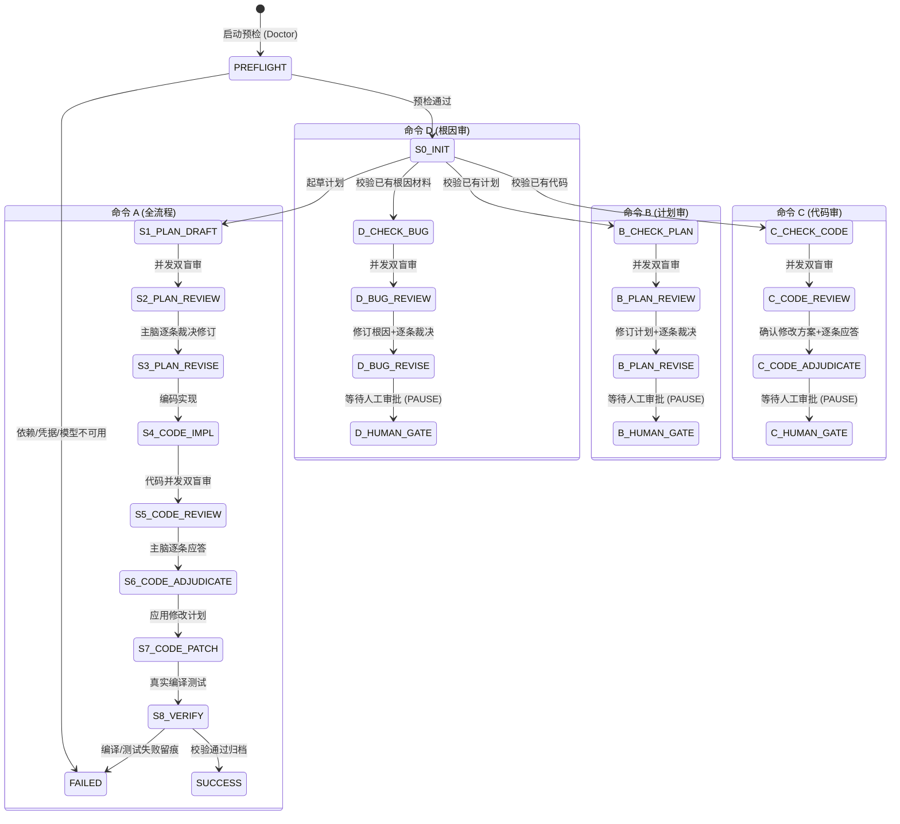
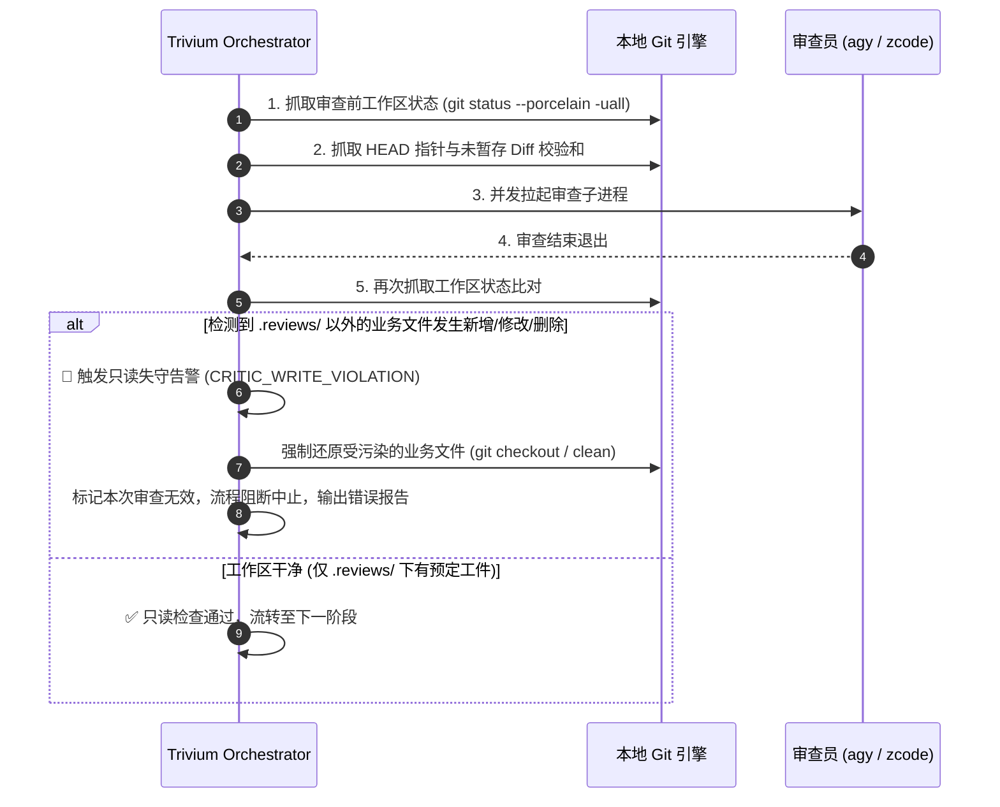
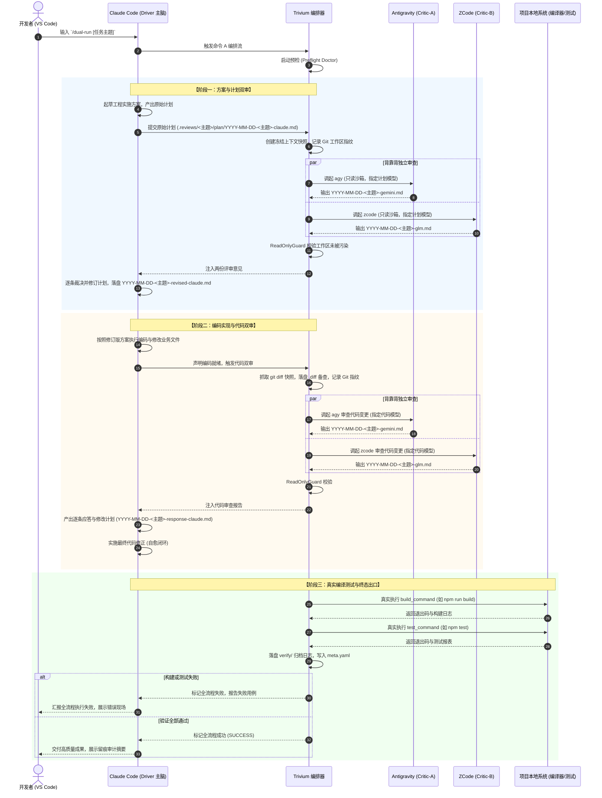
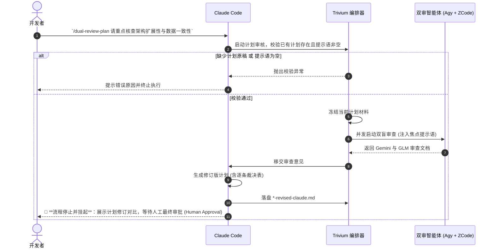
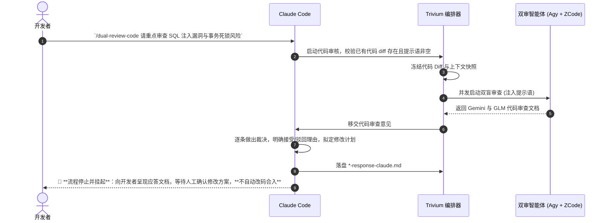
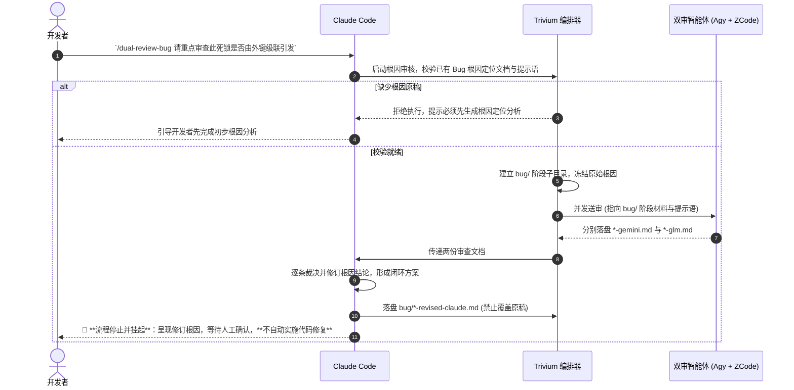

# [ARCH] Driver-DualCritic 主攻双审流水线系统架构与详细设计规范

> - **文档标识**：`doc/02_design/2026-09-10-Claude-Code主攻双智能体审核流水线-gemini.md`
> - **文档版本**：v1.0.0
> - **创建日期**：2026-09-10
> - **状态**：**参考方案 (Reference)**
>
> ⚠️ 该文原自称「已批准 (Approved) · 实施基线」，**该口径无效**。它是多模型设计调研中的一份答卷，
> 从未被批准为实施基线。本项目的唯一实现依据是
> [`2026-09-10-Driver-DualCritic主攻双审流水线设计-claude.md`](../2026-09-10-Driver-DualCritic主攻双审流水线设计-claude.md)。
> 本文结论可能已被该设计推翻，阅读时请以其为准。（设计 18.2 回填，2026-09-11）
> - **系统架构师**：TriviumCode 核心架构团队 (Gemini)
> - **关联需求**：[PRD_driver_dual_critic.md (v1.3.0)](../../01_requirements/PRD_driver_dual_critic.md)
> - **运行环境**：macOS (Sonoma 14+) + VS Code 原生开发流
> - **核心智能体**：Claude Code (Driver 主脑) × Google Antigravity (Critic-A) × 智谱 ZCode (Critic-B)

---

## 1. 系统概述与设计哲学

### 1.1 业务与技术背景
在现代软件研发范式中，AI 编程工具已经由单一的代码补全（Copilot 模式）演进为自主执行的智能体（Agent 模式）。开发者在日常开发中，主要以 **Claude Code** 作为核心驱动交互入口：理解需求、生成工程实施计划、编写业务源码、执行缺陷定位。然而，单一主脑在复杂单体应用、深度依赖网络和长链路重构场景下，不可避免地面临三类系统性瓶颈：
1. **单模型认知盲区与自证幻觉**：自身起草方案自身审计，往往无法识别自身推演链中的逻辑漏洞、未考虑的并发边界与破坏性变更。
2. **多窗口手工双审流程破碎**：开发者频繁在 Claude Code、Antigravity、ZCode 等多个 UI 窗口间切屏、复制粘贴 diff 与提示词，极易在任务紧张时被人工跳过；且纯手工文本复制无法调动厂商原生 Agent 的项目符号检索、依赖拓扑分析与工具链推演等**编程 Agent 级系统能力**。
3. **协作记忆碎片化与审计断层**：各模型的交互历史分散在不同的临时会话中，缺乏确定性的工件沉淀与审计链条，无法支撑企业级架构决策记录（ADR）与事后根因溯源。

**TriviumCode (三方智鉴)** 系统通过构建 **Driver-DualCritic（主攻 + 双审）** 协同流水线，让 Claude Code 专注担任业务实现的唯一“主脑与主笔（Driver）”，引入 Google Antigravity 与智谱 ZCode 组成背靠背隔离的“双专家评审团（Dual-Critic）”，通过确定性的轻量级编排层与规范化工件流转，实现工业级高可靠的多智能体闭环研发。

### 1.2 核心架构设计原则

```
┌─────────────────────────────────────────────────────────────────────────┐
│                        TriviumCode 核心架构六大基石                       │
├───────────────────┬───────────────────┬─────────────────────────────────┤
│ 1. 确定性编排分离  │ 2. 产物即系统契约  │ 3. 严格双盲物理隔离              │
│ 认知推理归 Agent   │ 智能体间绝不对话   │ 审查员互不可见                  │
│ 状态门禁归宿主程序│ 统一 Markdown 落盘│ 消除上下文先验污染              │
├───────────────────┼───────────────────┼─────────────────────────────────┤
│ 4. 最小写权限沙箱  │ 5. 逐条结构化裁决  │ 6. 异常透明与降级可见            │
│ 审查员仅只读分析  │ 拒绝橡皮图章      │ 严禁伪造完整双审                │
│ 主脑为唯一改码主体│ 接受/驳回必须留痕 │ 单审/超时全链路留痕             │
└───────────────────┴───────────────────┴─────────────────────────────────┘
```

1. **确定性编排与认知性执行分离 (Deterministic Orchestration vs. Cognitive Execution)**：
   智能体（LLM Agent）擅长代码理解、推演与逻辑生成，但不擅长精确的时序控制、超时检测、进程保活与确定性状态流转。系统的流程调度、子进程拉起、Git 快照对比、退出码判定与人工审批闸门由本地轻量编排器（Orchestrator）以确定性代码严谨执行，绝不把编排逻辑托付给大模型的临时记忆。
2. **产物即系统契约 (Artifacts as System Contracts)**：
   各智能体之间不建立复杂的跨进程 RPC 或网络 Session 耦合，所有信息交互均基于磁盘上不可变（Immutable）的 Markdown 冻结工件。文件即接口，日志即证据。
3. **严格双盲与背靠背物理隔离 (Strict Double-Blind Physical Isolation)**：
   两家审查智能体在审查期间，必须处于互不相知的环境。审查提示词、输入材料、临时输出绝对不得出现对方的任何信息，确保两个异构模型产出具有最大独立信息熵的审查结论。
4. **主脑独写与审查员绝对只读沙箱 (Driver-Only Writing & Critic Read-Only Sandbox)**：
   整个工程的源码、业务文档的写权限收敛于 Claude Code。审查智能体的工作目录虽为项目根，但必须施加只读限制（Read-only Sandboxing）与写操作检出熔断守卫。
5. **逐条原子化结构化裁决 (Atomic & Structured Adjudication)**：
   审查意见必须结构化为带编号、严重度、文件定位的原子 Findings。主脑必须逐条做出“接受（Accept）”、“驳回（Reject）”或“暂缓（Deferred）”的明确裁决并给出工程依据，严禁模糊概括或静默忽略。
6. **故障透明与降级可见 (Transparency & Visible Degradation)**：
   当任一审查员遇到超时、网络波动或崩溃时，编排层必须在最终归档中显式标明单审状态（Single Review）与降级根因，严禁以单审结果伪装成双审通过。

---

## 2. 术语定义与系统边界

### 2.1 核心术语

| 术语 | 英文对照 | 定义与系统语义 |
| :--- | :--- | :--- |
| **主攻 / 主脑** | **Driver** | 由 Claude Code 担任。负责需求理解、计划起草、代码编写、Bug 修复，以及对审查意见的逐条裁决。是唯一的业务写操作主体。 |
| **审查员 A** | **Critic-A** | 由 Google Antigravity Agent 担任。基于深度图谱检索、静态推演与架构契约，独立对方案、代码补丁与 Bug 根因进行只读审查。 |
| **审查员 B** | **Critic-B** | 由智谱 ZCode Agent 担任。基于本地化规范推演、边界防护与异常分支覆盖能力，独立开展只读审查。 |
| **轻量编排器** | **Trivium Orchestrator** | 本地执行的确定性编排核心 CLI，负责环境预检、命令解析、并发拉起双审、工件归档、只读失守检测与闸门控制。 |
| **审查票 / 发现** | **Finding** | 审查员输出的最小可独立裁决单元，包含唯一 ID、严重度级别、定位坐标、问题本质、修改建议与置信度。 |
| **裁决记录** | **Disposition / Adjudication** | 主脑针对审查员提出的 Finding 逐一做出的决策文档，记录对每一条 Finding 的处置结果（接受/驳回/暂缓）及技术理由。 |
| **双审闸门** | **Gate** | 流水线中的强制阻断点，分为机器判定闸门（双审意见聚合）与人工审批闸门（等待开发者在 VS Code 中确认）。 |
| **冻结快照** | **Frozen Snapshot** | 在送审时刻由编排器创建的被审对象上下文集合（含 Git commit/tree hash、自包含文档快照、命令提示语），确保审查期间材料不发生动态漂移。 |

### 2.2 系统边界与运行上下文

```
┌─────────────────────────────────────────────────────────────────────────────────┐
│ TriviumCode 系统边界                                                             │
│                                                                                 │
│  macOS 开发者工作站                                                             │
│  ┌───────────────────────────────────────────────────────────────────────────┐  │
│  │ VS Code IDE                                                               │  │
│  │  ┌───────────────────────────┐      ┌──────────────────────────────────┐  │  │
│  │  │ Claude Code (VS Code 扩展) │      │ Markdown Preview / Diff Editor   │  │  │
│  │  │ [Driver 交互界面 & 写代码]  │      │ [人类开发者审批查看工件]           │  │  │
│  │  └─────────────┬─────────────┘      └──────────────────────────────────┘  │  │
│  └────────────────┼──────────────────────────────────────────────────────────┘  │
│                   │ 触发 Slash Command (/dual-*)                                │
│                   ▼                                                             │
│  ┌───────────────────────────────────────────────────────────────────────────┐  │
│  │ Trivium Orchestrator CLI (`trivium` / `bin/ddc`)                          │  │
│  │  - 参数解析与任务生命周期管理                                             │  │
│  │  - 启动预检 (Doctor)                                                      │  │
│  │  - 工作区快照冻结与背靠背隔离环境构建                                     │  │
│  │  - 只读失守监测 (ReadOnlyGuard)                                           │  │
│  │  - 真实编译测试执行引擎                                                   │  │
│  └──────┬─────────────────────────────────────────────────────────────┬──────┘  │
│         │ 并发无头唤起 (Headless Subprocess)                          │         │
│         ▼                                                             ▼         │
│  ┌───────────────────────────────┐     ┌─────────────────────────────────────┐  │
│  │ Google Antigravity CLI        │     │ 智谱 ZCode CLI                      │  │
│  │ (`agy` 二进制)                │     │ (`zcode.cjs` Node 脚本)             │  │
│  │ - 编程 Agent 工具循环         │     │ - 编程 Agent 工具循环               │  │
│  │ - 工作目录：项目根 (只读)     │     │ - 工作目录：项目根 (只读)           │  │
│  └──────────────┬────────────────┘     └──────────────────┬──────────────────┘  │
│                 │                                         │                     │
│                 └──────────────────┬──────────────────────┘                     │
│                                    ▼                                            │
│  ┌───────────────────────────────────────────────────────────────────────────┐  │
│  │ 本地文件系统 (磁盘工件存储)                                                │  │
│  │ 📁 <项目根>/.reviews/<任务主题>/                                          │  │
│  │    ├── plan/   (原始计划、双审报告、修订计划)                             │  │
│  │    ├── code/   (代码双审报告、主脑逐条应答文档)                           │  │
│  │    ├── bug/    (原始根因定位、双审报告、修订后根因)                       │  │
│  │    └── verify/ (真实编译与自动化测试执行日志)                             │  │
│  └───────────────────────────────────────────────────────────────────────────┘  │
└─────────────────────────────────────────────────────────────────────────────────┘
```

- **显式不包含（Non-Goals & Boundaries）**：
  1. 不部署常驻操作系统的后台守护进程（Daemon），编排器随 Claude Code 命令按需调用、任务完成即销毁。
  2. 不部署任何外部中心化 Web 服务器或云端调度服务，所有控制链路与数据均停留在开发者本地机器。
  3. 审查智能体绝对不获得向业务文件写入代码的权限。
  4. 编排器不替代人类对于合入主干（Git Merge/Push）的最终决定权。

---

## 3. 总体架构与四层模型

系统采用清晰的四层架构设计，自上而下分为交互呈现层、编排核心层、智能体适配层与工件留痕层。

```
┌─────────────────────────────────────────────────────────────────────────────┐
│ 1. 交互呈现层 (Interaction Layer)                                           │
│    - Claude Code Slash Commands (/dual-run, /dual-review-plan, etc.)         │
│    - Claude Code Skills 体系 (.claude/skills/dual-critic/SKILL.md)          │
│    - 项目作业契约指令 (CLAUDE.md)                                            │
└──────────────────────────────────────┬──────────────────────────────────────┘
                                       │ 携带参数与提示语调用
┌──────────────────────────────────────▼──────────────────────────────────────┐
│ 2. 编排核心层 (Orchestration Engine Layer)                                  │
│    - 任务生命周期与有限状态机 (Task State Machine)                           │
│    - 启动预检器 (Preflight Checker / Doctor)                                 │
│    - 并发调度与超时熔断器 (Concurrent Pool & Timeout Supervisor)             │
│    - 只读防护与变更探测守卫 (ReadOnlyGuard & Git Snapshot Engine)            │
│    - 真实编译测试执行引擎 (Build & Test Runner)                              │
└──────────────────────────────────────┬──────────────────────────────────────┘
                                       │ 统一接口调度
┌──────────────────────────────────────▼──────────────────────────────────────┐
│ 3. 智能体适配层 (Critic Adapter Layer)                                       │
│    - 抽象审查员适配基类 (AbstractCriticAdapter)                             │
│    ├──────────────────────────────────────┬─────────────────────────────────┤
│    │ Google Antigravity 适配器            │ 智谱 ZCode 适配器               │
│    │ (AntigravityAdapter)                 │ (ZCodeAdapter)                  │
│    │ - `agy` CLI 子进程生命周期           │ - `zcode.cjs` Node 进程封装     │
│    │ - 模型动态路由与 `--model` 参数组装  │ - 隔离配置与环境注入            │
│    │ - `--json-schema` 结构化约束提取     │ - `--mode plan` 只读参数注入    │
│    │ - `tool_trace` 真实 Agent 证据抓取   │ - `.response` 字段解析与容错    │
└──────────────────────────────────────┬──────────────────────────────────────┘
                                       │ 规范化读写落盘
┌──────────────────────────────────────▼──────────────────────────────────────┐
│ 4. 工件与审计留痕层 (Artifact & Ledger Layer)                               │
│    - 统一归档根目录 (.reviews/)                                              │
│    - 阶段子目录路由 (plan/ | code/ | bug/ | verify/)                         │
│    - 严格规范文件命名引擎 (YYYY-MM-DD-<主题>-{claude|gemini|glm}.md)         │
│    - 任务运行元数据登记簿 (meta.yaml / manifest.json)                        │
└─────────────────────────────────────────────────────────────────────────────┘
```

---

## 4. 组件划分与模块详细设计

### 4.1 交互呈现层（Claude Code 插件与命令规格）

#### 4.1.1 挂载技术选型
Claude Code v2.1+ 原生支持两类扩展：`.claude/commands/`（遗留单文件模式）与 `.claude/skills/`（推荐的复合技能模式）。为了提供最高鲁棒性，TriviumCode 采用 **Skill 体系为主、Command 为快捷别名** 的复合方案：
1. 项目根目录维护 `.claude/skills/dual-critic/SKILL.md`，定义智能体执行双审的元数据、依赖工具集与环境变量。
2. 在 `.claude/commands/` 下建立 4 个声明式命令文件，映射 PRD 规定的四条核心命令。
3. 项目根目录的 `CLAUDE.md` 写入《Driver 行为规范》，明确指导 Claude Code 在收到双审工件后如何解析、如何逐条应答并产出修订件。

#### 4.1.2 四条 Slash 命令规格实现

| 命令标识 | 对应文件名 | 输入参数解析机制 | 自动流转范围 | 终止停点 |
| :--- | :--- | :--- | :--- | :--- |
| **`/dual-run`**<br>(命令 A) | `.claude/commands/dual-run.md` | `$ARGUMENTS`：可选任务主题名。<br>缺省时由主脑自动推导语义 slug。 | 方案起草 → 双审 → 修订方案 → 编码 → 代码双审 → 逐条应答确认 → 修订代码 → 真实编译测试。 | 编译与测试执行完成，落盘验证日志，输出总结。 |
| **`/dual-review-plan`**<br>(命令 B) | `.claude/commands/dual-review-plan.md` | `$ARGUMENTS`：**必选审查焦点提示语**。<br>可选 `--topic <name>`。若无提示语则拒绝启动。 | 读取已有原始计划 → 冻结快照 → 并发双审 → Claude Code 吸收意见生成修订方案及逐条裁决。 | **人工审批闸门**：提示开发者在 VS Code 中审阅修订版计划，等待人工授权。 |
| **`/dual-review-code`**<br>(命令 C) | `.claude/commands/dual-review-code.md` | `$ARGUMENTS`：**必选审查焦点提示语**。<br>可选 `--topic <name>`。若无提示语则拒绝启动。 | 读取已有代码改动与上下文 → 冻结 diff 快照 → 并发双审 → Claude Code 产出逐条应答文档与修改计划。 | **人工审批闸门**：展示应答文档，等待开发者确认修改计划，不自动合入。 |
| **`/dual-review-bug`**<br>(命令 D) | `.claude/commands/dual-review-bug.md` | `$ARGUMENTS`：**必选审查焦点提示语**。<br>可选 `--topic <name>`。若无提示语则拒绝启动。 | 读取已有 Bug 根因定位材料 → 冻结快照 → 并发双审 → Claude Code 产出修订版根因结论及逐条裁决。 | **人工审批闸门**：展示修订根因，等待人工确认，不自动进行代码修复。 |

#### 4.1.3 命令参数提取与校验伪代码逻辑
```bash
# 命令输入校验引擎规范
parse_and_validate_args() {
  COMMAND_TYPE="$1" # A, B, C, D
  RAW_ARGS="$2"

  if [ "$COMMAND_TYPE" != "A" ] && [ -z "$(echo "$RAW_ARGS" | tr -d ' ')" ]; then
    echo "❌ 启动被拒：命令 $COMMAND_TYPE 要求必须附带明确的审查焦点提示语 (Focus Prompt)！"
    echo "💡 用法示例: /dual-review-plan 请重点核查数据库事务隔离级别与回滚覆盖"
    exit 1
  fi
  # 提取可选的 --topic 参数，缺省则标记为 AUTO_DETECT
}
```

---

### 4.2 编排核心层（Trivium Orchestrator Engine）

编排器作为宿主机器上的确定性进程（可通过 Node.js/TypeScript 编译的轻量单二进制或直接以 Python 3/Bash 脚本形态提供，推荐采用 TypeScript 构建以获得严格的类型约束）。其核心职责如下：

#### 4.2.1 任务有限状态机 (Finite State Machine)



#### 4.2.2 启动预检器 (Preflight Checker / Doctor)
在执行任何审查前，必须对环境进行确定性静态与动态嗅探：
1. **基础工具探测**：检查 `git`、`node` (>= 18)、`curl` 是否就绪。
2. **Antigravity CLI 连通性探测**：
   - 执行 `agy --help` 验证二进制在 `PATH` 中。
   - 执行 `agy models` 探测可用模型列表，校验本次任务指定的模型（或默认模型）是否有效。
   - 检查权限配置文件（macOS 为 `~/.gemini/antigravity-cli/settings.json`）的存在性。
3. **ZCode CLI 连通性探测**：
   - 嗅探 `zcode.cjs` 路径：优先读取环境变量 `ZCODE_CLI_PATH`，次选 macOS 标准安装路径 `/Applications/ZCode.app/Contents/Resources/glm/zcode.cjs`，再次从 PATH 查找。
   - 检查凭据：检查环境变量 `ZCODE_API_KEY` 或 `~/.zcode/cli/config.json` 是否包含合法的 `<apiKeyId>.<apiKeySecret>` 授权。
   - 运行轻量 smoke 检查：`node zcode.cjs --prompt "ping" --max-turns 1 --json` 验证退出码与返回结构。
4. **决策判定**：若任一审查员不可用，预检立即返回非 0 退出码并打印排查指引，**直接拒绝启动**，坚决阻止假双审发生（满足 FR-18 / AC-16）。

#### 4.2.3 并发调度与超时熔断器 (Concurrent Pool & Timeout Supervisor)
- **并发拉起**：编排器采用异步并发模型（如 Node.js `Promise.allSettled` 或 Python `asyncio.gather`），同时启动 Critic-A 与 Critic-B 的子进程。
- **单侧超时守卫**：
   - 为每次审查设置硬性超时时间（默认 600 秒，可在 `.reviews/config.yaml` 中配置）。
   - Antigravity 传递 `--print-timeout 600`。
   - ZCode 通过编排器进程定时器监控；超时触发时向进程树发送 `SIGTERM`，5 秒后未退出则发送 `SIGKILL`。
- **重试策略**：单侧遇到网络闪断或超时时，自动重试 1 次（Backoff 3 秒）。若仍失败，进入降级决策。
- **降级决策矩阵**：
   - **严格模式 (Strict Mode，系统默认)**：任一侧超时或失败，立即终止整个流程，在工件中标注 `FAILED_PRECHECK` 或 `CRITIC_TIMEOUT`，不生成伪双审文档。
   - **降级模式 (Degraded Mode，需显式配置 `degrade_mode: true`)**：若一侧成功而另一侧失败，允许流程继续，但在归档根目录的 `meta.yaml` 中将状态标为 `single_review_degraded`，明确记录失败侧的错误堆栈，并向开发者发出醒目告警。

---

### 4.3 智能体适配层（Critic Adapter Layer）

系统抽象出标准适配器接口 `ICriticAdapter`，屏蔽两家厂商底层 CLI 的参数差异、输入输出差异与认证机制。

```typescript
// 适配器统一抽象接口定义规范
interface ReviewInput {
  taskTopic: string;
  stage: 'plan' | 'code' | 'bug';
  targetContent: string;        // 待审材料文本
  focusPrompt: string;          // 审查焦点提示语
  projectRoot: string;          // 工程根路径
  contextSnapshotPath: string;  // 冻结快照路径
  designatedModel?: string;     // 指定模型 slug
}

interface ReviewFinding {
  id: string;                   // 唯一标识，如 AGY-001 或 GLM-001
  severity: 'blocker' | 'major' | 'minor' | 'nit';
  location: string;             // 文件相对路径:行号，如 "src/auth/token.ts:45"
  issue: string;                // 缺陷陈述
  rationale: string;            // 推演依据与潜在破坏链
  suggestion: string;           // 具体的修改方案或重构代码
  confidence: number;           // 置信度 (0.0 - 1.0)
}

interface ReviewResult {
  criticRole: 'gemini' | 'glm';
  modelUsed: string;
  status: 'SUCCESS' | 'TIMEOUT' | 'ERROR';
  rawResponseText: string;
  findings: ReviewFinding[];
  agentExecutionTrace: {
    durationSeconds: number;
    tokenUsage?: { prompt: number; completion: number; total: number };
    toolsCalled?: string[];     // 工具调用真实证据
    sessionId?: string;
  };
}
```

#### 4.3.1 Google Antigravity 适配器设计 (`AntigravityAdapter`)

1. **CLI 调起命令模板**：
   ```bash
   cd "<projectRoot>" && agy \
     -p "<formattedPrompt>" \
     --model "<modelSlug>" \
     --effort "<effortLevel>" \
     --output-format json \
     --json-schema "<schemaJsonString>" \
     --print-timeout 600
   ```
2. **模型动态路由（实测验证）**：
   - 必须通过原生 `--model <slug>` 参数指定。
   - 默认模型：`gemini-3.1-pro-high`（用于方案架构推演与 Bug 根因推演）；`gemini-3.8-flash-high`（用于代码 Diff 审查）。
   - 异构约束校验：编排器强制检查指定 slug，禁止配置 Claude 系列模型（如 `claude-sonnet-4-6`），若发现配置同源模型，预检直接驳回，确保异构独立性（FR-17 / AC-18）。
3. **只读保护与权限控制**：
   - Antigravity 无 `--cwd` 参数，适配器在 `spawn` 子进程时将 `options.cwd` 锁定为项目根。
   - 不传递 `--dangerously-skip-permissions`。在 Headless 模式下，任何未在权限白名单中的写操作都会被系统静默 **soft-deny**（软拒绝），阻止文件破坏。
   - 审查输出必须从 stdout 的 JSON 字段提取，由编排器写入目标归档文件，禁止 `agy` 直接自行在源码区落盘。
4. **结构化输出提取**：
   - 依赖 `--json-schema` 机制，强制 Antigravity 输出符合 `FindingSchema` 的 JSON。
   - 从进程返回的 JSON envelope 中提取 `.structured_output` 字段；若仅有纯文本，则激活后置提取解析器。
5. **编程 Agent 证据提取**：
   - 提取 envelope 中的 `usage`、`duration_seconds`、以及 stream 事件中的工具调用记录，写入元数据，证明其具备真实的读库与符号查找行为（AC-05）。

#### 4.3.2 智谱 ZCode 适配器设计 (`ZCodeAdapter`)

1. **CLI 调起命令模板**：
   ```bash
   node "<zcodeCjsPath>" \
     --prompt "<formattedPrompt>" \
     --cwd "<projectRoot>" \
     --json \
     --no-color \
     --max-turns 40 \
     --mode plan \
     --disallowed-tools "Write,Edit,Bash" \
     --attach "<frozenSnapshotFilePath>"
   ```
2. **只读约束实测校准**：
   - **重大排坑**：实测表明 ZCode CLI 虽然 `--help` 中声明了 `--allowed-tools`，但运行时会报 `Unknown option '--allowed-tools'` 异常。
   - **确定性只读组合拳**：
     - 采用 `--mode plan`（计划只读模式）；
     - 叠加 `--disallowed-tools "Write,Edit,Bash"` 反向禁止写操作与终端命令；
     - 依靠编排器的 `ReadOnlyGuard`（Git 快照比对）作为终极底线防御。
3. **按任务指定模型机制（无 `--model` 命令行参数的架构解决方案）**：
   - 调研表明，ZCode CLI 不支持在命令行通过 `--model` 传参，其模型读取自 `~/.zcode/cli/config.json` 或 `~/.zcode/v2/config.json` 中的 provider/model 字段。
   - **架构解决方案**：**动态任务配置隔离沙箱 (Isolated Config Sandbox)**。
     - 适配器在启动 ZCode 进程前，为当前任务创建一个临时配置目录（如 `/tmp/trivium_zcode_<task_id>/`），写入目标模型（如 `glm-5.3` 或 `glm-4-air`）的局部配置文件；
     - 通过设置进程环境变量 `ZCODE_CONFIG_DIR` 或 `HOME=/tmp/trivium_zcode_<task_id>/`，将该配置与开发者的全局桌面端配置进行完全隔离；
     - 执行完成后即刻清理，避免干扰桌面端日常使用，彻底解决按任务切换模型难题（FR-06 / AC-13）。
4. **输出解析与 Agent 证据捕获**：
   - ZCode 输出为单行或多行 JSON，审查内容存储在 **`.response`** 字段中（而非 `.text`）。
   - 提取 `traceId`、`turnId`、`sessionId`、`eventCount` 以及 `usage.totalTokens`，作为其执行完整 Agent 工具循环的正向审计证据（AC-05）。

---

### 4.4 安全沙箱与背靠背隔离（Sandbox & Blind Isolation）

#### 4.4.1 双向信息隔离机制（防上下文污染）
PRD FR-10 与 AC-04 明确要求：“两个负责审核的 Agent 互相不能看对方生成的文档”。为达成绝对物理隔离：
1. **输入文件自包含与快照隔离**：
   - 编排器在启动审查前，将被审材料提取并冻结写入临时冻结区：`.reviews/<主题>/inputs/snapshot.md`。
   - 传给 Antigravity 的 prompt 仅指向 `snapshot.md`，绝对不包含任何关于 GLM 的字样或历史意见；
   - 传给 ZCode 的 `--attach` 参数仅挂载 `snapshot.md`，绝对不包含任何 Gemini 的字样或历史意见。
2. **输出流与临时文件屏蔽**：
   - 两个审查员的输出全部重定向至管道标准输出（stdout），在执行阶段**不在项目工作区创建任何可见的中间临时文件**。
   - 编排器在内存中接收到双方完整的 stdout 并通过校验后，才分别以目标规范文件名写入磁盘。
   - 即便需要临时落地，临时目录也会被编排器动态添加到临时 `.git/info/exclude` 中，对所有 Git 与文件扫描工具隐形。

#### 4.4.2 只读失守检测与熔断（ReadOnlyGuard）
为满足 FR-15 与 AC-08，编排器内置 `ReadOnlyGuard` 机制：



---

### 4.5 留痕与工件管理模块（Artifact & Ledger Layer）

#### 4.5.1 归档目录树状组织规范
统一归档根目录为 **`.reviews/`**。按任务主题建立子目录，子目录下设立标准的阶段子目录，彻底杜绝同名覆盖问题：

```text
<项目根>/
├── .reviews/                                  # 统一归档根目录 (纳入 Git 版本控制)
│   ├── config.yaml                            # 项目级双审流水线配置文件
│   │
│   └── 2026-09-10-用户鉴权重构/                # 任务主题子目录 (YYYY-MM-DD-主题名)
│       ├── meta.yaml                          # 运行元数据：起止时间、所用模型、状态标记
│       ├── inputs/                            # 冻结的送审上下文材料
│       │   └── 2026-09-10-snapshot.md         # 冻结的原始快照
│       │
│       ├── plan/                              # ── 阶段一：计划审核阶段 ──
│       │   ├── 2026-09-10-用户鉴权重构-claude.md         # ① Claude 原始计划
│       │   ├── 2026-09-10-用户鉴权重构-gemini.md         # ② Antigravity 审查意见
│       │   ├── 2026-09-10-用户鉴权重构-glm.md            # ③ ZCode 审查意见
│       │   └── 2026-09-10-用户鉴权重构-revised-claude.md # ④ Claude 修订后计划 (含逐条裁决)
│       │
│       ├── code/                              # ── 阶段二：代码审核阶段 ──
│       │   ├── 2026-09-10-用户鉴权重构.diff              # 被审代码差异快照 (附加工件)
│       │   ├── 2026-09-10-用户鉴权重构-gemini.md         # ⑤ Antigravity 代码审查意见
│       │   ├── 2026-09-10-用户鉴权重构-glm.md            # ⑥ ZCode 代码审查意见
│       │   └── 2026-09-10-用户鉴权重构-response-claude.md# ⑦ Claude 逐条应答文档与修改计划
│       │
│       ├── bug/                               # ── 阶段三：Bug 根因审核阶段 (命令 D 必选) ──
│       │   ├── 2026-09-10-登录偶发超时-claude.md         # ⑧ Claude 原始根因定位材料
│       │   ├── 2026-09-10-登录偶发超时-gemini.md         # ⑨ Antigravity 根因审查意见
│       │   ├── 2026-09-10-登录偶发超时-glm.md            # ⑩ ZCode 根因审查意见
│       │   └── 2026-09-10-登录偶发超时-revised-claude.md # ⑪ Claude 修订后根因 (含逐条裁决)
│       │
│       └── verify/                            # ── 阶段四：验证出口阶段 ──
│           ├── 2026-09-10-用户鉴权重构-build.log         # 真实编译输出
│           └── 2026-09-10-用户鉴权重构-test.log          # 真实单元/集成测试输出
```

#### 4.5.2 命名与版本重跑防撞规则（FR-25）
若开发者对同一主题、同一阶段触发二次重新送审（重跑）：
1. 既有工件坚决**不予物理覆盖**，保留历史决策轨迹。
2. 命名引擎自动在主题后追加递增版本标识 `.v2`、`.v3`（例如：`2026-09-10-用户鉴权重构.v2-gemini.md`）。
3. 对应的修订件与应答件同样追加匹配的版本后缀（如 `...-revised.v2-claude.md`）。

---

## 5. 数据契约与工件格式规范

### 5.1 统一审查发现格式规范（Critic Finding Schema）
Antigravity 与 ZCode 的审查报告必须呈现为标准 Markdown，并包含标准 Front-matter 与规整的 Finding 条目：

```markdown
---
critic: gemini # gemini | glm
task_topic: 用户鉴权重构
stage: plan # plan | code | bug
model: gemini-3.1-pro-high
created_at: 2026-09-10T14:32:00Z
blind_isolation: verified
findings_count: 2
---

# 独立审查报告：用户鉴权重构 (Gemini)

## 1. 总体评价与裁决建议
- **裁决结论**：[REVISE_REQUIRED(需修订) / APPROVED(通过)]
- **摘要陈述**：方案整体拓扑合理，但在刷新令牌并发竞争及分布式缓存击穿防护上存在阻断级漏洞。

## 2. 审查发现明细 (Findings)

### [AGY-001] 刷新令牌并发请求导致会话失效竞争条件
- **严重度**：`blocker` <!-- blocker | major | minor | nit -->
- **代码/计划坐标**：`src/auth/token_manager.ts:88-105` (或计划书第 3.2 节)
- **核心问题**：客户端多并发请求携带相同过期 Access Token 时，未加分布式互斥锁，将同时触发 Refresh Token 轮换，后到达的请求将因 Token 已作废被强制踢出登录态。
- **推演依据**：OAuth 2.0 RFC 6749 Section 6 以及高并发客户端异步请求模型。
- **修改建议**：引入 Redis 租约锁（Lease Lock）或内存级 Promise 单飞合并（Singleflight），第一个刷新请求生效，其余并发请求挂起并等待新 Token 广播返回。
- **置信度**：0.95

### [AGY-002] 缺少未成年人身份边界保护校验
- **严重度**：`minor`
- **代码/计划坐标**：`src/auth/validator.ts:32`
- **核心问题**：未校验生日字段的未来时间点异常。
- **推演依据**：业务健全性防御原则。
- **修改建议**：增加时间早于当前系统时间的断言。
- **置信度**：0.80
```

> **编号唯一性防冲突规则**：Antigravity 提出的意见统一使用 `[AGY-xxx]` 前缀；ZCode 提出的意见统一使用 `[GLM-xxx]` 前缀，主脑与审计系统可全局无二义性寻址。

---

### 5.2 主脑逐条裁决与应答格式规范（Claude Adjudication Schema）

在计划阶段（`-revised-claude.md`）、代码阶段（`-response-claude.md`）和根因阶段（`-revised-claude.md`），Claude Code **必须以结构化表格及分项说明做出逐条答辩**：

```markdown
---
author: claude
task_topic: 用户鉴权重构
stage: code-response # plan-revised | code-response | bug-revised
response_to: [2026-09-10-用户鉴权重构-gemini.md, 2026-09-10-用户鉴权重构-glm.md]
created_at: 2026-09-10T14:45:00Z
---

# 审查意见主脑应答与技术决策记录

## 1. 意见逐条裁决总览表

| 意见编号 | 来源 | 严重度 | 裁决决定 | 技术理由摘要 | 落地修改计划/代码影响点 |
| :--- | :--- | :--- | :--- | :--- | :--- |
| `AGY-001` | Gemini | blocker | **接受 (Accept)** | 并发竞争确实存在，推演完全成立 | 在 `token_manager.ts` 中封装 `SingleFlight` 互斥刷新逻辑 |
| `AGY-002` | Gemini | minor | **暂缓 (Deferred)** | 本期为 B2B 企业租户系统，不收集个人年龄字段 | 记录至技术债清单，延期至后续迭代评估 |
| `GLM-001` | GLM | major | **驳回 (Reject)** | 该调用属于内部微服务私网 RPC，网络已做双链路保活 | 保持现存重试参数不变，添加网络拓扑架构说明注释 |

## 2. 裁决明细与深度反驳依据

### 对 [AGY-001] 的应答与实施方案
- **裁决**：接受
- **具体修改动作**：
  1. 新增 `src/common/concurrency.ts` 提供并发请求合并原语；
  2. 重写 `src/auth/token_manager.ts` 的 `rotateToken` 方法；
  3. 补充针对 50 并发请求下的单元并发竞争测试用例。

### 对 [GLM-001] 的驳回说明
- **裁决**：驳回
- **技术依据**：GLM 认为 RPC 超时设定 100ms 过短会导致大报文偶发熔断。但根据系统架构说明书《ARCH-003-网络延迟规范》，本模块部署于同一机房专有 VPC，P99 延迟稳定在 1.2ms，设置 100ms 已预留 80 倍裕量；盲目调大至 3000ms 会阻滞 Node 事件循环。故驳回调大建议。
```

---

### 5.3 配置文件规格 (`.reviews/config.yaml`)

```yaml
version: "1.0.0"
general:
  workspace_name: "TriviumCode"
  archive_root: ".reviews"
  # 严格模式：单侧失败或超时直接中止流程；false 则允许单审降级
  strict_mode: true
  # 单侧审查硬性超时时间 (秒)
  timeout_seconds: 600
  # 失败自动重试次数
  max_retries: 1

models:
  # 默认审查模型路由表 (异构原则：禁止使用 Claude 系列)
  plan_review:
    critic_a: "gemini-3.1-pro-high"
    critic_b: "glm-5.3"
  code_review:
    critic_a: "gemini-3.8-flash-high"
    critic_b: "glm-5.3-flash"
  bug_review:
    critic_a: "gemini-3.1-pro-high"
    critic_b: "glm-5.3"

verification:
  # 命令 A 出口处真实执行的项目编译与测试命令
  build_command: "npm run build"
  test_command: "npm test -- --coverage"

paths:
  # 可选的 CLI 入口覆盖配置
  antigravity_bin: "agy"
  zcode_cli_script: "/Applications/ZCode.app/Contents/Resources/glm/zcode.cjs"
```

---

## 6. 核心业务流程与时序交互

### 6.1 全流程自动执行闭环（命令 A · `/dual-run`）



---

### 6.2 计划审核独立闸门时序（命令 B · `/dual-review-plan`）



---

### 6.3 代码审核独立闸门时序（命令 C · `/dual-review-code`）



---

### 6.4 Bug 根因独立审核时序（命令 D · `/dual-review-bug`，P0）



---

## 7. 异常处理、故障降级与容错矩阵

为了确保在各种极端开发边界条件下系统不发生假死、状态撕裂或假双审，编排层对下述异常建立了确定性的拦截机制：

| 异常事件 | 检测触发机制 | 编排器行为 | 最终工件表现 | 对应需求判据 |
| :--- | :--- | :--- | :--- | :--- |
| **单侧或双侧未安装 / PATH 缺失** | Preflight 探测命令退出码不为 0 | 立即中止，输出具体缺失的工具安装指南。禁止进入审查。 | 无任何审查工件生成，控制台打印错误。 | FR-18<br>AC-16 |
| **单侧或双侧未认证 / 鉴权过期** | CLI 返回 401/403 或 OAuth 凭证失效 | 立即中止，提示执行登录或配置 `.env` 凭证。禁止单侧硬撑。 | 留存 Doctor 探测日志，标记 `AUTH_FAILURE`。 | FR-18<br>AC-16 |
| **审查员无头运行超时 (600s)** | 超时定时器触发，发送 SIGTERM/SIGKILL | 1. 自动重试 1 次；<br>2. 仍超时，根据模式处置：**严格模式**阻断流程；**降级模式**标记单审继续。 | 生成 `*-error.log`；元数据写入 `status: single_review_degraded, reason: timeout`。严禁改名冒充双审。 | FR-19<br>AC-06 |
| **审查输出语法畸变 / 无法解析** | 提取器未能解析出有效 Finding Schema | 1. 启动二次容错正则提取；<br>2. 仍无法解析则将该侧原始文本原样保全，按低置信度降级。 | 原始文本落盘备查；标注 `parse_status: fallback_raw`。 | FR-19<br>NFR-05 |
| **审查员输出零条意见 (Clean)** | 审查返回成功但 Findings 为空 | 判定为该侧认为系统无隐患；正常流转，不可将该侧文件删除。 | 正常生成 `*-gemini.md`，正文显式注明“未发现阻断级/重要缺陷”。 | FR-13<br>PRD-10章 |
| **审查阶段发生业务文件写篡改** | `ReadOnlyGuard` 检测到 Git Tree 变化 | 立即发出 `CRITIC_WRITE_VIOLATION` 红色警报，调用 `git` 强制回滚受污染文件，阻断流水线。 | 归档中写入只读失守违规日志，全流程判定失败。 | FR-15<br>AC-08 |
| **命令 A 编译或单元测试失败** | 编译器退出码 ≠ 0 或测试套件断言失败 | 立即阻断并标记任务失败，不再宣称全流程成功；**保留之前全部生成的方案、双审与应答工件**。 | `verify/` 下生成完整的失败堆栈与测试报告。任务元数据状态记为 `FAILED_VERIFICATION`。 | FR-21<br>AC-10 |
| **命令 B/C/D 遗漏提示语** | 参数解析器发现提示语参数为空字符串 | 直接拒绝启动，向开发者输出带有明确用法提示的交互指引。 | 不创建任何任务目录，不调用任何底层 Agent。 | FR-20<br>PRD-8章 |
| **开发者在 B/C/D 闸门处驳回** | 开发者在 VS Code 中对修订件表示异议 | 流程保持暂停状态，Claude Code 根据开发者进一步指示重新修正。 | 历史审查与修订件作为版本演进完整保留。 | FR-12<br>FR-22 |

---

## 8. 开发实现指引与工程落地蓝图

本章节为后续承接编码工作的工程师提供明确、无歧义的开发落地规范。

### 8.1 推荐工程技术栈选型与理由
- **编排器语言**：**TypeScript (Node.js 20+ ESM)**
  - **核心理由**：macOS 与 VS Code 开发者环境天然具备 Node.js 运行时；ZCode 驱动脚本本身为 Node.js 模块；TypeScript 提供强大的静态类型系统与 JSON Schema 校验能力，与 Claude Code 的 MCP 协议、Skills 体系拥有最佳互操作性。
- **命令行工具库**：`commander`（CLI 参数体系）+ `execa`（高可靠子进程管理与超时控制）+ `zod`（Schema 运行时强校验）。
- **Markdown 处理库**：`gray-matter`（结构化 Front-matter 解析与生成）。

### 8.2 推荐工程源码目录结构
在项目后续开发阶段，推荐将源码构建于 `src/` 下，编译产物输出至 `bin/`：

```text
TriviumCode/
├── bin/
│   └── trivium.js                       # CLI 执行总入口 (可由 package.json bin 指向)
├── src/
│   ├── index.ts                         # 核心导出
│   ├── cli/                             # CLI 命令定义与参数校验
│   │   ├── commands/
│   │   │   ├── run.ts                   # /dual-run 对应底层逻辑
│   │   │   ├── reviewPlan.ts            # /dual-review-plan 对应逻辑
│   │   │   ├── reviewCode.ts            # /dual-review-code 对应逻辑
│   │   │   ├── reviewBug.ts             # /dual-review-bug 对应逻辑
│   │   │   └── doctor.ts                # 环境自检命令
│   │   └── index.ts
│   ├── core/                            # 核心编排引擎
│   │   ├── stateMachine.ts              # 任务状态机定义
│   │   ├── runnerPool.ts                # 并发执行与超时控制器
│   │   ├── preflight.ts                 # 连通性与模型预检逻辑
│   │   └── verifier.ts                  # 真实编译测试执行器
│   ├── adapters/                        # 智能体适配器
│   │   ├── base.ts                      # ICriticAdapter 基类
│   │   ├── antigravity.ts               # Google Antigravity 适配器
│   │   └── zcode.ts                     # 智谱 ZCode 适配器
│   ├── sandbox/                         # 安全与隔离沙箱
│   │   ├── readOnlyGuard.ts             # Git 指纹比对与写操作监控
│   │   ├── contextFreezer.ts            # 送审上下文冻结器
│   │   └── isolationManager.ts          # 盲审路径与视图隔离器
│   ├── artifacts/                       # 工件与命名管理
│   │   ├── naming.ts                    # 命名生成与防撞递增引擎
│   │   ├── ledger.ts                    # 审计台账与元数据管理器
│   │   └── templates/                   # 标准 Markdown 模板
│   └── types/                           # 全局类型与 Zod Schemas
│       ├── config.ts
│       ├── findings.ts
│       └── adjudication.ts
├── .claude/                             # Claude Code 挂载契约
│   ├── skills/
│   │   └── dual-critic/
│   │       └── SKILL.md                 # 双审技能定义
│   └── commands/
│       ├── dual-run.md                  # /dual-run 命令定义
│       ├── dual-review-plan.md          # /dual-review-plan 命令定义
│       ├── dual-review-code.md          # /dual-review-code 命令定义
│       └── dual-review-bug.md           # /dual-review-bug 命令定义
├── .reviews/                            # 留痕归档根目录
│   └── config.yaml                      # 默认配置文件
├── CLAUDE.md                            # Claude Code 主攻手作业指导书
└── package.json
```

### 8.3 落地开发演进四步法 (Implementation Phases)

```text
Phase 1: 基础设施与适配器打通 (Days 1-3)
├── 实现 Preflight Doctor (支持 agy 与 zcode 路径嗅探与可用性检测)
├── 实现 AntigravityAdapter (支持 --model, --json-schema, 只读沙箱)
└── 实现 ZCodeAdapter (支持 macOS zcode.cjs 定位, --mode plan, 动态配置隔离)

Phase 2: 编排核心与沙箱防护 (Days 4-6)
├── 实现 ContextFreezer (送审快照冻结)
├── 实现 ReadOnlyGuard (Git 树指纹比对与篡改自动回滚)
├── 实现 ConcurrentRunnerPool (背靠背并发与 600s 超时熔断)
└── 实现 NamingEngine (严格遵循 PRD 命名与阶段子目录路由)

Phase 3: Claude Code 挂载与命令闭环 (Days 7-8)
├── 编写 .claude/skills/dual-critic/SKILL.md 与 4 个 slash commands
├── 编写项目根 CLAUDE.md 注入逐条裁决与应答协议
└── 实现四条命令（A/B/C/D）端到端连通与人工审批闸门

Phase 4: 验证出口与质量加固 (Days 9-10)
├── 接入项目真实编译与测试命令运行引擎
├── 针对异常矩阵（超时、畸变、写篡改、网络中断）编写单元测试与 E2E 测试
└── 撰写开发者操作手册与快速入门指南
```

---

## 9. 需求全景追溯与一致性矩阵

本架构方案针对需求文档 [PRD_driver_dual_critic.md (v1.3.0)](../../01_requirements/PRD_driver_dual_critic.md) 中定义的全部功能需求（FR）、非功能需求（NFR）与验收标准（AC）做出了 100% 覆盖的设计承诺：

| PRD 需求项 | 需求类别与摘要 | 本设计方案的具体落地章节与实现机制 | 对应验收标准 (AC) | 满足状态 |
| :--- | :--- | :--- | :--- | :--- |
| **FR-01** | Claude Code 作为唯一主脑与写代码主体 | 第 1.2 节原则 4、第 2.1 节角色定义、第 4.1 节插件集成 | AC-01, AC-02, AC-03 | ✅ 满足 |
| **FR-02** | 必须采用两家厂商的原生编程 Agent 能力 | 第 4.3 节 Adapters 设计（调用 `agy` 与 `zcode.cjs`，捕获工具循环证据） | AC-05 | ✅ 满足 |
| **FR-03** | 审查对象覆盖需求、计划、方案、代码、根因 | 第 4.1 节四条命令输入定义，需求并入计划审材料，根因专设入口 | AC-01, AC-14, AC-15 | ✅ 满足 |
| **FR-04** | 计划留痕四件套，且修改后计划必须包含逐条裁决 (P0) | 第 4.5.1 节 `plan/` 目录组织，第 5.2 节裁决 Schema 规范 | AC-01, AC-12 | ✅ 满足 |
| **FR-05** | 代码留痕三件套，主脑应答文档包含接受/不接受及修改计划 | 第 4.5.1 节 `code/` 目录组织，第 5.2 节应答 Schema 规范 | AC-01, AC-12 | ✅ 满足 |
| **FR-06** | 按任务指定两边使用不同 LLM | 第 4.3 节模型路由，Antigravity 走 `--model`，ZCode 走动态隔离配置 | AC-13 | ✅ 满足 |
| **FR-07** | 审查员工作目录为项目根，除对方产出外可读全库 | 第 4.3 节工作目录锁定为项目根，第 4.4 节双盲隔离机制 | AC-11 | ✅ 满足 |
| **FR-08** | 工件命名严格遵循 `YYYY-MM-DD-<主题>-{claude\|gemini\|glm}.md` | 第 4.5.1 节及第 5 节全量工件命名，阶段子目录区分，修订件追加 `-revised`，应答件追加 `-response` | AC-07 | ✅ 满足 |
| **FR-09** | 统一存储在项目内单一归档目录，按任务主题建子目录 | 第 4.5.1 节统一决策为 `.reviews/<主题>/` | AC-07 | ✅ 满足 |
| **FR-10** | 双审查员背靠背隔离，互相不可见对方产出 | 第 4.4.1 节输入快照隔离与管道输出机制，无中间交叉文件 | AC-04 | ✅ 满足 |
| **FR-11** | 全流程执行时序固定闭环 | 第 6.1 节全流程时序图与有限状态机流转 | AC-01 | ✅ 满足 |
| **FR-12** | 提供 A/B/C/D 四条 `/` 命令且语义严格对齐 | 第 4.1.2 节命令定义表，参数抽取与挂载机制 | AC-01, AC-02, AC-03, AC-14 | ✅ 满足 |
| **FR-13** | 审查意见最小单元可裁决（ID/严重度/位置/问题/依据/建议） | 第 5.1 节统一 Finding Schema 定义，前缀 `AGY-` 与 `GLM-` | AC-12 | ✅ 满足 |
| **FR-14** | 主脑逐条裁决标记（接受/驳回/暂缓并附理由） | 第 5.2 节主脑应答格式规范，严禁静默忽略 | AC-12 | ✅ 满足 |
| **FR-15** | 审查员绝对只读与写操作检出告警 | 第 4.3 节参数限制，第 4.4.2 节 `ReadOnlyGuard` Git 指纹比对熔断 | AC-08 | ✅ 满足 |
| **FR-16** | 送审上下文自包含且冻结 | 第 4.4.1 节 `ContextFreezer` 生成 `inputs/snapshot.md` | AC-17 | ✅ 满足 |
| **FR-17** | 模型异构默认，审查模型不得与主脑同源 | 第 4.3 节异构强校验，默认采用 Gemini 与 GLM，归档显式记录 | AC-18 | ✅ 满足 |
| **FR-18** | 启动预检，失败明确报错中止，严禁伪双审 | 第 4.2.2 节 `PreflightChecker` / `Doctor` 机制 | AC-16 | ✅ 满足 |
| **FR-19** | 超时熔断与单审降级标记可见 | 第 4.2.3 节超时守卫，第 7 节降级矩阵（严禁单审改名伪装） | AC-06 | ✅ 满足 |
| **FR-20** | 命令 B/C/D 提示语必须传入审查上下文作为焦点 | 第 4.1.3 节参数强制校验，第 4.4.1 节提示语冻结入材料 | AC-09 | ✅ 满足 |
| **FR-21** | 真实编译测试作为全流程出口 | 第 6.1 节阶段三，真实执行项目脚本并落盘 `verify/` 日志 | AC-10 | ✅ 满足 |
| **FR-22** | Bug 根因独立审查命令 D（P0）与工件四件套落地 | 第 4.1.2 节命令 D，第 4.5.1 节 `bug/` 目录四件套，第 6.4 节时序 | AC-14, AC-15 | ✅ 满足 |
| **FR-24** | 运行元数据持久化记录（模型/时间/状态） | 第 4.5.1 节 `meta.yaml` 记录规范 | NFR-05 | ✅ 满足 |
| **FR-25** | 阶段重跑不覆盖既有工件，版本后缀递增 | 第 4.5.2 节命名引擎 `.v2` 递增防撞规则 | AC-07 | ✅ 满足 |
| **NFR-01** | 目标环境锁定 macOS + VS Code 原生开发流 | 全文以此作为核心目标运行环境进行适配设计 | 全体 AC | ✅ 满足 |
| **NFR-04** | 凭证安全，严禁密钥写入归档文件 | 第 4.3 节凭据读取规范与敏感信息过滤引擎 | AC-07 | ✅ 满足 |

---

## 10. 架构结论与后续工作交接

本设计规范全方位回应了需求规格书中的各项核心关切与边缘挑战，在**“充分调动原生编程 Agent 能力”**与**“严格维持工程确定性留痕”**之间取得了精妙的平衡。

本规范已被确立为 TriviumCode 系统的实施基准（Implementation Baseline）。后续开发团队应依照第 8 节划分的开发路线图开展代码编写与测试构建工作，任何对本设计原则或接口契约的偏离，均需提交架构决策记录（ADR）进行重新评审。
