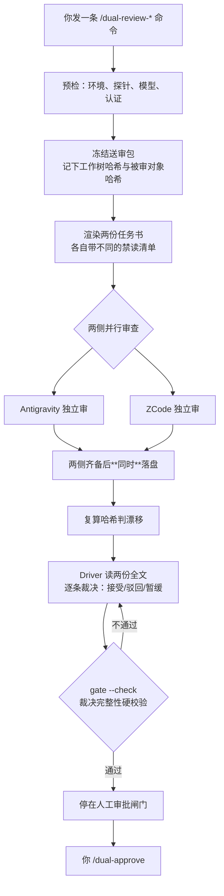

# MANUAL：TriviumCode 使用手册

> - **作者 / 负责人**：Driver（Claude）
> - **创建日期**：2026-09-13
> - **当前版本**：v1.0.0
> - **状态**：草稿(Draft)

---

## 本手册与 QUICKSTART 的分工

| | [QUICKSTART.md](./QUICKSTART.md) | 本手册 |
| :--- | :--- | :--- |
| 目标 | 照着敲，15 分钟跑通 | 理解每一步在干什么，能应对没照着剧本走的情况 |
| 命令 | 一览表 | 逐条完整契约、全部参数 |
| 配置 | 只讲必须配的那一项 | 全部字段逐条：默认值、什么时候改、改错的后果 |
| 出问题 | 六行速查 | 按症状分类的处置 + 已知限制 |

**第一次用请先读 QUICKSTART**，跑通之后再回来读本手册。本手册不假定你读过代码。

---

## 一、这是什么

一条让 **Claude Code 主攻写代码、另外两个 AI 背靠背复审**的流水线。

三个角色：

| 角色 | 是谁 | 能做什么 |
| :--- | :--- | :--- |
| **Driver**（执笔者） | Claude Code | 唯一能改业务代码的人。写方案、写代码、读审查意见、逐条裁决 |
| **Critic-A** | Google Antigravity（`agy`） | **只读**。独立审查，意见编号前缀 `AGY-` |
| **Critic-B** | 智谱 ZCode（`zcode.cjs`） | **只读**。独立审查，意见编号前缀 `GLM-` |

加一个本地编排器 `trivium`——它负责全部确定性逻辑：并行调度、超时、解析、落盘、防覆盖命名、闸门、留痕核验。

### 为什么要两个审查员，而且要背靠背

**背靠背**指两侧互相看不到对方的结论。这不是形式——它由三道机械屏蔽保证：审查期间对方的产出不在工作树里、原始输出落在项目外、送审任务书里逐条列出禁读路径并在事后与工具轨迹对账。

理由很朴素：一个模型看到另一个模型的结论后，倾向于附和而不是独立判断。两份独立结论的交集才是可信的，分歧则是需要人拍板的地方。

### 什么场景值得用

**值得**：

- 改动涉及并发、事务、权限、回滚路径这类「错了很贵」的地方
- 你自己也拿不准方案对不对
- 改的是别人要长期维护的代码
- 护栏、安全边界、判定逻辑本身——这类代码最容易「看起来合理地」开出洞

**不值得**：

- 纯文档改动（有 `skip_doc_only_review` 配置项专门跳过）
- 探索性试验、随手验证
- 一次双审墙钟 10~40 分钟、真实消耗两家厂商配额。改个错别字不值这个价

---

## 二、心智模型

### 2.1 一次运行的生命周期



关键点：

- **两侧齐备后同时落盘**——不会出现「一侧先落盘，另一侧还能看到」的窗口
- **逐条裁决是强制的**，少一条、理由空洞、编号不存在，闸门都会退回让你补
- **停点是 B/C/D 三条命令的定义**，不靠 Driver 自觉

### 2.2 四个阶段

| 阶段 | 被审对象 | 命令 |
| :--- | :--- | :--- |
| `plan` | 计划文档 `plan/<日期>-<主题>-claude.md` | `/dual-review-plan` |
| `code` | `git diff <base>` 算出的补丁 | `/dual-review-code` |
| `bug` | 根因分析文档 `bug/<日期>-<主题>-claude.md` | `/dual-review-bug` |
| `verify` | 无（执行你配置的编译测试命令） | `trivium verify` |

### 2.3 「闸门」是什么

一个按 `<主题>/<阶段>` 记录的状态位，存在 `.trivium/state.json`。七个状态，你会打交道的是这三个：

| 状态 | 含义 | 此时会挡什么 |
| :--- | :--- | :--- |
| `running` | 双审进行中 | 改业务文件（审查员在读真实工作树，你改了就是漂移） |
| `review_done_awaiting_disposition` | 审查落盘、裁决未齐 | `git commit`、结束对话 |
| `awaiting_approval` | 裁决已通过、等你审批 | 改业务文件 |

其余四个（`idle` / `approved` / `rejected` / `abandoned`）都不挡任何东西。

---

## 三、安装与启用

**最容易搞混的一点：安装是一次性的，启用是每个项目都要做的。**

| | 安装 | 启用 |
| :--- | :--- | :--- |
| 做什么 | 把编排器和 skill 装到 `~/.claude/skills/` | 在项目里生成 `.trivium/`、注册 Hook |
| 频率 | 每台机器一次（升级时重做） | 每个项目一次 |
| 命令 | `npm run build && node dist/install.cjs` | `trivium init` |

### 3.1 前置条件

| 项 | 要求 | 怎么确认 |
| :--- | :--- | :--- |
| 操作系统 | **macOS**。Linux / Windows **未验证** | — |
| Node.js | ≥ 18 | `node --version` |
| git | 项目必须是 git 仓库 | `git --version` |
| Antigravity | `agy` 可调用且**已登录** | `agy --version` |
| ZCode | 桌面端已装，CLI 凭据已配 | `ls ~/.zcode/cli/config.json` |

**凭据由你自己配**。编排器只读取已有登录态，从不代你写凭据，也不会把凭据写进任何工件——落盘前有密钥扫描（10 条规则 + 熵判定），命中即拒绝落盘。

### 3.2 安装

```bash
git clone <仓库> TriviumCode && cd TriviumCode
npm install
npm run build
node dist/install.cjs
```

装完先自检，**零配额消耗**：

```bash
node ~/.claude/skills/dual-critic/scripts/trivium.cjs doctor --selftest
```

它在临时夹具里真跑一遍 14 步全流水线。两侧走桩适配器，所以它**证明不了两家 CLI 可用**——那是 `doctor` 的事。

### 3.3 为什么 `trivium` 不在 PATH 上

这是有意的。项目内一律用 `.trivium/bin/trivium`，它是一个 sh wrapper，**内含 node 的绝对路径**——VS Code 这类 GUI 进程不读你的 `~/.zshrc`，依赖 PATH 会在插件里失效。

还没 `init` 的项目里用全路径：`node ~/.claude/skills/dual-critic/scripts/trivium.cjs <子命令>`。

### 3.4 在项目里启用

```bash
cd <你的项目>
node ~/.claude/skills/dual-critic/scripts/trivium.cjs init
node ~/.claude/skills/dual-critic/scripts/trivium.cjs doctor   # 约 2~4 分钟，消耗少量配额
```

`init` 动四处，全部幂等：

```
.trivium/bin/trivium      新建，wrapper
.trivium/config.yaml      新建（已存在则**跳过，绝不覆盖**）
.claude/settings.json     合并 5 个 Hook（按事件名替换同名条目），原文备份到 .trivium-backup
.gitignore                整体忽略 .claude/ 改成白名单写法；追加 .trivium/ 规则
CLAUDE.md / AGENTS.md     追加带标记的协议片段
```

**`doctor` 必须在终端里跑，不要在 Claude Code 里跑。** 它需要 2~4 分钟，会击穿 Bash 工具的 600s 超时——届时配额已烧而结论未落盘。

### 3.5 必须补一步：配置编译测试命令

编排器**只执行你显式声明的命令，绝不猜测执行**——`scripts.test` 完全可能耗时极长、依赖外部服务或有副作用。

```bash
.trivium/bin/trivium doctor --suggest-verify   # 只展示候选，不写入
```

然后手工写进 `.trivium/config.yaml`：

```yaml
verify:
  build: ['npm run typecheck', 'npm run build']
  test:  ['npm test']
```

两组皆空时 `/dual-run` 会拒绝启动。

**monorepo 注意**：每条命令是独立的 `/bin/sh -c` 进程，cwd 固定为项目根，**前一条的 `cd` 不会累积到下一条**，每条都要自带 `cd`：

```yaml
verify:
  build:
    - cd client && pnpm build
    - cd server && go build ./...
```

### 3.6 升级

```bash
cd TriviumCode && npm run build && node dist/install.cjs
cd <你的项目> && node ~/.claude/skills/dual-critic/scripts/trivium.cjs init
```

升级会刷新 wrapper 和 Hook（旧条目被**替换**，不叠加）。但有两样**不会**自动更新：

> **⚠️ 坑一：`config.yaml` 不会刷新。**
> `init` 对已存在的 `config.yaml` 无条件跳过。想拿到新版默认值只能手工编辑。
> 实例：`wait_timeout_s` 的默认值从 540 改成了 180（把进度反馈从 9 分钟收到 3 分钟），但老项目的 config.yaml 里仍是 540，体感上与没有反馈没区别。

> **⚠️ 坑二：`CLAUDE.md` 的协议片段也不会刷新。**
> 追加逻辑是「见 `<!-- BEGIN TriviumCode -->` 标记就跳过」，所以片段永远停在初始化那天的版本。
> 实测某项目的片段落后 18 行，缺的正是**已知误拦的出口指引**——撞上时会不知道怎么办。
> 手工同步：把 `CLAUDE.md` 里 BEGIN 到 END 之间的内容换成 `~/.claude/skills/dual-critic/protocol/CLAUDE.md.snippet` 的当前内容。

卸载：`node dist/install.cjs --uninstall`（只删用户级 skill 与 Agent 定义，项目内的 `.trivium/` 与 Hook 不动）。

---

## 四、七条命令

四条主命令（A/B/C/D）+ 三条辅助命令。全部标了 `disable-model-invocation: true`——**只能由你发起，Driver 不会自己调用**。

### 4.1 `/dual-run` —— 全流程（命令 A）

```
/dual-run <任务目标> [--topic <主题>] [--focus <提示语>] [--context <路径,…>]
          [--profile <名称>] [--model-gemini <slug>] [--model-glm <id>]
```

出方案 → 双审 → 修订 → 编码 → 双审 → 应答 → 改码 → 真实执行编译测试。

**A 是唯一不设人工闸门的命令**——它跑完整条链，中途不停。正文是**任务目标**（这次要达成什么），`--focus` 是可选补充。

前提：`verify.build` / `verify.test` 至少一组非空，否则拒绝启动。

### 4.2 `/dual-review-plan` —— 只审计划（命令 B）

```
/dual-review-plan <审查焦点提示语> [--goal <任务目标>] [--topic <主题>]
                  [--context <路径,…>] [--profile <名称>]
                  [--model-gemini <slug>] [--model-glm <id>]
                  [--plan-file <路径>] [--only gemini|glm] [--allow-single]
```

**对「已有」计划做双审**——所以先得有一份草稿落在 `.reviews/<主题>/plan/<日期>-<主题>-claude.md`。让 Claude Code 写好再发这条命令。

### 4.3 `/dual-review-code` —— 只审代码变更（命令 C）

```
/dual-review-code <审查焦点提示语> [--base <ref>] [其余同上]
```

被审对象是 `git diff <base>`（默认 `HEAD`）+ 未跟踪文件。补丁**只算一次**后透传给两侧——逐侧各自 diff 会让两侧审的不是同一段变更。

补丁**无条件剔除** `.reviews/`、`.trivium/`、`.git/`，与你的 `.gitignore` 写了什么无关。这是安全边界不是优化：`.reviews/` 是刻意进版本管理的，对方产出刚落盘时处于未跟踪状态，若被收进补丁就会经**被审对象本身**泄漏给审查员。

### 4.4 `/dual-review-bug` —— 只审根因分析（命令 D）

```
/dual-review-bug <审查焦点提示语> [--rca-file <路径>] [其余同上]
```

**不得由 B 或 C 代替**。根因分析的审查镜头与计划、代码都不同。

### 4.5 `--focus` 与 `--goal` 的区别（最容易用错）

| | 问的是 | 进 BRIEF 第几段 | 必填？ |
| :--- | :--- | :--- | :--- |
| `--focus`（正文） | **这次重点看什么** | 第 2 段，**逐字嵌入** | B/C/D 必填，缺则退 64 |
| `--goal` | **这次要达成什么** | 第 4 段 | 不必填 |

`--goal` 省略时会自动回退：显式值 → `task.json` 已记录的目标 → 同主题 plan 原稿的首个标题/首段。**刻意不兜底到主题名**。

换了 `--focus` 必定触发重审——它是审查焦点，不是描述。

### 4.6 自由文本里含 `--` 时要加引号

如果你的提示语里出现以 `--` 开头的词，需要用字面双引号包起来：

```
/dual-review-plan "重点核实 --plan-file 透传说明是否准确" --topic 文档修正
```

漏了引号，`--plan-file` 会被当成真旗标，连同后一个词一起被抠走。若解析器提示「主题异常短」，多半就是这里漏了引号。

### 4.7 `--only` 与 `--allow-single`（降级）

| | 作用 | 后果 |
| :--- | :--- | :--- |
| `--only gemini\|glm` | 只跑一侧，调试用 | **会被标为降级——这不是双审** |
| `--allow-single` | 一侧失败时不中止，产出单审结果 | 同上，且留痕记 `degradations[]` |

`--allow-single` 受配置 `review.allow_single_flag` 约束，二者是**与**关系：配置里关掉，命令行也开不回来。这是刻意的——否则「默认 strict」就只是纸面规定。

**降级绝不冒充双审**：幸存侧的文件照常落盘并标 `degraded`，失败侧在 `_meta/` 写一份 `.failed.json`，**不产出审查文档**。

### 4.8 三条辅助命令

```
/dual-approve --topic <主题> --stage plan|code|bug [--reject --reason <理由>]
/dual-abandon --topic <主题> [--stage <阶段>] [--reason <理由>]
/dual-status  [--topic <主题>]
```

- `approve` 必须显式写 `--stage`
- `abandon` 可省略 `--stage`，批量放弃该主题全部非 running 的闸门
- **三种结论都解除写锁，工件一律保留**
- `reject` 必须带 `--reason`

### 4.9 直接调 CLI 的命令

这些没有 skill 包装，在终端里跑：

```bash
.trivium/bin/trivium doctor [--selftest|--suggest-verify|--no-model-calls|--only agy|zcode]
.trivium/bin/trivium preflight --stage plan|code|bug|all
.trivium/bin/trivium verify --topic <主题> [--only build|test]
.trivium/bin/trivium report --topic <主题> [--out <路径>]
.trivium/bin/trivium review --status <run_id>
.trivium/bin/trivium review --cancel <run_id>
```

---

## 五、配置项逐条说明

文件是 `.trivium/config.yaml`（进 Git，团队共享）。本机结论在 `config.local.yaml`（不进 Git）。

优先级：**内置默认 → `config.yaml` → `config.local.yaml` → 命令行**。

配置不合法会退 69 并逐条列出问题（未知字段、枚举值拼错、区间越界），**不会静默 fail-open**。

### 5.1 主题与运行时

| 字段 | 默认 | 说明 |
| :--- | :--- | :--- |
| `topic.max_len` | 64 | 主题名长度上限 |
| `topic.forbid_chars` | `/ \ .. 空格` | 主题名要做文件名，禁路径分隔符 |
| `runtime.node` | `null` | 派生 worker 用的 node；null 取当前进程 |
| `runtime.run_root` | `~/.trivium/runs` | **原始输出落在项目外**，这是背靠背隔离的第二道 |
| `retention.run_dir_days` | 30 | 运行目录保留期，会话开始时清理 |

主题名不能以 `-r<数字>` / `-revised` / `-response` / `-verify` 结尾——否则无法区分「主题 X 的第 2 轮」与「主题 X-r2 的首轮」。

### 5.2 隔离

| 字段 | 默认 | 说明 |
| :--- | :--- | :--- |
| `isolation.peer_artifact_globs` | `**/*-gemini.md`, `**/*-glm.md` | 对方产出的识别模式，用于生成禁读清单 |
| `isolation.deny_via_cli` | `auto` | 是否用 CLI 的路径级 deny。**两侧实测均不支持，实际恒为降级** |
| `isolation.context_max_docs` | 12 | 必读清单的文件数上限 |

### 5.3 审查

| 字段 | 默认 | 什么时候改 |
| :--- | :--- | :--- |
| `review.timeout_s` | plan 900 / code 1200 / bug 1200 | 仓库大、补丁大时调大。**改大会连带改变 `max_waits`** |
| `review.wait_timeout_s` | **180** | 每次等待窗口，**同时是你能收到进度的最小间隔**。调小反馈更密，代价是往返变多 |
| `review.heartbeat_stale_s` | 120 | 超过这个时间没心跳判 worker 失联 |
| `review.failure_policy` | `strict` | 一侧失败即中止。改 `degrade` 则继续出单审 |
| `review.allow_single_flag` | `true` | 是否允许命令行 `--allow-single`。设 `false` 则命令行也开不回来 |
| `review.parallel` | `true` | 两侧并行。改 `false` 只会更慢，无收益 |
| `review.retry.transient_max` | 1 | 瞬时失败重试次数（429、连接重置、解析失败等）。超时**不重试**——大概率再超时 |
| `review.min_tool_calls` | 每阶段 5 | 证据下限：该侧至少要有这么多次读/搜工具调用 |
| `review.min_project_reads` | 每阶段 3 | 至少读到这么多个**项目文件**（排除被审对象、任务书、归档内文件、项目外文件） |
| `review.cache` | `false` | — |

**证据下限不是可选项**：Antigravity 的软拒绝会产生「exit 0 但零工具调用」的空审查，这两个下限是唯一能识别它的机制。达不到下限的一侧会被标「证据不足：本侧不得计为合格双审的一半」。

#### 漂移

| 字段 | 默认 | 管什么 |
| :--- | :--- | :--- |
| `review.on_drift_related` | `fail` | 审查期间被改的文件**落在 `--context` 或 diff 涉及范围内** |
| `review.on_drift` | `warn` | 审查期间**别处**文件被改 |
| （不可配） | 恒 `fail` | 被审对象本身的哈希变了 → 整次运行作废 |

默认组合的语义：动了被审范围内的东西 → 这次结论作废；动了不相干的东西 → 只告警。

#### 敏感文件与跳过

| 字段 | 默认 | 说明 |
| :--- | :--- | :--- |
| `review.sensitive_globs` | `.env*`, `**/.env*`, `**/*.pem`, `**/*.key`, `**/id_rsa*` | 三处生效：进禁读清单、**从补丁里剔除**、主题参数解析时剔除 |
| `review.skip_doc_only_review` | `false` | 改 `true` 则纯文档变更跳过 code 审 |
| `review.skip_globs` | `**/*.md`, `docs/**`, `**/*.txt` | 算「纯文档」的模式 |
| `review.never_skip_globs` | `package.json`, `Dockerfile`, `.github/**`, `.claude/**`, `.trivium/**` 等 | 这些即便是配置文件也绝不跳过 |
| `review.block_severities` | `['blocker','major']` | **⚠️ 死配置，无任何消费方，改它不会有效果** |

> `.env*` 的 glob 不跨 `/`，所以只匹配根目录——子目录里的 `config/.env.production` 要靠 `**/.env*` 那条。两条都要留。

### 5.4 审查员与档位

| 字段 | 默认 | 说明 |
| :--- | :--- | :--- |
| `critics.gemini.agent` | `trivium-critic` | 只读 Agent 定义名。**工具白名单不含任何写工具** |
| `critics.gemini.effort` | plan high / code medium / bug high | 思考档位。**模型 slug 自带档位时不传**，否则 agy 会直接拒绝 |
| `critics.gemini.readonly_commands` | `git log`, `ls`, `cat`, `grep` 等 | 允许的只读命令 |
| `critics.glm.max_turns` | 40 | ZCode 的最大轮数 |
| `critics.glm.unsupported_override` | `reject` | 模型覆盖落到全局档时拒绝还是标注 |
| `active_profile` | `default` | 当前档位 |

两个内置档位。两档的 Gemini 侧相同，差异只在 GLM 侧用不用 Flash：

| 档位 | 三个阶段的 Gemini 侧 | 三个阶段的 GLM 侧 | 用途 |
| :--- | :--- | :--- | :--- |
| `default` | `gemini-3.8-flash-high` | `GLM-5.3` | 日常 |
| `flash` | `gemini-3.8-flash-high` | `GLM-5.3-Flash` | 省时省配额 |

单次切换用 `--profile <名称>`；只换某一侧的模型用 `--model-gemini` / `--model-glm`（优先级更高）。

### 5.5 闸门

| 字段 | 默认 | 说明 |
| :--- | :--- | :--- |
| `gate.require_adjudication` | `true` | 是否强制逐条裁决 |
| `gate.allow_defer` | `true` | 是否允许「暂缓」这第三态 |
| `gate.block_business_write_when_awaiting_approval` | `true` | 闸门期锁业务写入。**关掉它只关业务文件锁，留痕的锚仍然任何时候都护着** |
| `gate.approval_lock_scope` | `session` | 写锁作用域。`session` 时只有**明确记录了别的会话**才不加锁 |
| `gate.approval_lock_ttl_h` | 24 | 写锁过期时间；也是死 running 闸门的回收阈值 |
| `gate.block_commit` | `true` | 裁决未齐时拦 `git commit` |
| `gate.stop_hook_max_blocks` | 2 | 拦几次收工后放行（防死循环）。配 0 会被 schema 拒绝 |
| `gate.max_check_retries` | 3 | — |
| `gate.reason_policy` | `warn` | 理由空洞时告警还是硬失败 |
| `gate.joint_blocker_policy` | `warn` | 双方共同 blocker 被驳回时告警还是硬失败 |

### 5.6 其他

| 字段 | 默认 | 说明 |
| :--- | :--- | :--- |
| `preflight.auth_cache_ttl_h` | 1 | 认证探活缓存 |
| `probe_ttl_days` | **7** | 探针保质期。**过期即预检硬失败，不是降级** |
| `verify.build` / `verify.test` | `[]` | 必须手工配 |

---

## 六、读懂产出

```
.reviews/<主题>/
├── task.json                                主题级元数据：各轮指针、闸门、审批、争议
├── plan/  code/  bug/  verify/
│   ├── <日期>-<主题>-claude.md               ← 你/Driver 写的原稿
│   ├── <日期>-<主题>-gemini.md               ← Antigravity 的审查
│   ├── <日期>-<主题>-glm.md                  ← ZCode 的审查
│   ├── <日期>-<主题>-revised-claude.md       ← 修订件（plan/bug，含逐条裁决）
│   ├── <日期>-<主题>-response-claude.md      ← 应答件（code）
│   └── _meta/                                 审计材料
```

重跑会自动抬 `-r<N>`：`<日期>-<主题>-r2-gemini.md`。**既有工件一律不覆盖**，用的是 `O_CREAT|O_EXCL` 原子创建。

### 6.1 `_meta/` 里有什么

| 文件 | 是什么 |
| :--- | :--- |
| `brief-<侧>-<run_id>.md` | 送给该侧的任务书（含禁读清单），两侧不同 |
| `changes-<run_id>.diff` | code 阶段冻结的被审补丁 |
| `changes.diff` | 上者的人读便利副本 |
| `review-<侧>-<run_id>.json` | **结构化结论。`gate --check` 的唯一事实来源** |
| `review-<侧>-<run_id>.failed.json` | 该侧失败/超时的记录（绝不改名冒充对方） |
| `review-<侧>-<run_id>.fallback-items.md` | 解析降级时的编号化待裁决单元 |
| `run-<run_id>.json` | 运行元数据：快照、漂移、生效模型、工具轨迹、留痕保护集 |

**`_meta/` 和 `task.json` 是编排器独占的，任何时候都不许你改**——它们是留痕的锚，改了就能整枝绕过核验。

### 6.2 怎么读一份审查结论

先看文档头部的旗标：

| 旗标 | 含义 |
| :--- | :--- |
| `degraded: true` | 这不是双审，只有一侧 |
| `parse_fallback: true` | 该侧输出不合 schema，**不参与阻断判定**，但仍须逐条裁决 |
| `evidence_ok: false` | **证据不足：本侧不得计为合格双审的一半** |
| `drift: true` | 审查期间工作树变动过 |

然后看 `verdict`：`approve` / `approve-with-nits` / `request-changes` / `block`。

每条意见有九个字段，其中 `evidence`（证据）和 `confidence`（置信度）最值得看——`confidence: low` 的意见不必当真，但也不该静默忽略。

### 6.3 怎么写好裁决

裁决表是一张 Markdown 表，六列：`id / source / severity / disposal / reason / action`。

三种裁决，**每种都必须有非空理由**：

| 裁决 | 还必须写 | 校验 |
| :--- | :--- | :--- |
| **接受** | `action` 落点（改哪个文件、怎么改） | 空了报 `missing_action` |
| **驳回** | 理由 | 空洞理由（「无需修改」「不适用」「已知悉」）报 `weak_reason` |
| **暂缓** | 理由 + 触发条件 | `allow_defer: false` 时直接不允许 |

解析器对写法很宽容：全角半角、`**AGY-01**` 的加粗、`` `AGY-01` `` 的反引号、列名同义词都能认。但对语义很严格：少一条、编号不存在、理由为空，一律退 2 并**点名缺口**。

**不要静默忽略任何一条**。闸门会逐条比对期望编号与表中编号的双向差集。

### 6.4 看复盘

```bash
.trivium/bin/trivium report --topic <主题>
```

给出时间线、每轮意见数与严重度分布、采纳率、被驳回项与理由、生效模型核对、降级与告警清单、双审退化指标、耗时汇总。

> **⚠️ 已知缺口**：报告里的「争议项」只会显示一个布尔标记，**永远打印不出具体编号**——`disputes[]` 数组在代码里没有任何写入点。

---

## 七、日常场景

### 场景 1 · 只审一份计划

```
（1）让 Claude Code 写方案，存到 .reviews/<主题>/plan/<日期>-<主题>-claude.md
（2）/dual-review-plan 重点看并发安全与回滚路径 --topic 登录重构
（3）等 10~40 分钟，期间每 3 分钟收到一行进度
（4）读两份审查文档全文
（5）Driver 写 -revised-claude.md 逐条裁决
（6）闸门校验通过 → 停在人工审批
（7）/dual-approve --topic 登录重构 --stage plan
```

### 场景 2 · 审一段代码改动

同上，命令换成 `/dual-review-code`，被审对象自动取 `git diff HEAD`。想比较别的基线用 `--base <ref>`。

**改动必须已经在工作树里**——没有变更时退 65。

### 场景 3 · 走完整流程

```
/dual-run 实现登录重试与退避 --topic 登录重构
```

跑完整条链，中途不停，最后真实执行 `verify.build` / `verify.test`。前提是这两组至少一组非空。

### 场景 4 · 审查跑到一半想停

```bash
.trivium/bin/trivium review --cancel <run_id>
```

按进程组杀掉 worker 及其拉起的 agy/zcode，回收锁与闸门。

> 注意：被取消的运行，其 `run-<id>.json` 会**停在 `status: running`**——`cancelRun` 不回写它。这是已知的实现缺口，不影响后续使用。

### 场景 5 · 裁决写了但闸门不过

```bash
.trivium/bin/trivium gate --stage plan --topic <主题> --check
```

退出码 2 **不是崩溃，是有话要说**——stdout 里就是待修补的清单，逐条点名了缺口。补完再跑一次。

### 场景 6 · 这个主题不想要了

```
/dual-abandon --topic <主题> --reason 需求取消
```

解除写锁，**全部工件保留**。

### 场景 7 · 重跑一轮

直接再发一次同样的命令。工件不会被覆盖，自动抬 `-r2`。

但**上一轮的裁决必须先补齐**——闸门是 `review_done_awaiting_disposition` 时重跑会被拒绝并提示「上一轮尚未裁决」。

---

## 八、五道护栏

前四道由 Claude Code Hook 强制，**不靠模型自觉**。

| 什么时候 | 挡什么 | 怎么过 |
| :--- | :--- | :--- |
| 审查进行中 | 改业务文件 | 等它跑完。审查员在读真实工作树，你改了会造成漂移，可能让整次运行作废 |
| 裁决未齐备 | `git commit`、结束对话 | 补齐裁决，跑 `gate --check` 通过 |
| **任何时候** | 写 `*-gemini.md` / `*-glm.md` | 这两类只能由编排器渲染落盘。你的产出后缀是 `-claude` |
| **任何时候** | 用 Bash 碰 `_meta/`、`task.json`、`state.json`、`.trivium/bin` | 这些是留痕的锚，改锚即可整枝绕过核验 |
| 闸门期 | 用 Bash 旁路改业务文件（`cat >`、`sed -i`、`tee`、`git checkout -- f`） | 同第一、二道 |

被挡住时 Hook 会打印具体主题、阶段和解法。**不要靠改配置绕开**——那会让整条流水线退化成「两个模型随口说了点什么」。

### 8.1 第四道有一种已知误拦

判定在**未剥离 heredoc 的原文**上做，且是纯字面扫描，所以**区分不了「写它」与「说它」**。

一条 Bash 命令只要正文里出现 `-gemini.md`、`_meta`、`task.json`、`state.json`、`.trivium` 这些字样，就会被拦——哪怕它实际要写的是别的文件，**包括 commit message**。

**出口：改用 Write / Edit 工具落文件**（精确判定，不看字面）。提交说明写进文件再 `git commit -F <文件>`，不要用 `-m` 内联。

这个代价是刻意接受的。正文里写保护路径恰恰是要防的攻击形态（`python3 - <<'PY' … PY` 里藏一条改 `_meta/` 的写入），正则无法区分「讨论它」与「攻击它」。误拦的后果是你换个工具，漏拦的后果是裁决期归档被篡改且无事后兜底——代价不对称，所以选了误拦。

**没有例外，包括 `git commit`。** 2026-09-12 给它开过一次豁免，双审打穿后撤回：三个前置条件仍漏掉至少五条夹带路径，其中换行、附着重定向、文本提及三条实测能放行。五类形态现在都锁成了测试负例。

### 8.2 第五道不是机械保证的

**人工审批这道关靠的是约定，不是护栏。**

`trivium approve` 是普通 CLI 子命令，**不校验调用来源**，而 review 命令的 `allowed-tools` 预批准了 `Bash(.trivium/bin/trivium:*)`。也就是说 **Driver 自己敲一条命令就能关掉等你审批的闸门**，不需要你确认。

曾经加过一次性确认码，后来移除了——码的明文经 stdout 由 Driver 转述给你，它读得到，构不成边界，只会让人误以为这道关是铁的。**虚假的安全感比没有护栏更糟。**

你的实际保障是**留痕**（那部分有机械边界）与**事后对账**：每次审批的时间、阶段、`run_id` 与会话来源都写在 `task.json` 的 `approvals[]` 里。

真正的机械边界需要宿主提供不经过模型的带外通道（TTY / 审批 UI），本项目没有。

---

## 九、出问题时

### 9.1 退出码

| 码 | 含义 | 是不是故障 |
| :--- | :--- | :--- |
| `0` | 成功 | 否 |
| `1` | 一般失败 | 是，看 stderr |
| `2` | 闸门阻断 | **否**，护栏按预期工作。stdout 里是待修补清单 |
| `64` | 参数错误 | 是，改命令。**不会产生任何工件** |
| `65` | 前置产物缺失 | 是，先补工件 |
| `69` | 环境或预检失败 | 是，跑 `doctor` / `preflight` |
| `70` | 主题被锁 | 是，同主题已有运行 |
| `73` | 运行仍在进行 | **否**，不是超时，是还没跑完 |
| `75` | 严格模式中止 | 是，一侧失败且 `failure_policy: strict` |

`2` 和 `73` 最容易被误处理：**`2` 不是崩溃而是有话要说，`73` 不是超时而是还没跑完。**

### 9.2 常见症状

| 症状 | 先看这个 |
| :--- | :--- |
| 命令没反应 / 提示未初始化 | `.trivium/config.yaml` 在不在？Hook 检测不到它一律放行 |
| 预检报探针过期 | 探针 7 天 TTL 且**过期即硬失败**。在终端里跑 `trivium doctor` 重新校准 |
| 某侧报不可用 | `trivium preflight --stage plan`，它会指出是探针过期、CLI 不可调用还是未认证 |
| 某侧被判「证据不足」 | 该侧读的项目文件数或工具调用数没达下限。看 `_meta/run-*.json` 的 `tool_calls` |
| 一侧超时 | 默认 strict 会中止。调大 `review.timeout_s`，或临时 `--allow-single` 降级 |
| 主题被锁但没有运行在跑 | 遗留锁会自动回收（四条判据取任一）。真卡住用 `review --cancel <run_id>` |
| 每次工具调用都报 hook 错误 | wrapper 里写死的 node 路径失效了（`brew upgrade node` 之后）。重跑 `init` |
| Bash 命令莫名被拦 | 命令正文里有 `.trivium` / `_meta` / `task.json` 之类的字样？见 §8.1 |

深度故障（锁、闸门、跑挂、留痕）按退出码查 [RUNBOOK_pipeline_ops.md](../06_deployment/RUNBOOK_pipeline_ops.md)。

---

## 十、已知限制与取舍

如实列出，**这些不是 bug，是知道且接受的边界**。

| 限制 | 具体是什么 | 现状 |
| :--- | :--- | :--- |
| **平台** | 只验证过 macOS。Linux / Windows 未验证 | 本期不作为目标平台 |
| **探针 7 天 TTL** | 过期即预检**硬失败**，且无临近预警。每个项目各存一份、各自计时——N 个项目就是 N 条要单独重烧配额的时间线 | 探针本是**本机级**结论，按项目存是实现现状。改成全局缓存属设计变更 |
| **路径级 deny 不可用** | 两侧实测均不支持。ZCode 的 `--disallowed-tools "Read(<路径>)"` 语法被接受，但模型改用 `Bash(head -1)` 读到了目标文件 | 隔离是**降级运行**——只靠禁读清单 + 事后轨迹核验（风险 R13） |
| **人工审批无机械边界** | 见 §8.2 | 需宿主提供带外通道 |
| **Bash 拦截有已知误拦** | 见 §8.1 | 刻意接受的取舍 |
| **配置与协议片段不会自动升级** | 见 §3.6 | 需手工同步 |
| **`block_severities` 是死配置** | 定义了但无消费方 | 改它不会有效果 |
| **报告的「争议项」无法显示编号** | `disputes[]` 无写入点 | 只有布尔标记生效 |
| **`doctor` 必须在终端跑** | 2~4 分钟，会击穿 Bash 工具 600s 超时 | 预检刻意不自动拉起它 |

---

## 十一、往下读

- [QUICKSTART.md](./QUICKSTART.md)：15 分钟速通
- [RUNBOOK_pipeline_ops.md](../06_deployment/RUNBOOK_pipeline_ops.md)：按退出码倒查故障
- [.reviews/README.md](../../.reviews/README.md)：留痕目录与命名规范
- [PROTOCOL_dual_critic_relay.md](../03_api/PROTOCOL_dual_critic_relay.md)：Schema 与协议契约
- [LLD_orchestrator.md](../02_design/LLD_orchestrator.md)：编排器实现说明（想改代码时读）
- [REPORT_2026-09-11_m0_probe.md](../05_testing/REPORT_2026-09-11_m0_probe.md)：两家 CLI 的实测坑清单
