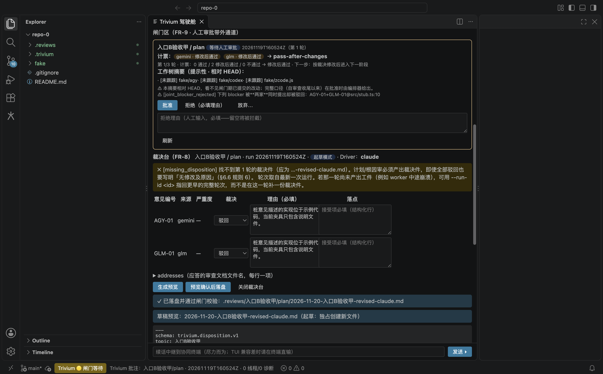

# TriviumCode 使用手册

**核心 1.3.8 · VS Code 驾驶舱 0.3.3 · 2026 年 11 月 26 日**

TriviumCode 把同一个 Git 项目交给一位主攻助手（Driver）执笔，再请一至三位审核者独立检查。你提供目标、选择参与者，并在需要人工决定时审批。可以全程在主攻助手的会话中工作，也可以在 VS Code 中装配任务、看审查意见和审批。

| 我现在要做什么 | 从哪里开始 |
| --- | --- |
| 第一次在自己的项目使用 | [安装核心并启用项目](#首次安装与项目启用)，然后按[四种任务](#2-四种任务如何选)选择入口 |
| 我已有计划，想在 VS Code 里从头走一次 | [驾驶舱实操](#10-在-vs-code-驾驶舱走通一次计划审查) |
| 我只用终端，想指定审核者和送审范围 | [主题与材料](#3-主题材料与焦点)、[模型与路线](#4-选审核者模型和路线) |
| 我收到审查意见，或需要作批准决定 | [逐条裁决](#6-阅读结论与逐条裁决)、[人工审批](#7-人工批准拒绝和放弃) |
| 我想看旧轮次、找不到输出，或换了一台机器 | [回放与运行监控](#11-监控批注与历史回放)、[故障处理与维护](#12-按现象排障与维护) |

本手册按以上版本的工作树编写。仓库 `releases/1.3.2/` 下的核心安装包和完整手册属于旧版。需要复现本版功能时，先核对核心和扩展各自的版本；核心版本可在项目终端执行 `./.trivium/bin/trivium --version` 查看，扩展版本见 VS Code 的「扩展」详情页。

## 首次安装与项目启用

### 准备一台机器

核心运行需要 Node.js 18 或以上、Git 2.20 或以上，以及所选 Driver 和审核者各自可用的 CLI、登录和配额。Windows 10/11 安装 Git for Windows。使用驾驶舱还需要 VS Code 1.85 或以上，扩展声明的 Node 环境为 20 或以上。源码构建建议用 Node.js 22 或以上。先在终端运行 `node --version` 和 `git --version` 核对。

**使用预构建包。** 取得同一版本的平台包及同名 `.sha256` 文件。macOS 在包所在目录用 `shasum -a 256 -c 文件名.sha256` 核对后解开 `.tar.gz`；Windows 用 PowerShell 的 `Get-FileHash 文件名.zip -Algorithm SHA256` 对照校验文件，再解开 ZIP。命令里的文件名换成手中包的名称。进入完整解压目录，Windows 可运行 `一键安装.cmd`，依次完成前置检查、安装、版本核对和桩自检。macOS 可分步运行：

```sh
unset TRIVIUM_ASSET_ROOT
node scripts/install-check.mjs
node dist/install.cjs
```

**从当前源码安装。** 在 TriviumCode 源码根目录执行以下命令；安装前检查报告同名入口时，先逐项核对归属。完成后重开主攻助手会话，使其重新加载入口。

```sh
unset TRIVIUM_ASSET_ROOT
npm ci
npm run build
node scripts/install-check.mjs
node dist/install.cjs
```

无论选哪种安装方式，都核对**已安装副本**。默认共享运行时位于用户的 Claude 技能目录，使用 Codex 主攻时也从此处调用。第二条命令在临时项目中用桩审核者跑 14 步，不消耗供应商配额。

```sh
node ~/.claude/skills/dual-critic/scripts/trivium.cjs --version
node ~/.claude/skills/dual-critic/scripts/trivium.cjs doctor --selftest
```

### 在目标项目准备第一轮

1. 打开**准备接受审查的 Git 项目根目录**。先预览初始化会修改哪些文件，再执行初始化；这一步会生成或合并项目配置、包装命令和相应 Hook。

   ```sh
   node ~/.claude/skills/dual-critic/scripts/trivium.cjs init --dry-run
   node ~/.claude/skills/dual-critic/scripts/trivium.cjs init
   ./.trivium/bin/trivium --version
   ./.trivium/bin/trivium doctor --no-model-calls
   ```

2. 选定本次组合。例如让 Codex 主攻、Gemini 和 GLM 审核计划。以下两条真实探针会调用供应商并使用配额；在驾驶舱需要按探针启动 Codex 主攻时，也运行 `./.trivium/bin/trivium doctor --only codex`。最后对相同审核组合做预检。

   ```sh
   ./.trivium/bin/trivium doctor --only agy
   ./.trivium/bin/trivium doctor --only zcode
   ./.trivium/bin/trivium preflight --stage plan --driver codex --critics gemini,glm
   ```

3. 核对结果。项目包装命令应返回所装核心版本，静态探针能识别本机入口，所选路线的真实探针应有模型与读取能力结论，预检应通过。到这一步即可在主攻会话输入正式入口，或打开驾驶舱装配任务。

**Windows PowerShell。** 初始化用 `node "$HOME\.claude\skills\dual-critic\scripts\trivium.cjs" init`。之后把示例中开头的 `./.trivium/bin/trivium` 换成 `.\.trivium\bin\trivium.cmd`；例如 `.\.trivium\bin\trivium.cmd doctor --only zcode`。在 Git Bash 中可直接使用上面的 shell 示例。

## 1. 使用前的基本约定

你始终与当轮 Driver 对话。Driver 是本轮唯一执笔者；审核者由编排器以独立只读进程拉起，不能看对方输出。你不需要手动打开几个审核窗口互相转发。

“审查有效”“裁决齐备”“用户批准”“编译测试通过”“安装验收通过”分别记账，彼此不能替代。A 可按约定走完整流程；B/C/D 默认到人工停点。审批期和审查中不得改业务代码。

产品缺省 Driver 为 Claude Code；下文示例以 Codex 主攻为例，换载体只换入口写法。四家入口写法：

| 当前主攻载体 | 全流程示例 | 护栏 |
| --- | --- | --- |
| Claude Code | `/dual-run 实现缓存失效策略` | L1 Hook |
| Codex | `$dual-run 实现缓存失效策略` | L2，按停点自觉执行 |
| Antigravity | `/dual-run 实现缓存失效策略` | L2；主攻完整真载体验收仍有未测面 |
| ZCode 桌面 | `/dual-run 实现缓存失效策略` | L2，已信任工作区的 Hook 为尽力拦截 |
| ZCode 命令行 | `/skill dual-run 实现缓存失效策略` | L2，不能承诺桌面 Hook 生效 |

四个正式审查入口之外，`dual-approve`、`dual-status`、`dual-abandon` 是辅助命令。裸 CLI 用于排查和高级操作，不取代仓库要求的正式入口，不要自行调用某家审核 CLI 拼装审查。

**在哪儿输入命令。** 表中带 `$` 或 `/` 的入口应粘贴到相应 Agent 的对话框，两个操作系统写法相同。以 `node`、`git` 或 `./.trivium/bin/trivium` 开头的示例在系统终端执行。驾驶舱「点火」会替你把同一个入口送进交互终端；一个任务选择一种发起方式即可。

## 2. 四种任务如何选

| 手中已有的材料 | 选哪个入口 | 这一轮交给你什么 |
| --- | --- | --- |
| 需求和验收目标，希望一路做到构建测试 | A · 全流程 | 审过的计划、代码、逐项应答，以及实际执行的验证结果或停点原因 |
| 一份待定的实施计划 | B · 计划双审 | 每轮的裁决和下一版完整计划，最后等人决定 |
| 工作树改动，或一段已提交的代码 | C · 代码双审 | 对指定差异的意见、应答和已落实的修改，最后等人决定 |
| 有证据的故障根因分析 | D · 根因双审 | 修订后的根因结论、仍缺的证据和人工停点 |

### A：从需求到编译测试

Codex 会话示例：

```text
$dual-run 为缓存加入失效策略，过期后重新加载，并覆盖并发读取场景 --topic 缓存失效 --critics gemini,glm
```

Driver 起草方案，按阶段认领和写原稿；独立审查后逐条修订，再编码、代码审查、应答、改码、执行配置中的 build/test。失败、能力不足、只读失守或需要用户决定时必须如实停下。不要把它理解为无条件必定自动成功。

计划审与代码审各是一个多轮评审循环：每个审核者给「通过 / 修改后通过 / 不通过」，不通过占半数及以上就由 Driver 按裁决修改后自动重审，否则按修改后的计划或代码进入下一步。每个阶段缺省最多 3 轮，可用 `--max-rounds-plan <n>` / `--max-rounds-code <n>` 分别指定、`--max-rounds <n>` 同时指定（1～10）。不写旗标时，新起一条轮次链取配置 `review.plan_rounds` / `review.code_rounds`（可选，1～10，可写在本机 `config.local.yaml`），没配才是 3；续轮沿用第一轮的上限（1.3.0 起）。最后一轮仍不通过会停下等你审批。计划审每轮另写一份完整新计划，代码审每轮裁决后直接改码。

### B：已有计划需要审查

```text
$dual-review-plan 检查缓存失效计划的并发边界和验收步骤 --topic 缓存失效 --critics gemini,glm
```

材料应在该主题 plan 下，由 Driver 命名并保留原稿；也可以显式 `--plan-file` 指定。判不通过的轮次会改计划后自动重审（最多 `--max-rounds <n>` 轮，缺省 3）；循环结束后等待人工审批，不开始编码。

### C：已有代码需要审查

```text
$dual-review-code 检查缓存刷新是否存在竞态和资源泄漏 --topic 缓存失效 --base HEAD --critics gemini,glm
```

默认审查相对 HEAD 的工作树差异；审查已提交范围时显式给正确 `--base`（例如提交前的基线）。不能用一个没有差异的 HEAD 范围声称审过刚提交的代码。每轮写完应答就按接受的意见改码，判不通过的轮次改后自动重审（最多 `--max-rounds <n>` 轮，缺省 3）；循环结束后停点，审批的是已改好的代码，不自动合入。

### D：已有根因分析需要审查

```text
$dual-review-bug 复核缓存偶发返回旧值的根因链和排除项 --topic 缓存旧值 --critics gemini,glm
```

根因原稿先写在 bug 阶段，也可用 `--rca-file` 指定。重点是证据、因果链和未知项；到修订结论与人工停点结束，不自动实施修复。

## 3. 主题、材料与焦点

- `--topic` 为整个任务沿用的主题，阶段区分 plan/code/bug；主题相同的新轮次自动抬升 rN，不覆盖历史。
- 任务目标描述“要做到什么”；审查焦点描述“这次重点检查什么”。B/C/D 必须有焦点，不能用模型自动猜测代替。
- `--context` 为必须参考的项目相对路径，逗号分隔；与禁读集冲突会拒跑。绝对路径及家目录写法有已知边界，优先用项目相对路径。
- plan/bug 原稿在审查前写，非缺省 Driver 要先按阶段 claim；入口会指导执行。旧主题按已登记作者继续，不能改历史后缀冒充新 Driver。
- 原稿、修订件/应答件后缀和 front-matter role 必须等于当轮 Driver id；审核者产物由编排器写，Driver 不自行生成其角色文件。

终端调用 `topic resolve` 时，正文整段作为一个参数传入，旗标放引号外：

```sh
./.trivium/bin/trivium topic resolve --stage code -- \
  '检查 --base 对送审范围的影响' --topic 缓存失效 --driver codex --critics gemini,glm --json
```

该命令只读解析，不启动审查。含 shell 单引号的正文需按 shell 规则处理；不要把未经引用的任务文字直接拼成命令。Windows 上这条请在 Git Bash 里执行：PowerShell 与 cmd 处理引号和 `--` 的规则与 sh 不同。

**把一份已有计划送审。** 假设自己的项目中已有 `docs/cache-plan.md`，且已探测 Claude 审核路线，可以在 Codex 会话中直接输入下面这一行。换成你的真实相对路径和可用审核者。这里显式选一位，便于第一次使用时控制配额。

```text
$dual-review-plan 检查过期边界与并发验收步骤 --topic 缓存失效 --plan-file docs/cache-plan.md --critics claude
```

**审一个已提交的改动。** 在干净工作树里，若目标正是最近一次普通提交，先用 `git diff --stat HEAD~1` 核对文件，再在入口 C 使用 `--base HEAD~1`。若工作树还有未提交变更，最终差异也会包含相对基线的这些变化。发现无关文件时先调整送审范围，再发起任务。

## 4. 选审核者、模型和路线

审核者 id 为 `claude|codex|gemini|glm`，选 1～配置上限（当前内置最多 3）家，不能重复或含自己。选 1 家是显式配置意图，不等于失败降级。不写 `--critics` 时按项目配置的 `review.default_critics` 选侧，各项目可以不同。

| 参数 | 含义 |
| --- | --- |
| `--critics gemini,glm` | 本轮审核者集合；preflight、start 必须一致 |
| `--driver codex` | 当轮主攻声明；入口已按载体给出时沿用，不人为替换 |
| `--profile pro` | 项目 `profiles` 中的模型表，不是供应商账号 |
| `--tier-gemini high` | 该侧配置的 high 档，档位必须存在 |
| `--model-gemini <模型>` | 覆盖具体模型，必须有值且为入选侧 |
| `--effort-claude <值>` | 原生枚举值，由该 CLI/模型的探针决定，不保证都认 low/medium/high |
| `--profile-claude <本机名称>` | Claude 厂商 profile 路线，需本机具备入口、账号和模型目录 |
| `--native-claude` | 显式原生登录路线；同侧不能与厂商 profile 同时给 |
| `--driver-model` / `--driver-provider` | 声明当前 Driver 会话；不是自动探测到的事实 |

Claude 和 Codex 支持 native/profile 选择。切换路线不替你切模型；缺 profile 退 64，入口/认证/只读能力不可用通常退 69，失败不自动换供应商。模型参数优先于配置默认；复杂配置的取值来源应看 resolve/运行留痕，不凭文字档位猜生效值。

默认表、具体档位、厂商 profile 都是项目或本机配置，不应照搬别人机器。本机层的 `tiers` 整段替换共享层；改其中一档时应提供自己需要的完整表。`profiles.<表>.<id>.effort` 已废弃，阶段格子 `{model, effort}` 仍可用。

模型/effort 的请求值与生效回读不同；null/unknown 表示没有证据，不等于请求已生效。同族、未知模型族仅告警，不是审批门禁。真实写尝试不可取样的受限路线必须连同受限边界一起引用。

### 配置写在哪里

| 位置 | 适合写什么 | 何时检查 |
| --- | --- | --- |
| `.trivium/config.yaml` | 团队共用的默认审核者、轮次、验证命令 | 新项目启用、团队调整策略 |
| `.trivium/config.local.yaml` | 本机 CLI 路径、厂商路线、探针结论及本机覆盖 | 换机器、切账号、升级 CLI 后 |
| 本次入口的参数 | 主题、焦点、基线、参与者、本次档位 | 点火前核对，特别是沿用旧主题时 |

例如，以下片段适用于已经定义了 `npm run build` 和 `npm test` 的项目。把键合并入现有配置，保留项目已有字段。运行 A 前可先执行 `doctor --suggest-verify` 查看候选，确认是团队日常使用的命令后再写入。

```yaml
review:
  default_critics: [gemini, glm]
  plan_rounds: 3
  code_rounds: 3
verify:
  build: ["npm run build"]
  test: ["npm test"]
```

真实审核会使用各方账号配额。明确选择一位审核者，与原定多位中有一位失败，是两种不同的运行记录。后一种情况按本轮冻结的失败策略处理；确需允许部分结果、且项目配置允许时，入口可显式带 `--allow-single`。复盘时查看实际入选侧、有效票和排除原因。

## 5. 跑前、等待与取消

```sh
./.trivium/bin/trivium status --json
./.trivium/bin/trivium preflight --stage code --driver codex --critics gemini,glm
```

`doctor` 探针保存本机事实；preflight 检查本次实际路线。厂商 CLI 升级、供应商 profile 或模型变化后，按提示更新相应探针，旧版本能力不自动有效。

**预检退 69 时的自动校准**（1.3.0 起）：四条正式入口跑预检退 69，且失败项全是 doctor 能修好的（探针缺失或过期、CLI 版本与探针记录不一致、所选路线没有探针结论、入口挪了、读取能力没探完）时，Driver 不再问你，而是：先发一句「预检退 69，以下失败项可由 doctor 重新校准……会消耗少量配额」，再逐家在前台跑带时限的 doctor（缺省每家至多 900 秒，配置项 `preflight.recalibrate_deadline_s`），然后用同一组参数重跑预检。通过就先说「预检首次退 69，已自动校准后通过。」再照常往下走；仍失败就停下，告诉你每家 doctor 的结果和要在终端重跑的命令。每次预检至多自动校准一轮；失败项里有一项不在上述范围，就不校准、原样报错。用 Claude Code 当 Driver 时，载体的工具超时缺省 600 秒短于这个时限，要按[运维手册](../06_deployment/RUNBOOK_pipeline_ops.md) §五设 `BASH_MAX_TIMEOUT_MS`，或把时限调小。

入口使用 `review --start` 立即返回 run_id，再有界 `--wait`；不要在 Driver 工具超时内同步阻塞几十分钟。手工观察同一个 run：

```sh
./.trivium/bin/trivium review --status <run_id> --json
./.trivium/bin/trivium review --wait <run_id> --timeout 30 --json
```

退出 73 表示仍在运行，继续等待同一 run；不是重新启动审查的理由。入口应使用 start 返回的等待次数上限和工具超时，超限先看状态。需要停止该运行时才执行：

```sh
./.trivium/bin/trivium review --cancel <run_id>
```

cancel 按记录核对进程身份并尝试回收；不能确认的进程会报告，不能把它们记成已结束。`dual-abandon` 处理开放闸门，不能等价替代取消正在运行的 worker。

## 6. 阅读结论与逐条裁决

工件位于 `.reviews/<主题>/{plan,code,bug,verify}/`，同阶段 `_meta` 保存机读清单。先看每侧状态、证据充分性、实际读取、模型回读与 guard 告警，再看意见，不能只看一句 approve。

每条 finding 都必须有一条 disposition：

| 决定 | 应写内容 |
| --- | --- |
| 接受 | 理由及具体修改/修订落点，区分计划落点和已实施代码 |
| 驳回 | 与代码或证据对应的理由；共同 blocker 全拒可能触发争议停点 |
| 暂缓 | 原因、残留风险、跟踪项/触发条件，不当成已解决 |

使用运行时提供的 disposition 模板，不手造 schema。裁决件作者为 Driver；finding id 保留原值，不把不同来源合并到丢编号。作废侧重跑最多一次，解析回退、单侧失败、未达到共同阻断有效侧数等都须如实保留。

例如一条意见指出“两个请求可能同时刷新同一个缓存键”。在计划阶段，接受理由可以写“当前方案只描述单请求，无法判断并发行为”，落点写“下一版计划的『并发验收』增加两个同时到达的请求，并断言只触发一次加载”。到了代码阶段，落点应指向真正改动的函数、文件或测试。该示例仅演示填写方式。

按入口提示校验裁决。以下第二条用于流程确定需要进入人工停点时：

```sh
./.trivium/bin/trivium gate --stage code --topic 缓存失效 --check
./.trivium/bin/trivium gate --stage code --topic 缓存失效 --await-approval
```

缺行、角色不符、原件 hash 改动、只读失守等按具体错误处理，不编辑状态文件清除失败。

## 7. 人工批准、拒绝和放弃

用户确认要批准后，在 Codex 会话输入：

```text
$dual-approve --topic 缓存失效 --stage code
```

拒绝需要原因：

```text
$dual-approve --topic 缓存失效 --stage code --reject --reason '先补并发验收方案'
```

两种决定都解除业务写锁并保留工件。还没决定时，用 `status --topic 缓存失效 --json` 查看闸门，用 `git status --short` 查看当前改动。审查入口会在停点输出摘要。原生 `approve` 命令执行时立即登记决定，只有用户明确批准后才能发起。

明确放弃当前闸门可用 `$dual-abandon --topic <主题>`，留痕保留。具体参数随 `$dual-abandon` 的入口说明；不要删除 `.reviews` 或 state 来放弃。

## 8. 编译、测试和复盘

```sh
./.trivium/bin/trivium doctor --suggest-verify
./.trivium/bin/trivium verify --topic 缓存失效
./.trivium/bin/trivium report --topic 缓存失效
./.trivium/bin/trivium report --topic 缓存失效 --json
```

verify 真实执行项目配置的 `verify.build` / `verify.test`；均未配退 64，build 失败不跑 test。审批通过不证明这些命令通过。report 只读历史，不重新调用模型；检查按 Driver/审核者聚合、请求/生效值、告警与耗时。争议布尔标记和具体争议明细的实现覆盖不同，见 Bug 清单。

**交付前怎样读验证记录。** 打开该主题的 `verify/`，先看命令清单，再看每条的退出码、是否超时和输出尾部。比如只配置了 build，记录只能证明该构建命令的结果；需要测试证据时，确认项目的测试命令已配置并实际运行。若构建先失败，交接时写明“构建失败；测试未执行”，并附上失败命令及其错误摘要。设备安装、界面交互等项目验收单独记录。

## 9. 退出码速查与操作边界

| 码 | 含义 | 下一步 |
| --- | --- | --- |
| 0 | 本子命令成功 | 检查本步骤的实际覆盖范围 |
| 1 | 一般失败 | 保存错误并定位，不当成成功重试 |
| 2 | 闸门/Hook 阻断 | 补裁决、重验工件或等待用户决定 |
| 64 | 参数或配置错误 | 核对模型值、选侧、profile 与阶段 |
| 65 | 前置材料缺失 | 找到原稿或正确 code 差异 |
| 69 | 环境/预检失败 | 查 CLI、认证、版本、只读能力和模型目录 |
| 70 | 同主题持锁 | status 核对，不并发开重复运行 |
| 73 | wait 尚在运行 | 等同一 run，不是失败 |
| 75 | 超时或严格模式中止 | 保留失败原件，再决定后续 |
| 76 | 带时限的 doctor 到点或被中断 | 查看已完成及待探测的分段，只对所需侧按提示重跑 |

Shell 写判据有已知误拦：命令看起来像写操作、又提到角色后缀或受保护关键词时，连 commit message 中的说明也可能命中。按项目规则使用结构化工具写文件、`git commit -F <文件>`，不要换拼写绕过。L2 的审批期写入不保证机械拦截，仍须遵守业务写锁。

**Windows 上 Claude Code 的「Git Bash wasn't found」提示（可选配置，不影响护栏）**：Git for Windows 装在自定义路径（如 `D:\Program Files\Git`）时，Claude Code 探测不到它，会话开头会出现「Git Bash wasn't found … ran in PowerShell」警告，且该会话里 Claude 自己的 Bash 工具不可用。**对 TriviumCode 的 L1 护栏无影响**——1.3.5 起 Windows 上合并的 Hook 命令是 PowerShell 形态，回退载体下阻断语义完好（2026-10-30 W4-S3 复测实测）。日常交互式会话若想消掉警告、让 Claude 走 Git Bash 载体，在终端执行一次（按实际安装路径调整，对新开会话生效）：

```powershell
setx CLAUDE_CODE_GIT_BASH_PATH "D:\Program Files\Git\bin\bash.exe"
```

撤销则删除该用户级变量。这是本机环境决策，装不装、设不设都不改变 L1 的判定与验收口径。

发生卡住、凭据清扫残留、版本不生效或哈希不符，见[运行期故障处置](../06_deployment/RUNBOOK_pipeline_ops.md)。现存缺陷与未测项集中在[现存 Bug 与未完成工作清单](../08_project/现存Bug与未完成工作清单.md)。

## 10. 在 VS Code 驾驶舱走通一次计划审查

下面以“缓存失效”计划为例。你需要一个已初始化的项目、原稿所在的主题，以及相应的 Driver 和审核者。若计划还在普通文档目录，可先用第 3 节的 `--plan-file` 会话方式送审；驾驶舱也能监控同一项目从其他会话发起的运行。

### 安装扩展并找到项目

1. 在 VS Code 左侧「扩展」中搜索 `@id:triviumcode.trivium-cockpit`，选择「TriviumCode 驾驶舱」。离线安装时在扩展视图右上角选择「… → 从 VSIX 安装…」，打开收到的 `trivium-cockpit-0.3.3.vsix`。扩展详情页显示版本后，按提示重新加载窗口。
2. 用独立的 VS Code 窗口打开**目标仓库根目录**。左侧「Trivium → 环境健康」应能看到本机探针登记的 CLI。若显示“尚未初始化”，先核对窗口打开的目录，再按本手册开头执行 `init`。已经在终端完成探测的，点「刷新环境」。
3. 在「查看 → 命令面板」运行「打开 Trivium 驾驶舱」。macOS 快捷键为 `⌘⇧P`，Windows 为 `Ctrl+Shift+P`。同处的「打开 Trivium 驾驶舱使用手册」可离线打开扩展随包说明。

### 装配、点火和续话

| 驾驶舱字段 | 本例怎么填 |
| --- | --- |
| Driver / 审查者 | 选原稿所属的 Driver，例如 Codex；勾选已探测的 Gemini、GLM。Driver 自身会从可选审核者中排除 |
| Driver 模型 / 思考强度 | 两项初始值都是「沿用 CLI 默认」。例如在 Codex 可见目录中选模型，再从它支持的列表选强度。首条任务使用本次原生启动参数 |
| 入口 / 主题 | 入口选「B · 计划双审」；主题填原稿已归档的「缓存失效」 |
| 审查焦点 | 填“检查两个请求同时命中已过期缓存时，计划能否验证只加载一次” |
| 高级 / 轮次 | 需要审核者必读某份规格时，从工作区选择对应文件。轮次上限可留空，由核心配置决定 |

1. 点击 **① 执行前置链（resolve → preflight）**。先核对解析出的主题、材料和路线，再看预检结果。若改动了主题、正文、选侧、Driver 模型或强度，重新执行此步。
2. 点击 **② 确认主题并点火**。到 VS Code 命名终端查看 Driver 是否收到入口与焦点。遇到目录信任、登录、选模或工具权限提示时，在原生终端核对并处理。看到输入框且确认尚未收到入口时，再点「重新注入」；已产生运行编号就继续观察原运行。
3. 需要补充说明时，在驾驶舱底部输入内容，点一次「发送 ▸」，然后看原终端是否收到。GLM 在入口仍处理时可暂存续话，等本轮结束后发出。收不到时可在同一 Driver 终端继续对话。
4. 运行卡出现后，记下**主题、阶段和运行编号**。只想收起终端，隐藏面板即可。关闭协同终端会进入「M3 外部驾驶舱（纯监控）」；已有运行仍可观察，后续要补写计划或续话则需恢复可用的 Driver 会话。

在包含此功能的驾驶舱中，Codex 和 Claude Code 提供逐模型的强度选项。Antigravity 通过模型变体选择强度，如目录里的 `Gemini 4 Argon (Low)`。独立 ZCode 3.18.2 的模型与强度由原生供应商配置决定。审核者使用「高级」中的档位表。显式选择的 Driver 模型也会作为 `--driver-model` 传给 Trivium，供运行记录使用。核实生效值请查看原生会话。

再次用同一 Driver、主题和入口点火时，若配置有冲突，点「保留原会话」继续旧任务，或点「保留原终端并另开会话」按新配置开始。旧终端都可继续查看和使用。

同样的参与者和档位需要反复使用时，点「另存（工作区级）」；希望在自己的其他项目载入时，点「另存（用户级）」。加载预设会回填装配参数，当前主题和正文由你填写。旧预设缺少模型或强度的字段时，相应选项沿用 CLI 默认。

### 从意见走到人工决定

1. 在运行卡核对每侧终态，打开审查正文或点击意见定位。让 Driver 处理每一个意见编号。需要在界面补裁时，在「裁决未齐」处点「进入裁决台（FR-8）」，逐项选接受、驳回或暂缓，填写理由，接受项另填落实位置。
2. 点「生成预览」，核对主题、轮次、作者和文件名，再点「预览确认后落盘」。系统会重新校验；若表单或原文件已变更，按提示重新加载或生成预览。若报 `missing_next_plan`，请 Driver 在该主题的 `plan/` 输出下一轮**完整计划**，再刷新闸门。只补裁决表仍缺这份计划。
3. 出现「等待人工审批」后，审批人阅读最新完整计划，对照计票、告警和工作树摘要，再亲自点击「批准」，或填写原因后「拒绝」。决定由扩展直接交给核心。核对动作回执和主题状态；入口 B 到此结束，编码另行发起。



**读图。** 这是安装态验收夹具在审批前的画面，示例中的两位审核者使用桩。上方闸门卡列出主题、阶段、运行编号、计票与审批按钮；下方裁决台的蓝色回执显示裁决件已落盘。裁决台仍可保留起草时的缺口文字，判断当前状态要看最新闸门卡和回执。

## 11. 监控、批注与历史回放

### 运行卡上先看哪一行

| 要判断的事 | 到哪里看 | 如何使用 |
| --- | --- | --- |
| 运行是否继续 | 主题、阶段、运行编号、心跳与各侧状态 | 在终端与驾驶舱用同一编号对照；等待窗口超时后继续观察该编号 |
| 某位审核者正在做什么 | 该侧、该次尝试的 stdout；必要时展开 `worker.log 尾部` | “等待该侧输出”表示输出文件已建立。有些 CLI 会在收尾时集中写出 |
| 最新输出是否完整 | “最近输出”、截断或中止提示 | 默认只显示每侧最近 64 KiB；正常封口后用「查看完整 stdout」。旧核心或旧运行可查日志及归档 |
| 本轮应该重审还是停点 | 计票及 `next_action` | `rerun` 跟随同一轮次链重审；`human_review` 等人工处理；`proceed` 按入口进入下一步，B/C/D 仍须核对人工停点 |

### 从一条意见回到代码

在「Trivium → 运行历史」展开主题并选择具体轮次。意见列表按审核者和严重度分组；在「问题」（Problems）面板选择意见可跳转到文件。行内批注挤在一起时，用命令面板的「选择要展示的审查者」过滤。选择「在 Diff 视图查看该意见关联的变更」可对照该轮冻结基线和当前文件。出现行号漂移、对象缺失或文件已删除提示时，以归档意见和该轮基线为准。

要回答“当时审的是什么”，选择**当时的运行编号**。要回答“现在是否仍然有问题”，再看当前工作树。旧运行的临时目录清理后，归档仍可供回放。文本意见的详细程度取决于当轮留下的元数据；结构化定位缺失时可打开原始审查 Markdown。

| 默认位置 | 可找到的记录 |
| --- | --- |
| `.reviews/<主题>/plan/`、`code/`、`bug/` | 各阶段的原稿或送审材料、各侧审查正文及 Driver 裁决。计划阶段还保存每轮完整新计划 |
| 各阶段下的 `_meta/` | 运行编号、参与者、工件清单、机读意见和计票依据；复盘时按运行编号匹配 |
| `.reviews/<主题>/verify/` | 编译测试的归档结果。交付时核对运行了哪些命令、各自结果和未执行项 |
| 本机运行根（默认 `~/.trivium/runs`） | 工作进程状态、日志和按侧保存的原始输出。日常从对应运行卡进入 |

### 状态栏三色灯

| 状态灯 | 业务文件怎么处理 |
| --- | --- |
| 绿色 · 自由编辑 | 正常编辑和保存 |
| 红色 · 审查中锁闭 | 保持文件原状，让各侧读到同一份工作树 |
| 黄色 · 闸门等待 | 先处理裁决或人工决定，等闸门解除后再编辑 |

VS Code 保存防护会预警、提示并提供恢复保存前内容的操作；即使看到了警示，保存仍可能已写盘。误保存后核对文件差异和运行告警，再判断是否需要重审。

## 12. 按现象排障与维护

| 看到的现象 | 先检查和处理 |
| --- | --- |
| 已装扩展，健康面板却为空 | 确认窗口打开目标 Git 仓库根目录。执行项目包装命令的 `--version`，运行静态探针并刷新；特定路线仍缺结论时，只对所需 CLI 做真实探测 |
| B/D 找不到被审材料，或 C 显示没有差异 | 核对主题、阶段和原稿路径；B/D 可显式指定原稿。C 用 `git diff --stat <基线>` 对照已跟踪文件范围，另用 `git status --short` 核对新增文件 |
| 预检退 64 或 69 | 查明是哪一侧。64 核对参数、档位、模型目录和 Driver 是否也被选为审核者；69 核对程序、登录、路线和只读能力，再按输出重探该侧 |
| 点火后停在欢迎或权限画面 | 打开命名终端完成原生交互。确认入口文本尚未送达再重发；需要自己按回车时，将 `trivium.launch.sendMode` 设为 `manual` |
| ZCode 显示缺少 `@zcode/tui` 或 GUI 找不到 Node | 给 GLM 主攻选择官方独立 ZCode CLI；使用解压发行包时分别指定脚本和 Node 的绝对路径，详见下方示例 |
| 关闭终端后不能发消息，运行卡还在 | 已进入 M3。沿原编号观察 worker；如需续话或完成下一版计划，恢复 Driver 会话 |
| 见到通过票，批准按钮还未出现 | 核对本轮状态、有效票、裁决缺口以及 B 阶段的下一版完整计划。回看最新闸门回执；仅当状态进入等待人工审批时再作决定 |
| 升级后仍显示旧版本或缺少实时输出 | 先区分扩展版本、已安装核心版本和本次运行的启动时间；更新后在目标项目重跑 `init` 并重开会话，旧运行沿用原有记录 |

### 选择 ZCode 安装

两种角色默认先查用户的独立启动器（macOS 为 `~/.local/bin/zcode`）和 `~/.zcode/runtime/current/bin/zcode.mjs`，再查 PATH 及常用 bin 目录。驾驶舱直接运行启动器，后台审核使用同一发行包的 `agent/zcode.cjs` 及 `agent/provider/zcode-builtin.json`。只有桌面版时，GLM 仍可用桌面包的内置 CLI 审核。桌面脚本提示缺少 `@zcode/tui` 时，请安装独立 CLI 后再点火。

需要为审核者固定入口时，在项目 `.trivium/config.local.yaml` 的 `agents.glm.entry` 填实际路径。换安装后运行 `.trivium/bin/trivium doctor --only zcode`，核对审核入口、内置 provider、Agent 版本和生效模型。`--no-model-calls` 只更新静态结果，新安装的模型响应和路径限制仍需完整探测。能力核验失败时按提示修复所选入口。

### 给 GLM 主攻指定交互入口

在受信任的工作区打开 VS Code 的「设置 (JSON)」。macOS 可先在登录终端用 `command -v zcode` 或 `command -v node` 找到本机实际路径。已有独立可执行文件时，只需把它的绝对路径填在 `trivium.launch.glmInteractivePath`。使用独立发行包的脚本时，两个字段分别填写；下列路径应替换为实际位置。

```json
{
  "trivium.launch.glmInteractivePath": "/实际路径/ZCode CLI/bin/zcode.mjs",
  "trivium.launch.glmNodePath": "/实际路径/bin/node"
}
```

同主题同入口点火时，核对驾驶舱显示的程序、解释器及配置冲突提示，再决定是否另开会话。后台审核者继续使用核心探针登记的入口。识别为独立发行包的主攻默认等待原生启动完成事件；若等待超时，先确认原生输入框就绪，再点「重新注入」。

### 换机、升级和卸载

1. **升级前**用 `dual-status` 检查开放运行与闸门，保留原包、校验文件和项目配置。安装匹配平台的新核心，扩展在 VS Code 的扩展视图单独更新。
2. **升级或换机后**为每个项目重跑 `init`，重开 Agent 会话，核对项目包装命令版本，执行桩自检，再对实际选用的路线运行探针。新机器重新配置账号、本机路径和探针；团队共享策略与审查历史随仓库保留。
3. **卸载时**先核对审计归档和开放运行。扩展从 VS Code 的「扩展」视图卸载；核心从完整安装包目录运行 `node dist/install.cjs --uninstall`，执行前清除调试用的 `TRIVIUM_ASSET_ROOT`。项目 Hook、配置和归档需按部署手册单独处理，尤其要成套处理 Hook 与包装命令。[部署手册](../06_deployment/部署手册.md)

**平台与验收记录。** 核心提供 macOS 和 Windows 原生路径。驾驶舱的独立 GLM 主攻在 macOS arm64 上有真实安装态记录，覆盖点火、忙时及空闲续话、关闭终端后继续监控。驾驶舱 Windows 真机未测；Linux/WSL 核心未验收。具体设备、场景和剩余项目见[驾驶舱验收记录](../05_testing/REPORT_2026-11-19_VSCode插件Phase4验收.md)与[实时输出验收记录](../05_testing/REPORT_2026-11-20_VSCode审查员实时输出验收.md)。
