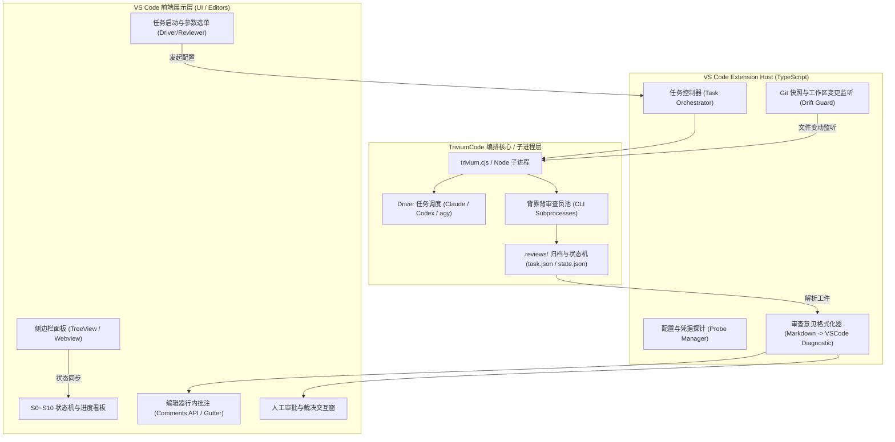

# TriviumCode VS Code 插件化改造技术方案与实施计划

> - **负责人 / 设计者**：Antigravity
> - **创建日期**：2026-11-05
> - **当前版本**：v1.0.0
> - **对应分支**：`feat/vscode-extension`
> - **文档状态**：草稿 (Draft) · 方案设计与实施计划，尚未启动编码实施

---

## 1. 背景与改造动因

TriviumCode 当前是一套基于 CLI 与各厂商智能体生态（Claude Code / Antigravity / Codex / ZCode）的「主攻 + 多审（Driver-MultiCritic）」多模型编排系统。通过背靠背只读多审、严格隔离、指纹核验与人工闸门机制，有效防止单模型幻觉与偏见。

然而，在日常实际工程使用中，当前纯 CLI / Skill 的交互形态存在较高门槛：
1. **参数装配繁琐**：用户需记忆并手工输入数十个命令旗标（如 `--driver`, `--critics`, `--tier-*`, `--profile-*`, `--max-rounds` 等），参数拼错直接退 64 错误。
2. **状态黑盒感强**：后台多审查员背靠背运行时，终端中仅有文本轮询进度，缺乏直观的并行监控视图。
3. **审阅与裁决切屏摩擦大**：审查员报告落盘为 `.reviews/` 下的 Markdown 文件，开发者需在代码编辑器与审查文件之间反复来回切屏，手工比对代码行号，手工编写规范的 Front-Matter 裁决件。

将 TriviumCode 改造为 **VS Code 插件（Extension）**，通过图形化窗格进行 Driver/Reviewer 选择、参数配置、Prompt 输入与编辑器原生审阅，是实现“高阶多智能体审查能力平民化、日常化”的关键一步。

---

## 2. 价值评估与现实边界

### 2.1 核心价值点

| 维度 | 当前 CLI / Skill 现状 | VS Code 插件化改造后 | 价值增益 |
| :--- | :--- | :--- | :--- |
| **交互与装配** | 终端长命令，心智负担重，易漏传或拼错旗标 | **可视化表单**：下拉选择 Driver，多选勾选 Reviewer，滑块调节轮次与思考等级 | **降低 90% 入门门槛**，新用户开箱即用 |
| **执行透明度** | 终端静态行刷新，难以感知背靠背各侧的并发状态 | **实时状态拓扑**：S0~S10 状态机流转图、各 Reviewer 独立运行卡片、耗时统计与流式终端日志 | 流程完全透明，故障点秒级定位 |
| **代码审查体验** | 散落在 `.reviews/` 中的 Markdown，人工肉眼找行号对比 | **原生 IDE 批注**：审查意见直接渲染为行内批注（Comments API）与问题诊断（Diagnostics），支持一键 Diff 与跳转 | **审查效率成倍提升**，体验对齐 GitHub PR Review |
| **裁决与人工审批** | 终端执行 `trivium approve`，手动编写 `-revised-*.md` 裁决件 | **交互式裁决台**：一键点击「接受/驳回/暂缓」并填写理由，自动生成合规裁决工件并放行写锁 | 消除 Schema 格式错误与漏裁，实现人机协同闭环 |

### 2.2 现实边界与设计取舍
- **Reviewer（审查员）搬入插件成本低**：审查员本质是无状态、只读的 CLI/API 进程，由编排器直接调度与落盘，插件可直接复用现有后台管道。
- **Driver（执笔主攻方）的执行模式分水岭**：
  - Driver 拥有修改工作区代码的权限。在纯 CLI 中，Driver 往往是宿主对话本身（如在 Claude Code 会话中驱动）。
  - 在 VS Code 插件中，Driver 调度需兼顾两类场景：
    - **全托管自动化模式**：插件后台静默拉起支持 Headless 执行的 Agent（如 `claude -p` / `codex exec`）；
    - **半自动协同辅助模式**：插件负责参数校验、预检与审查调度，将执行指令或上下文无缝抛送至内置终端中用户的活跃 Agent。

---

## 3. 总体系统架构设计

插件采用 **前后端解耦 + 核心引擎复用** 的三层架构，保证插件不会破坏现有 TriviumCode 严格的安全边界与 Schema 校验机制。

### 核心模块划分
1. **Presentation Layer (Webview & Custom Views)**
   - **Launch View**：任务目标输入框、Driver 下拉选单、Reviewer 多选列表、思考预算与轮次配置。
   - **Pipeline View**：状态机实时推进图、各审评侧子进程状态卡片、日志输出面板。
   - **Review & Approval View**：审查意见列表、逐条裁决操作区、工作树 Diff 概览与 Approve/Abandon 按钮。
2. **Extension Core (Controller Layer)**
   - **Task Controller**：调度核心，控制阶段流转与取消。
   - **Review Bridge**：读取 `.reviews/` 下的结构化审查工件（`review.v1.json` 及 Markdown），转化为 VS Code 原生的 `DiagnosticCollection` 和 `CommentController`。
   - **Workspace Guard**：基于 `vscode.workspace.onWillSaveTextDocument` 监听审查期间的文件改动，防止审查快照漂移。
3. **Engine Layer (Trivium Integration)**
   - **零重复逻辑，复用现有产物**：打包时集成单文件 `trivium.cjs`，通过 CLI 规范接口（`topic resolve`, `preflight`, `review`, `gate check`, `approve`, `abandon`）与编排核心通信。

---

## 4. 关键功能与 UI/UX 模块规划

### 4.1 任务启动与参数装配面板 (Launcher View)
- **Driver 选择器**：单选下拉框。选项由本地环境探针（Probe）动态驱动（如检测到已安装并登录 `Codex`、`Claude Code`、`Antigravity`、`ZCode`，置灰未就绪项）。
- **Reviewer 选择器**：多选 Checkbox 列表。根据已选 Driver 自动排除同身份项，提供快捷按钮（如「三审全开」、「仅两家」）。
- **阶段模式**：
  - `Full (Plan + Code)`：全流程全自动。
  - `Plan Only`：仅出方案与方案双审。
  - `Code Only`：对当前改动直接发起代码双审。
  - `Bug Review`：针对已有 Bug 定位材料发起双审。
- **高级折叠参数**：
  - 各侧模型选择（支持选择供应商原生或第三方 profile，如 Qwen、DeepSeek）。
  - 最大循环轮次（Max Rounds 1~5，默认 3）。
  - 审查焦点（Focus 提示语，可选）。
  - 上下文路径绑定（Context Paths，支持从 Workspace 树状选择）。
- **任务目标输入框**：支持快捷键提交，支持右键将当前选中的代码段一键注入 Prompt。

### 4.2 实时状态机监控看板 (Pipeline Timeline)
- **状态节点流转**：
  `S0.5 解析` ➔ `S0.6 预检` ➔ `S1 方案起草` ➔ `S2 计划双审` ➔ `S3 方案修订` ➔ `S4 计划闸门` ➔ `S5 编码实现` ➔ `S6 代码双审` ➔ `S7 裁决应答` ➔ `S9 代码闸门` ➔ `S10 验证收口`。
- **审核者并行状态卡**：
  - 展示当前入选审核者（如 Gemini / GLM / Codex）的并发状态标签：`Running`、`Passed`、`Changes Required`、`Rejected`。
  - 展开可查看独立流式 stdout/stderr 输出与耗时统计。
  - 提供全局中止（Abort）按钮。

### 4.3 编辑器原生代码审查批注 (Inline Review & Diff)
- **行内批注映射 (Comments API)**：
  - 将审查报告中的建议定位精准映射到对应文件的代码行下方。
  - 批注卡片上标明审核者头像/标签（`[Reviewer: Gemini]`、`[Reviewer: GLM]`）与严重等级（`Critical`、`Major`、`Minor`）。
- **差异审查视图 (Diff View)**：
  - 侧边栏列出涉及改动的文件列表，点击自动拉起带行内审查卡片的 VS Code 内置 Diff 比较器。
- **图形化裁决台 (Disposition Hub)**：
  - 针对每一条意见提供一键动作：`[接受]`、`[驳回]`、`[暂缓]`。
  - 点击后展开输入框填入理由，全部裁决后一键生成合规的 `-revised-*.md` 或 `-response-*.md` 文件，彻底告别手工编辑 YAML Front-Matter。

### 4.4 闸门与人工审批中心 (Gate & Approval Hub)
- 当流水线停在人工审批闸门（Human Review Gate）时，触发顶部通知与高亮看板。
- 面板展示：
  - 计票结果概览（如 `2 票修改后通过 / 1 票通过`）。
  - 当前工作树文件改动清单（Worktree Diff Summary）。
- 明确提供两项决策操作：
  - **`批准继续 (Approve)`**：调用 `trivium approve` 解除业务写锁并推进下一阶段。
  - **`放弃运行 (Abandon)`**：调用 `trivium abandon` 解除锁定但完整保留已有审查工件。

---

## 5. 核心技术难点与解决方案

### 5.1 难点 1：Driver 驱动模式与执行闭环
- **问题**：Reviewer 为只读子进程，极易在后台托管；但 Driver 需要修改业务代码，如何平衡全自动与交互灵活性？
- **方案**：采用 **双轨驱动（Dual Mode）架构**：
  1. *自动化 Headless 模式*：后台拉起支持 Headless 执行的 CLI（如 `codex exec` 或 `claude -p`），插件统一管理其输入输出，状态栏展示旋转进度；
  2. *终端交互协同模式*：在 VS Code 内部创建专用 Terminal，插件将生成的完整执行指令与上下文直接派发至终端，由用户在终端内与 Agent 交互，插件侧负责后台监听与图形化渲染。

### 5.2 难点 2：审查意见到 VS Code 语义对象的逆向解析
- **问题**：Reviewer 产出的审查表格可能存在相对路径、带引号路径、代码行号漂移等问题。
- **方案**：
  - 复用 TriviumCode 的 `parse.ts` 提取结构化 `ReviewItem` 数组；
  - 引入路径归一化匹配器，结合 Fuzzy Match 校验目标代码上下文，准确定位行范围；
  - 双路输出：常规错误绑定至 VS Code `DiagnosticCollection`（在 Problems 面板聚合）；可交互意见绑定至 `vscode.comments`。

### 5.3 难点 3：审查快照防漂移与并发安全
- **问题**：TriviumCode 严禁在审查进行中修改业务文件，否则快照漂移会导致整轮审查作废。
- **方案**：
  - 注册 `vscode.workspace.onWillSaveTextDocument` 钩子；
  - 当监测到流水线正处于背靠背审查阶段（Reviewing）或人工闸门期（Gated）时，拦截业务代码保存或弹出警示确认框；
  - 状态栏常驻写锁状态灯（绿色：自由编辑 / 黄色：闸门等待 / 红色：审查中锁闭）。

### 5.4 难点 4：跨平台环境与 PATH 继承
- **问题**：macOS 从 Dock/Spotlight 启动 VS Code 时，GUI 进程不读取用户 Shell（`~/.zshrc`），常丢失 `node`、`agy`、`codex` 等 CLI 的路径。
- **方案**：
  - 继承 `util/platform.ts` 中的探测机制，在插件激活时派生交互式登录 Shell 提取真实完整环境；
  - 在 VS Code Settings 中开放明确的 CLI 二进制绝对路径配置项作为兜底备用。

---

## 6. 分阶段实施计划与演进路线图

建议按 **4 个阶段** 循序渐进推进，各阶段均设明确的交付物与验证闭环：

### Phase 1：MVP 启动器与状态面板（基础闭环）
- **目标**：跑通 VS Code UI 到 TriviumCode 的基础参数装配与任务拉起。
- **交付内容**：
  - 初始化 VS Code Extension 项目骨架（TypeScript + Webview UI Toolkit）；
  - Activity Bar 增加 Trivium 侧边栏图标与基础启动面板；
  - 集成环境探针，动态加载本机可用 Agent 列表（Driver/Reviewer 下拉选单）；
  - 封装 `trivium topic resolve` 与 `trivium preflight`，点击按钮执行预检；
  - 生成启动指令并在 VS Code 内嵌终端中拉起任务。
- **验收指标**：能在插件界面完成参数配置，并在终端成功拉起预检与首轮审查。

### Phase 2：审查结果解析与原生行内展示（体验突破）
- **目标**：消除切屏读 Markdown 的痛点，实现 PR Review 级别的代码内嵌批注。
- **交付内容**：
  - 建立 `.reviews/` 与 `.trivium/` 文件系统监听器（FileSystemWatcher）；
  - 实现 Markdown / JSON 审查工件解析器，提取问题定位与建议；
  - 对接 VS Code `DiagnosticCollection`，在 Problems 面板归集各审核者意见；
  - 对接 `vscode.comments` API，在代码编辑器对应行下方渲染评审批注；
  - 集成 Diff 查看器，展示被审代码改动对比。
- **验收指标**：审查结束后，代码文件行内即时展示各 Reviewer 的批注卡片，点击可精确跳转。

### Phase 3：交互式裁决台与人工审批闭环（操作闭环）
- **目标**：彻底脱离手写 Markdown 裁决件与终端敲 `approve` 命令。
- **交付内容**：
  - 开发交互式裁决视图：针对每一条意见提供「接受/驳回/暂缓」按钮与理由输入框；
  - 自动渲染并落盘符合规范的 `-revised-*.md` / `-response-*.md` 裁决文件；
  - 集成人工审批（Human Review Gate）监听与弹窗提示；
  - 提供一键 `Approve` / `Abandon` 按钮与工作树 Diff 摘要查看；
  - 实现审查期间的 Workspace 保存拦截与快照漂移告警。
- **验收指标**：全流程中的方案裁决、代码裁决与人工审批均可在 UI 中一键完成，无需修改任何工件文件。

### Phase 4：全流程 Headless 自动化与体验打磨（生产就绪）
- **目标**：支持全托管全自动运行，提供企业级可配置能力。
- **交付内容**：
  - 实现 Headless Driver 进程调度器，支持后台静默编写方案与代码；
  - 提供多审查员流式终端分屏视图；
  - 增加历史审查记录（History）与复盘（Retrospective）看板；
  - 支持将常用配置保存为项目级模板（Presets）；
  - 完善打包发布脚本与使用手册。
- **验收指标**：达成高稳定性、零终端命令依赖的生产级交互体验。

---

## 7. 风险评估与应对策略

| 风险项 | 影响等级 | 应对策略 |
| :--- | :---: | :--- |
| **CLI 版本漂移** | 中 | 严格保持 TriviumCode 的 P7 原则（读探针结论，不硬编码 CLI 参数），由探针感知版本变化。 |
| **快照漂移导致审查作废** | 高 | 在审查阶段通过插件层强制提示与保存拦截，并提供直观的工作区锁定状态灯。 |
| **第三方模型 API 超时** | 中 | 继承 TriviumCode 现有的 Node 侧 `AbortSignal` 与宽限期处理，并在 UI 上支持单侧重试或降级放行。 |
| **VS Code UI 卡顿** | 低 | 审查工件读取与子进程全部在 Extension Host 异步执行，Webview 仅通过轻量级消息通信（postMessage）驱动渲染。 |

---

## 8. 总结

本改造方案在**完全保留 TriviumCode 底层严格校验、背靠背多审、防覆盖留痕与快照隔离**等核心优势的前提下，通过 VS Code 插件化完成了前端体验的升维。它将原本面向高阶极客的复杂 CLI 工具链，成功改造为具备开箱即用图形化配置、IDE 原生代码批注审阅、交互式一键裁决的现代多智能体开发工作台。
