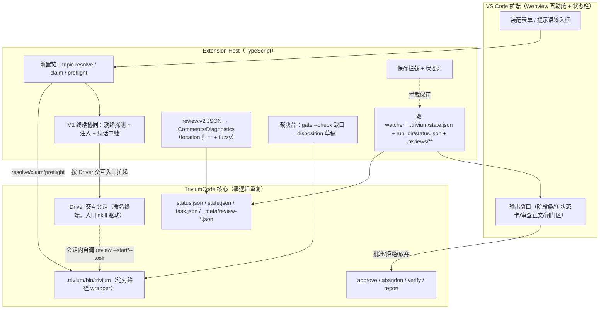

# TriviumCode VS Code 插件需求分析与开发计划（v2）

> - **编制者**：ZCode（GLM）
> - **创建日期**：2026-11-05
> - **当前版本**：v2.1.0
> - **对应分支**：`feat/vscode-extension`
> - **取代关系**：在 [2026-11-05-VSCode插件化改造技术方案与实施计划](./2026-11-05-VSCode插件化改造技术方案与实施计划.md)（Antigravity，v1.0.0）基础上修订；本文档生效后以本文档为开发依据，原文档保留作为历史方案
> - **修订记录**：v2.1（2026-11-05）按用户决定，交付目标收敛为 **M1 终端协同**：M2 内嵌托管降为不排期的远期演进（§4.1.4），阶段计划、FR 清单、风险表相应调整，总量预估 26~37 → **21~30 人日**
> - **文档状态**：草稿 (Draft) · 需求分析与开发计划，尚未启动编码实施，未走双审流程（按仓库约定，正式实施时经入口命令发起）

---

## 1. 原始需求还原

用户需求原文可拆为五点：

| # | 需求点 | 原文依据 |
| :--- | :--- | :--- |
| R1 | 把 TriviumCode 的功能做成 VS Code 插件 | 「类似这个项目的功能，做成 VS Code 插件」 |
| R2 | 插件窗口中选择 Driver 与 Reviewer 及相应参数 | 「通过选择谁当 driver，谁当 reviewer，相应的参数在插件窗口中选」 |
| R3 | 底部输入框输入提示语 | 「在底部的输入框输入提示语」 |
| R4 | 上部输出窗口输出 Driver 与 Reviewer 的输出信息 | 「上部的输出窗口输出 driver 和 reviewer 的输出信息」 |
| R5 | 开放接受更优的需求优化 | 「如果有更好的需求优化，也可以采纳」 |

R3 + R4 合起来是一种**对话式驾驶舱**形态：用户在插件里发任务、看两侧（Driver / Reviewer）的工作输出。这个形态与编排器现状之间有一条关键鸿沟（见 §2.2 事实 3），是本计划要正面回答的第一问题。

## 2. 事实基线（源码调研结论）

以下事实全部经源码核实，决定插件方案哪些是「复用」、哪些是「新做」。版本基线 `main@029f712a`（产品 1.3.5）。

### 2.1 编排器已提供、插件可直接复用的能力

| 能力 | 事实 | 出处 |
| :--- | :--- | :--- |
| 全量 CLI 机读输出 | 13 个子命令全部支持全局 `--json`；退出码协议（0/1/2/64/65/69/70/**73=仍在运行**/75/76） | `src/trivium/cli.ts:197-392`、`src/trivium/exit-codes.ts:8-31` |
| 异步运行四件套 | `review --start`（返回 `run_id`、`run_dir`、`max_waits`、`models`、`warnings`、`review_loop` 等）→ `--wait <run_id>` / `--status <run_id>` / `--cancel <run_id>` | `cli.ts:268-278,796-824` |
| 实时进度正本 | 运行目录 `<run_root>/<repoId>/<runId>/status.json`（schema `trivium.status.v1`）：`phase`（starting/running/parsing/archiving/success/failed/cancelled）、逐审查者 `sides.<critic>`（state/model/attempt/elapsed_s）、30s 心跳 | `src/trivium/status.ts:59-92`、`src/trivium/run-files.ts:25-40` |
| worker 日志 | `run_dir/worker.log`（worker 自身 stdout/stderr 全量重定向） | `run-protocol.ts:650-655` |
| 结构化审查正本 | `.reviews/<topic>/<stage>/_meta/review-<critic>-<runId>.json`，即 review.v2 契约：逐条 finding 带 `id/severity(blocker|major|minor|nit)/layer/kind/location/problem/evidence/suggestion/confidence` 与 `verdict/agreed/not_covered` | `skills/dual-critic/schema/review.v2.json`、真实样例 `.reviews/*/\plan/_meta/` |
| 环境探针结论 | `.trivium/config.local.yaml` 的 `probe:` 段：各家 CLI 入口绝对路径、版本、模型清单、能力实测；`doctor --json` 输出 `{ok,probe,notes,blockers,warnings}`；`doctor --selftest` 桩链路 14 步自检 | `src/trivium/config.ts:926-980`、`cli.ts:919-928`、`src/trivium/selftest.ts` |
| 闸门与审批状态机 | `.trivium/state.json`（`trivium.state.v1`，状态机 idle/running/review_done_awaiting_disposition/awaiting_approval/approved/rejected/abandoned）+ `.reviews/<topic>/task.json`（runs/approvals/degradations/disputes 计票） | `src/trivium/state.ts:37-106`、`src/trivium/meta.ts:149-259` |
| 审批与放弃命令 | `approve --topic --stage [--reason] [--reject --reason]`（拒绝必须带理由）；`abandon --topic [--stage]` | `cli.ts:362-371,1927-1950` |
| GUI 安全的调用入口 | `.trivium/bin/trivium` wrapper 内嵌 node 绝对路径（「GUI 进程不读 .zshrc」的既有解法）；各家 CLI 入口用探针实测绝对路径，**不依赖登录 Shell** | `src/trivium/init.ts:339-400`、`probes/env.ts:20-30` |
| 故障注入桩 | 环境变量 `TRIVIUM_STUB_CRITIC` 跨进程生效，可零配额跑通全链路（插件自动化测试可直接借用） | `test/integration/`（既有机制） |

### 2.2 编排器没有、插件侧需要新做（或想清楚）的能力

| # | 缺口 | 事实 | 对插件设计的含义 |
| :--- | :--- | :--- | :--- |
| G1 | **推送式进度** | worker 跑完即退，无事件/webhook/常驻进程 | 插件自建 `FileSystemWatcher` 盯 `status.json` + `state.json` + `.reviews/`；`--wait` 的 2s 轮询是给终端 skill 的，插件不必用 |
| G2 | **Driver 宿主** | 编排器从不拉起 Driver；plan/bug 的被审对象是「一份**现成的**原稿」，Driver（宿主对话）须在 `review --start` **之前**写好原稿并 `topic claim` 认领 | 「输入提示语→Driver 干活」由 M1 终端协同承接（§4.1）：插件把入口命令与提示语注入终端里的交互式 Agent 会话，阶段循环仍由入口 skill 驱动 |
| G3 | **审查员流式输出** | 各审查员原始 stdout 仅在 CLI 退出后一次性落盘 `<runDir>/<critic>/out/`；运行中只有 `status.json` 快照与非结构化 `worker.log` | 输出窗口运行期展示「逐侧状态卡 + worker.log 尾部」；侧完成后立即展示完整审查正文。真流式需核心增强 E1（§6.4，可选） |
| G4 | **带外审批通道** | `approve` 不校验调用来源，一次性确认码曾加后移除；源码自认「真正的边界需要宿主提供一条不经过模型的带外通道（TTY、审批 UI），**本项目没有**」 | 插件 UI 恰好就是设计许愿的那条通道——原方案漏掉的最大价值点，见 §4.4 |
| G5 | **run 列表查询** | `trivium status` 只有主题级计数；内部 `listRecordedRuns` 未暴露 CLI | 插件自行扫 `~/.trivium/runs/<repoId>/` + 读 `task.json` 构建历史（不依赖核心改动） |
| G6 | **配置读写命令** | 无 `config get/set`；直接写 YAML 受 `config.v2` schema、原子节点（`agents.*.tiers`、`profiles.*`）、deprecated 键规则约束 | 插件**不直写** `.trivium/*.yaml`：表单改动生成 CLI 旗标；持久化预设存插件侧（§4.5） |

## 3. 对原方案（v1.0.0）的修订裁决

逐条裁决，格式：**裁决**（采纳 / 修正 / 新增）— 理由。

| # | 原方案内容 | 裁决 | 理由 |
| :--- | :--- | :--- | :--- |
| C1 | §5.4「派生交互式登录 Shell 提取真实完整环境」 | **修正** | 与仓库既有机制相悖：项目设计明确「GUI 进程不读 ~/.zshrc」，既有解法是 wrapper 内嵌绝对 node 路径 + 探针实测 CLI 入口（§2.1 末行）。插件应**复用 `.trivium/bin/trivium` wrapper；后台入口取探针，GLM 主攻按 §4.1 单独选择**，登录 Shell 提取是重新发明已被否决的路径，还会引入 Shell 初始化副作用 |
| C2 | §4.2「S0~S10 状态机流转图」驱动 UI | **修正** | S0~S10 是入口 skill 的叙事阶段，不是机读状态。机器可见的是 `status.json` 的 `phase` + `sides` + 闸门 `state`。UI 数据层绑定机读状态，S 编号只允许作展示标签，避免「UI 显示的阶段」与「真实运行阶段」两套事实源 |
| C3 | §5.2「逆向解析 Markdown 审查表格定位行号」 | **修正** | 结构化正本 `_meta/review-*.json`（review.v2）已存在，`location` 字段直接可用。主路径消费 JSON 正本；Markdown 仅作兜底展示。保留「fuzzy 匹配校验行号漂移」（location 可能是相对路径、行号漂移真实存在），但输入是 JSON 字段不是表格解析 |
| C4 | Phase 1「生成启动指令并在 VS Code 内嵌终端拉起任务」 | **修正** | 原方案只把命令丢给用户手敲。插件应自己完成前置链（`topic resolve`/`claim`/`preflight` 经 wrapper 原生调用），再**自动**创建终端、注入入口命令与提示语（§4.1 M1），并把 `state.json`/`status.json` watcher 接上结构化进度 |
| C5 | §2.2/§5.1 双轨驱动（Headless + 终端协同） | **采纳并收敛为 M1 交付** | 双轨方向正确，但 headless 直发会让「提示语生效」从产品机制退化为工程责任（skill 自动发现不保证、Hook 护栏不保证、权限 UX 必然消失）。v2.1 起以 **M1 终端协同为唯一承诺交付模式**（理由见 §4.1），M2 内嵌托管留档为不排期演进（§4.1.4），M3 随 M1 基础设施零成本附赠 |
| C6 | §4.3 Comments API 行内批注、§4.4 审批中心 | **采纳** | 与 review.v2 正本结合后落地路径更短（见 C3） |
| C7 | §5.3 审查期保存拦截与状态灯 | **采纳并升格** | VS Code 侧的 `onWillSaveTextDocument` 拦截是 L2 载体不具备的**事前**拦截（AGENTS.md：L2「不宣称 Hook 兜得住」），插件补的正是这块短板；也是对「审查快照漂移」这一最高风险项的直接缓解 |
| C8 | — | **新增**：带外审批闭环（G4）。审批按钮经插件 UI 直连 `approve`，点击动作不经过任何模型上下文；后续可选核心增强 E2 恢复一次性确认码，让「UI 点击」升级为「UI 持码验证」 |
| C9 | — | **新增**：对话式驾驶舱布局，回应 R3/R4（§4.2） |
| C10 | — | **新增**：配置写入策略（G6：不直写 YAML）与预设体系 |
| C11 | — | **新增**：`TRIVIUM_STUB_CRITIC` 桩 + `doctor --selftest` 复用为插件自动化测试底座（零配额跑 UI 全流程） |

## 4. 优化后的需求规格

### 4.1 Driver 执行模式：以 M1 终端协同为交付目标

**决策（2026-11-05）**：M1 为唯一承诺交付模式。理由四条：

1. **提示语注入通道与人工使用完全同路径**——入口 skill 正文、项目上下文（AGENTS.md/CLAUDE.md）、Hook 护栏、权限确认弹窗四层托底在交互会话里原样生效，插件零额外责任；headless 直发会让其中两层不保证、一层必然消失。
2. **不扩大信任面**——写权限继续由 CLI 原生权限 UX 把关（每次写文件过人手）；不引入 headless 写授权这个最高风险项。
3. **单一事实源不被复制**——阶段循环（写原稿→`--start`→`--wait`→裁决→停点）仍由入口 skill 驱动，插件只旁观留痕；不需要在插件里重写一份阶段剧本。
4. **实现成本约为 M2 的几分之一**，P1 即可交付主体验，价值兑现最早。

**M1 运行形态（细化）**：

| 环节 | 设计 |
| :--- | :--- |
| 终端宿主 | 插件按所选 Driver，用探针入口拉起**交互会话**（不带审查用的 headless 旗标），创建命名终端（如 `Trivium · codex`），同主题同载体同入口复用终端。GLM 主攻依次选择驾驶舱显式路径、宿主 PATH 及常用安装位置的独立 zcode、兼容的探针入口；JS 脚本由绝对 Node 路径解释。GLM 审核仍用探针。冷启动实测补充：默认发送模式下，官方 3.18.2 发行布局先等待原生日志 bootstrap.app.startup.completed，再按配置的延迟挂载输入框；未知布局保留普通延迟 |
| 指令注入 | 前置链（`topic resolve` → `topic claim --driver <id>` → `preflight`）经 wrapper 校验通过后，插件把「入口命令 + 旗标 + 提示语」作为首条消息注入终端。**入口命令的载体差异（Codex `$dual-run`、Claude/ZCode `/dual-run` 等）从 skills 渲染产物读取，不在插件里硬编码第二份**（对齐仓库「只留一份事实源」纪律） |
| 注入可靠性 | 等待 CLI 就绪信号（可配置延迟 + 首次输出探测）后 `sendText`；失败回退为驾驶舱内「可复制命令条」（一键复制），不阻塞流程 |
| 输入框续话 | 底部输入框的后续消息尽力中继到该终端（`sendText` + 回车）；对 TUI 兼容性差的载体自动降级为提示「请在终端直接输入」 |
| 进度感知 | **旁观而非参与**：watch `.trivium/state.json` 发现主题锁/run_id → 转盯 `run_dir/status.json`；Driver 产物（原稿/裁决件）由 `.reviews/` watcher 感知。M1 下 `review --start` 由 Driver 会话自己调用，插件不代发 |
| 终端生命周期 | 用户关闭终端或会话结束 → 驾驶舱自动降级为 M3 纯监控（流水线不受影响——循环本来就由 Driver 会话持有，插件不产生半成品托管状态） |

**M3 外部驾驶舱**是 M1 的零成本子集（不注入、只监控 + 审阅 + 裁决 + 审批），随 P1 一并交付：对已在自己 CLI 里跑 `dual-*` 的存量用户，第一天就能拿到行内批注与带外审批。

### 4.1.4 M2 内嵌托管：远期演进（不排期、不承诺）

价值（无人值守、上下文卫生、任务可编程、流水线可测试）与前置风险（headless 写权限、提示词组装、四家适配矩阵）已完成评估，此处只留档三条实施前提，未来若立项直接取用：

1. 阶段提示词从 `skills-src/` 渲染产物**显式组装**进 prompt，不依赖各家 headless 的 skill 发现机制；
2. headless 能力矩阵（skill 加载 / AGENTS.md 挂载 / Hook 触发 / 写权限旗标）全部探针实测（对齐仓库纪律 1：旗标靠实测，不硬编码）；
3. 验收硬门槛：同一任务先走交互式入口、再走 M2，**逐项对拍**阶段行为与留痕（工件命名、认领链、gate 结果），可用 `doctor --selftest` 桩链路零配额执行。

试点路径：先 plan 阶段（Driver 只在 stdout 打印原稿、由插件代写文件，headless 零工作区写权限），编码阶段放开前须过插件 UI 的带外人工确认。

### 4.2 驾驶舱 UI 布局（回应 R2/R3/R4）

```
┌─ Trivium 驾驶舱（Webview 面板）──────────────────────────────────────┐
│ 装配条  Driver: codex ▾   审查者: [✓claude][✓glm][✓gemini]           │
│         入口: A│B│C│D   模式: 终端协同 ▾（外部驾驶舱）  轮次 ▾  ⚙高级 │
│──────────────────────────────────────────────────────────────────────│
│ 输出窗口（上部，分节流式追加）                        [中止] [日志]   │
│  ▸ 阶段条  plan · running ━━━━━━━╸─── 62% · 预算 900s · 第 1/3 轮   │
│  ▸ 侧状态卡  ┌ claude ✓ok 812s ─┐  ┌ glm ●running 410s ┐  …        │
│  │           │ 意见 RV-*-01 …   │  │ （完成后展示正文）  │           │
│  ▸ Driver 区  协同终端: Trivium·codex [聚焦]  产物: 原稿/裁决件/diff │
│  ▸ 闸门区  （awaiting_approval 时浮出）计票 + 工作树摘要 + 批准/拒绝 │
│──────────────────────────────────────────────────────────────────────│
│ 提示语输入框（底部）  当前语义: 任务目标(goal)  →中继至协同终端  [发送 ▸] │
└──────────────────────────────────────────────────────────────────────┘
```

说明：
- Driver 区提供「聚焦」按钮一键跳转协同终端（权限弹窗发生在终端里，这是刻意保留的人手把关）；产物链接点击在编辑器打开。
- 提示语语义随入口映射：入口 A 作为任务目标 `--goal`；入口 B/C/D 作为审查焦点 `--focus`（必填）。输入框 placeholder 注明当前语义。
- 状态栏常驻灯：🟢 自由编辑 / 🟡 闸门等待 / 🔴 审查中锁闭（联动 §4.3 FR-10 保存拦截）。

### 4.3 功能需求清单

| 编号 | 需求 | 模式 | 阶段 |
| :--- | :--- | :--- | :--- |
| FR-1 | 环境健康面板：探针结论 + `doctor --json` + `preflight`，置灰不可用 Agent；无 `.trivium/` 时引导 `trivium init` | — | P0 |
| FR-2 | 任务装配表单：Driver 单选 / 审查者多选（探针驱动、自动排除与 Driver 同身份项）、入口 A/B/C/D、`--max-rounds`、`--model-*/--tier-*/--effort-*/--profile-*` 高级折叠、context paths 从工作区树选择 | — | P1 |
| FR-3 | 发起前置链：`topic resolve` → `topic claim --driver` → `preflight`（经 wrapper 原生调用）；退出码 64/65/69/70 的错误面人性化展示 | M1 | P1 |
| FR-4 | 运行监控：watcher 盯 `run_dir/status.json`（阶段条、逐侧状态卡、心跳失联提示）+ `worker.log` 尾随；`--cancel` 中止按钮 | 全部 | P1 |
| FR-5 | **M1 终端协同（核心）**：按 §4.1 细化表实现——命名终端拉起交互会话、入口命令载体差异从渲染产物读取、就绪探测 + `sendText` 注入 + 失败回退可复制命令条、输入框续话尽力中继、终端关闭自动降级 M3 | M1 | P1 |
| FR-6 | 审查意见展示：消费 `_meta/review-*.json`（review.v2）→ 意见列表（severity 分级、按审查者分组）→ Comments API 行内批注 + Problems 面板 Diagnostics（location 归一 + fuzzy 行号校验）→ Diff 视图 | 全部 | P2 |
| FR-7 | 运行历史：扫 `run_root/<repoId>/` + `task.json` 构建主题/运行列表，回放过往审查 | 全部 | P2 |
| FR-8 | 裁决台：`gate --check --json` 的缺口清单驱动逐条「接受/驳回/暂缓 + 理由」UI → 生成 disposition 草稿（front-matter `role` 填当轮 Driver id）→ 用户确认后落盘 | 全部 | P3 |
| FR-9 | 人工审批：watcher 盯 `state.json` 感知 `awaiting_approval` → 计票展示 + 工作树摘要 + 批准（`approve --topic --stage`）/ 拒绝（`--reject --reason` 必填）/ 放弃（`abandon`） | 全部 | P3 |
| FR-10 | 漂移护栏：审查中/闸门期 `onWillSaveTextDocument` 拦截业务文件保存（弹窗警示）+ 状态栏灯 | — | P3 |
| FR-11 | 预设体系：常用装配存为插件侧 preset（globalState / workspace 配置），**不写 `.trivium/*.yaml`**（G6） | — | P3 |
| FR-12 | （已移除）M2 内嵌托管——降为远期演进，见 §4.1.4 留档 | — | 不排期 |
| FR-13 | 打包发布：`vsce` 出 `.vsix`，使用手册 | — | P4 |

### 4.4 带外审批的价值定位（C8）

`approval.ts:20-36` 自认 approve 无来源校验、无带外通道。现状下「Driver 模型自己跑 `trivium approve`」在技术上畅通——这正是闸门设计的已知弱点。插件提供的审批按钮满足带外通道的两个要件：**点击动作不经过任何模型上下文**、**决策者是人类本人**。后续可选核心增强 E2（恢复一次性确认码，`approve` 校验后才放行）可把该通道升级为持码验证；E2 属编排器侧改动，实施时按仓库约定走正式双审。

### 4.5 配置与安全边界（非功能需求）

- N1 插件只读消费 `.trivium/` 与 `.reviews/`；唯一例外是 FR-8 的 disposition 草稿落盘（落盘前用户确认，且文件命名走 `archive.ts` 同款规则——由编排器 `gate --check` 校验兜底）。
- N2 不修改用户全局配置（沿用仓库纪律 9）。
- N3 插件对 `status.json` 只读；已知父进程/worker 交叉写存在竞态窗口（2026-11-03 分析 §3.5），插件渲染必须**幂等**：读到旧快照不报错、终态以 `--status` 复核为准。
- N4 CLI 版本对齐：插件启动时读 `--version`，与内置契约（schema 版本串如 `trivium.status.v1`）不匹配时降级只读并提示升级。
- N5 多窗口/多仓库：状态按 workspace root 隔离；主题并发运行时装配条锁定。
- N6 全程中文 UI（与仓库文档语言一致）。

## 5. 系统架构（M1 目标形态）



集成面只有两条：**CLI（`--json` + 退出码）** 与 **文件面（watcher 只读）**。业务逻辑零重复：阶段循环归 Driver 会话的入口 skill，校验/防覆盖/留痕归编排器，插件只做装配、注入、旁观渲染与带外审批。

## 6. 分阶段开发计划

### 6.0 Phase 0：脚手架与探活（预估 2~3 人日）

- **交付**：`extension/` 独立包（独立 `package.json`/`tsconfig`，**不并入主仓 `npm run check`**，自带 check 脚本；esbuild + `vsce`）；Activity Bar 图标 + 环境健康面板（FR-1）；CLI/wrapper 定位与版本对齐（N4）。
- **验收**：在装有 TriviumCode 的仓库打开 VS Code，面板正确显示四家 Agent 的可用性/版本/入口（来自 `probe:` 段与 `doctor --json`）；未 init 的仓库给出引导。

### 6.1 Phase 1：启动器与运行监控——M1/M3 最小闭环（预估 6~8 人日）

- **交付**：装配表单（FR-2）；前置链（FR-3）；**M1 终端协同全套（FR-5，本计划核心）**；`state.json`→`status.json` 双层 watcher + `worker.log` 尾随 + `--cancel` 中止（FR-4）；输出窗口的阶段条/侧状态卡/Driver 区（终端聚焦 + 产物链接）；底部输入框（点火注入 + 续话中继）。
- **关键实现点**：
  - 注入可靠性专项：四家交互 CLI 的就绪探测与 `sendText` 兼容性逐一实测（就绪信号形态、粘贴行为、回车语义），形成注入矩阵；失败回退可复制命令条；
  - 入口命令文本（`$dual-run` / `/dual-run` 及旗标占位）从 skills 渲染产物读取并随 `npm run render` 演进，不硬编码；
  - run 发现：M1 下 `--start` 由 Driver 会话调用，插件靠 `state.json` 主题锁记录 + run 目录扫描发现 run_id；
  - `--start` 返回语义用于开场播报（warnings/review_loop 逐条展示）；心跳失联时如实提示 `--wait` 的失联收尾语义（含 `worker.log` 路径）。
- **验收**：全程无需手敲任何命令——从 UI 装配并点火后，插件自动开终端注入入口命令与提示语，看板观察到两侧状态推进至终态并查看审查正文；对已在别处运行的主题（M3），驾驶舱能自动发现并监控；权限弹窗发生在终端里且驾驶舱有指引跳转。

### 6.2 Phase 2：审查结果结构化展示（预估 5~7 人日）

- **交付**：review.v2 正本消费 → 意见列表 + Comments/Diagnostics + Diff（FR-6）；运行历史（FR-7）。
- **关键实现点**：`location` 归一（相对路径、带引号路径）+ 行号 fuzzy 校验（对照快照 hash 失配时降级为「文件级批注」并标注漂移）；同一文件多家意见分层合并展示。
- **验收**：一次真实运行结束后，意见以行内批注呈现、点击跳转准确；Problems 面板按 severity 聚合；历史列表可回放过往主题。

### 6.3 Phase 3：裁决台与带外审批闭环（预估 5~7 人日）

- **交付**：裁决台（FR-8）；闸门感知与 approve/reject/abandon（FR-9）；保存拦截与状态灯（FR-10）；预设（FR-11）。
- **关键实现点**：裁决件由插件代 Driver 起草（`role` 填当轮 Driver id），落盘前用户确认；`gate --check --json` 的 `failures/disposition/next_action` 驱动缺口清单 UI；审批前复核（`verifyRoundForApproval`）失败时如实展示阻断原因，不绕过。
- **验收**：入口 B（计划双审）从「审查结束」到「approve 放行」全程无终端命令操作、无手工编辑任何工件文件；审查期尝试保存业务文件被拦截并看到红灯。

### 6.4 Phase 4：打磨与发布（预估 3~5 人日）

- **交付**：`vsce` 打包 `.vsix` + 中文使用手册（FR-13）；四家 Agent × M1 真机会话回归矩阵（注入成功率、续话中继、终端生命周期降级）；stub 端到端测试固化（`TRIVIUM_STUB_CRITIC` 驱动 UI 全流程）；多窗口/多仓库回归；长输出窗口性能（虚拟滚动）。
- **可选核心增强（各自走正式双审，不阻塞插件发布）**：
  - E1 审查员 stdout 增量 tee 至 `<runDir>/<critic>/out/`（真流式，缓解 G3）。11 月 20 日的实现和实测边界见 [E1 验收报告](../05_testing/REPORT_2026-11-20_VSCode审查员实时输出验收.md)；
  - E2 `approve` 一次性确认码（§4.4）；
  - E3 `trivium runs list` CLI（插件已可自扫，低优先）。
- **验收**：干净机器装 `.vsix` 后，入口 B 全流程（点火→双审→裁决台→审批）除终端权限弹窗外零终端操作；中途关闭协同终端，驾驶舱正确降级 M3 且监控不中断。

### 6.5 里程碑总览


P1→P2 与 P2→P3 之间可并行部分工作（watcher 与解析器解耦）；总量预估 **21~30 人日**。

## 7. 测试与验收策略

| 层 | 手段 |
| :--- | :--- |
| 单元 | 旗标生成器、review.v2 → UI 模型解析器、location 归一/fuzzy（用 `.reviews/` 真实工件做夹具）、run 目录扫描 |
| 集成 | `@vscode/test-electron` 起真实 extension host；**复用 `TRIVIUM_STUB_CRITIC` 桩与 `doctor --selftest` 的夹具思路**，零配额驱动 UI 全流程；断言桩指纹 `cli_version: 'stub/0.0.0'` |
| 专项 | M1 注入矩阵：四家交互 CLI 的就绪探测、`sendText` 兼容性、续话中继、终端关闭降级，逐一真机过 |
| 手工验收矩阵 | 每 Phase 验收标准（§6）+ 四家 Agent × M1/M3 组合抽查 |
| 回归 | 插件只读消费核心面，核心侧仅 E1/E2/E3 触及，各自走核心仓的 `npm run check` 与双审 |

## 8. 风险登记

| 风险 | 等级 | 应对 |
| :--- | :---: | :--- |
| 审查期用户编辑导致快照漂移、整轮作废 | 高 | FR-10 事前拦截（VS Code 宿主级，L2 载体做不到的正是这个）+ 状态灯 + 漂移后果说明 |
| M1 注入时序/TUI 兼容（各家交互 CLI 启动节奏不同，`sendText` 可能早到或被吞） | 中 | 就绪探测 + 可配置延迟 + 注入矩阵逐家实测；失败回退可复制命令条，不阻塞流程 |
| 入口命令载体差异（`/` 与 `$` 前缀、旗标写法随版本演进） | 中 | 从 skills 渲染产物读取，不硬编码第二份（对齐「只留一份事实源」纪律） |
| 用户中途关闭终端/会话中断 | 低 | 驾驶舱降级 M3 纯监控；流水线归 Driver 会话所有，插件无半成品托管状态 |
| `status.json` 跨进程竞态（已知问题） | 中 | N3：渲染幂等 + 终态以 `--status` 复核；不依赖核心侧修复 |
| CLI 契约随版本演进 | 中 | N4 版本对齐 + schema 版本串检查，不匹配降级只读 |
| Webview 性能 | 低 | 全部 IO 在 Extension Host 异步；Webview 仅 postMessage 渲染 |

## 9. 附录：与原方案（v1.0.0）的差异对照

| 维度 | v1.0.0（Antigravity） | v2.1（本文档） |
| :--- | :--- | :--- |
| 环境解析 | 登录 Shell 提取（C1） | wrapper + 探针，GLM 主攻可独立选入口 |
| 进度数据源 | 未指明（Phase 1 拼命令进终端） | `state.json`/`status.json` 双层 watcher + `--json` 契约 |
| 状态模型 | S0~S10 叙事 | `status.json` phase/sides + 闸门 state 机读绑定 |
| 审查数据源 | 逆向解析 Markdown 表格 | review.v2 JSON 正本，Markdown 兜底 |
| Driver 模式 | 双轨（Headless/终端） | **M1 终端协同为交付目标**（注入矩阵 + 续话中继 + 降级链），M2 留档为不排期演进（§4.1.4），M3 随 P1 附赠 |
| 对话式输入（R3） | 无对应模块 | 驾驶舱输入框（点火注入 + 续话中继）+ goal/focus 语义映射；Driver 对话流在协同终端（权限人手把关刻意保留） |
| 带外审批 | 未识别 | 核心价值点（§4.4），可选 E2 持码升级 |
| 配置写入 | 未约定 | 不直写 YAML：旗标生成 + 插件侧 preset |
| 测试 | 未展开 | 桩复用（`TRIVIUM_STUB_CRITIC`）+ 真实工件夹具 + M1 注入矩阵 + 分层验收 |
| 工程位置 | 未约定 | `extension/` 独立包，不并入主仓闸门 |
| 工期 | 未估 | 21~30 人日（P0~P4） |
